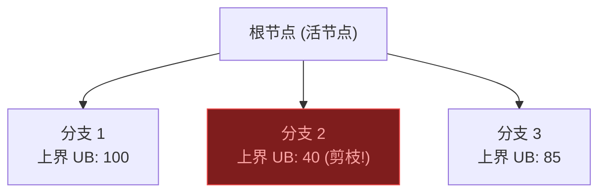

# 第六章 搜索范式：回溯法与分支限界法

> 面对指数级复杂度的离散组合优化问题，当无法通过动态规划或贪心直接求解时，必须深入**状态空间解空间树**进行系统化搜索。**回溯法**与**分支限界法**构成了计算机求解复杂约束问题的两大经典范式。

---

## 0. 考点优先级概览

根据面试常见考察频次与工程实用度，内容按优先级组织如下：

| 优先级 | 分类 | 核心内容 | 重点说明 |
| :--- | :--- | :--- | :--- |
| **P0** | **核心考点** | **回溯法 vs 分支限界法核心对比**、回溯标准模板、子集/组合/排列三大树形模型与去重剪枝 | 算法设计课必考理论与核心手撕 |
| **P1** | **分支限界与难题** | **分支限界法 (Branch and Bound) 核心机制**、上下界剪枝策略、N 皇后问题 (LC 51) | 求解单个最优解的广度剪枝范式 |
| **P2** | **工程与游戏实战** | 棋类 AI 博弈树与 Alpha-Beta 剪枝、游戏装备随机词条组合生成器 | 游戏人工智能与复杂约束求解 |
| **P3** | **基础与附录** | 经典题目速查清单、0-1 背包分支限界法 C++ 参考源码（可折叠） | 知识库备忘查阅 |

---

## P0：核心考点

### 1.1 算法课核心理论：回溯法 vs 分支限界法

这是计算机算法设计课程与高级面试中**极具辨析度**的一组经典算法设计范式对比：

| 核心维度 | 回溯法 (Backtracking) | 分支限界法 (Branch and Bound) |
| :--- | :--- | :--- |
| **搜索机制** | **深度优先搜索 (DFS)** | **广度优先搜索 (BFS)** |
| **底层数据结构** | **系统调用栈 / 显式栈** | **队列 (FIFO) 或 优先队列 (Heap)** |
| **求解目标** | 通常用于寻找**所有满足条件的可行解**，或枚举全排列/组合 | 通常用于求解组合优化问题中的**单个最优解**（最大值/最小值） |
| **状态空间树展开** | 顺着一条分支探底，失败后回溯“返回上一步” | 一次性生成当前活动节点的所有可能分支节点（分枝） |
| **剪枝方式** | **显式约束函数剪枝**（若当前部分解已不合法则回溯） | **限界函数 (Bounding Function)**（计算理论收益上界，若差于当前全局已知最优解则剪除） |
| **内存开销** | **极小**：空间复杂度为解空间树的高度 **$O(h)$** | **极大**：需同时维护所有活节点 (Live Nodes)，空间开销为树的宽度（最坏达指数级） |
| **典型代表算法** | N 皇后、数独求解、全排列/子集枚举 | 0-1 背包最优解、旅行商问题 (TSP)、布线问题 |

---

### 1.2 核心手撕：回溯法的标准代码模板

回溯法的本质是在解空间树上做深度优先遍历，核心在于**“做选择 $\to$ 深入递归 $\to$ 撤销选择”**的严格状态还原：

```cpp
void backtrack(参数列表, 路径 path, 结果集& result) {
    if (终止条件 / 满足目标) {
        result.push_back(path); // 收集结果
        return;
    }

    for (int i = 选择起点; i < 选择列表大小; ++i) {
        // 剪枝逻辑：若当前分支不可能产生合法解，提前跳过
        if (剪枝条件) continue;

        path.push_back(当前选择);     // 1. 做选择
        backtrack(更新参数, path, result); // 2. 递归深入
        path.pop_back();              // 3. 撤销选择 (状态回溯还原)
    }
}
```

---

### 1.3 回溯三大树形模型与去重技巧

#### 1. 子集型 (Subsets) 与 组合型 (Combinations)
* **核心特征**：元素无顺序之分（`[1, 2]` 和 `[2, 1]` 算同一个）。
* **控制手段**：通过传入一个 `startIndex`，下一层递归**只能选取 `startIndex` 之后的元素**，杜绝逆向重复选择。

#### 2. 排列型 (Permutations)
* **核心特征**：元素有先后顺序（`[1, 2]` 和 `[2, 1]` 算两个不同的排列）。
* **控制手段**：每次循环均从索引 `0` 开始遍历，通过一个布尔数组 `used[i]` 标记该位置元素是否已被当前路径选用。

#### 3. 数组含重复元素时的“同层去重”黄金法则
当输入数组本身带有重复元素（如 `[1, 2, 2']`），要求生成的子集或组合不重复：
1. **必须先将原始数组升序排序**：`std::sort(nums.begin(), nums.end())`。
2. **同层去重判定**：
   ```cpp
   // i > startIndex 表明当前在“同一树层”的后续分支中
   if (i > startIndex && nums[i] == nums[i - 1]) {
       continue; // 剪枝跳过重复分支
   }
   ```

---

### 1.4 常见面试问答要点

* **Q：回溯法与普通深度优先搜索 (DFS) 有何异同？**
  > **回答要点**：DFS 侧重于**图或树形结构的无死角遍历**，每个节点通常只访问一次（依靠 `visited` 数组防重）；而回溯法侧重于**求解约束满足问题**，它在进入分支时记录状态，从分支返回时必须**显式撤销该状态**，使得同一个物理变量能够在搜索空间中被成百上千次复用，探索所有可能的路径组合。

* **Q：为什么在剪枝之前通常必须先对数组进行排序？**
  > **回答要点**：排序可以将数值相同的重复元素聚集在一起，使得 `nums[i] == nums[i-1]` 的同层去重判定能够生效；此外，排序还能带来单调性，一旦累加和超过了目标值（`sum + nums[i] > target`），可以直接通过 `break` 提前终止该层后续所有更大元素的分支，大幅压缩解空间。

---

## P1：分支限界法 (Branch and Bound) 核心机制

### 2.1 分支限界法的运行范式与优先级队列

当问题是**求单极值优化问题（如最大收益、最短距离）**时，分支限界法比盲目遍历所有解的回溯法更具目的性：
1. **活动节点 (Live Node)**：已生成但尚未扩展子节点的节点。
2. **扩展节点 (E-Node)**：当前正在展开子分支的节点。
3. **限界函数 (Bounding Function)**：为每个节点计算其能够产出的**最优价值上界 (Upper Bound)**。
4. **剪枝原则**：记录当前全局已经找到的一个可行最好收益 `BestValue`。在扩展任意节点前，若其上界 $\le \text{BestValue}$，说明**无论该分支向下怎么走，都不可能超越现有最好解**，直接抛弃该分支！



#### 优先队列分支限界法 (LC 分支限界)
普通分支限界采用普通队列（按生成顺序）；而**优先队列式分支限界法（最佳优先搜索）**使用大顶堆，**每次优先挑出理论上界最大的活节点作为下一个扩展节点**，以最快速度逼近最优解并抬高 `BestValue`，从而产生雪崩式的剪枝效果。

---

### 2.2 经典手撕：N 皇后问题 (LeetCode 51)

* **约束条件**：任意两个皇后不能处于同一行、同一列，也不能处于同一正斜线（`row - col` 恒定）或副斜线（`row + col` 恒定）。
* **状态压缩回溯**：由于按行逐行放置，天然保证行不冲突。仅需记录列占用 `cols`、主对角线 `diag1` 和副对角线 `diag2`。

```cpp
#include <vector>
#include <string>

class Solution {
    std::vector<std::vector<std::string>> res;

    void dfs(int row, int n, std::vector<std::string>& board,
             std::vector<bool>& cols, std::vector<bool>& diag1, std::vector<bool>& diag2) {
        if (row == n) {
            res.push_back(board);
            return;
        }

        for (int col = 0; col < n; ++col) {
            int d1 = row - col + n; // 防止出现负下标
            int d2 = row + col;

            if (cols[col] || diag1[d1] || diag2[d2]) continue; // 剪枝

            board[row][col] = 'Q';
            cols[col] = diag1[d1] = diag2[d2] = true;

            dfs(row + 1, n, board, cols, diag1, diag2);

            // 回溯撤销
            board[row][col] = '.';
            cols[col] = diag1[d1] = diag2[d2] = false;
        }
    }

public:
    std::vector<std::vector<std::string>> solveNQueens(int n) {
        std::vector<std::string> board(n, std::string(n, '.'));
        std::vector<bool> cols(n, false), diag1(2 * n, false), diag2(2 * n, false);
        dfs(0, n, board, cols, diag1, diag2);
        return res;
    }
};
```

---

## P2：工程实践与业务场景

### 3.1 游戏 AI 决策：博弈树与 Alpha-Beta 剪枝

在五子棋、国际象棋等零和双人博弈中，AI 使用极小化极大 (Minimax) 算法预测未来 $K$ 步走法：
* **Max 层**：轮到 AI 行动，希望选取收益最大的着法。
* **Min 层**：轮到对手行动，假设对手必然选择让 AI 收益最小的着法。
* **Alpha-Beta 剪枝**：维护当前搜索路径上的最好下界 $\alpha$ 和对手允许的最大上界 $\beta$。一旦发现某个分支的期望收益 $\beta \le \alpha$，**后续子分支完全无需再看，直接截断**，剪枝率可达 90% 以上。

---

## P3：基础原理与参考实现

### 3.1 经典题目速查

| 题目 | 难度 | 核心思路 |
| :--- | :--- | :--- |
| **LC 46. 全排列** | Medium | `used` 标记数组，每次从 0 遍历，回溯时复位 `used[i] = false`。 |
| **LC 77. 组合** | Medium | `startIndex` 向后遍历，剪枝：`i <= n - (k - path.size()) + 1`。 |
| **LC 39. 组合总和** | Medium | 元素可无限重复选取：递归时继续传递 `startIndex = i`（自身可复选）。 |
| **LC 51. N 皇后** | Hard | 按行递归，维护列、正反对角线占用的布尔标记数组。 |
| **LC 79. 单词搜索** | Medium | 网格四向 DFS 回溯，进入时置为 `#` 防止重复访问，退出时恢复字符。 |

---

### 3.2 0-1 背包的分支限界法参考源码

<details>
<summary>👉 查看利用优先队列与价值上界剪枝的 0-1 背包分支限界法 C++ 源码</summary>

```cpp
#include <vector>
#include <queue>
#include <algorithm>

struct Item {
    int weight, value;
    double ratio;
    bool operator<(const Item& o) const { return ratio > o.ratio; } // 按单位价值降序
};

struct Node {
    int level;  // 当前考虑的物品下标
    int weight; // 当前背包累积重量
    int value;  // 当前背包累积价值
    double ub;  // 该分支理论可达到的最大价值上界
    bool operator<(const Node& o) const { return ub < o.ub; } // 大顶堆：上界大者优先
};

// 贪心估算该节点的最大理论上界 (Upper Bound)
double bound(const Node& u, int n, int W, const std::vector<Item>& items) {
    if (u.weight >= W) return 0;
    double val_ub = u.value;
    int total_w = u.weight;
    int j = u.level + 1;

    while (j < n && total_w + items[j].weight <= W) {
        total_w += items[j].weight;
        val_ub += items[j].value;
        ++j;
    }
    // 装满时将下一件物品按比例切分装入（连续背包上界）
    if (j < n) val_ub += (W - total_w) * items[j].ratio;
    return val_ub;
}

int knapsackBranchAndBound(int W, std::vector<Item>& items) {
    std::sort(items.begin(), items.end()); // 必须先按性价比排序
    int n = items.size();

    std::priority_queue<Node> pq;
    Node root{-1, 0, 0, 0.0};
    root.ub = bound(root, n, W, items);
    pq.push(root);

    int max_value = 0;

    while (!pq.empty()) {
        Node cur = pq.top();
        pq.pop();

        if (cur.ub <= max_value) continue; // 核心限界剪枝！

        int next_level = cur.level + 1;
        if (next_level == n) continue;

        // 分支 1：选择当前物品 items[next_level]
        if (cur.weight + items[next_level].weight <= W) {
            Node left{next_level, cur.weight + items[next_level].weight, cur.value + items[next_level].value, 0.0};
            left.ub = bound(left, n, W, items);
            max_value = std::max(max_value, left.value);
            if (left.ub > max_value) pq.push(left);
        }

        // 分支 2：不选当前物品 items[next_level]
        Node right{next_level, cur.weight, cur.value, 0.0};
        right.ub = bound(right, n, W, items);
        if (right.ub > max_value) pq.push(right);
    }
    return max_value;
}
```
</details>

---

> 📖 下一节：[第七章 数学与数论基础](./07_math.md) —— 快速幂、素数筛法与辗转相除法。
