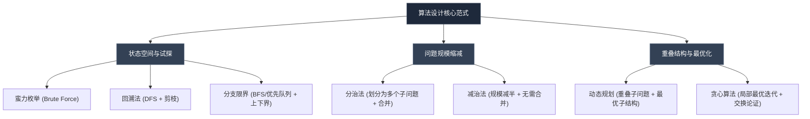

# 算法核心体系：设计范式、核心考点与工程实战

> 面向 **C++ 与游戏客户端/系统开发** 的算法知识库。与数据结构系列（偏向底层内存布局与容器实现）互补，本系列聚焦于 **经典算法设计范式、时空复杂度分析、核心考点拆解与实际工程应用**。

---

## 算法设计范式全景

大学算法分析与设计课程通常围绕七大经典范式展开。本系列各章节内容与经典范式的对应关系如下：

| 算法范式 | 核心机制与特征 | 典型问题与技术 | 对应章节 |
| :--- | :--- | :--- | :--- |
| **蛮力法 (Brute Force)** | 遍历所有可能状态，以最直接的方式求解 | 线性扫描、选择/冒泡排序、枚举子集、朴素字符串匹配 | Ch1, Ch6, Ch9 |
| **分治法 (Divide & Conquer)** | 将原问题划分为互不相交的子问题，递归求解并合并结果 | 快速排序（Hoare/三路）、归并排序、主定理分析 | Ch1 |
| **减治法 (Decrease & Conquer)** | 每次缩小问题规模（减常数/减半），仅深入一个子分支，无需合并 | 二分查找、二分答案、快速选择 (Quickselect) | Ch1, Ch2 |
| **动态规划 (Dynamic Programming)** | 最优子结构 + 重叠子问题，自底向上记录状态消除冗余计算 | 0-1/完全背包、LIS/LCS、区间 DP、状压 DP、树形 DP | Ch3, Ch4 |
| **贪心算法 (Greedy)** | 每一步做出当前局部最优选择，依赖贪心选择性质与最优子结构 | 区间调度、跳跃游戏、Huffman 编码、Dijkstra / Prim | Ch5 |
| **回溯法 (Backtracking)** | DFS 状态空间树，自顶向下试探，遇到不符合条件时回退 | 排列/组合/子集、N 皇后、可行性与最优性剪枝 | Ch6 |
| **分支限界法 (Branch & Bound)** | BFS 或优先队列遍历状态空间，利用估价函数/边界上下界剪枝 | 0-1 背包最优化剪枝、TSP、A* 启发式搜索 | Ch6 |



---

## 章节导航

### 📗 基础算法范式 (Ch 1–2)

---

#### [第一章 排序算法：从分治到混合调优](./01_sorting/)

> 从分治理论主定理到手写快速排序与归并排序，深入分析缓存局部性与工业级混合排序 (Introsort/Timsort)。

**核心内容**：
- **P0 核心考点**：快速排序（三数取中、三路划分）、Top-K 快速选择 (Quickselect) 平均 $O(n)$
- **P1 经典排序与理论**：分治法与主定理 $T(n) = aT(n/b) + f(n)$、堆排序（建堆 $O(n)$ 证明）、归并排序
- **P2 工程与缓存分析**：快排 vs 堆排缓存命中率实测、`std::sort` (Introsort) 与 `std::stable_sort` (Timsort) 选型
- **P3 算法实现**：快排/堆排/非比较排序完整实现

---

#### [第二章 二分查找与二分答案](./02_binary_search/)

> 深入减治范式，建立闭区间统一模板，掌握从离散有序数组检索到连续解空间单调性判定（二分答案）。

**核心内容**：
- **P0 核心考点**：双闭区间 `[left, right]` 模板、`std::lower_bound` / `upper_bound` 等价实现、旋转排序数组
- **P1 减治法与二分答案**：减治法与分治法的差异、单调性判定函数 `check(mid)`、"最大化最小值" 与 "最小化最大值"
- **P2 工程与游戏实战**：连续空间浮点二分、LOD (Level of Detail) 距离分级判定、动画帧关键帧检索
- **P3 参考实现**：浮点二分与进阶变体实现

---

### 📘 动态规划模型 (Ch 3–4)

---

#### [第三章 动态规划基础：状态转移与背包模型](./03_dp_basic/)

> 动态规划的两大核心基石：重叠子问题与无后效性。从线性 DP 到背包模型完整推导与空间优化。

**核心内容**：
- **P0 核心考点**：0-1 背包与完全背包（一维空间压缩核心区别）、最长递增子序列 ($O(n \log n)$ 贪心+二分)、最长公共子序列 (LCS)
- **P1 理论与进阶模型**：多重背包（二进制拆分）、多维费用与分组背包、编辑距离
- **P2 状态压缩与缓存**：滚动数组技巧、二维数组行优先 vs 列优先访存对 Cache Line 的影响
- **P3 模板实现**：经典模型代码库

---

#### [第四章 动态规划进阶：区间、状压与树形](./04_dp_advanced/)

> 拓展状态定义的维度，涵盖区间划分、位图状态压缩与树结构递归状态转移，结合单调队列进行转移加速。

**核心内容**：
- **P0 核心考点**：区间 DP（长度阶段遍历、戳气球/石子合并）、打家劫舍 III（树形 DP 基础）
- **P1 进阶状态建模**：状态压缩 DP（子集遍历 `mask` 枚举、TSP 问题）、换根 DP（两次 DFS 上下推导）
- **P2 转移优化与实战**：单调队列优化 $1D/1D$ 动态规划（滑动窗口最值消除线性内层循环）、技能树前置依赖解锁
- **P3 参考实现**：进阶 DP 模板库

---

### 📙 局部优化与状态空间搜索 (Ch 5–6)

---

#### [第五章 贪心算法：局部最优的取舍](./05_greedy/)

> 剖析贪心选择性质与最优子结构，掌握利用微扰法（交换论证）进行正确性严谨证明的通用方法。

**核心内容**：
- **P0 核心考点**：区间调度最优化（按右端点排序）、跳跃游戏（维护最远可达边界）
- **P1 理论与证明**：贪心选择性质与最优子结构、交换论证法 (Exchange Argument) 形式化证明、Huffman 编码树构建
- **P2 算法对比与实战**：贪心与 DP 适用边界对比、加油站环形回路、任务调度器冷却计算
- **P3 参考实现**：贪心调度与分配实现

---

#### [第六章 搜索范式：回溯法与分支限界法](./06_backtracking/)

> 统一对比系统性状态空间树遍历的两大范式：基于深度优先的回溯法与基于广度优先/优先队列的分支限界法。

**核心内容**：
- **P0 核心考点**：回溯法通用框架（排列、组合、子集）、去重机制（同层剪枝 vs 同枝选择）、N 皇后问题
- **P1 分支限界法专题**：回溯法 (DFS) vs 分支限界法 (BFS/PQ) 对比、0-1 背包优先队列分支限界（上界估价函数剪枝）
- **P2 剪枝策略与启发式**：可行性剪枝、最优性剪枝、记忆化搜索、从 Dijkstra 到 A* 启发式寻路的演化
- **P3 参考实现**：回溯与分支限界工程模板

---

### 📕 数学、底层与文本处理 (Ch 7–9)

---

#### [第七章 数学与数论基础](./07_math/)

> 掌握高频数论算法、快速计算技巧以及现代计算系统中的伪随机数与等概率抽样机制。

**核心内容**：
- **P0 核心考点**：快速幂与矩阵快速幂、欧几里得算法 (GCD/LCM)、Fisher-Yates 现代洗牌算法
- **P1 数论与采样**：质数筛法（埃氏筛 $O(n \log \log n)$ vs 欧拉线性筛 $O(n)$）、海量数据流蓄水池抽样 (Reservoir Sampling)
- **P2 工程应用**：扩展欧几里得与模逆元、大数取模运算、随机权重掉落表构建
- **P3 算法实现**：数论与采样模块实现

---

#### [第八章 位运算与状态压缩](./08_bitwise/)

> 深入位级指令与位掩码操作，分析位图在缓存紧凑度与无分支计算中的工程优势。

**核心内容**：
- **P0 核心考点**：`x & (x - 1)` 消去最低位、`lowbit(x)` 树状数组基石、异或性质（单次出现的数字）
- **P1 位掩码与子集枚举**：状态压缩表示、子集与超集遍历技巧 (`(sub - 1) & mask`)、内置位操作函数 (`__builtin_popcount` / `std::popcount`)
- **P2 游戏系统实战**：LayerMask 物理碰撞分层过滤、角色彩色状态与 Buff 位图管理、紧凑位图与 Cache Line 对齐
- **P3 参考实现**：Bitset 与位运算工具库

---

#### [第九章 字符串算法：KMP、滚动哈希与多模式匹配](./09_string/)

> 单模式精确匹配、滚动哈希与多模式自动机。深入分析前缀函数的对称性与工业级文本过滤方案。

**核心内容**：
- **P0 核心考点**：KMP 算法核心原理、`next` 前缀数组最长公共真前后缀推导、手写无回溯匹配
- **P1 经典文本算法**：Rabin-Karp 滚动哈希（多项式滚动）、最长回文子串 Manacher 线性算法
- **P2 多模式与工业应用**：AC 自动机架构（Trie + KMP fail 指针）、游戏敏感词高并发过滤系统、资源文件内容去重
- **P3 参考实现**：KMP 与 AC 自动机核心实现

---

## 知识框架对照

| 数据结构（容器与内存） | 核心算法（逻辑与控制） | 典型协同场景 |
| :--- | :--- | :--- |
| **数组 / 向量** | 双指针、滑动窗口、二分查找、快速排序 | 连续空间元素查找、渲染指令排序 |
| **栈** | 递归调用栈、单调栈、回溯状态保存 | 表达式解析、柱状图最大矩形、DFS |
| **队列 / 优先队列** | 层序遍历、分支限界法、Dijkstra、A* | 广度优先探索、任务调度、寻路算法 |
| **哈希表** | 滚动哈希 (Rabin-Karp)、记忆化搜索 | 文本去重、状态记忆、快速存在性判定 |
| **树 / 二叉树** | 分治法、树形 DP、回溯搜索树 | 层次结构评估、技能树规划、游戏决策树 |
| **图** | 拓扑排序、最短路径、最小生成树、状态空间搜索 | 场景寻路、任务前置关系、地图连通性 |
| **位图 / Bitset** | 状压 DP、位运算状态机、LayerMask | 物理碰撞检测、组合状态表示、高紧凑集合 |

---

## 建议学习路径

### 🎯 核心高频考点路径（聚焦常考重点）

```
阶段一：排序与二分（Ch1 快排/归并/堆排/Quickselect → Ch2 二分查找模板与二分答案）
阶段二：动态规划模型（Ch3 线性DP/0-1与完全背包 → Ch4 区间DP）
阶段三：搜索与贪心（Ch5 区间调度/跳跃游戏 → Ch6 排列组合回溯与剪枝）
阶段四：底层技巧（Ch8 位运算基础操作与 LayerMask 掩码）
```

### 📚 课程系统进阶路径（系统掌握算法体系）

```
第一周：算法基础与分治/减治范式（Ch1 排序全解 + Ch2 二分查找与二分答案）
第二周：最优化理论与动态规划（Ch3 动态规划基础 + Ch4 动态规划进阶与单调队列优化）
第三周：局部最优与状态空间搜索（Ch5 贪心法及交换论证 + Ch6 回溯法与分支限界法）
第四周：专项数学、底层优化与文本（Ch7 数论与随机抽样 + Ch8 位运算 + Ch9 字符串算法）
```

---

> 📖 本系列全部文章均采用 CC BY-NC-SA 4.0 协议发布。
