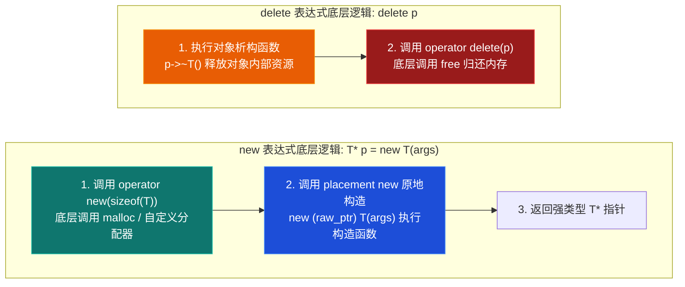
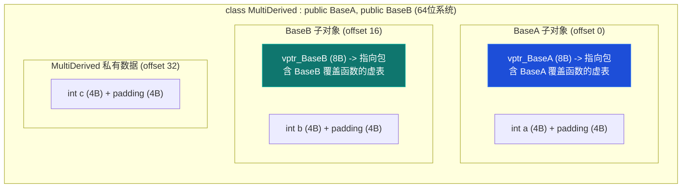

# 第一章 内存模型与对象布局

> C++ 的灵魂在于赋予程序员对硬件内存的直接支配权。从进程虚拟地址空间的各段划分，到 CPU 缓存感知的数据结构内存对齐；从虚函数表指针在继承链中的偏移调整，到解耦内存分配与构造的自定义分配器——理解内存模型与底层对象布局，是掌握高性能 C++ 与游戏引擎底层架构的核心基石。

---

## 0. 考点优先级概览

| 优先级 | 核心模块 | 重点考点 | 考核形式 |
| :--- | :--- | :--- | :--- |
| **P0** | **虚拟地址与对齐** | 进程 64 位虚拟地址空间 5 大区域划分、结构体自然对齐准则与尾部 Padding、`alignof`/`alignas` 与 `#pragma pack` | 内存布局图解、sizeof 手动推算大题 |
| **P0** | **堆栈与分配机理** | 栈 (Stack) 极速分配 vs 堆 (Heap) 碎片成因、`new`/`delete` 表达式全流程拆解、`new[]` 数组 Cookie 机制 | 机制辨析、未定义行为 (UB) 陷阱辨析 |
| **P1** | **对象内存模型推导** | 空类 `sizeof=1` 与 EBO 空基类优化、单继承/多继承/菱形虚继承下的 `vptr` 与 `vbptr` 内存排布、`this` 指针偏移调整 | **大厂底层必考对象模型推导** |
| **P1** | **栈帧结构与调用规约** | x86-64 栈帧 (RBP/RSP)、返回地址压栈、调用规约 (Calling Convention) 寄存器传参顺序与局部变量销毁 | 函数调用汇编时序、栈溢出根因 |
| **P2** | **工业与游戏实战** | Cache Line 64B 对齐与消除伪共享 (`alignas(64)`)、游戏对象池 (Pool Allocator) 侵入式链表、帧级线性分配器 (Linear Allocator) | 引擎底层内存架构、性能调优 |
| **P3** | **参考实现与速查** | C++ 侵入式对象池与无锁帧分配器骨架、内存模型高频面试速答对照表 | 参考代码库（已折叠）、30秒核心速答 |

---

## P0 核心考点：地址空间、字节对齐与堆栈机制

### 1. 进程 64 位虚拟地址空间拓扑

在现代操作系统中，程序运行在虚拟地址空间中。以 64 位 Linux（典型 48 位寻址）为例：

```
+-----------------------------------+ 0x7FFF_FFFF_FFFF (高地址)
|         内核空间 (Kernel Space)      | 进程不可直接访问
+-----------------------------------+
|         栈区 (Stack)  ↓ 向下增长    | 局部变量、函数参数、返回地址 (默认 ~8MB)
+-----------------------------------+
|               ↓                   |
|         动态共享映射区 (mmap)       | 动态链接库 (.so / .dll)、文件映射
|               ↑                   |
+-----------------------------------+
|         堆区 (Heap)   ↑ 向上增长    | malloc / new 动态分配 (brk / mmap)
+-----------------------------------+
|         .bss 段                    | 未初始化全局/静态变量 (内核自动清零)
+-----------------------------------+
|         .data 段                   | 已初始化全局/静态变量
+-----------------------------------+
|         .rodata 段                 | 只读常量段 (字符串字面量、const 全局变量)
+-----------------------------------+
|         .text 段                   | 代码段 (编译后的 CPU 机器指令)
+-----------------------------------+ 0x0000_0000_0000 (低地址)
```

---

### 2. 结构体内存对齐准则与 sizeof 计算

CPU 硬件访问内存是按“字长”（32 位为 4 字节，64 位为 8 字节）成块读取的。未对齐的内存访问会导致 CPU 执行**两次访存并触发拼接移位指令**，在部分架构（如 ARM）上甚至直接抛出硬件异常 (Bus Error)。

#### 结构体对齐核心三大定律：
1. **成员对齐**：每个成员的起始内存地址必须是该成员类型大小（或其自定义对齐值）的**整数倍**。
2. **结构体尾部对齐**：结构体的总尺寸必须是其**最大成员对齐值**的**整数倍**（不足部分插入尾部 Padding 填充）。
3. **嵌套结构体对齐**：嵌套结构体成员的起始地址必须是其内部最大对齐值的整数倍。

```cpp
// 示例 1：由于字段顺序导致的 Padding 膨胀 (sizeof = 12)
struct Unoptimized {
    char  a;    // offset 0, size 1
                // padding 3 bytes (后续 int 要求 4 字节对齐)
    int   b;    // offset 4, size 4
    char  c;    // offset 8, size 1
                // padding 3 bytes (结构体最大成员为 int 4B，总大小必须对齐为 4 的倍数)
};

// 示例 2：优化排布后消除 Padding (sizeof = 8)
struct Optimized {
    int   b;    // offset 0, size 4
    char  a;    // offset 4, size 1
    char  c;    // offset 5, size 1
                // padding 2 bytes (总大小凑满 8)
};
```

---

### 3. `new`/`delete` 表达式底层全流程与数组 Cookie

`new` 是 C++ 语言内置的**运算符表达式**，其内部严格拆解为两个阶段：



* **数组 Cookie 机制**：
  当执行 `MyClass* arr = new MyClass[5];` 时，编译器在分配的内存头部额外增加一个 **Cookie（通常为 8 字节）** 用于记录元素个数 `count = 5`，实际返回给用户的指针跳过该 Cookie。
  当执行 `delete[] arr;` 时，底层通过 `arr - 8` 逆向读取 `count`，逆序调用 5 次析构函数后再行释放内存。
* **混用未定义行为 (UB)**：若对 `new[]` 的内存执行单个 `delete`，编译器直接将首地址送入 `free`（丢失了偏移），导致堆损坏与内存崩溃。

---

## P1 理论进阶与模型推导：继承布局与栈帧机制

### 1. 复杂对象继承模型与虚指针内存排布

#### 1. 空类大小与空基类优化 (EBO)
* `sizeof(Empty) == 1`：C++ 标准强制要求每个独立对象拥有唯一的内存地址。若大小为 0，数组 `Empty arr[10]` 的所有元素地址将完全重叠。
* **EBO (Empty Base Optimization)**：当空类作为基类被继承时，编译器不为该基类分配任何内存空间：
  ```cpp
  struct Empty {};
  struct Derived : Empty { int x; }; // sizeof(Derived) == 4 (EBO 生效，不占多余 1 字节)
  ```

#### 2. 单继承 vs 多继承下的 `vptr` 布局
* **单继承**：派生类复用基类的虚函数表指针 (`vptr`)，始终占用头部 8 字节（64 位），派生类新增的虚函数仅在原基类虚表末尾追加项。
* **多继承**：派生类内部**包含多个基类子对象**，每个拥有虚函数的基类均对应独立的 `vptr`！



* **`this` 指针调整 (This Adjustment)**：
  当将 `MultiDerived* p` 隐式向上转换为 `BaseB*` 时，编译器会自动将指针数值加上偏移量 `16`：
  $$\text{BaseB*} = \text{reinterpret\_cast<char*>(p)} + 16$$
  使得指针精确对齐到 `BaseB` 子对象在派生类内部的起始位置。

---

### 2. x86-64 栈帧结构与函数调用时序

函数调用时栈帧 (Stack Frame) 的构造严格受 ABI 规约管理：

```
高地址
  |  ... 上一级函数的栈帧 (Caller Stack Frame) ...
  |  调用者压入的参数 (超过 6 个以上的溢出参数从右往左入栈)
  |  返回地址 (Return Address / RIP) <- call 指令自动压入
  |  保存的旧 RBP (Previous Frame Pointer) <- push rbp
  |  <--- 当前 RBP 寄存器指向此基址
  |  局部变量区域 (Local Variables) <- sub rsp, N
  |  编译器对齐 Padding
  |  <--- 当前 RSP 寄存器指向栈顶
低地址
```

* **System V AMD64 传参规约**：前 6 个整型/指针参数优先通过专用寄存器传递：`RDI`, `RSI`, `RDX`, `RCX`, `R8`, `R9`；浮点参数通过 `XMM0 ~ XMM7` 传递。仅当参数超过 6 个时才溢出到栈中，大幅降低访存开销。

---

## P2 工程实战与引擎底层：CPU 缓存与自定义分配器

### 1. Cache Line 64B 对齐与伪共享 (False Sharing) 消除

CPU 从 L1/L2 缓存读写数据以 **64 字节缓存行 (Cache Line)** 为最小原子单元。
当多线程并发修改位于**同一 Cache Line 内的不同独立变量**时，MESI 缓存一致性协议会强制使其他核心的整个 Cache Line 失效，引发严重的跨核心总线风暴与执行阻塞：

```cpp
// 错误模式：伪共享导致多核性能断崖暴跌
struct BadCounter {
    std::atomic<uint64_t> thread1_count; // offset 0 (与下行共处于同一 64B 缓存行内)
    std::atomic<uint64_t> thread2_count; // offset 8
};

// 工业级消除：显式强制 64 字节对齐
struct alignas(64) GoodCounter {
    std::atomic<uint64_t> count;
    // 强制独占单条 64 字节 Cache Line，彻底杜绝伪共享
};
```

---

### 2. 现代游戏引擎核心内存分配器体系

通用 `malloc`/`free` 存在多线程锁竞争、内存元数据开销大与外部内存碎片等严重弊端。游戏引擎普遍构建专属分配器：

1. **固定大小对象池分配器 (Pool Allocator)**：
   * 针对高频创建/销毁的均一对象（如子弹、粒子、网络包），使用 `union Slot` 将空闲对象内部空间直接重用为 `next` 指针（**侵入式空闲链表 Intrusive Free-List**），分配与归还均为 $O(1)$ 且零内存元数据浪费。
2. **线性/单帧分配器 (Frame / Linear Allocator)**：
   * 针对渲染命令、单帧碰撞结果等生命周期仅限一帧的瞬态数据，分配仅为单个原子指针自增 (`offset += size`)，帧末直接将 `offset = 0` 瞬时整体回收，彻底消除析构与内存回收代价。

---

## P3 参考实现与速查

### 1. 高性能游戏引擎侵入式对象池实现

<details>
<summary><strong>高性能 C++ 零内存浪费固定大小 Pool Allocator</strong></summary>

```cpp
#include <cstddef>
#include <new>
#include <utility>
#include <stdexcept>

template <typename T, std::size_t BlockCapacity = 1024>
class FixedObjectPool {
private:
    union Slot {
        T element;
        Slot* next_free;

        Slot() {}
        ~Slot() {}
    };

    Slot storage_[BlockCapacity];
    Slot* free_head_;
    std::size_t active_count_;

public:
    FixedObjectPool() : free_head_(nullptr), active_count_(0) {
        // 构建初始侵入式链表
        for (std::size_t i = 0; i < BlockCapacity; ++i) {
            storage_[i].next_free = free_head_;
            free_head_ = &storage_[i];
        }
    }

    ~FixedObjectPool() {
        // 对象池销毁，由使用者保证所有 active 对象的析构已就绪
    }

    template <typename... Args>
    T* Construct(Args&&... args) {
        if (!free_head_) {
            throw std::bad_alloc(); // 池耗尽
        }

        Slot* current_slot = free_head_;
        free_head_ = free_head_->next_free;
        active_count_++;

        // 原地构造 placement new
        return new (&current_slot->element) T(std::forward<Args>(args)...);
    }

    void Destroy(T* obj) {
        if (!obj) return;

        // 显式调用析构函数
        obj->~T();

        // 归还 slot 压入空闲链表头部
        Slot* current_slot = reinterpret_cast<Slot*>(obj);
        current_slot->next_free = free_head_;
        free_head_ = current_slot;
        active_count_--;
    }

    std::size_t GetActiveCount() const { return active_count_; }
};
```
</details>

---

### 2. 高频面试考点速答对照

| 问题 | 核心回答要点 (30 秒速答) |
| :--- | :--- |
| **C++ 内存划分为哪几个区？** | 64 位虚拟地址空间划分为：① **代码段 (.text)** 存储 CPU 机器指令；② **只读常量段 (.rodata)** 存储字符串字面量；③ **数据段 (.data / .bss)** 存储全局与静态变量；④ **堆区 (Heap)** 由程序员手动申请与释放；⑤ **栈区 (Stack)** 自动管理局部变量与函数栈帧。 |
| **结构体内存对齐的基本规则？** | ① 成员起始地址必须是其自身类型大小的整数倍；② 结构体总尺寸必须是其内部最大成员对齐值的整数倍（末尾补齐 Padding）；③ 优化原则是将变量按尺寸从大到小声明排列，以最小化填充浪费。 |
| **`new`/`delete` 与 `malloc`/`free` 的本质区别？** | `new`/`delete` 是 C++ 语言运算符，类型安全，在分配内存后会自动调用构造函数与析构函数，失败抛出 `bad_alloc`；`malloc`/`free` 是 C 标准库函数，返回 `void*`，只单纯分配物理字节，不执行任何对象的生命周期初始化，失败返回 `NULL`。 |
| **多继承下 `this` 指针调整 (This Adjustment) 是怎么回事？** | 多继承对象内部顺序排列多个基类子对象。当派生类指针转换为非首个基类的指针时，编译器会隐式将 `this` 指针向后偏移对应基类子对象的偏移量，确保通过基类指针能够精准访问到正确的基类虚表指针与成员变量。 |
| **什么是伪共享 (False Sharing)？工程上如何杜绝？** | 伪共享指多个线程独立修改位于同一个 64 字节 Cache Line 上的不同独立变量，导致缓存一致性协议强制作废全行，引发 CPU 跨核颠簸。工程上使用 `alignas(64)` 或手动填充 Padding 强制关键并发变量独占独立缓存行。 |
