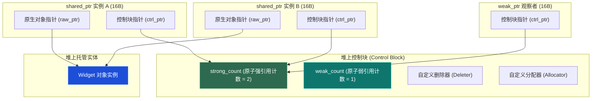
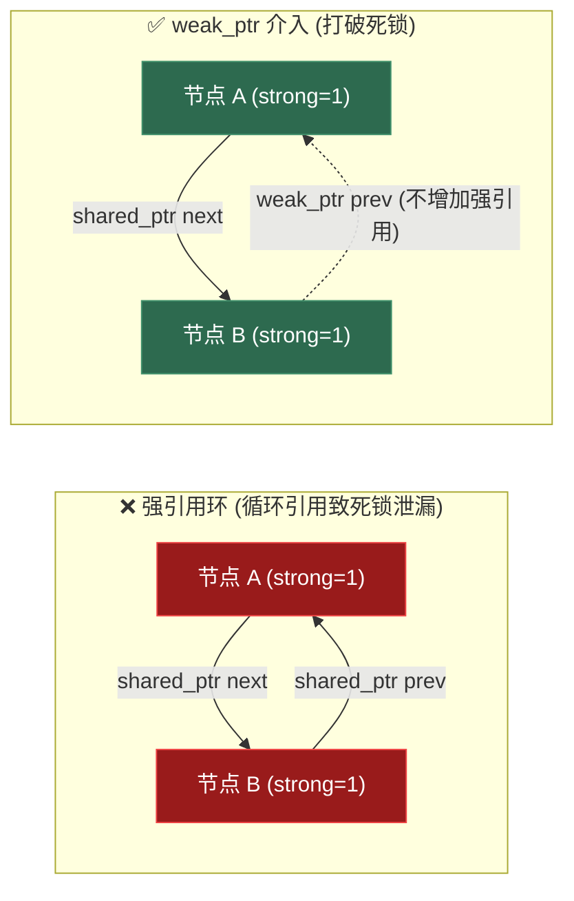
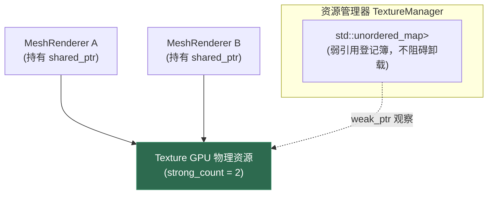

# 第二章 指针、引用与智能指针体系

> C++ 资源管理的精髓在于 **RAII (Resource Acquisition Is Initialization)**：将堆内存、操作系统文件描述符与 GPU 硬件句柄等外设资源的生命周期，严格绑定到栈对象的生命周期之中。从底层的裸指针与引用别名，到编译期零开销的独占所有权 (`unique_ptr`) 与带引用计数的共享所有权 (`shared_ptr`)，现代 C++ 构筑了一套既保全直接寻址性能又规避内存泄漏的安全管理网。

---

## 0. 考点优先级概览

| 优先级 | 核心模块 | 重点考点 | 考核形式 |
| :--- | :--- | :--- | :--- |
| **P0** | **核心概念与指针语法** | 指针与引用八大本质区别、顶层 const vs 底层 const（左右法则）、const 引用延长临时变量生命周期 | 语法辨析、陷阱填空与选择 |
| **P0** | **智能指针所有权模型** | `unique_ptr` 移动所有权约束、`shared_ptr` 双指针控制块拓扑、`weak_ptr` 破除循环引用状态机 | 核心机制时序图、内存泄漏归因分析 |
| **P1** | **控制块与性能权衡** | `make_shared` 单次内存分配 vs 独立 `new` 控制块优劣、`weak_ptr` 延长对象内存占用的副作用、引用计数原子性与线程安全边界 | **大厂高频深度考察、性能取舍推导** |
| **P1** | **设计范式与类型擦除** | `enable_shared_from_this` 原理与 CRTP 模式、成员函数指针尺寸 (8~24B) 与 this 偏移、`std::function` 类型擦除与 SBO 阈值 | 底层实现推导、虚表与偏移计算 |
| **P2** | **工业与游戏实战** | 游戏引擎材质纹理 `weak_ptr` 弱引用缓存池、实体间跨帧安全追踪、GPU 资源自定义 Deleter 与 RAII 句柄 | 引擎资源管理架构设计 |
| **P3** | **参考实现与速查** | 手写简易 `UniquePtr` 移动所有权骨架、GPU 资源 RAII 包装器、指针体系高频面试速答对照表 | 参考代码库（已折叠）、30秒核心速答 |

---

## P0 核心考点：指针语法、所有权模型与生命周期

### 1. 指针 vs 引用核心横评与 const 左右法则

| 维度 | 裸指针 (Pointer) | 引用 (Reference) |
| :--- | :--- | :--- |
| **本质定义** | 存储目标对象物理内存地址的**独立变量** | 目标对象的**别名 (Alias)**（编译器语义上不分配独立存储） |
| **可空性** | **允许为空** (`nullptr`) | **绝不允许为空**（必须绑定合法有效对象） |
| **重绑定能力** | **允许重新赋值**改变指向对象 | **不可重绑定**（初始化后终身绑定原对象，赋值操作仅改变原对象内容） |
| **内存占用** | 占用独立指针大小（32位 4B / 64位 8B） | 逻辑上不占空间（底层由编译器使用 const 指针实现） |
| **多级与算术** | 支持多级指针 (`int**`)、支持地址自增 (`p++`) | **不支持多级引用**、不支持算术偏移 |

#### const 左右法则与临时对象延长
* **口诀**：以 `*` 为分界线，**`const` 在 `*` 左边修饰指向的内容（底层 const），在 `*` 右边修饰指针变量本身（顶层 const）**。
  ```cpp
  const int* p1 = &x; // [底层 const] 所指内存只读，指针自身可改指其他变量
  int* const p2 = &x; // [顶层 const] 指针自身只读不可改指，所指内存可修改
  ```
* **const 引用延长生命周期**：非 const 左值引用无法绑定右值临时对象，但 **`const T&` 能够直接绑定右值临时对象**，并将其生命周期强制延长至与该引用相同的作用域。

---

### 2. `unique_ptr` 独占所有权模型

* **设计公理**：同一时刻，**有且仅有一个 `unique_ptr` 拥有对应资源的控制权**。
* **零运行时开销**：在未指定自定义有状态删除器的情况下，`sizeof(unique_ptr<T>) == sizeof(T*)`。它是纯编译期的所有权转移检查，不消耗任何额外的堆内存与原子操作开销。
* **语义约束**：**严厉禁用拷贝构造与拷贝赋值运算符**（被标记为 `= delete`），仅允许通过 `std::move()` 执行所有权转移：
  ```cpp
  auto p1 = std::make_unique<Widget>();
  // auto p2 = p1;            // 编译期报错！禁止拷贝
  auto p2 = std::move(p1);   // p1 原地置空变为 nullptr，所有权移交至 p2
  ```

---

### 3. `shared_ptr` 控制块 (Control Block) 拓扑与生命周期

`shared_ptr` 内部由两个物理指针构成（64 位系统下 `sizeof == 16`）：一个指向托管对象实例，另一个指向堆上分配的**控制块 (Control Block)**：



#### 双阶段销毁状态机：
1. **对象析构阶段**：当某个 `shared_ptr` 离开作用域或被重置时，执行 `strong_count.fetch_sub(1)`。当 **`strong_count` 归零** 时，内核立即触发调用 `Widget::~Widget()` 执行析构并释放托管实体自身内存，此时业务资源完全释放。
2. **控制块释放阶段**：只有当所有观察的 **`weak_ptr` 也全数销毁（即 `weak_count == 0`）** 时，堆上的控制块自身结构体才被真正从内存中 `free`。

---

### 4. 循环引用与 `weak_ptr` 破除机制

两个持有 `shared_ptr` 的对象相互引用，将导致双方的 `strong_count` 永远大于 0，触发永久性内存泄漏：



* **安全访问**：`weak_ptr` 无法直接通过 `*` 或 `->` 解引用，必须通过 **`wp.lock()`** 尝试升级为合法的 `shared_ptr`。若对象已死亡，`lock()` 原子性返回 `nullptr`，彻底消除了访问野指针的可能。

---

## P1 理论进阶与底层推导：控制块优化、线程安全与成员函数指针

### 1. `std::make_shared` vs `shared_ptr<T>(new T)` 工业级对比

```cpp
// 方式 A：独立分配
auto sp1 = std::shared_ptr<Widget>(new Widget());
// 方式 B：合并单次分配
auto sp2 = std::make_shared<Widget>();
```

| 评估维度 | `shared_ptr<T>(new T)` | `std::make_shared<T>()` |
| :--- | :--- | :--- |
| **内存分配次数** | **2 次独立的堆分配**（对象一次，控制块一次） | **仅 1 次连续堆分配**（控制块与对象紧邻合并在同一物理内存块中） |
| **CPU 缓存命中率** | 差（控制块与对象物理地址离散） | **极佳**（空间局部性强，单次读取易同时载入 L1 Cache） |
| **异常安全性** | 存在隐患（在复合表达式传参中可能泄漏对象） | **完全异常安全** |
| **自定义 Deleter** | **完全支持**自定义删除器与回收逻辑 | **不支持自定义 Deleter** |
| **内存完全释放延迟** | **对象与控制块解耦**：强引用归零时对象内存先还给系统 | **内存延迟驻留**：只要存在任意 `weak_ptr`，哪怕对象已析构，**整块合并大内存无法归还操作系统** |

---

### 2. `shared_ptr` 的线程安全边界解析

面试与工业工程中最容易混淆的边界：
1. **引用计数操作是线程安全的**：控制块内部的 `strong_count` 与 `weak_count` 采用 `std::atomic` 实现，多线程并发拷贝、传参、析构同一个对象生成的不同 `shared_ptr` 副本，其自增/自减操作绝对原子安全。
2. **指针变量本身的读写是非线程安全的**：多线程并发读写**同一个 `shared_ptr` 对象本身**（例如一个全局 `g_sp`，线程 1 执行 `g_sp = sp_new`，线程 2 执行 `auto local = g_sp`）存在数据竞争，必须加锁或使用 C++20 `std::atomic<std::shared_ptr<T>>`。
3. **托管的目标对象不是线程安全的**：智能指针仅代理所有权，多个线程通过指针同时修改目标对象成员必须自行加互斥锁。

---

### 3. `enable_shared_from_this` 原理推导

当一个类的成员函数需要将自身传递给异步任务或其他模块时：
```cpp
// 错误写法：Double Free 致命陷阱
std::shared_ptr<Widget> GetShared() {
    return std::shared_ptr<Widget>(this); // 严重错误！为同一个对象独立创建了第二个全新控制块！
}
```

* **CRTP 规范解法**：继承自 `std::enable_shared_from_this<Widget>`：
  * 基类内部包含一个私有的 `std::weak_ptr<Widget> weak_this_`。
  * 当该对象首次被 `std::make_shared` 或 `shared_ptr` 包装时，标准库自动为该 `weak_this_` 绑定控制块。
  * `shared_from_this()` 底层直接通过该弱指针执行 `weak_this_.lock()` 安全返回，复用同一个控制块。

---

### 4. 成员函数指针与 `std::function` SBO 机制

* **成员函数指针尺寸异常 (8 ~ 24B)**：
  普通函数指针固定为 8 字节（存储代码段地址）；而成员函数指针可能膨胀至 **16 或 24 字节**。其底层结构体内部除了存储函数地址外，还必须携带 **`this` 指针调整偏移量 (`delta`)** 与虚函数表偏移 (`vindex`)，用于在多继承和虚继承环境下调整 `this` 寻址。
* **`std::function` 的小对象优化 (SBO, Small Buffer Optimization)**：
  `std::function` 内部维护了一段小缓冲区（通常为 16~32 字节）。若包装的 Lambda 捕获的数据量小于该阈值，直接在对象栈内存内就地构造；若捕获了大对象/大数组，则会隐式退化为调用 `operator new` 产生堆分配开销。

---

## P2 工程实战与游戏架构：弱引用缓存与 GPU 句柄管理

### 1. 游戏引擎纹理与材质弱引用缓存池

在游戏引擎资源管理器中，同一份贴图可能被多个 Mesh 实例共享。当场景切换所有网格体销毁后，纹理应自动释放。若缓存池使用 `shared_ptr` 会导致强引用永不归零；因此**工业界标准做法是使用 `weak_ptr` 作为缓存索引**：



* **加载逻辑**：查询缓存，执行 `it->second.lock()`。若返回有效指针直接复用；若返回空说明已被回收，原地剔除脏条目并触发磁盘重新流式加载。

---

### 2. 跨帧实体安全观察防悬垂

在战斗逻辑中，AI 行为树与技能系统需要锁定追踪目标。若直接保存 `Entity*` 裸指针，一旦目标被摧毁析构，追踪者将陷入非法访存 (Use-After-Free) 崩溃。使用 `std::weak_ptr<Entity>`，每帧通过 `lock()` 安全检测目标生命周期，失效时优雅切换脱战状态。

---

## P3 参考实现与速查

### 1. 简易独占智能指针 `UniquePtr` 移动所有权实现

<details>
<summary><strong>高性能 C++ 移动语义与所有权独占 UniquePtr 核心实现</strong></summary>

```cpp
#include <utility>

template <typename T>
class UniquePtr {
private:
    T* raw_ptr_;

public:
    explicit UniquePtr(T* ptr = nullptr) noexcept : raw_ptr_(ptr) {}

    ~UniquePtr() {
        delete raw_ptr_;
    }

    // 严厉禁用拷贝语义
    UniquePtr(const UniquePtr&) = delete;
    UniquePtr& operator=(const UniquePtr&) = delete;

    // 启用移动语义（所有权安全转移）
    UniquePtr(UniquePtr&& other) noexcept : raw_ptr_(other.raw_ptr_) {
        other.raw_ptr_ = nullptr;
    }

    UniquePtr& operator=(UniquePtr&& other) noexcept {
        if (this != &other) {
            delete raw_ptr_;          // 释放本端原有资源
            raw_ptr_ = other.raw_ptr_; // 接管对方资源
            other.raw_ptr_ = nullptr; // 剥夺对方所有权
        }
        return *this;
    }

    T& operator*() const noexcept { return *raw_ptr_; }
    T* operator->() const noexcept { return raw_ptr_; }
    T* get() const noexcept { return raw_ptr_; }

    T* release() noexcept {
        T* temp = raw_ptr_;
        raw_ptr_ = nullptr;
        return temp;
    }

    void reset(T* new_ptr = nullptr) noexcept {
        T* old_ptr = raw_ptr_;
        raw_ptr_ = new_ptr;
        delete old_ptr;
    }

    explicit operator bool() const noexcept { return raw_ptr_ != nullptr; }
};
```
</details>

---

### 2. 高频面试考点速答对照

| 问题 | 核心回答要点 (30 秒速答) |
| :--- | :--- |
| **指针和引用的本质区别是什么？** | 指针是存储变量地址的实体变量，有自己的独立存储地址，可以为空也可以重新指向，支持指针运算；引用是变量的纯语法别名，底层虽由 const 指针实现但逻辑上不占空间，必须在声明时初始化且终身不可改绑，绝不允许为空。 |
| **`unique_ptr` 与 `shared_ptr` 的底层开销差异？** | `unique_ptr` 是独占语义，禁止拷贝仅允许移动，无自定义删除器时大小等于原生指针，属于零运行时抽象开销；`shared_ptr` 是共享语义，大小为 16B（原生指针 + 控制块指针），内部维护堆上控制块与两套原子引用计数，存在原子自增与堆分配开销。 |
| **`std::make_shared` 比直接 `new` 强在哪里？有何副作用？** | 优势：将对象内存与控制块合并为单次堆内存分配，提升 CPU 缓存局部性且杜绝复合传参异常泄漏；缺点：不支持自定义 Deleter，且由于控制块与对象强行绑定在同一物理内存块，只要有任意 `weak_ptr` 存活，即便对象已析构其实体内存也无法提前归还操作系统。 |
| **`shared_ptr` 的引用计数为什么必须是原子操作？** | 多个线程可能同时执行对同一个对象的 `shared_ptr` 拷贝构造或析构（各自在不同的线程栈上持有副本）。如果强引用计数的递增和递减不是原子的，并发执行 `fetch_add` / `fetch_sub` 会发生数据竞争导致计数错乱，进而引发提前 Double Free 或内存泄漏。 |
| **为什么普通弱引用 `weak_ptr` 不能直接解引用？** | `weak_ptr` 不拥有对象的所有权，无法阻止其他线程随时归零强引用并析构对象。因此必须调用 `.lock()` 尝试原子性地升级为 `shared_ptr`。只有当升级成功（强引用有效递增）后，才能确保在整个访问期间对象绝对存活。 |
