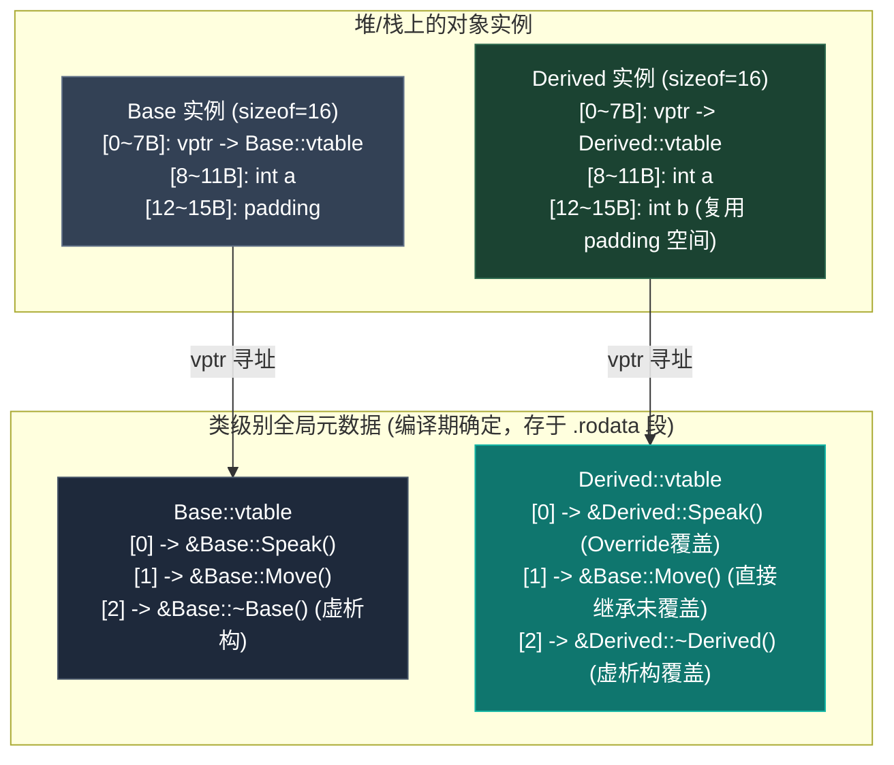
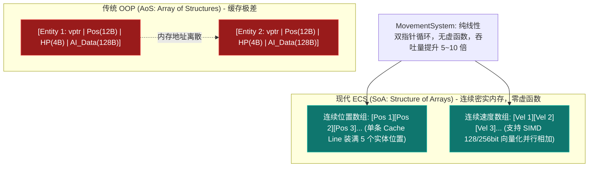

# 第三章 面向对象深入：虚函数、多态与继承

> C++ 面向对象系统通过统一的基类指针实现了运行期多态。然而抽象的背后是底层内存布局与指令跳转的物理开销：从存储在 `.rodata` 只读段的虚函数表 (vtable)，到对象头部的虚表指针 (vptr)；从多继承与菱形虚继承中的 Thunk 指针偏移调整，到深继承树对 CPU 指令流水线与 L1 Cache 的破坏——理解多态的底层成本，是规避滥用继承并迈向现代面向数据设计 (ECS) 的必经之路。

---

## 0. 考点优先级概览

| 优先级 | 核心模块 | 重点考点 | 考核形式 |
| :--- | :--- | :--- | :--- |
| **P0** | **虚表与动态绑定** | 虚函数表 (vtable) 与对象虚指针 (vptr) 映射、动态多态运行期查找机制、虚析构函数的绝对必要性 | 核心概念问答、机制时序推导 |
| **P0** | **类型转换系统** | C++ 四种显式 Cast（`static` / `dynamic` / `const` / `reinterpret`）检查阶段与应用边界 | 语法规范、代码审校陷阱题 |
| **P1** | **汇编推导与经典陷阱** | 虚函数调用汇编级拆解（两次间接访存 + 间接跳转）、构造/析构期调用虚函数非多态陷阱、对象切片 (Object Slicing) | 汇编时序分析、代码输出推导题 |
| **P1** | **继承拓扑与 Thunk 机制** | 单继承复用虚表、多继承多虚表与 Thunk 函数 `this` 调整、菱形虚继承虚基类指针 (`vbptr`) 偏移推导 | **大厂底层必考对象模型推导大题** |
| **P2** | **工业与引擎架构实战** | 为什么游戏引擎热路径禁用虚函数（虚调用开销、无法内联、分支预测失败）、ECS (面向数据设计) 架构替代深继承树 | 引擎系统设计、性能瓶颈调优 |
| **P3** | **参考实现与速查** | C++ 游戏引擎轻量级自定义 RTTI 类型系统实现、面向对象高频面试速答对照表 | 参考代码库（已折叠）、30秒核心速答 |

---

## P0 核心考点：虚函数机制、虚析构与类型转换

### 1. 静态多态 vs 动态多态核心对比

| 维度 | 编译期多态 (Static Polymorphism) | 运行期多态 (Dynamic Polymorphism) |
| :--- | :--- | :--- |
| **实现机制** | 函数重载 (Overload)、模板特化与泛型、CRTP (奇异递归模板模式) | 继承体系、虚函数 (`virtual`)、纯虚抽象类 |
| **决议时机** | **编译期**完成符号绑定与静态分发 | **运行期**通过虚函数表间接寻址动态分发 |
| **运行期性能** | **零抽象开销**：代码可全面被编译器内联优化 | **存在间接寻址开销**、无法内联、易引发 CPU 分支预测失败 |
| **类型约束** | 类型必须在编译期静态已知 | 支持处理运行时由工厂动态装载的未知派生类对象 |
| **工业代表** | STL 泛型算法、高性能数学库 (Eigen)、游戏 ECS 系统 | 游戏大型场景管理、插件架构、事件监听者模式 |

---

### 2. 虚函数表 (vtable) 与虚指针 (vptr) 底层映射模型

* **vtable (虚函数表)**：编译器在编译阶段为每个**包含虚函数的类**生成一个全局唯一的函数指针数组，存放在可执行文件的**只读常量段 (`.rodata`)** 中。
* **vptr (虚表指针)**：每个实例化对象在物理内存的头部（通常为 offset 0，占用 8 字节）均被编译器隐式插入一个指针，**指向该类所归属的 vtable**。



---

### 3. 虚析构函数的物理必要性

当使用基类指针释放一个由堆分配的派生类对象时：
```cpp
Base* p = new Derived();
delete p; // 若 Base 析构函数未声明为 virtual，触发严重资源泄漏！
```

* **非虚析构的灾难**：编译器依据静态指针类型 `Base*` 执行静态绑定，仅调用 `Base::~Base()`，**派生类特有的析构函数 `Derived::~Derived()` 将完全被跳过**，导致派生类内部申请的堆内存、文件句柄或 GPU 缓冲区彻底泄漏。
* **虚析构的核心机制**：基类析构函数声明为 `virtual ~Base() = default;` 后，析构函数成为 vtable 的固定项。`delete p` 底层会先通过 vptr 查表调用最顶层派生类的析构函数，派生类析构执行完毕后再逐级向上链式调用基类析构，保证内存安全。
* **工程准则**：**凡是定义了虚函数或可能被继承作为多态基类的类，其析构函数必须为 `virtual`**。

---

### 4. C++ 四种显式 Cast 核心机制对比

| 转换操作符 | 适用场景 | 检查时机 | 底层实现与安全边界 |
| :--- | :--- | :---: | :--- |
| **`static_cast`** | 基本数据类型截断/提升、向上安全类型转换、**已知类型的向下转换**、`void*` 强转 | **编译期** | 纯静态类型校验与静态数值偏移，**无任何运行时安全检查**。若向下转换目标与真实类型不符，引发未定义行为。 |
| **`dynamic_cast`** | **基类与派生类之间的安全向下转换 (Downcasting)**、交叉转换 | **运行期** | **依赖 RTTI (`type_info`)**。沿着继承树遍历指针虚表，若转换失败，指针版本返回 **`nullptr`**，引用版本抛出 **`std::bad_cast`** 异常。必须保证类拥有至少一个虚函数。 |
| **`const_cast`** | 剥离或添加变量的 `const` 或 `volatile` 属性 | **编译期** | 仅更改编译器类型检查属性，**若对原本就定义在只读段的常量强行写值会引发段错误 (Crash)**。通常用于兼容第三方遗留 C API。 |
| **`reinterpret_cast`**| 指针转整型 (`uintptr_t`)、不相关指针类型之间的强制按位映射 | **无检查** | **没有任何汇编指令开销**，仅在编译器层面强制按位重新解释内存。极其危险，仅用于底层协议反序列化与显存物理地址对齐。 |

---

## P1 理论进阶与底层推导：汇编级时序、多继承与 RTTI

### 1. 虚函数调用的汇编指令级拆解

对于多态调用代码 `p->Speak()`，编译器在 x86-64 下生成的底层机器指令严格分为三步：

```nasm
; 假设当前基类指针 p 存放在 rbx 寄存器中，Speak() 为虚表中第 0 项 (offset 0)
mov rax, [rbx]       ; 1. 解引用基类指针，读取对象前 8 字节 -> 获取 vptr 地址并存入 rax
mov rax, [rax + 0]   ; 2. 访问 vtable[0]，读取 Speak() 真实函数的物理内存地址 -> 存入 rax
call rax             ; 3. 间接调用函数 (CPU 指令跳转执行)
```

#### 虚函数调用的硬件代价：
1. **两次内存间接寻址开销**：普通静态成员函数直接生成 `call 地址`，而虚函数必须经历 `读 vptr -> 读 vtable` 两次物理访存。
2. **彻底阻断内联优化 (Inlining)**：由于调用目标在运行期才能确认，编译器无法展开函数体，破坏了局部变量常量折叠与向量化机会。
3. **CPU 分支目标预测 (BTB) 污染**：多态容器中遍历不同派生类时，`call rax` 跳转地址频繁变动，引发 CPU 预测流水线冲刷。

---

### 2. 构造函数与析构函数中调用虚函数的静态绑定陷阱

```cpp
struct Base {
    Base() { Speak(); } // 编译执行调用的是 Base::Speak()，绝非派生类版本！
    virtual void Speak() { std::cout << "Base"; }
};
struct Derived : Base {
    void Speak() override { std::cout << "Derived"; }
};
Derived d; // 仅输出 "Base"
```

* **底层状态机原因**：
  在构造派生类对象时，内存首先被分配，随后**优先调用基类构造函数**。此时派生类成员尚未初始化，编译器在进入 `Base::Base()` 内部时，**强制将对象的 `vptr` 指向 `Base::vtable`**！只有当基类构造完毕进入 `Derived::Derived()` 时，`vptr` 才会重写为 `Derived::vtable`。同理，析构时进入基类阶段后 `vptr` 已被回退。因此构造/析构期多态完全失效。

---

### 3. 多继承、Thunk 函数与菱形虚继承推导

#### 1. 多继承下的 Thunk 函数与 `this` 修正
在多继承中，派生类内部依次平铺排列多个基类子对象：
```cpp
struct Base1 { virtual void Foo(); int a; };
struct Base2 { virtual void Bar(); int b; };
struct Multi : Base1, Base2 { void Foo() override; void Bar() override; };
```
* 当通过 `Base2* p = &multi;` 调用 `p->Bar()` 时，`Bar()` 的实现期望获取的是 `Multi` 的完整对象首地址。
* **Thunk (跳板函数)**：编译器在 `Base2` 的虚表中存放的不是裸函数地址，而是一段动态调整汇编：
  ```nasm
  __thunk_Bar:
      sub rcx, 16      ; 将 this 指针减去 Base2 相对于 Multi 的偏移量 (16 字节)
      jmp Multi::Bar   ; 调整完毕后直接跳转至真正的实现函数
  ```

#### 2. 菱形虚继承与虚基类指针 (`vbptr`)
为了消除菱形继承下最顶层基类数据的双份拷贝冗余，采用 `class B : virtual public A`：
* 派生类不再直接平铺基类数据，而是在对象内部插入一个 **`vbptr` (虚基类表指针)**。
* 共享的公共基类数据被强制移动到整个多派生类对象内存的**最末端**。
* 访问公共基类成员需通过 `vbptr` 查阅 **`vbtable` (虚基类表)** 获取相对偏移量，引入了第三重内存间接跳转。

---

## P2 工程实战与引擎架构：面向数据设计 (ECS) 替代深继承

### 1. 为什么游戏引擎热循环杜绝深继承与虚函数

在 3A 游戏引擎核心热路径（如每秒运行 60 次的数万粒子模拟、动画骨骼蒙皮、碰撞剔除）中，传统的面向对象继承体系呈现致命缺陷：

```cpp
// ❌ 经典面向对象深继承：严重破坏 CPU 缓存局部性
class Entity {
public:
    virtual void Update(float dt) = 0; // 几万个不同的 Entity 指针散落在堆各处
};
```

1. **缓存冷缺失 (Cache Miss)**：堆上分配的多态对象在内存中是离散跳跃存储的，遍历时导致 CPU 每次加载的 Cache Line 几乎无可用数据。
2. **多态内联阻断**：微小的数学计算（如 `x += vx * dt`）若包裹在虚函数内，函数调用自身的栈帧创建开销远超计算本身。

---

### 2. ECS (Entity-Component-System) 架构革新

现代商业引擎（Unity DOTS、Unreal Mass Entity）全面转向**面向数据设计 (Data-Oriented Design, DoD)**：



---

## P3 参考实现与速查

### 1. 游戏引擎自定义轻量级类型标识系统 (零开销 RTTI)

<details>
<summary><strong>高性能 C++ 自定义编译期类型 ID 与类型安全转换实现</strong></summary>

```cpp
#include <cstdint>
#include <iostream>

using TypeId = uintptr_t;

// 利用 C++ 模板单例地址的唯一性，生成零开销的编译期全局唯一 TypeId
template <typename T>
class TypeIdentifier {
public:
    static TypeId Get() {
        static char id_anchor;
        return reinterpret_cast<TypeId>(&id_anchor);
    }
};

class Actor {
public:
    virtual ~Actor() = default;
    virtual TypeId GetTypeId() const = 0;
    virtual bool IsA(TypeId target_id) const {
        return target_id == TypeIdentifier<Actor>::Get();
    }
};

#define DECLARE_ACTOR_TYPE(ClassName, ParentClass)                    \
public:                                                               \
    static TypeId StaticType() {                                      \
        return TypeIdentifier<ClassName>::Get();                      \
    }                                                                 \
    TypeId GetTypeId() const override {                               \
        return StaticType();                                          \
    }                                                                 \
    bool IsA(TypeId target_id) const override {                       \
        return target_id == StaticType() || ParentClass::IsA(target_id); \
    }

class Pawn : public Actor {
    DECLARE_ACTOR_TYPE(Pawn, Actor)
};

class Character : public Pawn {
    DECLARE_ACTOR_TYPE(Character, Pawn)
};

// 高性能 Cast 替代极其缓慢的 dynamic_cast
template <typename Target, typename Source>
Target* Cast(Source* src) {
    if (src && src->IsA(Target::StaticType())) {
        return static_cast<Target*>(src);
    }
    return nullptr;
}
```
</details>

---

### 2. 高频面试考点速答对照

| 问题 | 核心回答要点 (30 秒速答) |
| :--- | :--- |
| **虚函数的动态绑定是如何在底层实现的？** | 包含虚函数的类由编译器生成只读虚函数表 (vtable) 存储函数地址；每个实例化对象首部隐式存储虚表指针 (vptr)。运行时调用 `p->func()` 时，CPU 执行两次间接寻址：先通过对象解引用得到 vptr，再根据常数偏移量从 vtable 取出真实函数地址执行跳转调用。 |
| **为什么基类析构函数必须定义为 virtual？** | 若析构函数为非虚函数，通过基类指针 `delete` 派生类对象时，编译器仅根据静态指针类型调用基类的析构函数，导致派生类的析构函数被完全跳过，其内部托管的动态内存与系统句柄无法被释放，引发严重内存泄漏。 |
| **为什么构造函数和析构函数中调用虚函数无法实现多态？** | 派生类对象构造时优先执行基类构造，此时派生类成员尚未初始化，编译器强制将对象的 `vptr` 指向基类 vtable；析构时亦是先析构派生类再析构基类，基类析构期间 `vptr` 已被重置为基类虚表，因此虚函数调用均退化为静态本类版本。 |
| **`static_cast` 与 `dynamic_cast` 的根本区别与性能差异？** | `static_cast` 是纯编译期静态类型转换，不增加任何运行时寻址开销，但向下转换安全性由程序员自行保证；`dynamic_cast` 专用于基类向派生类的安全向下转换，依赖运行期 RTTI 遍历继承树校验合法性，存在较大运行时性能惩罚。 |
| **多继承下指针转换为什么会发生数值改变 (This Adjustment)？** | 多继承对象内部顺序并列存放多个基类子对象。当派生类指针隐式或显式转换为非首个基类的指针时，编译器必须将指针地址加上目标基类子对象相对于派生类起点的物理偏移量，确保通过该基类指针能够精准对齐到正确的基类虚表与成员。 |
