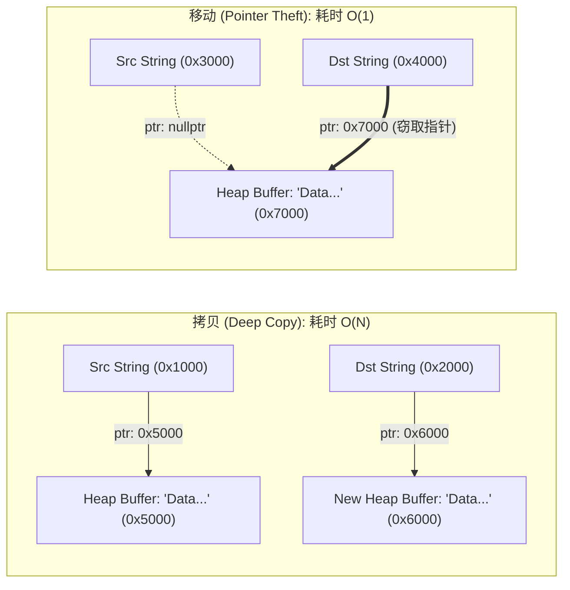

# 第四章 值类别、移动语义与完美转发

> 移动语义的核心在于所有权转移（Ownership Transfer）——将即将销毁的对象所持有的堆内存与系统句柄直接转移给新对象，以常数级指针置换替代线性时间深拷贝。

---

## 0. 考点优先级概览

| 优先级 | 核心模块 | 重点考点 | 考核形式 |
| :--- | :--- | :--- | :--- |
| **P0** | **值类别体系** | glvalue / lvalue / prvalue / xvalue 分类依据与生命周期 | 概念辨析 / 代码类型推断 |
| **P0** | **移动语义机制** | 移动构造与移动赋值、深拷贝与指针窃取对比、Rule of 5/0 | 手写核心函数 / 内存分析 |
| **P1** | **引用折叠与转发** | 万能引用判定条件、4 类折叠规则推导、`std::forward` 源码级实现 | 模板推导计算题 |
| **P1** | **返回值优化** | RVO / NRVO 消除原理、`return std::move(local)` 负优化反模式 | 编译原理机制分析 |
| **P2** | **异常安全与工程** | `noexcept` 对 `std::vector` 扩容的影响 (`std::move_if_noexcept`) | 性能陷阱排查 / 底层设计 |
| **P3** | **工业级类设计** | 支持移动语义的资源管理类、Copy-and-Swap 惯用法 | 工业代码速查 / 面试速答 |

---

## P0 核心考点：值类别体系与移动语义本质

### 1. C++11 值类别分类体系

C++11 之后，表达式的值由两个正交属性决定：**具有身份（Identity）**（是否有明确的内存地址，可通过取地址符 `&` 获取）与**可被移动（Movable）**。

```
                     Expressions (表达式)
                     /                 \
          glvalue (泛左值)              rvalue (右值)
          /             \              /            \
    lvalue (左值)        xvalue (将亡值)        prvalue (纯右值)
```

| 类别 | 身份 (Identity) | 可移动 (Movable) | 定义与典型示例 | 取地址 `&expr` |
| :--- | :---: | :---: | :--- | :---: |
| **lvalue** (左值) | **是** | 否 | 持久存储的对象：具名变量 `x`、解引用 `*ptr`、返回左值引用的函数调用 `arr[i]` | **合法** |
| **prvalue** (纯右值) | 否 | **是** | 临时运算结果或字面量：字面常量 `42` (除字符串字面量外)、算术运算 `a + b`、返回非引用的函数调用 | **非法** |
| **xvalue** (将亡值) | **是** | **是** | 即将销毁但具内存实体的对象：`std::move(x)` 转型结果、返回右值引用的函数调用 `static_cast<T&&>(var)` | **合法** (需转为左值) |

> **关键推论**：
> - `glvalue = lvalue ∪ xvalue`（拥有内存实体的表达式总称）。
> - `rvalue = prvalue ∪ xvalue`（可以绑定到右值引用 `T&&` 的表达式总称）。
> - **具名的右值引用本身是左值**：若形参定义为 `Widget&& w`，则在函数体内部表达式 `w` 具有变量名和确定地址，其值类别为 **lvalue**。

### 2. 拷贝 vs 移动的内存变化



- **深拷贝**：分配新堆内存，执行逐字节复制；源对象与目标对象内存完全解耦。
- **移动构造**：直接将目标指针指向源对象的堆空间，并将源对象的内部指针置为 `nullptr`（置为有效但未指定状态 Valid but unspecified state），避免析构时发生二次释放（Double Free）。

### 3. 三五法则 (Rule of Five) 与零法则 (Rule of Zero)

- **Rule of Zero**：若类无需直接管理原生资源，优先使用智能指针与标准容器，由编译器默认生成析构、拷贝与移动函数。
- **Rule of Five**：一旦手动实现了析构函数、拷贝构造函数或拷贝赋值运算符中的任意一个，编译器将**抑制隐式生成移动操作**。必须显式定义全部五个特殊成员函数：
  1. 析构函数 `~T()`
  2. 拷贝构造 `T(const T&)`
  3. 拷贝赋值 `T& operator=(const T&)`
  4. 移动构造 `T(T&&) noexcept`
  5. 移动赋值 `T& operator=(T&&) noexcept`

---

## P1 理论进阶与机制推导：完美转发与编译器优化

### 1. `std::move` 的本质与误区

`std::move` 并不在运行时移动任何数据，也不生成任何汇编机器码，其核心就是一次无条件的 `static_cast`：

```cpp
template <typename T>
constexpr std::remove_reference_t<T>&& move(T&& t) noexcept {
    return static_cast<std::remove_reference_t<T>&&>(t);
}
```

> **常见误区**：对 `const` 对象调用 `std::move` 会产生致命陷阱。若 `const Widget w;` 调用 `std::move(w)`，其类型被转换为 `const Widget&&`，无法匹配 `Widget(Widget&&)`（无 const），最终会静默退化调用拷贝构造函数 `Widget(const Widget&)`。

### 2. 万能引用与引用折叠推导

#### 万能引用（Forwarding Reference）成立条件
仅当发生**模板类型推导**且形参形式严格为 `T&&` 时（或者 `auto&&`），`T&&` 才是万能引用；若类型已由外层类指定（如 `std::vector<T>::push_back(T&&)`），则仅为普通右值引用。

#### 引用折叠规则（Reference Collapsing）
C++ 语法禁止显式定义引用的引用，但在模板推导或 `typedef/using` 场景下，编译器按照以下矩阵折叠：

| 原始类型参数 `T` | 声明形式 `T&&` 折叠结果 | 逻辑规则 |
| :--- | :---: | :--- |
| 左值引用 `X&` | `X& &&` $\rightarrow$ **`X&`** | 只要有左值引用参与，折叠结果必为左值引用 |
| 常量左值引用 `const X&` | `const X& &&` $\rightarrow$ **`const X&`** | 保持常左值引用属性 |
| 右值引用 `X&&` | `X&& &&` $\rightarrow$ **`X&&`** | 双重右值引用折叠为右值引用 |

### 3. 完美转发 `std::forward` 实现推导

完美转发旨在将参数按照调用方的原始值类别（左值保持左值，右值保持右值）传递给下游函数：

```cpp
template <typename T>
constexpr T&& forward(std::remove_reference_t<T>& param) noexcept {
    return static_cast<T&&>(param);
}
```

- **推导示例 1（实参为左值 `Widget&`）**：
  模板推导出 `T = Widget&`。代入 `forward`：`static_cast<Widget& &&>(param)` 折叠为 `Widget&`（转发为左值）。
- **推导示例 2（实参为右值 `Widget`）**：
  模板推导出 `T = Widget`。代入 `forward`：`static_cast<Widget&&>(param)` 维持为 `Widget&&`（转发为右值）。

### 4. 返回值优化 (RVO/NRVO) 与反模式

- **RVO (Return Value Optimization)**：返回纯右值临时对象（如 `return Widget();`），编译器直接在接收方的栈空间构造对象，完全省去拷贝与移动。
- **NRVO (Named Return Value Optimization)**：返回具名局部变量（如 `Widget w; return w;`），编译器通过空间共用优化消除构造。
- **致命反模式：`return std::move(local_var);`**：
  局部对象强制转换为右值引用后，破坏了 NRVO 的消除条件（要求返回对象与函数签名完全同型），迫使编译器放弃零成本的 NRVO，强行执行一次移动构造。**禁止在返回局部变量时套用 `std::move`**。

---

## P2 工程实战与底层性能：noexcept 与高频资源零拷贝

### 1. `noexcept` 对 `std::vector` 扩容的决定性影响

`std::vector` 在内存耗尽触发扩容重分配时，遵循**强异常安全保证**（Strong Exception Safety Guarantee）：若在移动元素过程中抛出异常，必须能够无损回滚到原有状态。

```cpp
// 标准库内部决策伪逻辑
if constexpr (std::is_nothrow_move_constructible_v<T> || !std::is_copy_constructible_v<T>) {
    move_elements(); // 移动构造：常数开销
} else {
    copy_elements(); // 降级为深拷贝：线性开销与高额内存分配！
}
```

> **性能灾难案例**：如果自定义类型的移动构造函数未显式声明 `noexcept`，`std::vector::reserve` 或 `push_back` 将放弃移动语义，退化为深拷贝所有既有元素。在游戏引擎每帧高频触发的粒子或骨骼变换数据中，未标记 `noexcept` 将直接导致严重的 CPU Cache 失效与堆碎片。

### 2. 引擎级大数据资源的零拷贝转移

在图形渲染管线中，网格顶点缓冲区（Vertex Buffer）、纹理贴图（Texture2D）通常持有数兆字节的显存句柄与映射内存。通过移动语义实现所有权移交，开销仅为几个整型句柄与指针的寄存器置换。

---

## P3 参考实现与速查

### 1. 工业级强异常安全动态缓冲区 (Move-Enabled Buffer)

<details>
<summary>展开查看标准支持移动语义与 Copy-and-Swap 惯用法的 Buffer 类实现</summary>

```cpp
#include <utility>
#include <cstddef>
#include <algorithm>

class MemoryBuffer {
private:
    char* m_data{nullptr};
    std::size_t m_size{0};

public:
    explicit MemoryBuffer(std::size_t size = 0)
        : m_data(size ? new char[size]() : nullptr), m_size(size) {}

    ~MemoryBuffer() noexcept {
        delete[] m_data;
    }

    // 拷贝构造函数 (深拷贝)
    MemoryBuffer(const MemoryBuffer& other)
        : m_data(other.m_size ? new char[other.m_size] : nullptr), m_size(other.m_size) {
        if (m_data) std::copy(other.m_data, other.m_data + m_size, m_data);
    }

    // 移动构造函数 (关键：必须标记 noexcept，指针窃取)
    MemoryBuffer(MemoryBuffer&& other) noexcept
        : m_data(other.m_data), m_size(other.m_size) {
        other.m_data = nullptr;
        other.m_size = 0;
    }

    // 移动赋值 / 统一赋值 (Copy-and-Swap 惯用法天然保证强异常安全)
    MemoryBuffer& operator=(MemoryBuffer other) noexcept {
        swap(*this, other);
        return *this;
    }

    friend void swap(MemoryBuffer& first, MemoryBuffer& second) noexcept {
        using std::swap;
        swap(first.m_data, second.m_data);
        swap(first.m_size, second.m_size);
    }

    [[nodiscard]] char* data() noexcept { return m_data; }
    [[nodiscard]] std::size_t size() const noexcept { return m_size; }
};
```
</details>

### 2. 核心高频考点速答对照表

| 面试高频提问 | 30 秒答题核心逻辑 |
| :--- | :--- |
| **`std::move` 的底层原理是什么？** | `std::move` 在编译期利用 `remove_reference` 消除引用，并通过 `static_cast<T&&>` 无条件将表达式强转为右值引用（xvalue）。它不产生汇编代码，不移动字节，仅改变值类别以激活移动构造重载。 |
| **为什么移动构造函数必须加 `noexcept`？** | 标准容器（如 `std::vector`）扩容时为确保强异常安全，使用 `std::move_if_noexcept` 检测。若未标 `noexcept`，扩容中抛异常无法回滚，容器被迫回退为低效的深拷贝。 |
| **什么是引用折叠？折叠规则是什么？** | 在模板或类型别名展开产生引用的引用时生效。规则为“左值引用具有传染性”：只要有左值引用参与（`& &`、`& &&`、`&& &`）均折叠为左值引用 `&`；只有纯右值引用结合（`&& &&`）才折叠为右值引用 `&&`。 |
| **万能引用与右值引用的判定标准？** | 必须同时满足模板类型推导且语法形式严格为 `T&&`（如 `template<typename T> void f(T&&)`）。若所属类型已被类模板确定无需推导（如 `vector<T>::push_back(T&&)`），则为普通右值引用。 |
| **返回局部变量时写 `return std::move(x)` 为什么是负优化？** | 阻碍了编译器的命名返回值优化（NRVO）。标准规定返回局部对象时会自动选择移动语义或直接原地构造；显式调用 `std::move` 将类型强转为右值引用，破坏了 NRVO 的同型消除条件，平白多一次移动开销。 |
