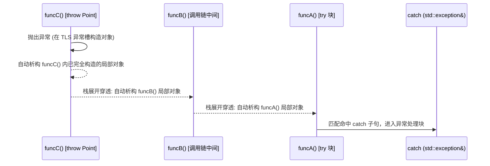

# 第九章 异常处理与异常安全体系

> 异常机制实现了错误处理与正常业务控制流的正交解耦。从栈展开的物理销毁过程、构造与析构的边界陷阱，到 Copy-and-Swap 强异常安全保证与工业级无异常（`-fno-exceptions`）范式，构建高容错系统。

---

## 0. 考点优先级概览

| 优先级 | 核心模块 | 重点考点 | 考核形式 |
| :--- | :--- | :--- | :--- |
| **P0** | **栈展开与生命周期** | 栈展开 (Stack Unwinding) 逐级析构机理、构造函数与析构函数抛异常 | 行为推导 / 内存泄漏排查 |
| **P0** | **异常安全三大保证** | 基本保证 (Basic)、强保证 (Strong)、不抛保证 (Nothrow) 判定标准 | 概念辨析 / 架构审查 |
| **P1** | **语义契约与传递** | `noexcept` 规范、`throw;` vs `throw e` 对象切片、`std::exception_ptr` 跨线程 | 语法推演 / 编译分析 |
| **P1** | **引擎无异常范式** | `-fno-exceptions` 根因（代码膨胀与不可预测性）、`std::expected` / 错误码 | 系统架构设计论述 |
| **P2** | **工业级事务回滚** | Copy-and-Swap 惯用法实现强异常安全、多资源原子初始化 | 高可用核心类设计 |
| **P3** | **工业安全容器实现** | 具备强异常安全保证的动态缓冲区实现、核心高频速答表 | 核心源码查阅 / 面试速答 |

---

## P0 核心考点：栈展开物理机理与异常安全级别

### 1. 栈展开（Stack Unwinding）与双异常崩溃



- **底层执行流**：当 `throw` 触发时，运行时在线程局部存储（TLS）分配异常对象，由 DWARF 展开表或 SEH 逆向遍历栈帧。每退出一层调用栈，**必须按构造逆序调用该栈帧内所有已构造局部对象的析构函数**。
- **析构函数严禁抛出异常（双异常崩溃）**：
  若在栈展开过程中，某个局部对象的析构函数再次抛出新异常，此时运行时同时存在两个处于传播状态的未决异常，系统将**立即强制调用 `std::terminate()` 终止整个进程**。C++11 起所有析构函数默认隐式标记为 `noexcept`。

### 2. 构造函数抛出异常的致命内存陷阱

```cpp
// ❌ 内存泄漏反模式：裸指针多资源初始化
class BadHolder {
    Resource* m_resA{nullptr};
    Resource* m_resB{nullptr};
public:
    BadHolder() {
        m_resA = new Resource("A"); // 1. 构造成功
        m_resB = new Resource("B"); // 2. 抛出 bad_alloc！
    }
    ~BadHolder() {                  // ⚠️ 构造未完成，析构函数永远不会被调用！
        delete m_resA;              // m_resA 发生永久内存泄漏！
        delete m_resB;
    }
};

// ✅ RAII 自动化防御模式
class SafeHolder {
    std::unique_ptr<Resource> m_resA;
    std::unique_ptr<Resource> m_resB;
public:
    SafeHolder() 
        : m_resA(std::make_unique<Resource>("A")),
          m_resB(std::make_unique<Resource>("B")) {} // 若 B 抛异常，已完全构造的成员 m_resA 会被栈展开自动析构！
};
```

### 3. 异常安全三大保证（Exception Safety Guarantees）

| 保证级别 | 核心承诺与状态定义 | 典型代表与工程实现方式 |
| :--- | :--- | :--- |
| **Nothrow（无抛保证）** | **绝对不向外部抛出任何异常**；若内部发生错误则在函数体内完全消化，或直接终止 | 析构函数、全局 `swap`、移动构造与移动赋值（显式标记 `noexcept`） |
| **Strong（强保证 / 事务语义）** | **操作要么完全成功，要么发生异常后回滚至调用前的初始状态**（Commit or Rollback） | `std::vector::push_back`；通过 **Copy-and-Swap** 惯用法或局部副本作修改后交换实现 |
| **Basic（基本保证）** | 发生异常后，**不发生任何资源泄漏**，且所有对象的不变量（Invariants）保持有效合法 | 标准容器大部分非强保证操作；对象处于有效但可能未指定的合法状态 |

---

## P1 理论进阶与机制推导：noexcept 契约与无异常架构

### 1. `noexcept` 语义与标准库性能决策

`noexcept` 向编译器立下契约：本函数绝不向外抛出异常。
- **违约惩罚**：若标记了 `noexcept` 的函数内部抛出异常且未在内部捕获，运行时**直接调用 `std::terminate()`**，剥夺外层任何 `catch` 的拦截机会。
- **`std::move_if_noexcept` 性能决策分歧**：`std::vector` 在扩容时若使用非 `noexcept` 移动构造，移动中途抛异常将导致原数据部分丢失破坏强保证；因此容器会**静默回退为线性时间深拷贝**。

### 2. `throw;` vs `throw e;` 对象切片辨析

```cpp
try {
    throw DerivedException("Disk Failure");
} catch (const BaseException& e) {
    // throw;   // ✅ 原样重新抛出：保留原始 DerivedException 的完整多态类型
    // throw e; // ❌ 发生对象切片 (Object Slicing)：按基类 BaseException 拷贝，派生信息丢失！
}
```

### 3. 游戏引擎与嵌入式为什么禁用异常 (`-fno-exceptions`)？

在 AAA 游戏引擎（Unreal Engine）与高性能工业底层，通常全局开启 `-fno-exceptions`，核心技术根因包括：
1. **指令缓存与体积损耗**：异常处理依赖巨大的 DWARF 栈展开元数据表（`.eh_frame`），二进制可执行文件膨胀 15%~30%，加剧 I-Cache 颠簸。
2. **控制流不可预测**：任何一行非 noexcept 代码都隐含非局部跳转分支，严重阻碍编译器激进执行循环向量化与指令流水线重排。
3. **现代替代**：工业界全面转向返回错误码、`std::optional`、或现代 C++23 风格的 `std::expected<T, E>` / Result 联合体模式。

---

## P2 工程实战与底层性能：Copy-and-Swap 强异常安全

### 1. Copy-and-Swap 事务模式

实现强异常安全赋值运算符的标准范式：
1. 先利用拷贝构造函数在局部栈上生成一个完整副本（所有可能引发 `bad_alloc` 的内存操作全部发生在副本中）。
2. 若分配失败抛出异常，`this` 对象尚未发生任何实质改动，状态自动保持。
3. 若分配成功，调用 `noexcept` 的 `swap` 将原对象与局部副本置换，旧内存随局部对象离开作用域自动析构。

---

## P3 参考实现与速查

### 1. 工业级具备强异常保证的安全动态数组容器

<details>
<summary>展开查看基于 Copy-and-Swap 保证强异常安全的 DynamicArray 核心实现</summary>

```cpp
#include <cstddef>
#include <algorithm>
#include <utility>
#include <new>

template <typename T>
class SafeArray {
private:
    T* m_data{nullptr};
    std::size_t m_capacity{0};
    std::size_t m_size{0};

public:
    SafeArray() noexcept = default;

    explicit SafeArray(std::size_t cap)
        : m_data(cap ? static_cast<T*>(::operator new(cap * sizeof(T))) : nullptr),
          m_capacity(cap), m_size(0) {}

    ~SafeArray() noexcept {
        clear();
        ::operator delete(m_data);
    }

    void clear() noexcept {
        for (std::size_t i = 0; i < m_size; ++i) {
            m_data[i].~T();
        }
        m_size = 0;
    }

    // 强异常安全保证：若元素拷贝构造失败，容器状态完全无损
    void push_back(const T& val) {
        if (m_size == m_capacity) {
            std::size_t newCap = m_capacity ? m_capacity * 2 : 1;
            SafeArray<T> temp(newCap); // 1. 在独立内存空间预备扩容

            // 2. 转移已有元素
            for (std::size_t i = 0; i < m_size; ++i) {
                new (&temp.m_data[i]) T(m_data[i]); // 若抛异常，temp 析构清理，this 不受影响
                temp.m_size++;
            }

            // 3. 构造新元素
            new (&temp.m_data[temp.m_size]) T(val);
            temp.m_size++;

            // 4. 全部成功后无抛置换 (Commit)
            swap(*this, temp);
        } else {
            new (&m_data[m_size]) T(val);
            m_size++;
        }
    }

    friend void swap(SafeArray& a, SafeArray& b) noexcept {
        using std::swap;
        swap(a.m_data, b.m_data);
        swap(a.m_capacity, b.m_capacity);
        swap(a.m_size, b.m_size);
    }
};
```
</details>

### 2. 核心高频考点速答对照表

| 面试高频提问 | 30 秒答题核心逻辑 |
| :--- | :--- |
| **什么是栈展开？它与 RAII 有什么关系？** | 栈展开是抛出异常后运行时逐层退出调用栈并按逆序调用局部对象析构函数的过程。RAII 依赖栈展开保证：即使函数因异常非正常退出，包裹在类中的系统句柄与堆内存也能在析构中确定性释放。 |
| **为什么析构函数中绝对不能抛出异常？** | 若在已有异常正进行栈展开时析构函数再次抛出异常，系统将因存在两个并发传播的未决异常而直接调用 `std::terminate()` 强制崩溃。析构函数默认隐式声明为 `noexcept`。 |
| **构造函数中抛出异常会导致内存泄漏吗？如何预防？** | 会。若构造函数未完全执行即抛出异常，该对象的析构函数不会被触发，体内已 `new` 的裸指针发生永久泄漏。预防手段：严禁裸指针，类成员必须全部采用智能指针等 RAII 类型管理。 |
| **异常安全的三个级别分别是什么？** | Nothrow（绝对不抛异常）、Strong（事务性保证，失败回滚至原状态）、Basic（发生异常不发生资源泄漏，对象保持合法可用）。强保证常用 Copy-and-Swap 实现。 |
| **工业级游戏引擎为什么普遍禁用 C++ 异常？** | 异常机制引入庞大的栈展开元数据表导致二进制体积膨胀，破坏指令缓存，且隐式跳转阻碍编译器乱序优化。通常全局编译 `-fno-exceptions`，采用错误码或 `std::expected` 处理可控失败。 |
