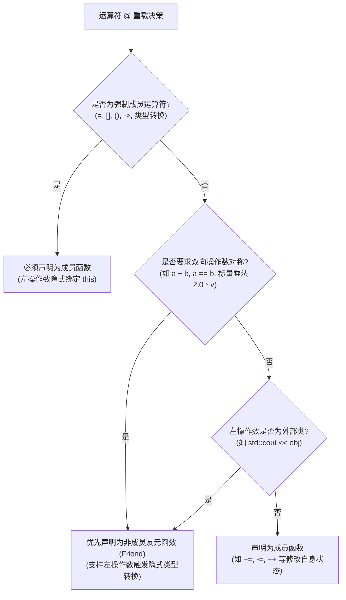

# 第十章 运算符重载与三向比较体系

> 运算符重载的本质是直观的语法糖与泛型算法的协议接口。掌控成员与非成员函数的对称性规则、ADL 参数依赖查找，以及 C++20 三向比较（Spaceship Operator）的序关系推导，杜绝隐式转换灾难与短路求值破坏。

---

## 0. 考点优先级概览

| 优先级 | 核心模块 | 重点考点 | 考核形式 |
| :--- | :--- | :--- | :--- |
| **P0** | **重载边界与成员抉择** | 4 个不可重载运算符、5 个必须为成员的运算符、成员 vs 非成员对称性 | 语法正误辨析 / 选择题 |
| **P0** | **核心重载范式** | 前置 `++` vs 后置 `++(int)`、下标 `[]` 双版本、流提取 `<<` 的 ADL 绑定 | 核心函数手写 / 机制辨析 |
| **P1** | **三向比较体系** | C++20 `<=>` 比较类别（`strong_ordering` / `weak` / `partial` 与 NaN） | 概念推导 / 现代特性大题 |
| **P1** | **反模式与语言禁忌** | 严禁重载 `&&` 与 `||`（短路特性丢失）、`operator->` 穿透调用机制 | 典型 Bug 排查 |
| **P2** | **引擎级数学架构** | 复合赋值优化（`+=` 驱动 `+`）、消除中间临时副本与返回值优化 | 游戏引擎底层设计 |
| **P3** | **工业级数学类实现** | 完整标准 Vector3 向量重载实现、核心高频速答表 | 核心源码查阅 / 面试速答 |

---

## P0 核心考点：语法边界、成员抉择与对称性

### 1. 运算符重载的语法边界与合法性

```
                           C++ 运算符全景
                           /            \
               可以重载 (38 个)        🔴 绝对不可重载 (4 个)
              /               \                  |
     常规运算符           必须为成员函数 (5 个)     :: (作用域解析)
  (+ - * / % 等)         =  []  ()  ->  operator T()  .  (成员访问)
                                                  .* (成员指针访问)
                                                  ?: (三元条件运算符)
```

> **绝对禁区**：禁止凭空发明语言不存在的运算符（如 `**`, `<=>=`）；禁止改变原生运算符的操作数个数、结合性与优先级。

### 2. 成员函数 vs 非成员函数（对称性法则与 ADL）



#### 操作数对称性经典陷阱
若将向量数乘 `operator*(float)` 定义为成员函数：
```cpp
Vec3 v(1, 2, 3);
Vec3 a = v * 2.0f; // ✅ 成功: 解析为 v.operator*(2.0f)
Vec3 b = 2.0f * v; // ❌ 编译报错: 基础类型 float 内部不存在 operator*(Vec3) 成员！
```
**工业标准解法**：算术与比较运算符必须声明为**非成员函数**（通常置于同一命名空间内配合 ADL 查找），使左右操作数享有同等隐式转换能力。

### 3. ADL (Argument-Dependent Lookup / Koenig 查找)
当调用非限定函数名时，编译器不仅在当前词法作用域查找，还会**自动遍历其实参类型所属的命名空间**。因此，定义在类所在命名空间内的非成员 `operator<<` 与 `swap`，无需显式 `using` 即可被泛型算法无缝解析。

---

## P1 理论进阶与机制推导：核心运算符与 C++20 三向比较

### 1. 核心运算符标准实现规范

| 运算符 | 签名特征与返回值规范 | 核心实现与推导逻辑 |
| :--- | :--- | :--- |
| **前置自增 `++it`** | `T& operator++() noexcept;` | 修改自身状态，**返回自身的左值引用 `*this`**（零开销，性能优先） |
| **后置自增 `it++`** | `T operator++(int) noexcept;` | 入参包含哑元 `int` 以区分签名；保存旧副本，调用前置 `++(*this)`，**返回旧值副本** |
| **下标 `[]`** | `T& operator[](size_t);`<br/>`const T& operator[](size_t) const;` | **必须同时提供 const 与非 const 两个版本**；非 const 版本禁止调用可能抛异常的逻辑 |
| **箭头 `->`** | `T* operator->() const;` | **语法穿透特性**：若返回值是指针，直接访问其成员；若返回值仍是对象，编译器**递归解引用**直至遇到原生裸指针 |
| **类型转换** | `explicit operator bool() const;` | **必须标记 `explicit`**；避免其意外隐式提升为 `int` 参与运算，但仍可在 `if/while` 条件中隐式工作 |

### 2. C++20 三向比较（Spaceship Operator `<=>`）

C++20 引入 `<=>` 运算符，一行代码自动合成全套 6 种比较（`==`, `!=`, `<`, `<=`, `>`, `>=`）：
```cpp
struct Transform {
    float x, y, z;
    auto operator<=>(const Transform&) const = default; // 逐成员递归生成比较
    bool operator==(const Transform&) const = default;  // 默认生成高效相等性测试
};
```

#### 三种序关系类别（Ordering Categories）推演
1. **`std::strong_ordering`（强序）**：绝对可替代性。若 $a \equiv b$，则在所有可观察属性上 $f(a) \equiv f(b)$（如整数比较）。
2. **`std::weak_ordering`（弱序）**：相对等价性。$a \equiv b$ 仅代表排序等价，可能存在其他内部差异（如大小写不敏感的字符串比较）。
3. **`std::partial_ordering`（偏序）**：**存在不可比元素**。典型代表为浮点数：若操作数包含 `NaN`，则 `NaN < 0`、`NaN > 0`、`NaN == 0` 均恒为 `false`。

### 3. 致命禁忌：严禁重载 `&&` 与 `||`

内置逻辑运算符具备**短路求值特性**（Short-Circuit Evaluation）：若左操作数已能决定结果，右操作数绝对不会被求值。
- **重载后的灾难**：一旦重载 `operator&&(A, B)`，其本质退化为普通函数调用 `operator&&(a, b)`。依据 C++ 规范，**函数调用的全部实参必须在进入函数体前全部求值完成**，短路语义彻底荡然无存，引发严重未定义行为或崩溃。

---

## P2 工程实战与底层性能：复合赋值优化

### 1. 复合赋值驱动算术运算

在高性能数学计算中，避免冗余的构造与内存搬迁：
- 核心修改逻辑一律封装在成员函数 `operator+=` 中，返回引用 `*this`。
- 非成员的 `operator+` 直接按值传递左操作数，利用拷贝传参复用栈空间，内部调用 `lhs += rhs; return lhs;`，天然激活编译器的 RVO / NRVO 返回值优化。

---

## P3 参考实现与速查

### 1. 工业级高性能 Vec3 数学类运算符实现

<details>
<summary>展开查看符合标准工程规范与 C++20 的 Vec3 运算符重载实现</summary>

```cpp
#include <iostream>
#include <compare>

class Vec3 {
public:
    float x{0.0f}, y{0.0f}, z{0.0f};

    constexpr Vec3() noexcept = default;
    constexpr Vec3(float x_, float y_, float z_) noexcept : x(x_), y(y_), z(z_) {}

    // 1. 复合赋值：成员函数，返回自身引用
    constexpr Vec3& operator+=(const Vec3& rhs) noexcept {
        x += rhs.x; y += rhs.y; z += rhs.z;
        return *this;
    }

    constexpr Vec3& operator*=(float scalar) noexcept {
        x *= scalar; y *= scalar; z *= scalar;
        return *this;
    }

    // 2. 下标访问：提供 const 与非 const 双版本
    [[nodiscard]] constexpr float& operator[](size_t index) noexcept {
        return (&x)[index];
    }
    [[nodiscard]] constexpr const float& operator[](size_t index) const noexcept {
        return (&x)[index];
    }

    // 3. C++20 三向比较：浮点数成员自动推导为 std::partial_ordering
    auto operator<=>(const Vec3&) const noexcept = default;
    bool operator==(const Vec3&) const noexcept = default;
};

// 4. 算术运算符：非成员函数，保证标量与向量的乘法对称性
[[nodiscard]] constexpr Vec3 operator+(Vec3 lhs, const Vec3& rhs) noexcept {
    lhs += rhs;
    return lhs;
}

[[nodiscard]] constexpr Vec3 operator*(Vec3 v, float s) noexcept {
    v *= s;
    return v;
}

[[nodiscard]] constexpr Vec3 operator*(float s, Vec3 v) noexcept {
    v *= s;
    return v; // 完美支持 2.0f * v 语法
}

// 5. 流输入输出：非成员友元/普通函数配合 ADL
inline std::ostream& operator<<(std::ostream& os, const Vec3& v) {
    return os << "Vec3(" << v.x << ", " << v.y << ", " << v.z << ")";
}
```
</details>

### 2. 核心高频考点速答对照表

| 面试高频提问 | 30 秒答题核心逻辑 |
| :--- | :--- |
| **C++ 中哪些运算符绝对不能被重载？** | 共有 4 个：作用域解析运算符 `::`、成员访问运算符 `.`、成员指针访问运算符 `.*`、以及三元条件运算符 `?:`。 |
| **哪些运算符必须重载为类的成员函数？** | 共有 5 个：赋值 `=`、下标 `[]`、函数调用 `()`、箭头访问 `->` 以及类型转换运算符 `operator T()`。语言强制要求它们必须由左侧宿主对象直接绑定。 |
| **为什么算术运算符（如 `+`, `*`）推荐作为非成员函数？** | 保证双向对称性与隐式类型转换一致性。若定义为成员函数，`v * 2.0` 合法，但 `2.0 * v` 无法编译，因为基本类型 `float` 无法拥有成员函数。非成员函数可平等对待双操作数。 |
| **前置 `++` 与后置 `++` 在重载语法与性能上的区别？** | 语法上前置签名无参并返回引用 `T&`，后置带哑元 `int` 参数并返回临时对象副本 `T`。性能上前置零开销无需构造副本，后置必须产生额外拷贝，泛型迭代器中必须优先用前置。 |
| **为什么绝对不要重载 `&&` 和 `||` 运算符？** | 原生逻辑运算符拥有短路求值特性。一旦重载为函数，其操作数必须在进入函数前全部求值，破坏了短路语义，导致预期的空指针防御或状态守卫失效引发崩溃。 |
