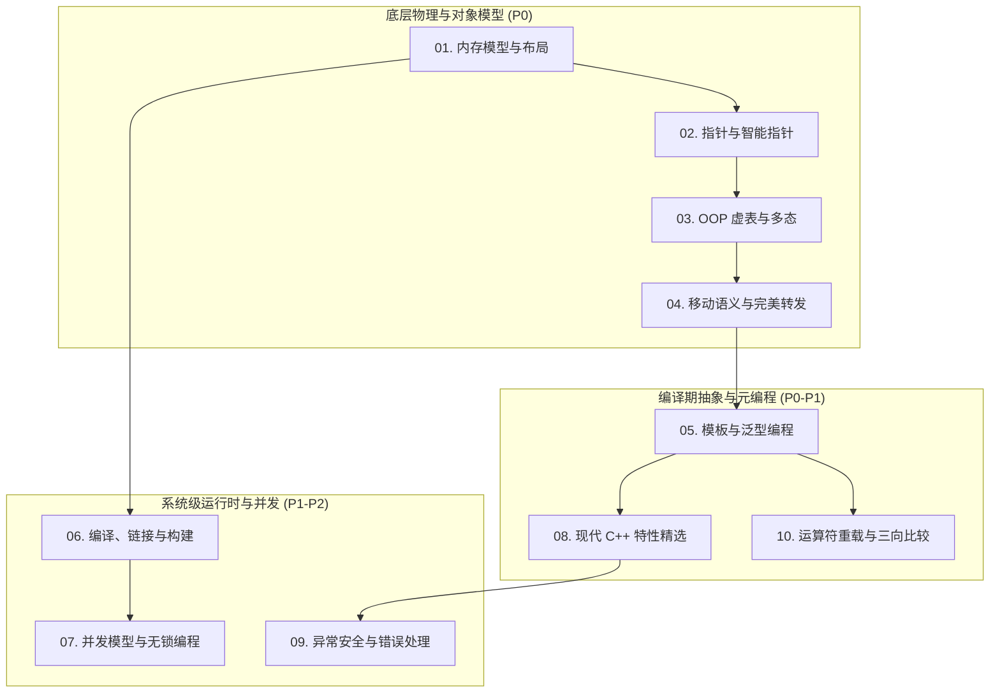

# C++ 深入笔记：从语法底层到高性能架构

> 本专栏面向高性能基础设施与游戏引擎底层架构，对现代 C++ 的物理内存布局、编译期/运行期机制、硬件缓存亲和性及并发无锁编程进行纵深剖析。

---

## 0. 专栏架构全景图

---

## 1. 核心章节知识图谱

| 章节 | 核心机制与底层考点 | 优先级 | 工业级/引擎实践场景 |
| :--- | :--- | :---: | :--- |
| [**01. 内存模型与对象布局**](./01_memory_model/) | 虚拟地址划分、结构体对齐/空类大小、EBO、Cache Line 64B 伪共享 | **P0** | 原生侵入式内存池 (Intrusive Pool Allocator) |
| [**02. 指针、引用与智能指针**](./02_pointers_and_smart_pointers/) | 指针与引用汇编差异、控制块拆分、`make_shared` 弱引用缓存驻留 | **P0** | 零开销 GPU 显存 Handle 封装、SBO 机制 |
| [**03. OOP 深入：虚函数与多态**](./03_oop_and_polymorphism/) | vptr/vtable 汇编反编译、Thunk 偏移调节、虚基类表 vbptr、四类 Cast | **P0** | 零 RTTI 编译期类型 ID、ECS SoA 布局 |
| [**04. 移动语义与完美转发**](./04_move_semantics/) | 值类别体系 (glvalue/xvalue)、引用折叠、`std::forward`、NRVO 消除 | **P0** | `std::vector` 的 `noexcept` 扩容保证、强异常安全缓冲区 |
| [**05. 模板与泛型编程**](./05_templates/) | 编译期多态、函数特化禁区、SFINAE 机制、C++20 Concepts、两阶段查找 | **P0** | 编译期 CRTP 消除虚表、零开销强类型 Handle |
| [**06. 编译、链接与构建**](./06_compilation_and_linking/) | 构建 4 阶段、Name Mangling、`extern "C"`、ODR 规则、GOT/PLT 延迟绑定 | **P1** | 跨平台 Gameplay 动态库热重载、Unity Build 防污染 |
| [**07. 并发模型与无锁编程**](./07_concurrency/) | CAS 原语、6 种硬件内存序 (Happens-Before)、`scoped_lock` 预防死锁 | **P0** | 64B 隔离 SPSC 无锁环形队列、逻辑/渲染双缓冲 |
| [**08. 现代 C++ 特性精选**](./08_modern_cpp/) | `decltype` 表达式规则、Lambda 闭包类机理、`optional`/`variant`/`span` | **P0** | 编译期 FNV-1a 字符串哈希、类型安全 EventBus |
| [**09. 异常处理与异常安全**](./09_exception_handling/) | 栈展开 (Stack Unwinding)、双异常崩溃、Copy-and-Swap 强保证 | **P1** | `-fno-exceptions` 底层机理与安全容器封装 |
| [**10. 运算符重载与三向比较**](./10_operator_overloading/) | 不可重载 4 运算符、对称非成员函数、ADL 查找、C++20 `<=>` 序关系 | **P1** | SIMD 友好的工业级 Vec3 向量数学库实现 |

---

## 2. 推荐复习与攻坚路径

### 路线 A：底层核心攻坚（针对大厂核心 C++ / 引擎架构轮次）
- **核心路径**：`01_memory_model` $\rightarrow$ `02_pointers_and_smart_pointers` $\rightarrow$ `03_oop_and_polymorphism` $\rightarrow$ `04_move_semantics` $\rightarrow$ `07_concurrency`
- **考核重点**：直接针对虚拟地址空间划分、虚表汇编指令间接跳转、移动语义与 `noexcept` 扩容退化、CPU 缓存一致性与 SPSC 无锁队列。

### 路线 B：现代泛型与工程构建（针对中高级系统设计轮次）
- **核心路径**：`05_templates` $\rightarrow$ `06_compilation_and_linking` $\rightarrow$ `08_modern_cpp` $\rightarrow$ `09_exception_handling` $\rightarrow$ `10_operator_overloading`
- **考核重点**：两阶段查找与 CRTP 静态多态、动态链接 PIC 与 GOT/PLT、`enum class` 与 `variant` 模式匹配、强异常安全保证与模块热重载。
