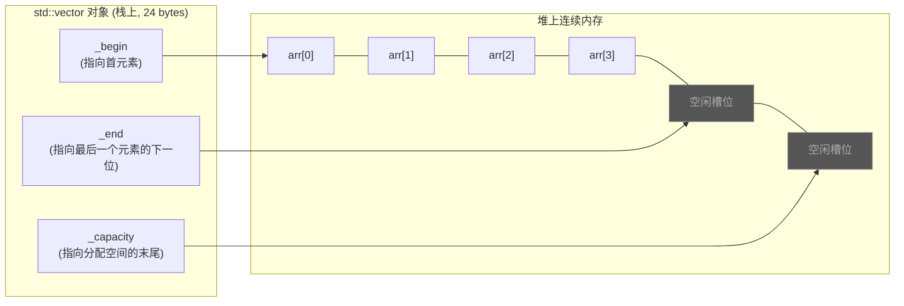

# 第一章 数组 (Array)

> 数组是一段存储在**连续内存空间**上的同类型元素集合。因其连续的物理内存布局，它是现代计算机体系结构中缓存命中率最高的数据结构。

---

## 0. 考点优先级概览

根据面试常见考察频度与工程实用度，内容按优先级组织如下：

| 优先级 | 分类 | 核心内容 | 重点说明 |
| :--- | :--- | :--- | :--- |
| **P0** | **核心考点** | Cache Line 局部性、`std::vector` 三指针底层、扩容机制 (1.5x vs 2x)、迭代器失效、`reserve` vs `resize` | 必须深入理解的底层机制与经典高频问题 |
| **P1** | **经典算法** | 双指针（对撞/快慢）、滑动窗口、前缀和、环形缓冲区 (Ring Buffer)、数组经典题速查 | 算法核心思想与常见技巧 |
| **P2** | **工程实践** | 数据局部性优化：SoA vs AoS、对象池 (Object Pool)、顶点缓冲区 (Vertex Buffer) 对齐 | 面向性能调优与游戏引擎数据布局 |
| **P3** | **基础与附录** | `std::array` 特性、多维数组行优先存储、复杂度速查表、手写环形缓冲区实现（折叠） | 知识库查阅备忘 |

---

## P0：核心考点

### 1.1 为什么数组快？—— CPU Cache Line 与空间局部性

数组在现代硬件上执行极快，根本原因在于其**物理内存的连续性**与 CPU 缓存体系的高度契合。

* **Cache Line 预取机制**：
  CPU 从内存读取数据时，并非单字节读取，而是以 **Cache Line**（现代 CPU 通常为 64 字节）为基本单位整块拉入 L1/L2 缓存。
* **空间局部性 (Spatial Locality)**：
  当访问 `arr[0]` 时，后续紧跟的若干元素（例如 15 个 4 字节的 `int`）已被顺带加载至同一高速缓存行中。随后对这些相邻元素的访问将直接命中 L1 缓存（约 1ns），而无需发起耗时的系统总线内存访问（约数十至上百纳秒）。
* **对比链表**：
  链表的每个节点是独立动态申请的，散落在堆内存的不同角落。遍历链表时几乎每个节点都会引发一次 Cache Miss（指针追逐），因此在中小规模数据遍历时，连续数组的性能显著优于链表。

```
┌─────────────────────────────────────────────────────────┐
│                  CPU Cache Line (64 bytes)              │
│  arr[0]  arr[1]  arr[2]  arr[3]  ...  arr[15]           │
│   4B      4B      4B      4B           4B               │
└─────────────────────────────────────────────────────────┘
```

---

### 1.2 `std::vector` 内部结构与三指针模型

`std::vector` 在 64 位系统下仅占用 24 个字节（栈上），其底层通过三个裸指针维护一段堆内存：



* **大小计算**：
  $$\text{size}() = \_end - \_begin$$
* **容量计算**：
  $$\text{capacity}() = \_capacity - \_begin$$

---

### 1.3 扩容机制与策略对比 (2x vs 1.5x)

当调用 `push_back` 且当前 `size() == capacity()` 时触发扩容：
1. **申请新内存**：依据扩容倍数分配一块更大的连续堆内存。
2. **搬迁旧元素**：使用移动语义（`std::uninitialized_move`）或拷贝构造将旧数据转移至新内存。
3. **销毁并释放**：析构旧内存中元素并释放旧内存块。
4. **更新三指针**：将 `_begin`、`_end`、`_capacity` 指向新堆地址。

#### 扩容因子对比
| 编译器 / 标准库实现 | 扩容因子 | 扩容序列示例（初值为 1） |
| :--- | :--- | :--- |
| **GCC (libstdc++) / Clang (libc++)** | **2x** | 1 $\to$ 2 $\to$ 4 $\to$ 8 $\to$ 16 $\to$ 32 |
| **MSVC (STL)** | **1.5x** | 1 $\to$ 2 $\to$ 3 $\to$ 4 $\to$ 6 $\to$ 9 $\to$ 13 |

#### 为什么 MSVC 倾向于 1.5 倍扩容？
* **2 倍扩容的弊端**：
  每次扩容后释放的旧内存总和永远小于新分配块的大小：
  $$1 + 2 + 4 + \dots + 2^{k-1} = 2^k - 1 < 2^k$$
  这意味着先前释放的所有旧内存块由于容量不足，**永远无法被重用**，容易加剧堆内存碎片。
* **1.5 倍扩容的优势**：
  经过若干轮扩容后，之前所释放的历史内存块总和将超过当前需要的新块大小，内存分配器有机会复用旧地址空间，降低内存碎片率。

---

### 1.4 `reserve` vs `resize` vs `shrink_to_fit`

这是日常开发与面试中最容易混淆的基础操作：

```cpp
std::vector<int> v;

// 1. reserve：仅调整 capacity，不构造任何元素
v.reserve(100); 
// 此时：size() = 0, capacity() = 100
// 效果：预先分配内存，后续 push_back 100 次以内绝不触发重新分配。

// 2. resize：改变 size，会真实构造或析构元素
v.resize(10);   
// 此时：size() = 10, capacity() = 100
// 效果：末尾新增 10 个被值初始化的元素（int 初始化为 0）。
v.resize(5);    
// 此时：size() = 5, capacity() = 100
// 效果：后 5 个元素被析构销毁，但 capacity 保持不变。

// 3. shrink_to_fit：请求释放多余未使用的 capacity
v.shrink_to_fit();
// 此时：size() = 5, capacity() ≈ 5 (实现可选择忽略该建议)
```

---

### 1.5 迭代器失效 (Iterator Invalidation)

在 `vector` 上进行增删操作时，原有的迭代器、指针或引用可能变为悬垂指针（Dangling Pointer）。

#### 触发规则汇总
| 触发操作 | 迭代器失效范围 | 原因说明 |
| :--- | :--- | :--- |
| **`push_back` / `emplace_back`（未扩容）** | 仅 `end()` 失效 | 末尾位置后移 |
| **`push_back` / `emplace_back`（触发扩容）** | **所有迭代器全部失效** | 底层指针被释放，搬迁到了全新内存地址 |
| **`insert` / `emplace`** | 插入点及之后的所有迭代器失效（若扩容则全失效） | 插入点后面的元素需向右整体平移 |
| **`erase`** | 被删位置及之后的所有迭代器失效 | 被删元素后续的数据向左平移填补空缺 |
| **`clear`** | **所有迭代器全部失效** | 全部元素被析构清空 |

#### 遍历删除的标准范式
```cpp
std::vector<int> vec = {1, 2, 3, 4, 5, 6};

// ❌ 错误做法：迭代器直接失效，引发未定义行为
for (auto it = vec.begin(); it != vec.end(); ++it) {
    if (*it % 2 == 0) vec.erase(it); // it 已失效，再执行 ++it 会崩溃
}

// ✅ 正确做法 1：使用 erase 的返回值接收下一个合法迭代器
for (auto it = vec.begin(); it != vec.end(); ) {
    if (*it % 2 == 0) {
        it = vec.erase(it); // erase 会返回被删元素之后的有效迭代器
    } else {
        ++it;
    }
}

// ✅ 正确做法 2：标准 Erase-Remove 惯用法
vec.erase(std::remove_if(vec.begin(), vec.end(), [](int x) { return x % 2 == 0; }), vec.end());

// ✅ 正确做法 3：C++20 std::erase_if（推荐）
std::erase_if(vec, [](int x) { return x % 2 == 0; });
```

---

### 1.6 常见面试问答要点

* **Q：数组与链表的核心优缺点与选型依据？**
  > **回答要点**：数组基于连续内存，支持 $O(1)$ 随机访问，且对 CPU Cache 空间局部性高度友好；但中间插入删除为 $O(n)$，且扩容需要重新分配内存。链表增删节点为 $O(1)$（已知指针时），但随机查找为 $O(n)$，且每个节点带额外指针开销，指针跳跃导致 Cache Miss 频繁。因此除高频头部/中间插入且不关心遍历的极端场景外，绝大多数业务首选数组。

* **Q：`std::vector` 的扩容过程是怎样的？为什么其 push_back 时间复杂度是均摊 $O(1)$？**
  > **回答要点**：当容量不足时，分配 1.5 或 2 倍的新内存，将旧元素移动或拷贝到新区域并释放旧内存。单次扩容需要 $O(n)$ 代价，但由于扩容按几何级数递增，每插入 $N$ 个元素总重分配代价约为 $O(N)$，均摊到每次 `push_back` 上仍为稳定的 $O(1)$。

* **Q：`reserve` 与 `resize` 的本质区别？**
  > **回答要点**：`reserve` 仅改变容器的 `capacity`，不构造对象，容器的 `size` 保持不变，用于提前分配内存规避扩容开销；`resize` 会实际改变 `size`，若变大则就地构造新元素，若变小则析构多余元素。

---

## P1：经典算法与应用技巧

### 2.1 双指针技巧速查

双指针是数组题型中压缩时间复杂度的核心工具，常见分为三类：

1. **对撞指针（首尾双指针）**：
   * **适用条件**：数组已有序，用于在 $O(n)$ 内寻找符合条件的配对。
   * **典型应用**：有序数组的两数之和、反转数组、接雨水（盛最多水的容器）。
2. **快慢指针（同向双指针）**：
   * **适用条件**：在一次遍历中进行原地元素筛选与去重。
   * **典型应用**：移除指定元素（LC 27）、有序数组去重（LC 26）。
3. **滑动窗口（左右边界指针）**：
   * **适用条件**：维护一个连续的子数组/子串状态。
   * **典型应用**：无重复字符的最长子串、长度最小的子数组。

```cpp
// 典型快慢指针：原地移除元素 O(n) 时间，O(1) 空间
int removeElement(std::vector<int>& nums, int val) {
    int slow = 0;
    for (int fast = 0; fast < nums.size(); ++fast) {
        if (nums[fast] != val) {
            nums[slow++] = nums[fast];
        }
    }
    return slow; // 返回新长度
}
```

---

### 2.2 前缀和 (Prefix Sum)

* **核心思想**：空间换时间，将单次区间求和复杂度由 $O(k)$ 降为 $O(1)$。
* **定义**：`prefix[i]` 表示前 `i` 个元素的累加和：
  $$\text{sum}(L, R) = \text{prefix}[R + 1] - \text{prefix}[L]$$
* **典型结合**：前缀和与哈希表结合，解决“和为 K 的连续子数组（LC 560）”。

---

### 2.3 环形缓冲区 (Ring Buffer)

环形缓冲区采用固定容量的连续数组，逻辑上首尾衔接，通过 `head`（读索引）和 `tail`（写索引）维护数据流动。广泛用于无锁队列、音频流传输与最近帧时间统计。

```
写索引计算：tail = (tail + 1) % Capacity
判空条件：size == 0
判满条件：size == Capacity
```

---

### 2.4 数组高频算法思路速查

| 题目 | 难易度 | 核心思路 |
| :--- | :--- | :--- |
| **LC 26. 删除排序数组中的重复项** | Easy | 快慢指针：`fast` 寻找新元素，写入 `slow` 所在槽位。 |
| **LC 27. 移除元素** | Easy | 快慢指针：`fast` 遍历，非指定值写入 `slow` 并自增。 |
| **LC 704. 二分查找** | Easy | 闭区间 `[left, right]`，循环条件 `left <= right`，中点防溢出 `left + (right - left) / 2`。 |
| **LC 53. 最大子数组和 (Kadane 算法)** | Medium | 动态规划状态压缩：当前和若小于 0 则放弃，重新以当前数起步：`cur = max(num, cur + num)`。 |
| **LC 56. 合并区间** | Medium | 按区间起点升序排序，遍历比对当前区间的起点是否落在上一区间的终点之内。 |
| **LC 238. 除自身以外数组的乘积** | Medium | 前缀积与后缀积：先顺序遍历存前缀乘积，再逆向遍历累乘后缀乘积，达到 $O(1)$ 额外空间。 |

---

## P2：工程实践与性能优化

### 3.1 内存布局优化：AoS vs SoA (数据导向设计 DOD)

在高性能系统与游戏引擎开发中，数组的组织形式直接决定了渲染管线与物理模拟的 Cache 命中率。

* **AoS (Array of Structures，结构体数组)**：
  面向对象常规写法。一个对象的全部属性连续排列。
  ```cpp
  struct Particle {
      float x, y, z; // 位置 (12 bytes)
      float vx, vy, vz; // 速度 (12 bytes)
      float life; // 生命 (4 bytes)
      uint32_t color; // 颜色 (4 bytes)
  };
  std::vector<Particle> particles; // AoS 布局
  ```
  * **缺点**：若当前系统仅需更新所有粒子的位置（如物理积分计算 `pos += vel * dt`），每次读取粒子时必须将 `life`、`color` 等无关字段一同载入 Cache Line，导致缓存有效载荷减半。
* **SoA (Structure of Arrays，数组的结构体)**：
  数据导向设计（Data-Oriented Design，ECS 核心思想）。将各字段分别拆分为平铺数组。
  ```cpp
  struct ParticleSystem {
      std::vector<float> posX, posY, posZ;
      std::vector<float> velX, velY, velZ;
      std::vector<float> life;
      std::vector<uint32_t> color;
  }; // SoA 布局
  ```
  * **优势**：更新位置时，CPU 载入的 Cache Line 100% 均为连续的坐标数据，配合 SIMD 指令集（SSE/AVX）可轻松实现单指令多数据并行计算。

---

### 3.2 游戏核心模式：对象池 (Object Pool)

频繁创建和销毁游戏对象（如子弹、粒子）会造成剧烈的堆内存分配与垃圾碎片。对象池预先分配基于数组的连续存储块，复用闲置对象。

<details>
<summary>👉 查看基于数组的对象池 (Object Pool) C++ 参考实现</summary>

```cpp
#include <vector>
#include <cstdint>
#include <stdexcept>

template <typename T, std::size_t Capacity>
class ObjectPool {
    union Node {
        T element;
        Node* next_free;
        Node() {}
        ~Node() {}
    };

    std::vector<Node> _pool;
    Node* _free_list = nullptr;
    std::size_t _active_count = 0;

public:
    ObjectPool() : _pool(Capacity) {
        // 构建初始空闲空闲链表（指针复用未激活的槽位内存）
        for (std::size_t i = 0; i < Capacity - 1; ++i) {
            _pool[i].next_free = &_pool[i + 1];
        }
        _pool[Capacity - 1].next_free = nullptr;
        _free_list = &_pool[0];
    }

    template <typename... Args>
    T* acquire(Args&&... args) {
        if (!_free_list) return nullptr; // 池满
        Node* node = _free_list;
        _free_list = _free_list->next_free;
        new (&node->element) T(std::forward<Args>(args)...); // 定位 new
        ++_active_count;
        return &node->element;
    }

    void release(T* obj) {
        if (!obj) return;
        obj->~T(); // 显式析构
        Node* node = reinterpret_cast<Node*>(obj);
        node->next_free = _free_list;
        _free_list = node;
        --_active_count;
    }

    std::size_t active_count() const { return _active_count; }
};
```
</details>

---

## P3：基础原理与参考实现

### 4.1 `std::array` 特性与使用考量

* **栈上分配**：大小在编译期固定（`std::array<T, N>`），无堆内存分配与解引用开销。
* **避免数组退化**：原生 C 数组作为函数参数传递时会退化为指针（丢失长度信息），而 `std::array` 保留完整的容器接口与类型安全语义。
* **多维数组行优先存储 (Row-Major)**：
  在 C/C++ 中，二维数组在内存中是按行连续平铺的。因此在多层循环中，**必须优先外层行遍历、内层列遍历**（`for i -> for j`），以最大化命中 Cache Line。

---

### 4.2 复杂度速查总表

| 操作类型 | `std::array<T, N>` | `std::vector<T>` | 备注说明 |
| :--- | :--- | :--- | :--- |
| **下标随机访问** | **$O(1)$** | **$O(1)$** | 一次乘法与地址偏移 |
| **尾部插入/删除** | 不支持 | **$O(1)$ 均摊** | 扩容时单次 $O(n)$ |
| **头部/中间插入** | 不支持 | **$O(n)$** | 需向后平移后续所有元素 |
| **头部/中间删除** | 不支持 | **$O(n)$** | 需向前平移补位 |
| **内存扩容代价** | 静态无法扩容 | **$O(n)$** | 重新分配与元素搬运 |
| **内存额外开销** | 0（等同原生 C 数组） | 24 字节指针 + 空闲容量预留 | 64 位系统下 |

---

### 4.3 环形缓冲区完整参考实现

<details>
<summary>👉 查看环形缓冲区 (RingBuffer) 模板类完整源码</summary>

```cpp
#include <array>
#include <optional>
#include <stdexcept>

template <typename T, std::size_t Capacity>
class RingBuffer {
    static_assert(Capacity > 0, "Capacity must be > 0");

    std::array<T, Capacity> _buf{};
    std::size_t _head = 0;     // 读取位置
    std::size_t _tail = 0;     // 写入位置
    std::size_t _size = 0;

    std::size_t _next(std::size_t idx) const { return (idx + 1) % Capacity; }

public:
    void push(const T& value) {
        _buf[_tail] = value;
        _tail = _next(_tail);
        if (_size == Capacity) {
            _head = _next(_head); // 满时覆盖最旧元素
        } else {
            ++_size;
        }
    }

    std::optional<T> pop() {
        if (_size == 0) return std::nullopt;
        T val = _buf[_head];
        _head = _next(_head);
        --_size;
        return val;
    }

    std::size_t size() const { return _size; }
    bool empty() const { return _size == 0; }
    bool full() const { return _size == Capacity; }
};
```
</details>

---

> 📖 下一章：[第二章 链表：指针的舞蹈](../02_linked_list/) —— 从单链表反转到虚拟头节点，从快慢指针检测环到 LRU Cache 双向链表实现。
