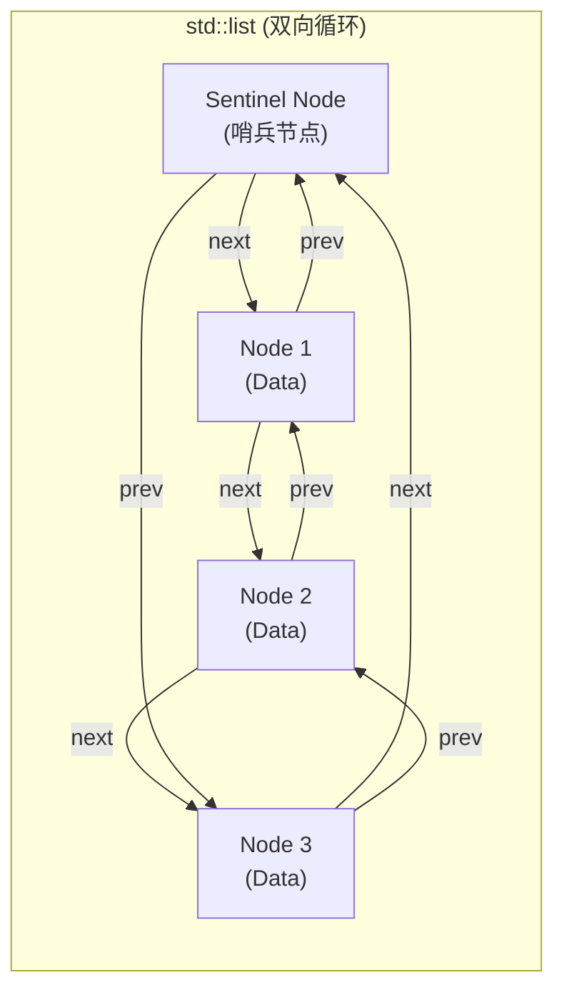

# 第二章 链表 (Linked List)

> 链表是一组通过**指针串联**的非连续物理内存节点。它以牺牲随机访问为代价，换取了动态伸缩与已知节点位置下 **$O(1)$** 的就地增删能力。

---

## 0. 考点优先级概览

根据面试常见考察频次与工程实用度，内容按优先级从高到低组织：

| 优先级 | 分类 | 核心内容 | 重点说明 |
| :--- | :--- | :--- | :--- |
| **P0** | **核心考点** | 链表 vs 数组核心对比、虚拟头节点 (Dummy Head)、单链表反转、Floyd 快慢指针测环 | 面试手撕必考题型与核心机制 |
| **P1** | **进阶原理** | `std::list` 循环双链表与迭代器稳定性、合并有序链表、相交链表、经典算法速查 | 原理深入与双指针高阶应用 |
| **P2** | **工程实践** | 侵入式链表 (Intrusive List)、空闲链表 (Free List) 内存池、多链表挂载管理 | 操作系统与游戏引擎底层架构必问 |
| **P3** | **基础与附录** | `std::forward_list` 特性、复杂度对比总表、手写单链表完整实现（可折叠） | 知识库备忘查阅 |

---

## P0：核心考点

### 1.1 链表 vs 数组对比

| 维度 | 数组 (`std::vector`) | 链表 (`std::list`) |
| :--- | :--- | :--- |
| **物理内存布局** | **连续内存** | **离散分布在堆中** |
| **随机访问 (`arr[i]`)** | **$O(1)$** | $O(n)$（需从头或尾逐个遍历） |
| **已知指针插入/删除** | $O(n)$（需搬迁后续元素） | **$O(1)$**（修改前后指针即可） |
| **头部插入/删除** | $O(n)$ | **$O(1)$** |
| **内存额外开销** | 极低（仅预留 capacity 空闲槽） | **高**（每个节点额外占用 8~16 字节指针与堆元数据） |
| **CPU 缓存命中率** | **高**（Cache Line 空间局部性） | **极差**（指针追逐频繁引发 Cache Miss） |
| **扩容代价** | 需申请新内存并整体搬迁 | 无扩容概念，按需单个 `new` / `delete` |
| **迭代器稳定性** | 扩容时全部失效，删除时后方失效 | **极高**（除被删节点本身外，其余迭代器恒有效） |

---

### 1.2 哨兵技巧：虚拟头节点 (Dummy Head)

在对单链表进行增删操作时，常规做法需要对“操作发生在头节点”进行繁琐的特殊边界处理：
* `head == nullptr` 时的判空。
* 删除头节点时需要更新外部的 `head` 指针。

**虚拟头节点设计**：在堆或栈上分配一个哨兵节点 `dummy`，令 `dummy->next = head`。所有对头节点的操作均退化为**对某个已有节点的后续节点操作**，消除边界判断分支。

```cpp
// 示例：原地删除链表中所有值为 val 的节点
ListNode* removeElements(ListNode* head, int val) {
    ListNode dummy(0); // 栈上分配虚拟头节点，避免额外内存管理
    dummy.next = head;

    ListNode* cur = &dummy;
    while (cur->next) {
        if (cur->next->val == val) {
            ListNode* to_delete = cur->next;
            cur->next = cur->next->next; // 跨过目标节点
            delete to_delete;
        } else {
            cur = cur->next;
        }
    }
    return dummy.next;
}
```

---

### 1.3 核心手撕：单链表反转 (LeetCode 206)

这是链表面试中最基础、最常被要求现场手写的题目。推荐采用三指针（`prev`, `curr`, `next`）迭代法，做到 $O(1)$ 空间原地反转。

```cpp
ListNode* reverseList(ListNode* head) {
    ListNode* prev = nullptr;
    ListNode* curr = head;

    while (curr) {
        ListNode* next = curr->next; // 1. 暂存下一个节点，防止链断裂
        curr->next = prev;           // 2. 指针反向
        prev = curr;                 // 3. prev 前进
        curr = next;                 // 4. curr 前进
    }
    return prev; // 新的头节点
}
```
* **时空复杂度**：时间 $O(n)$，空间 $O(1)$。

---

### 1.4 环检测：Floyd 快慢指针 (LeetCode 141 & 142)

#### 1. 判断是否有环 (LC 141)
定义两个指针：`slow` 每次走 1 步，`fast` 每次走 2 步。若链表中存在环，两者必然在环内相遇；若无环，`fast` 将先遇到 `nullptr`。

#### 2. 寻找入环点 (LC 142)
* **数学推导**：
  设链表头到入环点的非环长度为 $a$，入环点到首次相遇点顺时针距离为 $b$，相遇点继续顺时针走到入环点距离为 $c$（环长为 $b + c$）。
  - 快指针移动距离：$S_{fast} = a + n(b + c) + b$
  - 慢指针移动距离：$S_{slow} = a + b$
  - 因为 $S_{fast} = 2 \times S_{slow}$，故有：
    $$a + n(b + c) + b = 2(a + b) \implies a = (n - 1)(b + c) + c$$
  - 当 $n = 1$ 时简化为：**$a = c$**。
* **结论**：**在快慢指针首次相遇后，让一个指针重回起点 `head`，另一个指针保持在相遇点，两人同时以每次 1 步的速度前进，相遇之处必然是入环点！**

```cpp
ListNode* detectCycle(ListNode* head) {
    ListNode* slow = head;
    ListNode* fast = head;

    // 步骤一：寻找相遇点
    while (fast && fast->next) {
        slow = slow->next;
        fast = fast->next->next;
        if (slow == fast) {
            // 步骤二：重置一个指针到起点，同速前进找入环点
            ListNode* ptr1 = head;
            ListNode* ptr2 = slow;
            while (ptr1 != ptr2) {
                ptr1 = ptr1->next;
                ptr2 = ptr2->next;
            }
            return ptr1; // 返回入环点
        }
    }
    return nullptr; // 无环
}
```

---

### 1.5 常见面试问答要点

* **Q：为什么在中小规模数据遍历时，数组通常比链表快得多？**
  > **回答要点**：核心在于 CPU Cache 的空间局部性。数组内存严格连续，CPU 预取时每次能将整个 Cache Line（64B）读入缓存，后续遍历全在 L1/L2 缓存中完成；而链表各节点通过堆动态分配，内存地址离散分布，遍历每个节点通常都会引发一次指针跳跃与 Cache Miss，访问主存代价极其昂贵。

* **Q：单链表删除节点需要 $O(1)$ 还是 $O(n)$？**
  > **回答要点**：严格区分场景。若仅给定目标值或目标节点本身，由于必须先找到目标节点的“前驱节点”（Predecessor），单链表整体耗时为 $O(n)$；但如果已经拥有前驱指针，或者使用双向链表，纯粹的指针断开与重连操作是 $O(1)$ 的。

* **Q：`std::list` 的迭代器在插入和删除时会失效吗？**
  > **回答要点**：插入操作绝不影响任何现有迭代器；删除操作仅导致指向被删除节点的迭代器失效，其余所有已有迭代器、指针与引用完全不受影响。这与 `std::vector` 在扩容时全量失效形成鲜明对比。

---

## P1：进阶原理与经典算法

### 2.1 `std::list` 底层实现：带哨兵的环形双向链表

标准库的 `std::list` 大多采用**带哨兵头节点的双向循环链表**实现：



* **统一性**：空表状态下，哨兵节点的 `next` 和 `prev` 均指向自身。插入首尾节点无需特殊判断分支。
* **节点结构**：每个节点承载两个 64 位指针（`prev` 和 `next`），对于存储小对象（如 `int`、`char`），指针本身的内存开销远大于有效载荷。

---

### 2.2 相交链表 (LeetCode 160)

* **问题**：给定两个单链表头 `headA` 和 `headB`，找出它们相交的起始节点。
* **双指针等长遍历思想**：
  若 A 长度为 $a+c$，B 长度为 $b+c$（$c$ 为相交公共段长度）。
  指针 $pA$ 遍历完 A 后跳到 B 的头部；指针 $pB$ 遍历完 B 后跳到 A 的头部。
  两者走过的总距离均为 $a + c + b$，因此在第二轮遍历时，两人必然在相交起始点相遇；若不相交，最终同时指向 `nullptr`。

```cpp
ListNode* getIntersectionNode(ListNode* headA, ListNode* headB) {
    if (!headA || !headB) return nullptr;
    ListNode* pA = headA;
    ListNode* pB = headB;
    while (pA != pB) {
        pA = pA ? pA->next : headB;
        pB = pB ? pB->next : headA;
    }
    return pA;
}
```

---

### 2.3 链表高频算法思路速查

| 题目 | 难度 | 核心思路 |
| :--- | :--- | :--- |
| **LC 21. 合并两个有序链表** | Easy | 借助虚拟头节点，双指针比对较小值依次串接至尾部。 |
| **LC 83. 删除排序链表中的重复元素** | Easy | 单指针遍历，当 `cur->val == cur->next->val` 时跳过下一节点并释放。 |
| **LC 19. 删除链表的倒数第 N 个结点** | Medium | 快慢指针：快指针先走 $N$ 步，随后快慢指针同速前进，快指针到达末尾时慢指针刚好在待删节点前驱。 |
| **LC 92. 反转链表 II** | Medium | 虚拟头节点定位到反转区间前驱，通过头插法逐个将区间内后续节点调至区间头部。 |
| **LC 23. 合并 K 个升序链表** | Hard | 小顶堆（优先队列）：将各链表当前头节点放入堆中，每次取出最小者后将其 `next` 重新入堆，复杂度 $O(N \log K)$。 |
| **LC 25. K 个一组翻转链表** | Hard | 递归或迭代先探测后续是否存在长度为 $K$ 的子段，存在则反转并与后续处理结果拼接，不足 $K$ 则保持原样返回。 |

---

## P2：工程实践与性能优化

### 3.1 侵入式链表 (Intrusive Linked List)

在 Linux 内核（`list_head`）和游戏引擎（Unreal Engine `TIntrusiveLinkedList`）中，**几乎不使用 `std::list`，而是全面采用侵入式链表**。

#### 1. 传统非侵入式 (`std::list`) vs 侵入式
* **非侵入式**：链表节点与数据对象分别独立分配。对象放入链表时，需额外动态申请一个包裹节点（`Node<T>`），包含 `prev`、`next` 指针和数据副本/引用。每次加入链表都是一次堆内存分配。
* **侵入式**：链表的指针 Hook（`prev`/`next`）**直接内嵌在业务对象类的数据结构内部**。

```
非侵入式：
[std::list::Node] ---> 堆上独立申请 [Actor Data]

侵入式：
[Actor Data 内部包含: { prev, next, hp, position, ... }]
```

#### 2. 侵入式链表的三大工程优势
1. **零额外内存分配**：数据对象创建时 Hook 随之就地存在，加入链表无需任何堆分配。
2. **$O(1)$ 自我脱链**：当一个实体被判定死亡需要移除时，由于 Hook 本就在实体身上，该实体**无需查找容器，自己就能将自己从链表中断开**。
3. **多链表同时共存**：一个对象内部可内嵌多个不同名称的 Hook（例如 `visible_hook` 与 `collision_hook`），使其能够零成本同时挂在多个系统链表中。

<details>
<summary>👉 查看侵入式链表 (Intrusive List) C++ 参考实现</summary>

```cpp
#include <iostream>

// 侵入式节点基类 (Hook)
struct ListNodeHook {
    ListNodeHook* prev = nullptr;
    ListNodeHook* next = nullptr;

    bool is_linked() const { return next != nullptr; }

    void unlink() {
        if (!is_linked()) return;
        prev->next = next;
        next->prev = prev;
        prev = nullptr;
        next = nullptr;
    }
};

// 侵入式链表容器
class IntrusiveList {
    ListNodeHook _head; // 哨兵

public:
    IntrusiveList() {
        _head.next = &_head;
        _head.prev = &_head;
    }

    void push_back(ListNodeHook* node) {
        node->unlink(); // 若已在其他位置，先脱链
        node->next = &_head;
        node->prev = _head.prev;
        _head.prev->next = node;
        _head.prev = node;
    }
};

// 业务类直接继承 Hook 或内嵌 Hook
struct Monster : public ListNodeHook {
    std::string name;
    int hp;
    Monster(std::string n, int h) : name(std::move(n)), hp(h) {}
};
```
</details>

---

### 3.2 空闲链表 (Free List) 与内存分配器

自定义内存池（Memory Pool）与对象池通常利用空闲链表追踪未分配的内存槽位。
* **技巧：Union 内存复用**
  在空闲状态下，内存槽位内存储的是指向下一个空闲槽位的指针；一旦分配给业务，该槽位被重解释为业务数据。**不需要为链表指针开辟任何额外存储空间**。

---

## P3：基础原理与参考实现

### 4.1 `std::forward_list` 单向链表

* **零额外开销**：C++11 引入的单向链表，内存占用与手写 C 单链表完全一致。
* **无 `size()` 接口**：为了坚守“零额外开销原则”，没有维护内部计数器变量（如果提供则每次增删都多一次同步开销，若遍历计算则违背 $O(1)$ 认知）。
* **`insert_after` 设计**：由于单链表无法获取前驱，其插入和删除接口均为向后操作（`insert_after`、`erase_after`）。

---

### 4.2 复杂度横向对比总表

| 数据结构 | 随机访问 | 头部插入/删除 | 尾部插入/删除 | 已知位置插入/删除 | 内存碎片率 |
| :--- | :--- | :--- | :--- | :--- | :--- |
| **`std::vector`** | **$O(1)$** | $O(n)$ | **$O(1)$ 均摊** | $O(n)$ | 较低（整块扩容） |
| **`std::forward_list`** | $O(n)$ | **$O(1)$** | $O(n)$ (无尾指针) | **$O(1)$** (`after`) | 较高（频繁单个 new） |
| **`std::list`** | $O(n)$ | **$O(1)$** | **$O(1)$** | **$O(1)$** | 较高（频繁单个 new） |
| **侵入式链表** | $O(n)$ | **$O(1)$** | **$O(1)$** | **$O(1)$** | **极低（对象内嵌 Hook）** |

---

### 4.3 手写泛型单链表完整实现

<details>
<summary>👉 查看手写单链表完整 C++ 模板实现代码</summary>

```cpp
#include <iostream>
#include <stdexcept>

template <typename T>
class SinglyLinkedList {
    struct Node {
        T data;
        Node* next;
        Node(const T& val, Node* n = nullptr) : data(val), next(n) {}
    };

    Node* _head = nullptr;
    std::size_t _size = 0;

public:
    SinglyLinkedList() = default;
    ~SinglyLinkedList() { clear(); }

    void push_front(const T& value) {
        _head = new Node(value, _head);
        ++_size;
    }

    bool pop_front() {
        if (!_head) return false;
        Node* old = _head;
        _head = _head->next;
        delete old;
        --_size;
        return true;
    }

    void clear() {
        while (pop_front());
    }

    std::size_t size() const { return _size; }
    bool empty() const { return _head == nullptr; }
};
```
</details>

---

> 📖 下一章：[第三章 栈：后进先出的秩序](../03_stack/) —— 从函数调用栈到单调栈，从括号匹配到游戏中的 UI 导航与状态机管理。
