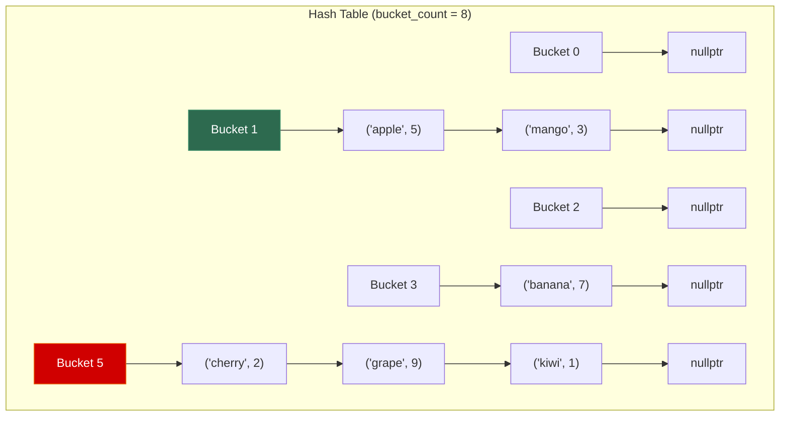

# 第五章 哈希表 (Hash Table)

> 哈希表通过**哈希函数**将 Key 映射到数组下标，在平均情况下以 **$O(1)$** 的时间复杂度完成增删查操作。

---

## 0. 考点优先级概览

根据面试常见考察频次与工程实用度，内容按优先级从高到低组织：

| 优先级 | 分类 | 核心内容 | 重点说明 |
| :--- | :--- | :--- | :--- |
| **P0** | **核心考点** | `unordered_map` vs `map`、冲突解决策略、Rehash 机制、自定义 Key、高频问答 | 基础必考，侧重底层机制与选型对比 |
| **P1** | **进阶原理** | 最坏情况与防碰撞、删除与墓碑标记、LRU Cache、一致性哈希、经典算法思路 | 深入原理与经典复合结构手写 |
| **P2** | **工程实践** | 缓存局部性分析、Flat Hash / Robin Hood、空间哈希 (Spatial Hashing) | 关注工业级场景下的性能调优 |
| **P3** | **基础与附录** | 常见哈希算法特性、各数据结构复杂度对比、开放寻址完整代码实现（可折叠） | 知识库备忘，需要时查阅 |

---

## P0：核心考点

### 1.1 `std::unordered_map` vs `std::map` 对比

| 维度 | `std::map` (红黑树) | `std::unordered_map` (哈希表) |
| :--- | :--- | :--- |
| **底层实现** | 自平衡二叉搜索树（红黑树） | 桶数组 + 单链表（链地址法） |
| **平均增/删/查** | $O(\log n)$ | **$O(1)$** 均摊 |
| **最坏时间复杂度** | $O(\log n)$ | $O(n)$（发生极端冲突时） |
| **元素有序性** | **严格有序**（按 Key 升序） | **无序** |
| **范围查询** | 支持（`lower_bound` / `upper_bound`） | 不支持（只能全表线性扫描） |
| **迭代器稳定性** | 增删节点不影响其他迭代器 | Rehash 时所有迭代器失效 |
| **内存开销** | 每个节点存父/左/右指针与颜色，较固定 | 桶指针数组 + 链表节点 + 负载因子预留 |
| **Key 的要求** | 需支持严格弱序（重载 `<`） | 需提供哈希函数（`std::hash`）与相等判定（`operator==`） |
| **CPU 缓存友好度** | 差（树节点分散在堆中） | 差（链表节点分散在堆中） |
| **适用场景** | 需要按顺序遍历或范围查询 | 绝大多数场景，仅需精确键值查找 |

```cpp
// 场景 1：需要范围查询或有序遍历 → std::map
std::map<int, std::string> score_rank;
auto it = score_rank.lower_bound(60); // 快速定位第一个 >= 60 分的元素

// 场景 2：海量高频精确定位 → std::unordered_map
std::unordered_map<uint64_t, PlayerData> players;
if (auto it = players.find(player_id); it != players.end()) {
    // 均摊 O(1) 查找
}
```

> 💡 **选型总结**：需要有序遍历或范围查找时选 `map`；仅需精确查找且追求执行速度时选 `unordered_map`。

---

### 1.2 哈希冲突两大解决策略

哈希函数将大范围 Key 映射到有限桶下标时，根据鸽巢原理必然会产生冲突。主流处理策略有两种：

#### 1. 链地址法 (Separate Chaining) —— `std::unordered_map` 默认实现
每个桶维护一个单链表头指针。映射到同一桶下标的元素以链表节点形式挂载。



#### 2. 开放寻址法 (Open Addressing)
数据直接存储在一维连续数组中，不外挂链表。发生冲突时按既定探测方式（线性探测、二次探测等）寻找下一个可用槽位。

```
[1] 占满 → 冲突 → 探测槽位 [2] → 为空 → 写入 [2]
```

#### 3. 对比总结

| 维度 | 链地址法 (Separate Chaining) | 开放寻址法 (Open Addressing) |
| :--- | :--- | :--- |
| **内存结构** | 指针数组 + 堆上分散链表节点 | **单块连续数组** |
| **缓存局部性** | 差（指针跳跃，Cache Miss 较多） | **优（连续内存，利于 CPU 预取）** |
| **负载因子承受上限** | 可以 $\ge 1.0$（链表可无限增长） | **必须 $< 1.0$**（通常建议 $\le 0.7$） |
| **删除操作** | 正常单链表节点删除 | 不能直接置空，需设 `DELETED` 标记 |
| **典型代表** | `std::unordered_map`、Java `HashMap` | Google `absl::flat_hash_map`、Rust `HashMap` |

---

### 1.3 扩容与 Rehash 机制

#### 1. 负载因子 (Load Factor)
$$\alpha = \frac{\text{元素总数 (size)}}{\text{桶总数 (bucket\_count)}}$$
* `load_factor()`：当前实际负载因子。
* `max_load_factor()`：触发扩容的阈值，STL 默认通常为 `1.0`。

#### 2. Rehash 触发流程
当插入新元素导致 `load_factor() >= max_load_factor()` 时，哈希表自动扩容：
1. 分配约 2 倍大小的新桶数组（通常取下一个质数）。
2. 遍历旧桶中的所有节点，用新桶数重新取模并移动到新桶。
3. 释放旧桶数组内存。

| 场景 | 时间复杂度 | 说明 |
| :--- | :--- | :--- |
| **单次触发 Rehash** | **$O(n)$** | 需搬运现有全部元素 |
| **均摊时间复杂度** | **$O(1)$** | 翻倍扩容策略下的均摊分析 |

#### 3. 使用 `reserve()` 预分配优化性能
如果能预估插入的元素总量，提前调用 `reserve` 可以避免运行时的多次扩容与数据搬迁。

```cpp
std::unordered_map<int, int> map;

// 推荐：提前分配容量，避免中途多次 Rehash
map.reserve(1000000);
for (int i = 0; i < 1000000; ++i) {
    map[i] = i;
}
```

---

### 1.4 自定义类型作为 Key

使用自定义结构体作为 `unordered_map` 或 `unordered_set` 的 Key 时，必须同时提供两项定义：
1. **相等比较**：重载 `operator==`（用于在桶内确定是否为同一个 Key）。
2. **哈希计算**：特化 `std::hash<T>` 或提供自定义哈希仿函数。

```cpp
#include <iostream>
#include <unordered_map>
#include <string>

struct PlayerKey {
    int zone_id;
    uint64_t uid;

    // 1. 重载 operator==
    bool operator==(const PlayerKey& other) const {
        return zone_id == other.zone_id && uid == other.uid;
    }
};

// 2. 特化 std::hash
namespace std {
    template <>
    struct hash<PlayerKey> {
        std::size_t operator()(const PlayerKey& k) const noexcept {
            std::size_t h1 = std::hash<int>{}(k.zone_id);
            std::size_t h2 = std::hash<uint64_t>{}(k.uid);
            // 0x9e3779b9 来自黄金分割比，常用于 hash_combine 减少位冲突
            return h1 ^ (h2 + 0x9e3779b9 + (h1 << 6) + (h1 >> 2));
        }
    };
}

int main() {
    std::unordered_map<PlayerKey, std::string> player_table;
    player_table[{101, 9527}] = "Warrior"; // 正常使用
    return 0;
}
```

> ⚠️ **注意**：`std::pair<int, int>` 默认不能直接作为 `unordered_map` 的 Key，因为标准库未为其提供 `std::hash` 特化版本，需要手动传递哈希仿函数。

---

### 1.5 常见面试问答要点

* **Q：哈希表的底层原理与增删查复杂度？**
  > **回答要点**：哈希表通过哈希函数将键映射为数组索引，平均与均摊增删查均为 $O(1)$。发生哈希冲突时采用链地址法或开放寻址法解决。在极端恶化情况下（全部元素冲突在同一位置）退化为 $O(n)$。

* **Q：什么是 Rehash？何时触发？如何避免开销？**
  > **回答要点**：当元素数量与桶数量的比值（负载因子）超过阈值时触发。容器会申请两倍左右的新桶数组，并将所有旧元素重新哈希放置。单次代价为 $O(n)$，均摊为 $O(1)$。可通过预估数据量并在写入前调用 `reserve()` 消除多次扩容开销。

* **Q：`std::map` 与 `std::unordered_map` 该如何选型？**
  > **回答要点**：常规精确匹配查找优先选 `unordered_map`（均摊 $O(1)$，效率更高）。若业务依赖 Key 的有序遍历或范围查找（如 `lower_bound`），则必须选用底层基于红黑树的 `std::map`（$O(\log n)$）。

* **Q：自定义结构体做 Key 需要满足什么条件？**
  > **回答要点**：必须提供 `operator==`（判断同桶内的 Key 相等性）以及哈希函数（通常特化 `std::hash<T>`）。若有多个成员字段，可通过异或与位移进行 Hash Combine 组合。

---

## P1：进阶原理与经典算法

### 2.1 哈希表的最坏情况 $O(n)$ 与 Hash-DoS

* **退化原因**：
  若哈希函数质量差，或数据集分布极端，导致全部元素计算出的桶索引完全一致，哈希表退化为单链表，查找复杂度变为 $O(n)$。
* **Hash-DoS（哈希碰撞拒绝服务）**：
  攻击者若获知服务端使用的哈希算法（如早期未加盐的固定哈希），可构造大量同哈希值的参数发起请求，导致服务端哈希表插入耗时飙升至 $O(n^2)$，耗尽 CPU 资源。
* **防范方案**：
  使用带随机密钥（Seed）的抗碰撞哈希算法（例如 Python 和 Rust 使用的 SipHash），每次程序启动时种子随机，外界无法预先构造碰撞数据。

---

### 2.2 开放寻址法的删除与墓碑标记 (Tombstone)

在开放寻址法（如线性探测）中，删除元素**不能直接将槽位重置为空 (`EMPTY`)**。

```
初始状态：
槽位:  [0]    [1]    [2]    [3]
数据:  Empty  A:5    B:9    C:1
说明:  A, B, C 初始哈希均为 1，通过线性探测依次排在 1, 2, 3

若直接置空 B:
槽位:  [0]    [1]    [2]    [3]
数据:  Empty  A:5   Empty   C:1

查找 C 时:
hash(C) = 1 → 检查 [1] 是 A（不符）
           → 探测 [2]，发现是 Empty！
           → 算法判定 C 不存在，提前返回！导致 C 无法被查到。
```

* **墓碑标记机制**：
  槽位采用三态管理：`EMPTY`（未用）、`OCCUPIED`（有效）、`DELETED`（墓碑标记）。
  - **查找时**：遇到 `DELETED` 视同有冲突，**继续向后探测**。
  - **插入时**：遇到 `DELETED` 可复用该槽位写入新数据。
  - **扩容清理**：当发生扩容重排时，所有 `DELETED` 标记均被丢弃，恢复数组紧凑度。

---

### 2.3 手写经典题：LRU Cache (LeetCode 146)

LRU 缓存机制是哈希表与双向链表结合的经典应用：
* **哈希表**（`unordered_map<int, Node*>`）：负责根据 Key 进行 $O(1)$ 的节点定位。
* **双向链表**：负责以 $O(1)$ 代价将最近访问的节点移到表头，并在超额时从表尾淘汰最久未使用节点。

```cpp
#include <unordered_map>

class LRUCache {
    struct Node {
        int key, val;
        Node* prev = nullptr;
        Node* next = nullptr;
        Node(int k, int v) : key(k), val(v) {}
    };

    int _capacity;
    std::unordered_map<int, Node*> _map;
    Node* _head; // 虚拟头
    Node* _tail; // 虚拟尾

    void _remove(Node* node) {
        node->prev->next = node->next;
        node->next->prev = node->prev;
    }

    void _push_front(Node* node) {
        node->next = _head->next;
        node->prev = _head;
        _head->next->prev = node;
        _head->next = node;
    }

public:
    LRUCache(int capacity) : _capacity(capacity) {
        _head = new Node(0, 0);
        _tail = new Node(0, 0);
        _head->next = _tail;
        _tail->prev = _head;
    }

    int get(int key) {
        auto it = _map.find(key);
        if (it == _map.end()) return -1;
        _remove(it->second);
        _push_front(it->second); // 标记为最近使用
        return it->second->val;
    }

    void put(int key, int value) {
        if (auto it = _map.find(key); it != _map.end()) {
            it->second->val = value;
            _remove(it->second);
            _push_front(it->second);
            return;
        }

        if (static_cast<int>(_map.size()) >= _capacity) {
            Node* lru = _tail->prev; // 淘汰尾部
            _remove(lru);
            _map.erase(lru->key);
            delete lru;
        }

        Node* new_node = new Node(key, value);
        _map[key] = new_node;
        _push_front(new_node);
    }
};
```
* **复杂度**：`get` 与 `put` 均为 **$O(1)$**，空间复杂度为 $O(\text{capacity})$。

---

### 2.4 分布式概念：一致性哈希 (Consistent Hashing)

* **传统取模的缺陷**：
  若采用 `hash(key) % N` 分布数据，当机器增减（$N$ 变化）时，几乎所有数据项都会重新映射，导致大规模缓存失效。
* **一致性哈希环**：
  哈希空间首尾相接成环（$0 \sim 2^{32}-1$），节点与数据 Key 均映射在环上。数据顺时针寻找到的第一个节点即为其归属节点。
  * **增删机器**：只影响新节点到逆时针前一个节点之间的数据，平均仅需重迁约 $\frac{1}{N}$ 的数据。
  * **虚拟节点 (Virtual Nodes)**：为每台物理节点分配多个虚拟节点均匀分布于环上，解决节点较少时的数据倾斜问题。

```cpp
// 核心逻辑：利用 std::map 有序性维护哈希环
class ConsistentHashRing {
    std::map<uint32_t, std::string> _ring;

public:
    std::string get_server(const std::string& key) const {
        if (_ring.empty()) return "";
        uint32_t h = std::hash<std::string>{}(key);
        auto it = _ring.lower_bound(h); // 顺时针找第一个 >= h 的节点
        if (it == _ring.end()) it = _ring.begin(); // 回到环首
        return it->second;
    }
};
```

---

### 2.5 经典面试题目思路速查

| 题目 | 难度 | 核心思路 |
| :--- | :--- | :--- |
| **LC 1. 两数之和** | Easy | 遍历时将数字存入哈希表，同时检查 `target - num` 是否已存在。 |
| **LC 128. 最长连续序列** | Medium | 数据存入哈希集合，遍历时**仅在数字为序列起点**（`!set.count(x - 1)`）时才向后计数，保持 $O(n)$。 |
| **LC 49. 字母异位词分组** | Medium | 将字符排序后的字符串（或 26 位频次特征）作为哈希表的 Key。 |
| **LC 3. 无重复字符的最长子串** | Medium | 滑动窗口搭配哈希表记录字符最新索引，出现重复时左指针直接向右跳跃。 |
| **LC 36. 有效的数独** | Medium | 用三组哈希集合分别记录行、列和 $3 \times 3$ 宫格内的数字出现情况。 |
| **LC 560. 和为 K 的子数组** | Medium | 前缀和 + 哈希表：哈希表记录各前缀和出现次数，查询 `prefix_sum - k` 的频次。 |

---

## P2：工程实践与性能优化

### 3.1 实际工程中为何常替换 `std::unordered_map`？

在追求极致性能的工业级库（Google Abseil、EA EASTL、游戏引擎）中，标准库的 `std::unordered_map` 经常被平坦哈希表替代，主要原因如下：
1. **Cache Miss 严重**：
   标准库强制采用链地址法，每个节点由单独的堆内存分配产生。遍历或查找时沿链表跳转，引发频繁的 CPU 高速缓存缺失。
2. **内存开销大且碎片化**：
   每个节点需额外承载指针开销和内存对齐填充，对于小型基本类型键值对，有效载荷占比较低，且频繁申请堆内存产生大量碎片。
3. **空桶遍历开销**：
   在迭代器遍历时必须扫过所有桶槽位，哪怕大部分桶处于空闲状态。

---

### 3.2 现代高性能哈希：Flat Hash Map 与 Robin Hood Hashing

为了兼顾 $O(1)$ 查询与缓存连续性，现代实现多使用基于紧凑数组的开放寻址方案：

* **Flat Hash Map（如 Google `absl::flat_hash_map`）**：
  数据平铺于连续数组中，利用 SIMD 指令并发比对多个槽位的元数据控制字节，显著降低单次探测周期的耗时。
* **Robin Hood Hashing（知贫济富哈希）**：
  - 记录每个元素与其理想槽位的**探测距离**。
  - 插入时，若新元素的探测距离大于当前槽内已有元素的探测距离，则**抢占该槽**，将被挤出的元素继续向后探测安置。
  - 使得整个容器内所有元素的探测距离方差最小化，且查找失败时可根据探测距离提前终止。

---

### 3.3 空间哈希 (Spatial Hashing) 在游戏中的应用

在游戏物理与渲染中，大量实体互相进行碰撞检测若采用暴力双重循环复杂度为 $O(n^2)$。
**空间哈希**将二维/三维空间划分成固定大小的网格，把网格坐标编码后作为 Key，将实体分配到各网格桶中。检测时只需检测实体自身及相邻网格中的对象，将复杂度降低至接近 **$O(n)$**。

<details>
<summary>👉 查看 2D 空间哈希参考实现代码</summary>

```cpp
#include <unordered_map>
#include <vector>
#include <cmath>
#include <cstdint>
#include <algorithm>

struct AABB {
    float x, y, w, h;
};

class SpatialHash {
    float _cell_size;
    std::unordered_map<int64_t, std::vector<uint32_t>> _grid;

    int64_t _encode(int gx, int gy) const {
        return (static_cast<int64_t>(gx) << 32) | static_cast<uint32_t>(gy);
    }

    int _to_grid(float coord) const {
        return static_cast<int>(std::floor(coord / _cell_size));
    }

public:
    SpatialHash(float cell_size = 64.0f) : _cell_size(cell_size) {}

    void clear() { _grid.clear(); }

    void insert(uint32_t entity_id, const AABB& aabb) {
        int min_gx = _to_grid(aabb.x - aabb.w / 2.0f);
        int max_gx = _to_grid(aabb.x + aabb.w / 2.0f);
        int min_gy = _to_grid(aabb.y - aabb.h / 2.0f);
        int max_gy = _to_grid(aabb.y + aabb.h / 2.0f);

        for (int gx = min_gx; gx <= max_gx; ++gx) {
            for (int gy = min_gy; gy <= max_gy; ++gy) {
                _grid[_encode(gx, gy)].push_back(entity_id);
            }
        }
    }

    std::vector<uint32_t> query_candidates(const AABB& aabb) const {
        std::vector<uint32_t> candidates;
        int min_gx = _to_grid(aabb.x - aabb.w / 2.0f);
        int max_gx = _to_grid(aabb.x + aabb.w / 2.0f);
        int min_gy = _to_grid(aabb.y - aabb.h / 2.0f);
        int max_gy = _to_grid(aabb.y + aabb.h / 2.0f);

        for (int gx = min_gx; gx <= max_gx; ++gx) {
            for (int gy = min_gy; gy <= max_gy; ++gy) {
                if (auto it = _grid.find(_encode(gx, gy)); it != _grid.end()) {
                    candidates.insert(candidates.end(), it->second.begin(), it->second.end());
                }
            }
        }
        std::sort(candidates.begin(), candidates.end());
        candidates.erase(std::unique(candidates.begin(), candidates.end()), candidates.end());
        return candidates;
    }
};
```
</details>

---

### 3.4 常见业务架构组件

1. **资源管理器 (Resource Manager)**：通过虚拟资源路径查找已加载资产对象（如纹理、网格），常配合引用计数进行自动卸载与垃圾回收。
2. **配置表热加载 (Config Hot Reload)**：配置文件加载为多级哈希表，通过监听文件修改时间，在运行时重新载入并重置索引。
3. **数据库索引设计对比（为何 InnoDB 默认使用 B+ 树而非哈希索引？）**：
   业务查询中包含大量 `BETWEEN` 范围筛选、`ORDER BY` 排序以及前缀模糊匹配，哈希索引仅能支持等值查找，无法支持范围遍历。

<details>
<summary>👉 查看简易资源管理器代码框架</summary>

```cpp
#include <unordered_map>
#include <memory>
#include <string>

class Resource { public: virtual ~Resource() = default; };

class ResourceManager {
    std::unordered_map<std::string, std::shared_ptr<Resource>> _cache;

public:
    template <typename T>
    std::shared_ptr<T> load(const std::string& path) {
        if (auto it = _cache.find(path); it != _cache.end()) {
            return std::dynamic_pointer_cast<T>(it->second);
        }
        auto res = std::make_shared<T>();
        _cache[path] = res;
        return res;
    }

    void garbage_collect() {
        for (auto it = _cache.begin(); it != _cache.end(); ) {
            if (it->second.use_count() == 1) { // 仅 cache 持有时回收
                it = _cache.erase(it);
            } else {
                ++it;
            }
        }
    }
};
```
</details>

---

## P3：基础原理与参考实现

### 4.1 基础概念：What & Why

在海量数据映射场景下：
- **普通数组**：当下标范围极其分散时（如 64 位整型 ID），无法分配如此巨大的连续内存。
- **有序数组 / 树**：查找开销为 $O(\log n)$，在极高频访问时仍有性能开销。
- **哈希表**：利用哈希函数将大范围 Key 散列映射到有限的槽位区间，实现均摊 $O(1)$ 的直接定位。

**合格哈希函数的特点**：
1. **确定性**：相同输入必然输出相同哈希值。
2. **分布均匀**：哈希值在值域空间内尽可能平坦散列。
3. **计算快速**：运算开销尽可能低。

---

### 4.2 常见哈希算法特性对比

| 哈希算法 | 特点 | 常见应用 |
| :--- | :--- | :--- |
| **FNV-1a** | 代码极简，少量位异或与乘质数，散列均匀 | GCC/Clang `std::hash<string>` 内部实现 |
| **MurmurHash3** | 性能优异，雪崩效应好 | Redis、Kafka 等分布式中间件 |
| **xxHash** | 结合 SIMD 优化，吞吐极高 | 文件校验、资产完整性检查 |
| **SipHash** | 伪随机抗碰撞 | Python `dict`、Rust `HashMap`（抵御 Hash-DoS） |

```cpp
// FNV-1a 参考实现
inline std::size_t fnv1a_hash(const std::string& str) {
    std::size_t hash = 14695981039346656037ULL;
    for (char c : str) {
        hash ^= static_cast<std::size_t>(c);
        hash *= 1099511628211ULL;
    }
    return hash;
}
```

---

### 4.3 复杂度速查总表

#### 1. `std::unordered_map` API 复杂度
* `find` / `count` / `operator[]`：平均 **$O(1)$**，最坏 $O(n)$。
* `insert` / `erase`：平均 **$O(1)$**，触发 Rehash 时单次 $O(n)$。
* `size` / `empty`：**$O(1)$**。
* 全表迭代：$O(n + \text{bucket\_count})$。

#### 2. 六大查找结构对比
| 数据结构 | 精确查找 | 范围查找 | 插入 | 删除 | 顺序性 | 内存消耗 |
| :--- | :--- | :--- | :--- | :--- | :--- | :--- |
| **有序数组** | $O(\log n)$ | $O(\log n + k)$ | $O(n)$ | $O(n)$ | 有序 | 最紧凑 |
| **`std::map` (红黑树)** | $O(\log n)$ | $O(\log n + k)$ | $O(\log n)$ | $O(\log n)$ | 有序 | 较高 |
| **`std::unordered_map`** | **$O(1)$** | 不支持 | **$O(1)$ 均摊** | **$O(1)$** | 无序 | 中等 |
| **跳表 (SkipList)** | $O(\log n)$ | $O(\log n + k)$ | $O(\log n)$ | $O(\log n)$ | 有序 | 中等 |
| **B+ 树** | $O(\log n)$ | $O(\log n + k)$ | $O(\log n)$ | $O(\log n)$ | 有序 | 紧凑（块对齐） |
| **字典树 (Trie)** | $O(m)$ 前缀 | 支持前缀匹配 | $O(m)$ | $O(m)$ | 有序 | 高 |

---

### 4.4 从零手写开放寻址哈希表参考实现

<details>
<summary>👉 查看完整开放寻址哈希表 C++ 实现源码（含三态标记与自动扩容）</summary>

```cpp
#include <vector>
#include <functional>
#include <stdexcept>
#include <cstdint>

template <typename Key, typename Value, typename Hash = std::hash<Key>>
class OpenAddressHashMap {
    enum class State : uint8_t { EMPTY, OCCUPIED, DELETED };

    struct Slot {
        Key   key;
        Value value;
        State state = State::EMPTY;
    };

    std::vector<Slot> _slots;
    std::size_t _size = 0;
    std::size_t _capacity;
    Hash _hasher;

    static constexpr float MAX_LOAD = 0.7f;

    std::size_t _probe(std::size_t hash) const { return hash % _capacity; }
    std::size_t _next(std::size_t idx) const { return (idx + 1) % _capacity; }

public:
    OpenAddressHashMap(std::size_t cap = 16) : _slots(cap), _capacity(cap) {}

    Value* find(const Key& key) {
        std::size_t idx = _probe(_hasher(key));
        for (std::size_t i = 0; i < _capacity; ++i) {
            if (_slots[idx].state == State::EMPTY) return nullptr;
            if (_slots[idx].state == State::OCCUPIED && _slots[idx].key == key) {
                return &_slots[idx].value;
            }
            idx = _next(idx);
        }
        return nullptr;
    }

    void insert(const Key& key, const Value& value) {
        if (static_cast<float>(_size + 1) / _capacity >= MAX_LOAD) {
            _grow();
        }
        std::size_t idx = _probe(_hasher(key));
        while (true) {
            if (_slots[idx].state != State::OCCUPIED) {
                _slots[idx] = {key, value, State::OCCUPIED};
                ++_size;
                return;
            }
            if (_slots[idx].key == key) {
                _slots[idx].value = value;
                return;
            }
            idx = _next(idx);
        }
    }

    bool erase(const Key& key) {
        std::size_t idx = _probe(_hasher(key));
        for (std::size_t i = 0; i < _capacity; ++i) {
            if (_slots[idx].state == State::EMPTY) return false;
            if (_slots[idx].state == State::OCCUPIED && _slots[idx].key == key) {
                _slots[idx].state = State::DELETED; // 标记删除
                --_size;
                return true;
            }
            idx = _next(idx);
        }
        return false;
    }

private:
    void _grow() {
        std::size_t new_cap = _capacity * 2;
        std::vector<Slot> new_slots(new_cap);
        for (auto& slot : _slots) {
            if (slot.state == State::OCCUPIED) {
                std::size_t idx = _hasher(slot.key) % new_cap;
                while (new_slots[idx].state == State::OCCUPIED) {
                    idx = (idx + 1) % new_cap;
                }
                new_slots[idx] = {std::move(slot.key), std::move(slot.value), State::OCCUPIED};
            }
        }
        _slots = std::move(new_slots);
        _capacity = new_cap;
    }
};
```
</details>

---

> 📖 下一章：[第六章 树：层级世界的骨架](../tree/) —— 从二叉树遍历到 AVL 旋转，从红黑树到堆排序，再到游戏引擎中的场景树、骨骼动画与定时器管理。
