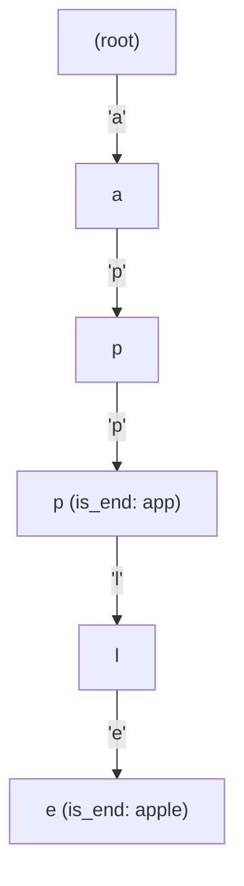

# 第八章 前缀树 (Trie / 字典树)

> 前缀树是一种多叉树结构，用于高效存储和检索字符串集合。其核心特点是**利用公共前缀减少查询时间并避免无谓比较**，所有核心操作的时间复杂度仅与**目标字符串长度 $L$ 相关，与词库规模 $N$ 完全无关**。

---

## 0. 考点优先级概览

根据面试常见考察频次与工程实用度，内容按优先级组织如下：

| 优先级 | 分类 | 核心内容 | 重点说明 |
| :--- | :--- | :--- | :--- |
| **P0** | **核心考点** | Trie 节点结构设计、`insert`/`search`/`startsWith` 手写实现、Trie vs 哈希表对比 | 基础概念与标准手撕模板 |
| **P1** | **进阶算法与变体** | 单词搜索 II (Trie + 回溯剪枝)、带通配符查找、前缀计数变体、0-1 Trie | 经典难题优化与扩展应用 |
| **P2** | **工程实践** | 游戏敏感词过滤 (DFA 算法基石)、控制台命令补全、基数树 (Radix Tree) 压缩 | 实际文本系统与性能调优 |
| **P3** | **基础与附录** | 字符集实现对比、各检索结构复杂度总表、固定数组版完整源码（可折叠） | 知识库查阅备忘 |

---

## P0：核心考点

### 1.1 Trie 节点结构与核心设计

Trie 的每个节点代表一个字符串状态，路径上的字符转移构成了具体的键值：



* **核心成员**：
  1. `children`：子节点指针集合（若限定小写英文字母，通常使用 `std::array<TrieNode*, 26>`）。
  2. `is_end`：布尔标记，表示从根到当前节点是否构成一个**完整的独立单词**（区分“前缀”与“完整词”）。

---

### 1.2 核心手撕：实现 Trie 树 (LeetCode 208)

面试中要求手写 Trie 树时，标准小写字母数组版本是最受青睐的写法：

```cpp
#include <array>
#include <string>

class Trie {
    struct Node {
        std::array<Node*, 26> children{};
        bool is_end = false;
    };

    Node* _root;

public:
    Trie() : _root(new Node()) {}

    // 1. 插入单词：时间复杂度 O(L)
    void insert(const std::string& word) {
        Node* cur = _root;
        for (char c : word) {
            int idx = c - 'a';
            if (!cur->children[idx]) {
                cur->children[idx] = new Node();
            }
            cur = cur->children[idx];
        }
        cur->is_end = true;
    }

    // 2. 精确查找完整单词：时间复杂度 O(L)
    bool search(const std::string& word) const {
        Node* cur = _root;
        for (char c : word) {
            int idx = c - 'a';
            if (!cur->children[idx]) return false;
            cur = cur->children[idx];
        }
        return cur->is_end;
    }

    // 3. 判断是否存在以 prefix 为前缀的词：时间复杂度 O(L)
    bool startsWith(const std::string& prefix) const {
        Node* cur = _root;
        for (char c : prefix) {
            int idx = c - 'a';
            if (!cur->children[idx]) return false;
            cur = cur->children[idx];
        }
        return true; // 只要路径走得通即可，不要求 is_end
    }
};
```
* **复杂度分析**：`insert`、`search`、`startsWith` 的时间复杂度均为严格的 **$O(L)$**（$L$ 为字符串长度），空间复杂度为 $O(N \times L \times \Sigma)$（$\Sigma$ 为字符集大小）。

---

### 1.3 Trie vs 哈希表对比

| 维度 | 哈希表 (`std::unordered_set<string>`) | 前缀树 (Trie) |
| :--- | :--- | :--- |
| **精确匹配查找** | $O(L)$（需遍历计算 Hash） | $O(L)$（逐字符跳转） |
| **前缀匹配 (`startsWith`)** | ❌ **无法高效支持**（必须全表线性扫描 $O(N \times L)$） | ✅ **原生 $O(L)$ 极速响应** |
| **字典序遍历** | ❌ 无序 | ✅ **天然按字典序排列** |
| **内存开销** | 紧凑（仅存字符串和桶元数据） | **偏高**（每个节点带指针数组，空指针多） |
| **最坏情况保证** | 可能存在 Hash 碰撞退化为 $O(N)$ | **严格 $O(L)$，无碰撞退化风险** |

---

### 1.4 常见面试问答要点

* **Q：为什么前缀匹配场景下不用哈希表而用 Trie？**
  > **回答要点**：哈希函数的映射是单向且离散的，前缀相似的两个词（如 `app` 和 `apple`）哈希值完全无关。若要用哈希表查找“所有以 `app` 开头的词”，必须遍历词库中的每个单词做前缀校验，耗时 $O(N \times L)$；而 Trie 树将公共前缀物理合并，顺着前缀走完 $L$ 步后即可直接获取其所有子孙分支，耗时仅 $O(L)$。

* **Q：Trie 树的节点实现，数组和哈希表各自适用什么场景？**
  > **回答要点**：定长数组（`Node*[26]`）访问极快（一次偏移寻址）、无哈希计算开销，最适合字符集小且密集的场景（如纯小写英文字母）；如果字符集规模极大且稀疏（如中文、Unicode、包含各种标点符号），用数组会造成大量空指针浪费，此时应使用 `std::unordered_map<char, Node*>` 仅为实际出现的字符创建分支。

---

## P1：进阶算法与变体应用

### 2.1 经典难题：单词搜索 II (LeetCode 212)

* **问题背景**：在二维网格中寻找所有在给定词典中出现过的单词。
* **朴素 DFS 缺陷**：对词典中的每个词依次在网格中做 DFS 搜索，大量路径被重复遍历，导致超时。
* **Trie + DFS 剪枝核心优化**：
  1. 将全部词典构建为一棵 Trie 树。
  2. 遍历网格的每个格子作为起点发起 DFS，在搜索过程中**同时在网格与 Trie 树上并进**。
  3. 若当前网格路径构成的字符在 Trie 树的当前子分支不存在，**立即剪枝返回**。
  4. 命中单词后，可将 Trie 节点的 `is_end` 置为 false 或将叶子节点脱链（剪枝优化），避免重复收集。

---

### 2.2 前缀计数变体

在常规 Trie 节点上增加一个整型计数器 `pass_count`：
* `insert(word)` 沿途所有经过的节点其 `pass_count` 自增 1。
* 快速查询“以某前缀开头的单词总共有多少个”：直接返回前缀终止节点的 `pass_count` 即可，复杂度仍为 $O(L)$。

---

### 2.3 0-1 Trie（求解最大异或对）

* **原理**：将非负整数视作固定长度（如 32 位）的二进制字符串存入只有 0 和 1 两个子分支的 Trie 树中。
* **应用**：给定一个数 $X$，要在集合中寻找与其异或结果最大的数时，从最高位开始，**贪心寻找与 $X$ 当前位相反的分支（若为 1 则优先走 0，若为 0 优先走 1）**，单次查询时间仅为 $O(32) = O(1)$。

---

### 2.4 经典题目速查

| 题目 | 难度 | 核心思路 |
| :--- | :--- | :--- |
| **LC 208. 实现 Trie (前缀树)** | Medium | 基础 26 叉树，包含 `insert`、`search`、`startsWith`。 |
| **LC 211. 添加与搜索单词** | Medium | 带通配符 `.` 的查找：遇到普通字符走对应分支，遇到 `.` 则递归遍历所有非空子分支。 |
| **LC 212. 单词搜索 II** | Hard | 网格 DFS 回溯 + Trie 树剪枝，找到单词后可就地消除标记防重。 |
| **LC 14. 最长公共前缀** | Easy | 所有单词插入 Trie 树，从根向下一路寻找唯一的单分支直到分支分叉或遇到单词结束符。 |

---

## P2：工程实践与业务场景

### 3.1 游戏聊天敏感词过滤系统 (DFA 算法基石)

网络游戏中的聊天框通常需要实时过滤违禁词并替换为 `*`：
* **DFA 敏感词树**：违禁词库构建为 Trie 树结构。
* **滑动扫描**：玩家发送一段文本，使用外层循环从每个字符作为起点在敏感词树中向下匹配。一旦遇到 `is_end == true`，将该区间全部替换为 `*`。
* **进阶（AC 自动机）**：在 Trie 树基础上构建“失败指针（Fail Pointer）”，结合 KMP 思想实现单次扫描全量多模式匹配，处理海量词库。

---

### 3.2 游戏控制台指令自动补全 (Console Auto-complete)

在游戏内置命令行（如按 `~` 键打开的 Console）中：
* 所有内置调试指令（如 `stat fps`、`god_mode`、`teleport`）注册入 Trie 树。
* 玩家输入前缀并按下 TAB 键时：
  1. 调用 `startsWith` 定位到对应节点。
  2. 从该节点向下执行一次轻量 DFS，收集所有候选项输出供玩家选择。

---

### 3.3 空间压缩变体：基数树 (Radix Tree / Patricia Tree)

标准 Trie 树对于较长且无分支的单链路径会产生大量只有一个子节点的节点，造成指针浪费。
**基数树**：将所有无分支的单路径节点进行**边压缩合并**（如将 `r -> a -> n` 压缩为一个单边包含 `"ran"` 的节点），大幅降低树的高度和节点内存占用，广泛用于 Linux 内核页缓存路由及网络路由表。

---

## P3：基础原理与参考实现

### 4.1 节点实现方式对比

| 方案 | 内存特征 | 访问效率 | 字符集适应性 |
| :--- | :--- | :--- | :--- |
| **固定数组 (`Node*[26]`)** | 每个节点占固定 26 个指针，稀疏时多空指针 | **极高**（一次下标偏移即可命中） | 仅适合英文小写等确定小字符集 |
| **哈希表 (`unordered_map`)** | 按需创建节点，无冗余空指针 | 略低（每次跳转伴随一次 Hash 计算） | **通用**，完美支持中文、Unicode 字符 |

---

### 4.2 各查找结构复杂度对比总表

| 数据结构 | 精确查找 | 前缀匹配 | 字典序遍历 | 内存紧凑度 |
| :--- | :--- | :--- | :--- | :--- |
| **`std::unordered_set`** | **$O(L)$** | 不支持（$O(N \times L)$） | 不支持 | **高** |
| **`std::set` (红黑树)** | $O(L \log N)$ | $O(L \log N)$ (`lower_bound`) | 支持 | 中等 |
| **前缀树 (Trie)** | **$O(L)$** | **$O(L)$** | **支持** | 较低（指针开销大） |
| **基数树 (Radix Tree)** | **$O(L)$** | **$O(L)$** | **支持** | 中等（压缩单链节点） |

---

### 4.3 基础前缀树参考实现源码

<details>
<summary>👉 查看基础 Trie 完整 C++ 实现（含析构释放）</summary>

```cpp
#include <array>
#include <string>

class TrieTree {
    struct Node {
        std::array<Node*, 26> children{};
        bool is_end = false;

        ~Node() {
            for (Node* child : children) {
                delete child;
            }
        }
    };

    Node* _root;

public:
    TrieTree() : _root(new Node()) {}
    ~TrieTree() { delete _root; }

    void insert(const std::string& word) {
        Node* cur = _root;
        for (char c : word) {
            int idx = c - 'a';
            if (!cur->children[idx]) cur->children[idx] = new Node();
            cur = cur->children[idx];
        }
        cur->is_end = true;
    }

    bool search(const std::string& word) const {
        Node* cur = _root;
        for (char c : word) {
            int idx = c - 'a';
            if (!cur->children[idx]) return false;
            cur = cur->children[idx];
        }
        return cur->is_end;
    }

    bool startsWith(const std::string& prefix) const {
        Node* cur = _root;
        for (char c : prefix) {
            int idx = c - 'a';
            if (!cur->children[idx]) return false;
            cur = cur->children[idx];
        }
        return true;
    }
};
```
</details>

---

> 📖 下一章：[第九章 并查集：动态连通性的图谱](../09_union_find/) —— 从朋友圈连通性到 Kruskal 最小生成树，从路径压缩到游戏大地图动态联通区域分析。
