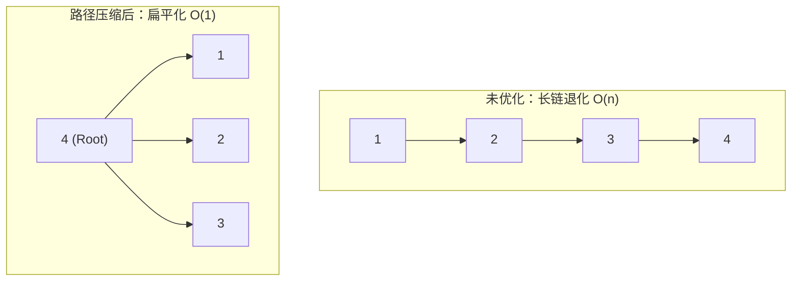

# 第九章 并查集 (Union-Find / Disjoint Set Union)

> 并查集是一种专门用于处理**动态连通性问题 (Dynamic Connectivity)** 的树形数据结构。它仅需一个连续数组维护父节点指针，通过**路径压缩**与**按秩合并**两大优化，能将增删查连通状态的操作压缩至近似 **$O(1)$**。

---

## 0. 考点优先级概览

根据面试常见考察频次与工程实用度，内容按优先级组织如下：

| 优先级 | 分类 | 核心内容 | 重点说明 |
| :--- | :--- | :--- | :--- |
| **P0** | **核心考点** | 树形并查集原理、路径压缩与按秩合并两大优化、反阿克曼函数复杂度、标准模板手撕 | 面试必写基础模板与核心优化推演 |
| **P1** | **经典算法与扩展** | 无向图成环检测 (冗余连接)、Kruskal 最小生成树、等式满足性、带权并查集 | 常见面试算法题型与图论核心结合点 |
| **P2** | **工程实践** | 游戏动态大地图连通性检测、随机地牢与迷宫生成 (破墙算法)、帮派阵营合并 | 游戏服务器与关卡设计应用 |
| **P3** | **基础与附录** | Quick Find vs Quick Union 演进、复杂度总表、完整封装 C++ 模板源码（可折叠） | 知识库查阅备忘 |

---

## P0：核心考点

### 1.1 并查集核心模型：一个数组表达森林

并查集逻辑上是一组森林，但在物理内存中仅需一个 `parent` 数组：
* `parent[i]` 存储节点 `i` 的父节点索引。
* **根节点特性**：若 `parent[x] == x`，说明 `x` 是该集合的**代表元（根节点）**。
* **判断连通**：若两个节点的根相同（`find(a) == find(b)`），则两者处于同一个连通分量中。

---

### 1.2 两大核心优化：路径压缩与按秩合并

未经优化的朴素并查集在持续单调合并时，树形结构会退化为一条单向链表，导致 `find` 操作退化至 $O(n)$。

#### 1. 路径压缩 (Path Compression)
在执行 `find(x)` 向上寻找根节点时，将沿途经过的所有祖先节点的 `parent` **直接修改为根节点**。后续再次访问这些节点时只需一次跳转即可直达根部。

```cpp
// 递归路径压缩：一行代码实现扁平化
int find(int x) {
    if (parent[x] != x) {
        parent[x] = find(parent[x]); // 沿途节点全部指向最终代表元
    }
    return parent[x];
}
```

#### 2. 按秩合并 (Union by Rank / Size)
合并两个集合时，若随意将一棵大树挂在矮树下面，会拉深整棵树的高度。
* **按秩合并**：维护各集合的高度 `rank`（或节点总数 `size`）。
* **核心规则**：永远把**较矮的树挂在较高的树根部**；只有在两棵树高度相等时，被挂载的根节点高度才增加 1。



---

### 1.3 核心手撕：并查集终极标准模板

这是面试中处理图连通性、集合合并题目的最高频标准手撕模板：

```cpp
#include <vector>
#include <numeric>

class UnionFind {
    std::vector<int> _parent;
    std::vector<int> _rank;
    int _count; // 连通分量总数

public:
    UnionFind(int n) : _parent(n), _rank(n, 1), _count(n) {
        std::iota(_parent.begin(), _parent.end(), 0); // 初始化 parent[i] = i
    }

    // 查找代表元（带路径压缩）
    int find(int x) {
        if (_parent[x] != x) {
            _parent[x] = find(_parent[x]);
        }
        return _parent[x];
    }

    // 合并集合（按秩合并）
    bool unite(int x, int y) {
        int rootX = find(x);
        int rootY = find(y);
        if (rootX == rootY) return false; // 已在同一集合中

        if (_rank[rootX] < _rank[rootY]) {
            _parent[rootX] = rootY;
        } else if (_rank[rootX] > _rank[rootY]) {
            _parent[rootY] = rootX;
        } else {
            _parent[rootY] = rootX;
            _rank[rootX]++;
        }
        --_count;
        return true;
    }

    bool connected(int x, int y) {
        return find(x) == find(y);
    }

    int count() const { return _count; }
};
```

---

### 1.4 时间复杂度与反阿克曼函数 $\alpha(n)$

同时应用**路径压缩**与**按秩合并**后：
* 单次操作的均摊时间复杂度为 **$O(\alpha(n))$**。
* $\alpha(n)$ 为**反阿克曼函数 (Inverse Ackermann Function)**。阿克曼函数增长极其恐怖，在宇宙原子总数（约 $10^{80}$）的规模下，$\alpha(n) \le 4$。
* **结论**：在任何实际工程和算法场景中，并查集的单次操作均可视为**均摊常数级 $O(1)$**。

---

### 1.5 常见面试问答要点

* **Q：为什么并查集只适合“合并集合”而难以支持“集合拆分”？**
  > **回答要点**：合并操作只需将其中一个根节点的父指针指向另一个根节点，是单向且破坏原始层级信息的（尤其在路径压缩后，子节点原有的具体层级已被全量抹平，只保留指向根节点的快照）。若要拆分集合，无法直接追溯历史连接关系，必须依赖全量重建或采用极其复杂的可持久化并查集。

* **Q：路径压缩与按秩合并，哪个优化对性能提升贡献更大？**
  > **回答要点**：**路径压缩贡献显著更大**。单纯仅使用路径压缩，单次操作均摊复杂度已可达 $O(\log n)$（且实际极快）；单纯仅使用按秩合并，复杂度也是严格 $O(\log n)$；只有将两者联合使用时，复杂度才能达到理论极致的 $O(\alpha(n))$。面试手撕时若时间紧迫，优先写出递归路径压缩。

---

## P1：经典算法与扩展应用

### 2.1 无向图成环检测 (LeetCode 684) 与 Kruskal 最小生成树

* **无向图成环判定**：
  遍历图中的每一条无向边 $(u, v)$：
  - 若 `find(u) == find(v)`：说明在此边之前，$u$ 与 $v$ 已经连通，当前边是一条**冗余边（引发了环的产生）**。
  - 若 `find(u) != find(v)`：调用 `unite(u, v)` 将两端点合并。
* **Kruskal 最小生成树 (MST)**：
  1. 将图中所有边按权值升序排序。
  2. 从小到大贪心遍历边：若两端点不在同一集合中，将其合并并纳入生成树边集；若在同一集合则跳过（避免产生环）。

---

### 2.2 等式方程的可满足性 (LeetCode 990)

* **问题**：给定一组等式（如 `a==b`）和不等式（如 `b!=c`），判断是否可能同时成立。
* **解题范式**：
  1. 第一轮扫描：只处理所有的等式 `x == y`，调用 `unite(x, y)` 建立等价连通分量。
  2. 第二轮扫描：只处理所有的不等式 `x != y`，校验 `connected(x, y)` 是否为 true。若已连通，直接判定矛盾返回 false。

---

### 2.3 带权并查集 (Weighted Union-Find)

在常规并查集的基础上，在每个节点上附带一个权重值 `weight[x]`，表示**节点 $x$ 与其父节点 `parent[x]` 之间的某种相对代数关系（如向量差、倍数差）**。
* **应用场景**：除法求值 (LC 399)、种类并查集（如经典的“食物链”三向食物链推演）。
* **路径压缩更新**：在回溯时，利用向量加法将权值累加更新为相对根节点的绝对关系。

---

### 2.4 经典题目速查

| 题目 | 难度 | 核心思路 |
| :--- | :--- | :--- |
| **LC 684. 冗余连接** | Medium | 遍历边，两端点若已在同一连通分量中，则当前边即为导致成环的冗余边。 |
| **LC 547. 省份数量 (朋友圈)** | Medium | 邻接矩阵中为 1 的位置调用 `unite`，最终输出 `uf.count()`。 |
| **LC 990. 等式方程的可满足性** | Medium | 两轮扫描：先用等式构建连通集，再用不等式校验连通性。 |
| **LC 200. 岛屿数量 (并查集解法)** | Medium | 遇到陆地向右、向下探索合并相邻陆地，最终统计非水集合数量。 |
| **LC 399. 除法求值** | Medium | 带权并查集：维护变量节点间的商倍率权重关系。 |

---

## P2：工程实践与业务场景

### 3.1 游戏大地图动态连通性校验

在 RTS、开放世界或战棋游戏中，地图障碍物可能动态改变（如桥梁被炸毁、大门开启）：
* 判定两个阵营或玩家基地之间是否处于通路状态，可利用网格并查集在 $O(1)$ 时间内快速回答。
* 当特定通道被连通时，只需调用一次 `unite` 即可将两大区域合并。

---

### 3.2 随机地牢生成 (Kruskal 破墙算法)

在 Roguelike 游戏中生成迷宫或地牢：
1. 初始状态下将地图划分成 $M \times N$ 个独立房间，房间之间全由墙壁隔开（彼此互不连通）。
2. 将所有内部墙壁随机打乱排序。
3. 依次尝试拆除一堵墙：若该墙分隔的两侧房间在并查集中未连通，则**拆毁该墙并调用 `unite`**；若已连通则保留该墙。
4. 遍历完成后，必定生成一棵无回路、全房间可达的完美随机迷宫。

---

## P3：基础原理与参考实现

### 4.1 演进过程：Quick Find vs Quick Union

| 算法变体 | `find` 复杂度 | `union` 复杂度 | 核心瓶颈 |
| :--- | :--- | :--- | :--- |
| **Quick Find** | **$O(1)$** | $O(n)$ | 数组直接存所属组号。合并两个组需遍历全量数组修改组号，代价高昂。 |
| **Quick Union** | $O(n)$（最坏） | $O(n)$（最坏） | 树形结构。合并快，但缺少优化时容易退化为单支链表。 |
| **加权路径压缩版** | **$O(\alpha(n))$** | **$O(\alpha(n))$** | 均摊近似 $O(1)$，工业界与面试统一的标准形态。 |

---

### 4.2 泛型并查集完整实现源码

<details>
<summary>👉 查看支持任意哈希类型（如 string）的泛型并查集 C++ 源码</summary>

```cpp
#include <unordered_map>

template <typename T>
class GenericUnionFind {
    std::unordered_map<T, T> _parent;
    std::unordered_map<T, int> _rank;
    int _count = 0;

public:
    void add(const T& x) {
        if (_parent.count(x)) return;
        _parent[x] = x;
        _rank[x] = 1;
        ++_count;
    }

    T find(const T& x) {
        if (_parent[x] != x) {
            _parent[x] = find(_parent[x]);
        }
        return _parent[x];
    }

    bool unite(const T& x, const T& y) {
        add(x); add(y);
        T rootX = find(x);
        T rootY = find(y);
        if (rootX == rootY) return false;

        if (_rank[rootX] < _rank[rootY]) {
            _parent[rootX] = rootY;
        } else if (_rank[rootX] > _rank[rootY]) {
            _parent[rootY] = rootX;
        } else {
            _parent[rootY] = rootX;
            _rank[rootX]++;
        }
        --_count;
        return true;
    }

    bool connected(const T& x, const T& y) {
        if (!_parent.count(x) || !_parent.count(y)) return false;
        return find(x) == find(y);
    }

    int count() const { return _count; }
};
```
</details>

---

> 📖 下一章：[第十章 数据结构选型终极指南](../10_selection_guide/) —— 十大数据结构全景横评、选型决策树、反选型避坑与工业级架构综合实战。
