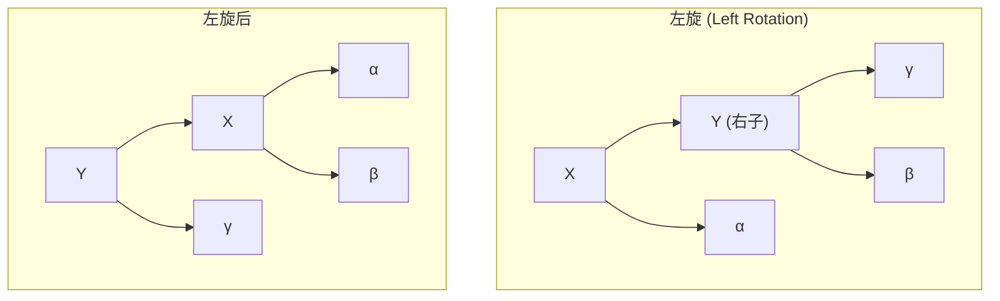

# 6.3 平衡树：AVL 与红黑树

> 平衡二叉搜索树通过在增删节点时执行**局部旋转与重新染色**，强制树高锁定在 $O(\log n)$ 级别，从而从根本上消除了普通 BST 极端退化为 $O(n)$ 链表的风险。

---

## 0. 考点优先级概览

根据面试常见考察频次与工程实用度，内容按优先级组织如下：

| 优先级 | 分类 | 核心内容 | 重点说明 |
| :--- | :--- | :--- | :--- |
| **P0** | **核心考点** | AVL vs 红黑树核心对比、红黑树五大性质、为什么 STL 选择红黑树而非 AVL | 面试常问高频理论与选型依据 |
| **P1** | **旋转与调整** | AVL 四种失衡形态（LL、RR、LR、RL）与旋转原理、红黑树插入修复核心思路 | 机制深入理解，推演平衡旋转 |
| **P2** | **工业实践** | 多路平衡树：B 树与 B+ 树（为什么数据库和文件系统选 B+ 树而非红黑树） | 磁盘与海量存储领域架构演进 |
| **P3** | **基础与附录** | AVL 树旋转手写代码参考（可折叠）、各平衡树理论复杂度总表 | 算法底层实现备忘 |

---

## P0：核心考点

### 1.1 AVL 树 vs 红黑树核心对比

这是高级技术面试中针对自平衡树**最经典、考察频次最高**的选型辨析题：

| 维度 | AVL 树 | 红黑树 (Red-Black Tree) |
| :--- | :--- | :--- |
| **平衡判定标准** | **高度严格平衡**：任意节点的左右子树高度差绝对值 $\le 1$ | **黑色高度平衡**：从根到各叶子的黑节点数量相同 |
| **最大树高限制** | 约 $1.44 \log_2 n$（极矮胖） | 最多 $2 \log_2(n+1)$ |
| **查找性能** | **极高**（树高度极低，平均查找次数更少） | 略逊于 AVL（树可能稍微高一点点） |
| **插入所需旋转次数** | 最多 2 次旋转 | **最多 2 次旋转** |
| **删除所需旋转次数** | 最多 $O(\log n)$ 次旋转（可能一路向根回溯调整） | **常数级最多 3 次旋转！** |
| **增删节点维护成本** | **高**（对平衡要求过于严苛，增删经常引发深层重平衡） | **低**（旋转次数有严格 $O(1)$ 上限，更多依赖廉价变色） |
| **内存开销** | 每个节点存一个 `int` 高度值 | 每个节点存一个 `color` 标记（通常只需 1 bit 复用内存） |
| **典型应用场景** | **读多写少、追求极致查找速度**（如静态字典、Windows 内核内存管理） | **读写频繁综合场景**（C++ `std::map`/`set`、Linux CFS 调度器、Java `TreeMap`） |

> 💡 **总结金句**：**AVL 树牺牲了写入性能换取极致的查询性能；红黑树在查询和修改之间取得了完美的工程折中。**

---

### 1.2 红黑树五大核心性质

红黑树本质上是对 2-3-4 树等阶实现的二叉树表示，其所有平衡特性均由以下 5 条性质约束：

1. **每个节点要么是红色，要么是黑色。**
2. **根节点是黑色的。**
3. **每个叶子节点（NIL 空节点）是黑色的。**
4. **不能有两个连续的红色节点**（如果一个节点是红色的，其两个子节点必须是黑色的）。
5. **对每个节点，从该节点到其所有后代叶子节点的简单路径上，均包含相同数目的黑色节点（黑高 Black-Height 相等）。**

#### 为什么红黑树最长路径不会超过最短路径的 2 倍？
* **最短路径**：全由黑色节点构成的路径（黑高为 $B$）。
* **最长路径**：红黑节点严格交替排列的路径（黑-红-黑-红...），由于性质 4 禁止连续红节点，红节点数量不可能超过黑节点数量，故最长路径至多为 $2B$。
* **结论**：没有任何一条路径会比其他路径长出两倍以上，整棵树保持在粗略的对数高度内。

---

### 1.3 常见面试问答要点

* **Q：为什么 `std::map` 和 `std::set` 选用红黑树而非 AVL 树？**
  > **回答要点**：作为通用标准库容器，`std::map` 必须兼顾频繁的插入、删除与查找。AVL 树在删除节点时，由于高度差严格限制在 1 以内，可能会引发自底向上直到根节点的多米诺骨牌式级联旋转（最坏需要 $O(\log n)$ 次旋转）；而红黑树的删除操作通过颜色调整，**旋转次数被数学证明严格锁死在至多 3 次常数级**。因此在动态增删密集的通用场景下，红黑树的综合吞吐性能大幅胜出。

* **Q：红黑树的颜色标记是如何被高效存储的？**
  > **回答要点**：虽然概念上是一个布尔值（或枚举），但在 64 位系统下指针由于 4 字节或 8 字节对齐，指针地址的最低 2 到 3 位恒定为 0。现代工业实现（如 Linux 内核 `rbtree.h`）通常直接把颜色标记存储在父节点指针的最低 1 位中（利用位运算提取），完全不占用任何额外的内存字节。

---

## P1：旋转与平衡维护机制

### 2.1 AVL 树的四种失衡与旋转模式

当新插入节点导致某个祖先节点的平衡因子（$\text{BF} = \text{左子树高度} - \text{右子树高度}$）绝对值大于 1 时，需根据失衡形态执行旋转：



| 失衡形态 | 触发原因 | 修复动作 | 说明 |
| :--- | :--- | :--- | :--- |
| **LL (左左)** | 插入在失衡节点的左孩子的左子树 | **单右旋 (Right Rotate)** | 根节点右移下沉，左孩子升为新根 |
| **RR (右右)** | 插入在失衡节点的右孩子的右子树 | **单左旋 (Left Rotate)** | 根节点左移下沉，右孩子升为新根 |
| **LR (左右)** | 插入在失衡节点的左孩子的右子树 | **先左旋后右旋 (Double Rotate)** | 先对左孩子左旋拉直成 LL 形态，再对根节点右旋 |
| **RL (右左)** | 插入在失衡节点的右孩子的左子树 | **先右旋后左旋 (Double Rotate)** | 先对右孩子右旋拉直成 RR 形态，再对根节点左旋 |

---

### 2.2 红黑树插入修复的三种情况（新插入节点默认为红色）

新插入的节点 $Z$ 初始必须涂为**红色**（这样不会破坏性质 5 的黑高）。若其父节点也是红色，违背性质 4，分三种情况修复：

* **Case 1：叔父节点也是红色**
  - **处理**：将父节点与叔父节点均染为黑色，将祖父节点染为红色。当前节点上移至祖父节点继续迭代。
* **Case 2：叔父节点是黑色，且当前节点是父节点的右孩子（折线型）**
  - **处理**：对父节点执行一次左旋，将结构拉直，转化为 Case 3。
* **Case 3：叔父节点是黑色，且当前节点是父节点的左孩子（直线型）**
  - **处理**：将父节点染为黑色，祖父节点染为红色，对祖父节点执行一次右旋。平衡恢复，修复结束。

---

## P2：工程实践：B 树与 B+ 树为什么适合磁盘存储？

在关系型数据库（如 MySQL InnoDB）与文件系统中，为什么不使用红黑树作为主键索引，而全部采用多路平衡搜索树（B+ 树）？

1. **磁盘 I/O 寻道极其缓慢**：
   机械磁盘或 SSD 的块读取是以“页 (Page，通常 4KB 或 16KB)”为单位的。红黑树是二叉树，海量数据（如 1000 万行）下树高达到约 24 层，查找一次数据最坏需进行 24 次随机磁盘 I/O，耗时可达数百毫秒。
2. **多路平衡树 (B/B+ 树) 树极矮胖**：
   一个节点对应一个磁盘页，内部可容纳上千个扇出分支。1000 万行数据的 B+ 树高度通常仅为 3~4 层，仅需 3 次磁盘 I/O 即可定位目标。
3. **B+ 树专为范围查询优化**：
   非叶子节点仅存键作为路由索引，所有真实数据平铺在底层叶子节点中，叶子节点之间通过双向链表互相串联。执行 `WHERE id BETWEEN 100 AND 200` 时，只需定位起点 100，随后顺着叶子链表线性遍历即可，无需在树间回溯。

---

## P3：基础原理与参考实现

### 3.1 AVL 树旋转手写代码参考

<details>
<summary>👉 查看 AVL 树左旋、右旋与高度更新核心 C++ 函数</summary>

```cpp
#include <algorithm>

struct AVLNode {
    int val;
    int height = 1;
    AVLNode* left = nullptr;
    AVLNode* right = nullptr;
    AVLNode(int v) : val(v) {}
};

int getHeight(AVLNode* node) {
    return node ? node->height : 0;
}

int getBalanceFactor(AVLNode* node) {
    return node ? getHeight(node->left) - getHeight(node->right) : 0;
}

void updateHeight(AVLNode* node) {
    node->height = 1 + std::max(getHeight(node->left), getHeight(node->right));
}

// 右单旋 (LL 修复)
AVLNode* rightRotate(AVLNode* y) {
    AVLNode* x = y->left;
    AVLNode* T2 = x->right;

    x->right = y;
    y->left = T2;

    updateHeight(y);
    updateHeight(x);
    return x; // 新根
}

// 左单旋 (RR 修复)
AVLNode* leftRotate(AVLNode* x) {
    AVLNode* y = x->right;
    AVLNode* T2 = y->left;

    y->left = x;
    x->right = T2;

    updateHeight(x);
    updateHeight(y);
    return y; // 新根
}
```
</details>

---

> 📖 下一节：[6.4 堆与优先队列](./06_04_heap.md) —— 从二叉堆数组表示到建堆复杂度证明，从 Top-K 选型到索引堆在寻路算法中的应用。
