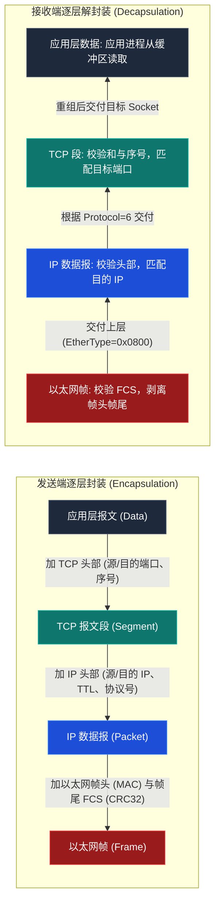
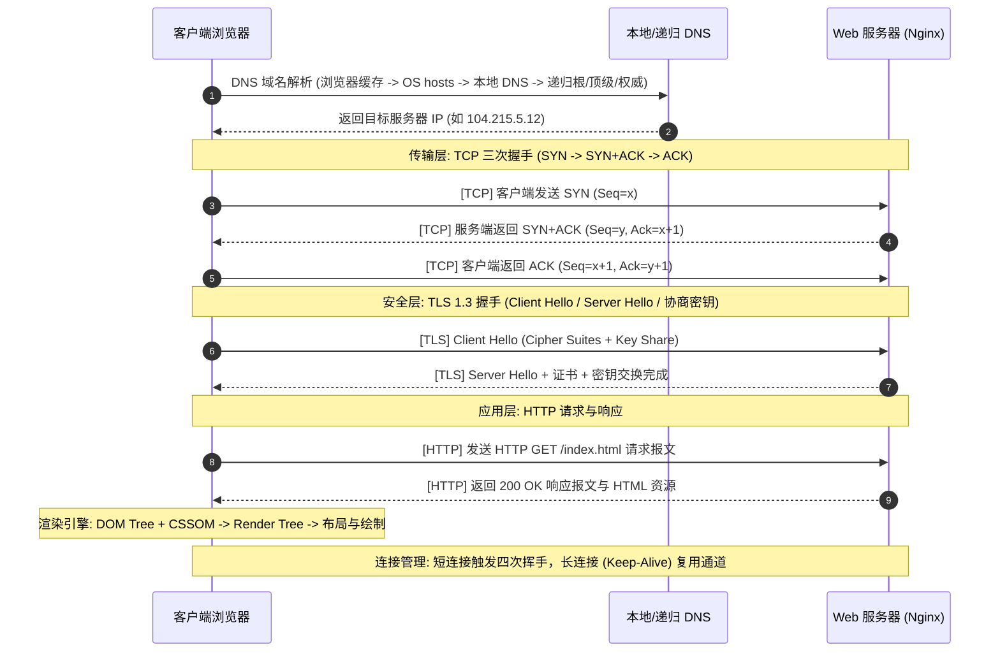
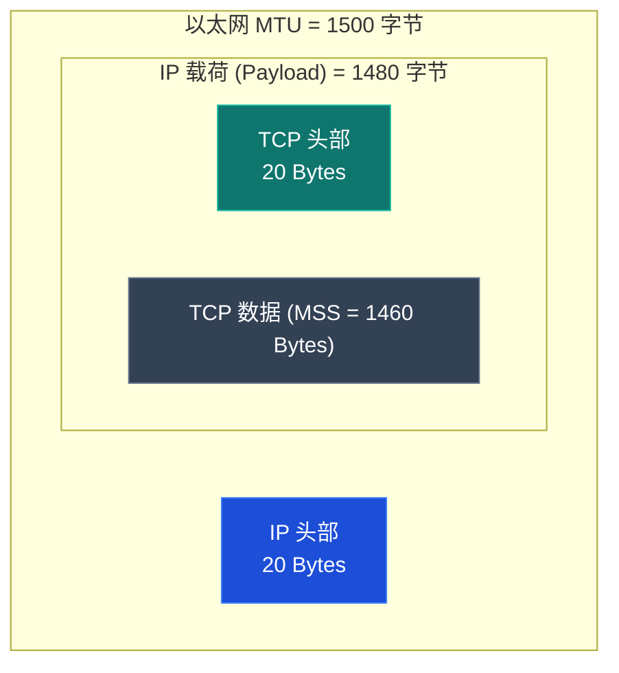

# 第一章 网络分层模型与协议概览

> 网络通信的本质是**协议分工与端到端寻址**。分层模型通过清晰的接口解耦了物理传输、路由寻址、可靠传输与应用业务，构成了整个互联网互联互通的基础抽象。

---

## 0. 考点优先级概览

| 优先级 | 核心模块 | 重点考点 | 考核形式 |
| :--- | :--- | :--- | :--- |
| **P0** | **网络分层与封装** | TCP/IP 四层与 OSI 七层对应关系、各层 PDU 封装与解封装、URL 完整请求时序 | 核心机制辨析、高频综合大题 |
| **P0** | **核心报文与协议** | IPv4 头部核心字段（TTL、协议号、片偏移）、MAC vs IP vs 端口寻址边界 | 报头分析、选择题与概念题 |
| **P1** | **经典指标与计算** | 网络时延四要素计算、时延带宽积 (BDP) 推导、CIDR 子网划分与主机地址推算 | **期末 / 408 必考定量计算大题** |
| **P1** | **链路与寻址机制** | ARP 协议解析过程与 ARP 缓存表、以太网 CSMA/CD 争用期与最小帧长推导 | 机制分析、经典计算推导 |
| **P2** | **工业与游戏实战** | MTU 1500B / MSS 1460B 边界与 IP 分片性能陷阱、游戏紧凑二进制包头设计与内存对齐、网络字节序处理 | 游戏客户端/服务端架构、高并发调优 |
| **P3** | **参考实现与速查** | C++ 网络包头结构定义与端序转换实现、网络分层高频面试速答对照表 | 参考代码库（已折叠）、30秒核心速答 |

---

## P0 核心考点：分层体系、封装解封装与端到端时序

### 1. TCP/IP 四层与 OSI 七层模型映射

OSI 七层模型是国际标准化的理论参考模型，而实际工业落地普遍采用事实标准 **TCP/IP 四层模型**（教学中常扩展为五层模型便于讲解链路与物理细节）。

| TCP/IP 四层 | 五层教学模型 | OSI 七层 | 协议数据单元 (PDU) | 寻址标识 | 核心功能与经典协议 |
| :--- | :--- | :--- | :--- | :--- | :--- |
| **应用层** | **应用层** | 应用层 / 表示层 / 会话层 | **Message / Data (报文)** | 进程 / URL | 为应用程序提供网络服务。协议：HTTP/HTTPS、DNS、FTP、SSH、WebSocket |
| **传输层** | **传输层** | 传输层 | **Segment (报文段) / Datagram** | **Port (端口号, 16-bit)** | 提供**端到端 (End-to-End)** 的进程级通信。协议：TCP (可靠)、UDP (不可靠) |
| **网络层** | **网络层** | 网络层 | **Packet (分组 / IP 数据报)** | **IP 地址 (32-bit / 128-bit)** | 提供**主机到主机 (Host-to-Host)** 的路由选择与分组转发。协议：IP、ICMP、ARP、OSPF、BGP |
| **网络接口层** | **数据链路层** | 数据链路层 | **Frame (帧)** | **MAC 地址 (48-bit)** | 相邻节点间的点对点/广播帧传输、差错检测。协议：以太网 (Ethernet)、Wi-Fi (802.11) |
| | **物理层** | 物理层 | **Bit (比特流)** | 物理引脚 / 频率 | 在物理介质上透明传输原始比特流。介质：双绞线、光纤、无线电波 |

---

### 2. 协议栈数据封装与解封装机制

通信数据在发送端沿协议栈自顶向下逐层添加控制头部（封装），在接收端自底向上逐层剥离并交付（解封装）：



* **多路复用与多路分解 (Multiplexing / Demultiplexing)**：
  * 链路层通过以太网帧头的 `EtherType` 区分上层是 IPv4 (`0x0800`)、IPv6 (`0x86DD`) 还是 ARP (`0x0806`)。
  * 网络层通过 IP 头部的 `Protocol` 区分上层是 TCP (`6`)、UDP (`17`) 还是 ICMP (`1`)。
  * 传输层通过端口号 (`Port`) 将数据派发给绑定的具体应用进程 Socket。

---

### 3. 端到端综合时序：浏览器输入 URL 到页面呈现



---

### 4. IPv4 报文头部结构核心字段解析

标准 IPv4 报头固定长度为 20 字节（若带可选字段可扩充至 60 字节）：

| 字段 | 长度 | 关键作用与考核重点 |
| :--- | :--- | :--- |
| **Version** | 4-bit | IP 协议版本号（IPv4 填 `4`，IPv6 填 `6`）。 |
| **IHL (Header Length)** | 4-bit | 头部长度，**以 4 字节为单位**。无可选字段时值为 5（$5 \times 4 = 20\text{ Byte}$），最大为 15（60 字节）。 |
| **Total Length** | 16-bit | 报文总长度（头部 + 数据），单位为字节。最大理论值 $2^{16}-1 = 65535\text{ Byte}$。 |
| **Identification (标识)** | 16-bit | 标识同一 IP 数据报的所有分片，重组时通过该字段归拢同一数据报。 |
| **Flags (标志位)** | 3-bit | 保留位 (1b) + **DF (Don't Fragment)** + **MF (More Fragments)**。DF=1 禁止分片；MF=1 表示后续仍有分片，MF=0 表示当前为最后一片。 |
| **Fragment Offset (片偏移)** | 13-bit | 当前分片相对于原始数据载荷起始位置的相对偏移量，**以 8 字节为基本单位**。 |
| **TTL (Time to Live)** | 8-bit | 生存时间，防止报文在路由环路中无限循环。经过一个路由器跳数减 1，减至 0 丢弃并返回 **ICMP 超时报文 (Type 11)**。`traceroute` 即利用此机制。 |
| **Protocol** | 8-bit | 指明上层承载协议：`6` 为 TCP，`17` 为 UDP，`1` 为 ICMP，`2` 为 IGMP。 |
| **Header Checksum** | 16-bit | **仅校验 IP 报头自身**（不校验数据载荷），每跳路由器修改 TTL 后均需重新计算校验和。 |
| **Source / Destination IP** | 各 32-bit | 源主机与目的主机的 32 位 IPv4 地址。 |

---

## P1 理论进阶与经典计算：时延模型与网络划分

### 1. 计算机网络四大时延与时延带宽积计算

数据从发送端传输到接收端经历的端到端总时延由四个分量叠加而成：

$$D_{\text{total}} = D_{\text{trans}} + D_{\text{prop}} + D_{\text{proc}} + D_{\text{queue}}$$

1. **传输时延 (Transmission Delay / 发送时延)**：发送节点将数据块推入物理链路所需的时间。
   $$D_{\text{trans}} = \frac{L \text{ (数据报长度, bit)}}{R \text{ (链路带宽/传输速率, bps)}}$$
2. **传播时延 (Propagation Delay)**：电磁波在物理介质上传播一定物理距离所需的时间。
   $$D_{\text{prop}} = \frac{d \text{ (物理链路长度, m)}}{v \text{ (介质传播速率, 光纤中约为 } 2 \times 10^8 \text{ m/s)}}$$
3. **处理时延 (Processing Delay)**：交换机或路由器分析报头、检验差错、查表查找路由所需的时间（通常为微秒级）。
4. **排队时延 (Queueing Delay)**：分组在路由器输入/输出队列中等待被转发的时间（取决于网络瞬时拥塞程度）。

> **经典计算示例**：
> 主机 A 向主机 B 发送大小为 $1.5\text{ KB}$ 的数据包，物理链路为 $2000\text{ km}$ 的光纤，链路传输速率为 $100\text{ Mbps}$，电磁波在光纤中的传播速度为 $2 \times 10^8\text{ m/s}$，忽略处理与排队时延。
> - 传输时延 $D_{\text{trans}} = \frac{1.5 \times 1024 \times 8\text{ bit}}{100 \times 10^6\text{ bps}} = \frac{12288}{10^8} \approx 0.123\text{ ms}$。
> - 传播时延 $D_{\text{prop}} = \frac{2 \times 10^6\text{ m}}{2 \times 10^8\text{ m/s}} = 0.01\text{ s} = 10\text{ ms}$。
> - 总时延 $D \approx 0.123\text{ ms} + 10\text{ ms} = 10.123\text{ ms}$。可见对于小数据包，传播时延占据绝对主导。

#### 时延带宽积 (Bandwidth-Delay Product, BDP)
$$\text{BDP} = \text{链路带宽 (bps)} \times \text{单向传播时延 (s)}$$
* **物理意义**：管道中所能容纳的在途最大比特数量，决定了全双工通信下发送端需要多大的**滑动窗口**才能打满整条物理信道。

---

### 2. CIDR 无分类域间路由与子网划分计算

CIDR 采用斜线记法 `a.b.c.d/n`，前 $n$ 位为网络前缀（网络号），后 $32-n$ 位为主机号。

#### 核心推导公式
* **子网掩码 (Subnet Mask)**：前 $n$ 位连续全 `1`，后 $32-n$ 位连续全 `0`。
* **网络地址 (Network Address)**：$\text{IP} \ \& \ \text{子网掩码}$（主机号全 0）。
* **直接广播地址 (Broadcast Address)**：$\text{网络地址} \ | \ (\sim\text{子网掩码})$（主机号全 1）。
* **可分配有效主机地址范围**：从 $\text{网络地址} + 1$ 到 $\text{广播地址} - 1$。
* **可用主机数**：$2^{32-n} - 2$（扣除全 0 的网络地址与全 1 的广播地址）。

#### 标准计算矩阵模板

以分配给定网段 `192.168.10.138/27` 为例：

| 步骤 | 计算项目 | 二进制 / 十进制推导过程 | 最终计算结果 |
| :--- | :--- | :--- | :--- |
| 1 | 前缀长度与主机位数 | $n = 27$，主机位数 $32 - 27 = 5$ 位 | 网络位 27，主机位 5 |
| 2 | 子网掩码 | 前 27 位为 1：`11111111.11111111.11111111.11100000` | `255.255.255.224` |
| 3 | IP 最后一个字节转换 | $138 = 128 + 8 + 2 =$ `10001010` (前 3 位子网，后 5 位主机) | `100 01010` |
| 4 | 网络地址计算 | 掩码末字节 `11100000` & $138$ `10001010` = `10000000` ($128$) | **`192.168.10.128`** |
| 5 | 直接广播地址计算 | 主机位全 1：`10011111` ($128 + 31 = 159$) | **`192.168.10.159`** |
| 6 | 可用主机 IP 范围 | 介于网络地址与广播地址之间 | **`192.168.10.129` ~ `192.168.10.158`** |
| 7 | 最大可用主机总数 | $2^5 - 2 = 32 - 2$ | **30 台** |

---

### 3. ARP 协议与数据链路层 CSMA/CD 碰撞机理

#### 1. ARP (地址解析协议) 寻址状态机
* **功能**：解决同局域网内已知目标 IPv4 地址、解析对应 48 位以太网 MAC 物理地址的问题。
* **工作流程**：
  1. 主机 A 查询本地 **ARP 高速缓存表 (ARP Cache)**，若未命中则发起 **ARP 请求广播**（目的 MAC 为 `FF:FF:FF:FF:FF:FF`）。
  2. 局域网内所有主机网卡均接收并上送该帧，仅匹配目标 IP 的主机 B 处理该报文，并将 A 的 IP-MAC 记录加入本地缓存。
  3. 主机 B 向主机 A 单播返回 **ARP 应答报文**，主机 A 更新本地 ARP 缓存表。
* **注意**：ARP 工作在网络层与数据链路层交界处，其请求帧直接封装在以太网帧中传输（`EtherType = 0x0806`）。

#### 2. CSMA/CD 争用期与最小帧长推导
以太网采用带冲突检测的载波监听多路访问协议，关键考点在于保证发送端在完成帧传输之前能够检测到信道碰撞：
* **争用期 (Contention Period / 双向传播时延)**：$2\tau = 2 \times \frac{S}{v}$。
* **最小帧长定理**：$\text{最小帧长} \ge 2\tau \times R$（其中 $R$ 为传输速率）。
* 若帧长过短，发送端尚未检测到冲突就已发射完毕，将无法触发碰撞检测重传机制。经典 $10\text{ Mbps}$ 局域网规定争用期为 $51.2\mu s$，因此规定以太网**最小帧长为 64 字节**。

---

## P2 工程实战与底层性能：MTU、包头设计与零拷贝

### 1. MTU 边界与 IP 分片性能惩罚

* **MTU (Maximum Transmission Unit, 最大传输单元)**：数据链路层帧载荷上限，以太网标准为 **1500 字节**。
* **MSS (Maximum Segment Size)**：TCP 报文段的有效载荷上限：
  $$\text{MSS} = \text{MTU} - \text{IP 头部 (20B)} - \text{TCP 头部 (20B)} = 1460\text{ 字节}$$



#### IP 分片的致命代价（为什么工业界与游戏通信竭力规避 IP 分片）：
1. **隐式雪崩丢包**：IP 报文本身无独立重传机制。若一个 4000 字节的 UDP 包被切分为 3 个 IP 分片，只要中间任意 1 个分片在路由器丢包，接收端内核因无法完成重组将**直接丢弃全部 3 个分片**，使整体丢包概率呈几何倍数增加。
2. **内核重组缓冲区开销**：内核必须分配专用重组定时器与重组队列，易遭受 IP 分片畸形包攻击（如 Teardrop 攻击引发内存拒绝服务）。
3. **工程准则**：在应用层（如游戏 UDP/KCP 传输）主动限制每个数据包大小不超过 **$1200 \sim 1400\text{ 字节}$**，并在 IP 头设置 `DF=1` 配合 Path MTU Discovery (PMTUD)，彻底从源头规避网络层分片。

---

### 2. 高性能游戏二进制协议头设计与内存对齐

游戏客户端与服务端通信要求极致压缩报头体积并保证反序列化零拷贝。若直接使用 C++ `struct` 映射网络数据，默认的编译器内存对齐将引入不可见的 Padding 字节，且跨端平台架构可能出现大端 (Big-Endian) 与小端 (Little-Endian) 错乱。

* **网络字节序**：标准化规定为**大端序 (Big-Endian)**，即高位字节存储在低地址处。
* **主机字节序**：绝大多数现代 x86/ARM CPU 均为**小端序 (Little-Endian)**。
* **对齐处理**：使用 `#pragma pack(push, 1)` 强制 1 字节紧凑对齐，消除跨平台编译器 Padding 差异。

---

## P3 参考实现与速查

### 1. 紧凑网络数据包头与端序转换实现

<details>
<summary><strong>高性能 C++ 紧凑网络包头定义与字节序自适应解析</strong></summary>

```cpp
#include <cstdint>
#include <cstring>
#include <type_traits>

#if defined(_WIN32)
#include <winsock2.h>
#else
#include <arpa/inet.h>
#endif

// 强制 1 字节紧密对齐，严防编译器插入 padding 导致跨平台解包偏移
#pragma pack(push, 1)
struct GamePacketHeader {
    uint16_t magic;      // 协议魔数校验 (如 0x55AA)
    uint16_t msg_id;     // 业务消息类型 ID
    uint32_t sequence;   // 客户端数据报严格递增序号
    uint16_t payload_len;// 真实载荷长度 (紧随包头后的字节数)
    uint8_t  flags;      // 消息标记 (位域: 0x01 可靠传输, 0x02 心跳包, 0x04 压缩)
    uint8_t  checksum;   // 简单包头异或校验和
};
#pragma pack(pop)

static_assert(sizeof(GamePacketHeader) == 12, "PacketHeader must be exactly 12 bytes!");

// 主机序转网络序 (大端)
inline GamePacketHeader HostToNetwork(const GamePacketHeader& src) {
    GamePacketHeader dst;
    dst.magic       = htons(src.magic);
    dst.msg_id      = htons(src.msg_id);
    dst.sequence    = htonl(src.sequence);
    dst.payload_len = htons(src.payload_len);
    dst.flags       = src.flags;
    dst.checksum    = src.checksum;
    return dst;
}

// 网络序转主机序 (小端)
inline GamePacketHeader NetworkToHost(const GamePacketHeader& src) {
    GamePacketHeader dst;
    dst.magic       = ntohs(src.magic);
    dst.msg_id      = ntohs(src.msg_id);
    dst.sequence    = ntohl(src.sequence);
    dst.payload_len = ntohs(src.payload_len);
    dst.flags       = src.flags;
    dst.checksum    = src.checksum;
    return dst;
}
```
</details>

---

### 2. 高频面试考点速答对照

| 问题 | 核心回答要点 (30 秒速答) |
| :--- | :--- |
| **OSI 七层与 TCP/IP 四层的映射与区别？** | OSI 是理论七层模型，TCP/IP 是工业实战四层模型。OSI 的应用层、表示层、会话层合并为 TCP/IP 的应用层；OSI 的数据链路层与物理层合并为 TCP/IP 的网络接口层。传输层与网络层在两者间职责对齐。 |
| **浏览器输入 URL 到页面呈现经历了什么？** | ① **DNS 解析**获取目标 IP；② 传输层建立 **TCP 三次握手**；③ 安全层完成 **TLS 密钥协商**；④ 客户端发送 **HTTP 请求**，服务端返回 200 与 HTML；⑤ 浏览器渲染引擎构建 DOM/CSSOM 树并绘制；⑥ 连接关闭或由 Keep-Alive 复用。 |
| **MAC 地址和 IP 地址分别解决什么问题？为什么不能只保留一个？** | MAC 地址是二层物理标识，负责局域网同一链路内的**单跳寻址 (Hop-by-Hop)**；IP 地址是三层逻辑标识，具备拓扑层级结构，负责跨异构网络的**全局路由寻址 (End-to-End)**。若只用 MAC 地址，全球路由器必须维护数十亿条无规律平面路由表导致内存崩溃。 |
| **什么是 MTU 与 MSS？超过 MTU 会发生什么？** | MTU 是数据链路层单帧载荷上限（以太网 1500B）；MSS 是 TCP 净荷上限（MTU - 20B IP - 20B TCP = 1460B）。IP 数据报超过路径 MTU 且 DF=0 时将触发网络层 IP 分片，任一分片丢失会导致全包重传，引发性能雪崩。 |
| **网络时延由哪四部分构成？** | 传输时延（数据量/带宽）、传播时延（物理距离/光速）、处理时延（路由器报头检错与查表）与排队时延（路由器缓冲区拥塞等待）。高速长距离网络中小数据包主要受传播时延约束。 |
