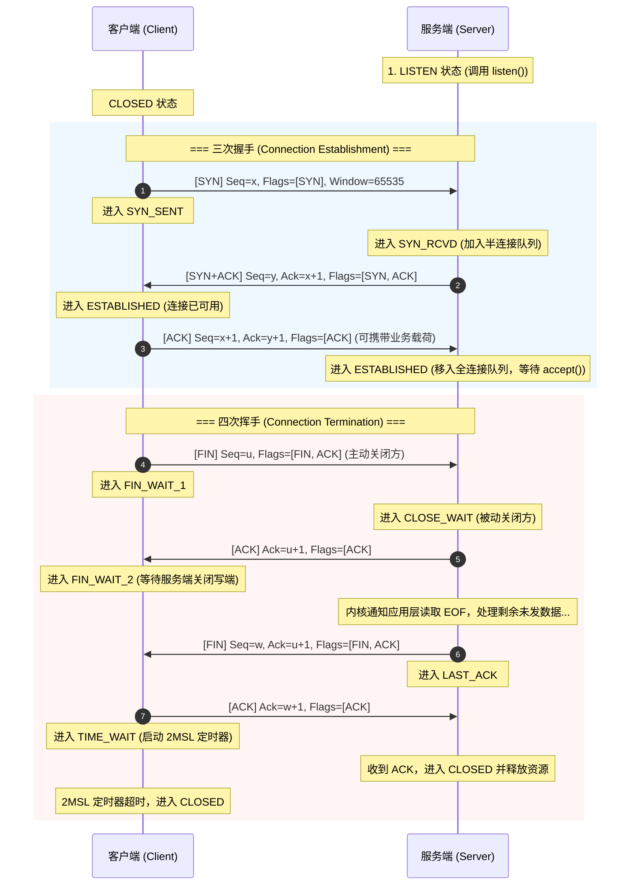
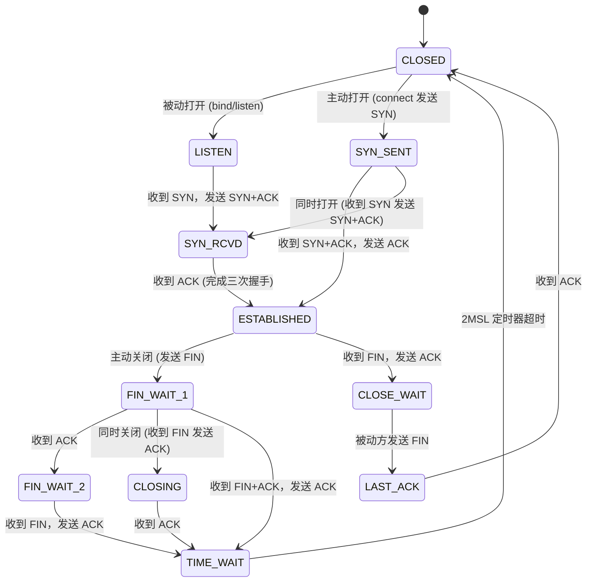
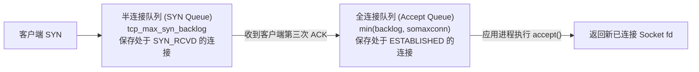
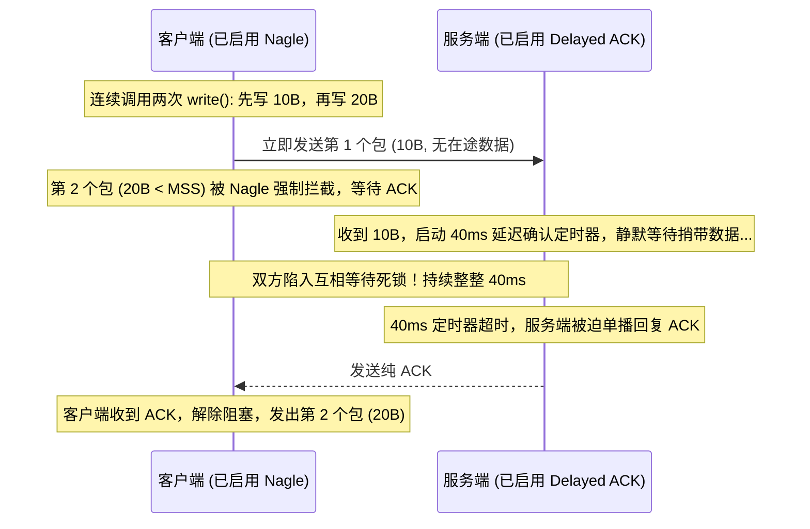
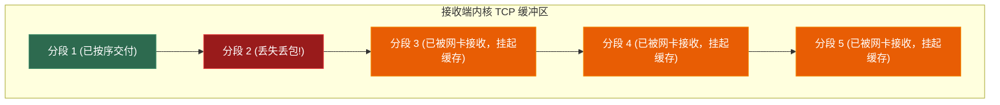

# 第二章 TCP 传输机制与状态机

> TCP 是面向连接、可靠的基于字节流的传输层协议。它通过初始序号同步、滑动窗口、累积确认与端到端拥塞控制，在不可靠的 IP 网络之上构建了有序可靠的双向字节流管道。然而其强保序性带来的队头阻塞与拥塞降速开销，深刻影响了现代高性能网络与实时系统的架构选型。

---

## 0. 考点优先级概览

| 优先级 | 核心模块 | 重点考点 | 考核形式 |
| :--- | :--- | :--- | :--- |
| **P0** | **连接生命周期与状态机** | 三次握手与四次挥手 11 种状态转移、为什么握手需三次而挥手需四次、TIME_WAIT 与 CLOSE_WAIT 异常分析 | 状态机推导、时序图绘制、核心概念问答 |
| **P0** | **可靠传输与滑动窗口** | 累计确认 (Cumulative ACK)、超时重传 (RTO)、3 重复 ACK 快速重传、SACK 选择性确认、滑动窗口与流量控制 | 机制辨析、窗口滑动过程追踪 |
| **P1** | **拥塞控制定量推演** | 慢启动、拥塞避免、快速重传、快速恢复 Reno/Cubic/BBR 对比，**408 必考拥塞窗口数字演进表格推导** | **期末 / 408 经典定量计算大题** |
| **P1** | **连接队列与安全机制** | 半连接队列 (SYN Queue) 与全连接队列 (Accept Queue) 溢出判定、SYN Flood 攻击原理与 SYN Cookie 防护 | 操作系统内核网络参数分析、系统调优 |
| **P2** | **工业与游戏实战** | Nagle 算法与 Delayed ACK 40ms 延迟死锁、`TCP_NODELAY` 调优、TIME_WAIT 端口耗尽与 `SO_REUSEADDR`、TCP 队头阻塞 | 高性能并发架构、网络性能调优 |
| **P3** | **参考实现与速查** | C++ 长度前缀粘包拆包解析器、非阻塞 connect 异步连接检测、TCP 高频面试速答对照表 | 参考代码库（已折叠）、30秒核心速答 |

---

## P0 核心考点：连接生命周期、状态机与滑动窗口

### 1. TCP 报文头核心结构

标准 TCP 报头最小长度为 20 字节，最大为 60 字节（带 40 字节选项）：

```
 0                   1                   2                   3
 0 1 2 3 4 5 6 7 8 9 0 1 2 3 4 5 6 7 8 9 0 1 2 3 4 5 6 7 8 9 0 1
+-+-+-+-+-+-+-+-+-+-+-+-+-+-+-+-+-+-+-+-+-+-+-+-+-+-+-+-+-+-+-+-+
|          Source Port          |       Destination Port        |
+-+-+-+-+-+-+-+-+-+-+-+-+-+-+-+-+-+-+-+-+-+-+-+-+-+-+-+-+-+-+-+-+
|                        Sequence Number                        |
+-+-+-+-+-+-+-+-+-+-+-+-+-+-+-+-+-+-+-+-+-+-+-+-+-+-+-+-+-+-+-+-+
|                    Acknowledgment Number                      |
+-+-+-+-+-+-+-+-+-+-+-+-+-+-+-+-+-+-+-+-+-+-+-+-+-+-+-+-+-+-+-+-+
| Offset| Rsv |U|A|P|R|S|F|          Window Size               |
+-+-+-+-+-+-+-+-+-+-+-+-+-+-+-+-+-+-+-+-+-+-+-+-+-+-+-+-+-+-+-+-+
|           Checksum            |         Urgent Pointer        |
+-+-+-+-+-+-+-+-+-+-+-+-+-+-+-+-+-+-+-+-+-+-+-+-+-+-+-+-+-+-+-+-+
|                    Options (Variable 0~40B)                   |
+-+-+-+-+-+-+-+-+-+-+-+-+-+-+-+-+-+-+-+-+-+-+-+-+-+-+-+-+-+-+-+-+
```

* **Sequence Number (32-bit)**：本报文段所发送数据的第一个字节序号。在建立连接时由双方各自随机生成初始序号 (ISN, Initial Sequence Number)。
* **Acknowledgment Number (32-bit)**：期望收到对方下一个报文段的第一个数据字节序号。数值为 $N$ 表示序号小于 $N$ 的所有字节已成功接收（**累积确认**）。
* **Data Offset (4-bit)**：TCP 报文头长度，以 **4 字节** 为单位。最小为 5（20B），最大为 15（60B）。
* **Control Flags (控制位)**：
  * **SYN**：同步序号，用于建连发起。
  * **ACK**：确认号有效标志位（建连第三步及之后的所有报文均需置 1）。
  * **FIN**：释放连接标志位，表示发送方已无数据发送。
  * **RST**：连接复位，用于强制释放异常连接或拒绝非法报文。
  * **PSH**：提示接收端立即将缓冲区数据推入应用层，避免等待缓冲区填满。
* **Window Size (16-bit)**：接收窗口大小 ($rwnd$)，用于流量控制。结合选项中的窗口缩放因子 (Window Scale Option) 可突破 $64\text{ KB}$ 限制。

---

### 2. 三次握手与四次挥手时序



---

### 3. TCP 11 种标准状态转移机



#### 核心机制深度解析
* **为什么必须是三次握手（两次握手的致命缺陷）**：
  1. **防止历史重复连接的初始化造成资源浪费**：若因网络抖动，客户端超时的历史旧 SYN 延迟到达服务端，服务端若仅凭两次握手即进入 ESTABLISHED，将导致无效连接与内存泄漏。三次握手下，客户端收到带有旧确认号的 SYN+ACK 会发送 RST 报文中止错误连接。
  2. **双方双向同步初始序列号 (ISN)**：双方必须各自确认自己的初始序号已被对方正确知晓（客户端发送 Seq=x 需服务端 ACK=x+1；服务端发送 Seq=y 需客户端 ACK=y+1，共需 $2 \times 2 = 4$ 次交互，中间两步合并为 SYN+ACK，故为 3 次）。
* **为什么 TIME_WAIT 必须等待 2MSL (Maximum Segment Lifetime)**：
  1. **确保被动关闭方能够收到最后的 ACK**：若客户端发送的最后一个 ACK 丢失，服务端因超时会重发 FIN。客户端在 2MSL 窗口内保留状态，若再次收到 FIN 能重发 ACK，避免服务端滞留在 LAST_ACK 状态无法正常关闭。
  2. **保证本连接产生的所有网络在途报文全部消亡**：防止这些旧报文在延迟到达后被后续使用相同四元组（源IP、源端口、目的IP、目的端口）的新连接错误接收。

---

## P1 理论进阶与经典计算：拥塞控制推演与队列溢出

### 1. 拥塞控制四大算法与 408 经典数值推演

拥塞控制旨在保护中间网络路由器缓冲区不被撑爆。发送窗口实际限制为：

$$\text{Effective Window} = \min(\text{rwnd (接收端通告窗口)}, \text{cwnd (拥塞窗口)})$$

#### 四大阶段核心规则（Reno 模型）
1. **慢启动 (Slow Start)**：初始 $\text{cwnd} = 1\text{ MSS}$。每收到一个 ACK，$\text{cwnd} \mathrel{+}= 1\text{ MSS}$。每经过一个往返时间 RTT，**$\text{cwnd}$ 翻倍（指数增长：$1 \to 2 \to 4 \to 8 \to \dots$）**，直至达到慢启动门限 $\text{ssthresh}$。
2. **拥塞避免 (Congestion Avoidance)**：当 $\text{cwnd} \ge \text{ssthresh}$ 时，每个 RTT 窗口仅增加 $1\text{ MSS}$（**加法增大，线性增长**），直至发生网络丢包。
3. **快速重传 (Fast Retransmit)**：接收方收到乱序分段时连续发送重复 ACK。发送方连续收到 **3 个重复 ACK** 时，立即重传对应缺失分段，无需等待 RTO 超时。
4. **快速恢复 (Fast Recovery)**：
   * **收到 3 个重复 ACK**：$\text{ssthresh} = \frac{\text{cwnd}}{2}$，更新 $\text{cwnd} = \text{ssthresh} + 3\text{ MSS}$，随后直接进入拥塞避免线性增长。
   * **发生 RTO 超时重传（网络重度拥塞）**：$\text{ssthresh} = \frac{\text{cwnd}}{2}$，强制重置 $\text{cwnd} = 1\text{ MSS}$，重新执行慢启动。

#### 408 经典真题推演模型
> **题目模型**：设初始 $\text{ssthresh} = 16\text{ MSS}$，$\text{cwnd} = 1\text{ MSS}$。在第 8 个 RTT 末尾收到 3 个重复 ACK；在第 14 个 RTT 发生重传超时 (Timeout)。计算各 RTT 末尾的 $\text{cwnd}$ 与 $\text{ssthresh}$ 演化：

| RTT 轮次 | 初始 cwnd | 所处阶段 | RTT 结束时 cwnd | ssthresh | 触发事件与状态转换说明 |
| :---: | :---: | :---: | :---: | :---: | :--- |
| **1** | 1 | 慢启动 | 2 | 16 | 指数增长 |
| **2** | 2 | 慢启动 | 4 | 16 | 指数增长 |
| **3** | 4 | 慢启动 | 8 | 16 | 指数增长 |
| **4** | 8 | 慢启动 | 16 | 16 | 达到 ssthresh，转换为拥塞避免 |
| **5** | 16 | 拥塞避免 | 17 | 16 | 加法增大 (+1) |
| **6** | 17 | 拥塞避免 | 18 | 16 | 加法增大 (+1) |
| **7** | 18 | 拥塞避免 | 19 | 16 | 加法增大 (+1) |
| **8** | 19 | 拥塞避免 | **20** | 16 | **末尾收到 3 个重复 ACK** |
| **9** | **10** | 快速恢复 | 11 | **10** | $\text{ssthresh} = 20/2 = 10$，进入快速恢复后切回拥塞避免 |
| **10** | 11 | 拥塞避免 | 12 | 10 | 线性增长 (+1) |
| **11** | 12 | 拥塞避免 | 13 | 10 | 线性增长 (+1) |
| **12** | 13 | 拥塞避免 | 14 | 10 | 线性增长 (+1) |
| **13** | 14 | 拥塞避免 | 15 | 10 | 线性增长 (+1) |
| **14** | 15 | 拥塞避免 | **16** | 10 | **末尾发生 RTO 超时丢包 (Timeout)** |
| **15** | **1** | 慢启动 | 2 | **8** | $\text{ssthresh} = 16/2 = 8$，$\text{cwnd}$ 断崖跌回 1，重启慢启动 |

---

### 2. 拥塞控制算法工业演进对比

| 算法 | 拥塞检测信号 | 窗口调整策略 | 核心局限与应用场景 |
| :--- | :--- | :--- | :--- |
| **TCP Reno** | 丢包（3 个重复 ACK 或 RTO 超时） | AIMD（加法增大，乘法减小） | 在大带宽长延迟 (High BDP) 链路下，丢包后重填管道极慢。 |
| **TCP Cubic** | 丢包 | 采用关于时间的三次函数曲线增长，快速逼近前次拥塞窗口 | **现代 Linux 默认拥塞控制算法**，在高 BDP 网络中吞吐量极佳。 |
| **Google BBR** | **测量最大交付带宽 (BtlBw) 与最小往返时延 (RTprop)** | 摒弃“丢包=拥塞”模型，沿 BDP 运行，排空路由器多余缓冲区 | 彻底消除 Bufferbloat 拥塞，在弱网高随机丢包环境下吞吐量碾压 Cubic。 |

---

### 3. 半连接队列与全连接队列

Linux 内核在三次握手期间维护两个核心队列：



* **全连接队列满时的系统行为**：
  * 若全连接队列已满，内核依据 `net.ipv4.tcp_abort_on_overflow` 决定动作：
    * `0`（默认）：**丢弃客户端的第三次 ACK**，假装没收到，触发服务端重发 SYN+ACK。给应用层 `accept()` 腾出缓冲时间。
    * `1`：直接向客户端发送 **RST 报文** 拒绝连接。
* **SYN Flood 攻击与 SYN Cookie 防护**：
  * 攻击者伪造大量不存在的源 IP 发送 SYN 包，使半连接队列被完全打满，正常请求被丢弃。
  * **SYN Cookie 原理**：当半连接队列满且开启 `net.ipv4.tcp_syncookies = 1` 时，服务端收到 SYN **不分配内存 PCB 资源**，而是将连接四元组、时间戳与 MSS 选项通过密钥生成哈希，直接作为服务端 SYN+ACK 的 **初始序号 ISN** 返回。客户端回复 ACK 时携带该序号，服务端校验通过后才原地分配内存。

---

## P2 工程实战与底层性能：延迟死锁、队头阻塞与端口治理

### 1. Nagle 算法与 Delayed ACK 40ms 延迟死锁

* **Nagle 算法**：旨在避免小包泛滥占用带宽。规定：若连接上有已发送但尚未被确认的在途数据，且当前积攒的数据小于 MSS，则**强制缓存在本地发送队列中，直到收到上一个分段的 ACK 或积攒满 MSS 才允许发送**。
* **Delayed ACK (延迟确认)**：接收端收到数据后不立即回复 ACK，而是等待固定周期（通常为 **40ms**）期望与本端的响应数据一同捎带返回 (Piggybacking)。



* **工业与游戏底层调优准则**：
  * 在游戏、RPC 与金融交易场景下，必须在客户端与服务端显式关闭 Nagle 算法：
    ```cpp
    int enable = 1;
    setsockopt(fd, IPPROTO_TCP, TCP_NODELAY, &enable, sizeof(enable));
    ```

---

### 2. TIME_WAIT 端口耗尽与底层治理方案

当高并发短连接系统（如反向代理或爬虫节点）主动关闭大量连接时，本地四元组的大量端口将处于 TIME_WAIT 状态（持续 $2\text{MSL} = 60\text{s}$），导致无法向同一目标服务器发起新连接（抛出 `EADDRNOTAVAIL`）。

* **方案 1：应用层开启 `SO_REUSEADDR`（服务重启防占用）**
  * 允许监听 Socket 重新绑定处于 TIME_WAIT 状态的端口，确保服务端进程重启时无需等待 2MSL。
* **方案 2：Linux 内核参数开启 `tcp_tw_reuse`（安全出向复用）**
  * 在客户端开启 `net.ipv4.tcp_tw_reuse = 1` 并依赖 `net.ipv4.tcp_timestamps = 1`（PAWS 机制防旧包干扰），允许处于 TIME_WAIT 状态超过 1 秒的端口被复用于对外发起新连接。
* **方案 3：架构层面彻底采用持久长连接 (Keep-Alive)**
  * 维持长连接池，从根源消除瞬时频繁四次挥手带来的 TIME_WAIT 积累。

---

### 3. TCP 队头阻塞 (Head-of-Line Blocking) 的物理缺陷

TCP 协议栈在内核层面强制保证**按序交付 (In-Order Delivery)**：



* **致命问题**：若分段 2 在传输途中丢失，尽管分段 3、4、5 已经顺利抵达接收端内存，**TCP 内核驱动绝不允许将它们提前交付给应用层**。应用层必须被动等待超时重传或快速重传补齐分段 2 后，整批数据才被一次性释放。
* **实时游戏影响**：FPS 游戏中即使每秒产生 60 次位置更新，只要丢失一个包，后续 59 个最新位置将全部被内核卡死，造成玩家画面严重顿挫与瞬间瞬移。因此实时游戏动作/位置同步通常改用基于 UDP 的自研 ARQ 或 KCP 协议。

---

## P3 参考实现与速查

### 1. 工业级长度前缀粘包拆包解析器

<details>
<summary><strong>高性能 C++ 环形缓冲区 TCP 粘包/拆包处理实现</strong></summary>

```cpp
#include <vector>
#include <cstdint>
#include <cstring>
#include <iostream>
#include <algorithm>

#if defined(_WIN32)
#include <winsock2.h>
#else
#include <arpa/inet.h>
#endif

class TcpStreamBuffer {
public:
    TcpStreamBuffer() : buffer_(4096), read_idx_(0), write_idx_(0) {}

    // 接收网卡数据写入缓冲区
    void Append(const char* data, size_t len) {
        EnsureCapacity(len);
        std::memcpy(buffer_.data() + write_idx_, data, len);
        write_idx_ += len;
    }

    // 按照 2 字节包头长度前缀提取完整应用层数据包
    bool TryPopMessage(std::vector<uint8_t>& out_payload) {
        constexpr size_t kHeaderSize = sizeof(uint16_t);
        size_t available_bytes = write_idx_ - read_idx_;

        if (available_bytes < kHeaderSize) {
            return false; // 甚至不足以解析包头长度
        }

        // 读取长度字段并执行网络序转主机序
        uint16_t net_len = 0;
        std::memcpy(&net_len, buffer_.data() + read_idx_, kHeaderSize);
        uint16_t msg_total_len = ntohs(net_len);

        if (available_bytes < msg_total_len) {
            return false; // 发生拆包，数据段未收齐，继续等待更多数据
        }

        // 完整包已到达，拷贝载荷部分交付应用层
        size_t payload_len = msg_total_len - kHeaderSize;
        out_payload.resize(payload_len);
        std::memcpy(out_payload.data(), buffer_.data() + read_idx_ + kHeaderSize, payload_len);

        read_idx_ += msg_total_len;

        // 缓冲区定期平移复位，防止读指针无限后移
        if (read_idx_ == write_idx_) {
            read_idx_ = 0;
            write_idx_ = 0;
        }
        return true;
    }

private:
    void EnsureCapacity(size_t need_bytes) {
        if (buffer_.size() - write_idx_ < need_bytes) {
            // 先尝试向左紧凑平移
            if (read_idx_ > 0) {
                size_t remaining = write_idx_ - read_idx_;
                std::memmove(buffer_.data(), buffer_.data() + read_idx_, remaining);
                read_idx_ = 0;
                write_idx_ = remaining;
            }
            // 平移后仍不足则扩容
            if (buffer_.size() - write_idx_ < need_bytes) {
                buffer_.resize(buffer_.size() * 2 + need_bytes);
            }
        }
    }

    std::vector<char> buffer_;
    size_t read_idx_;
    size_t write_idx_;
};
```
</details>

---

### 2. 非阻塞 Connect 异步建连状态检测

<details>
<summary><strong>跨平台非阻塞 connect 与超时轮询机制</strong></summary>

```cpp
#include <fcntl.h>
#include <poll.h>
#include <unistd.h>
#include <sys/socket.h>
#include <netinet/in.h>

bool AsyncConnectWithTimeout(int sock_fd, const sockaddr_in& target_addr, int timeout_ms) {
    // 1. 设置套接字为非阻塞模式
    int flags = fcntl(sock_fd, F_GETFL, 0);
    fcntl(sock_fd, F_SETFL, flags | O_NONBLOCK);

    // 2. 发起连接：非阻塞模式下立即返回 -1，errno 变为 EINPROGRESS
    int ret = connect(sock_fd, reinterpret_cast<const sockaddr*>(&target_addr), sizeof(target_addr));
    if (ret == 0) {
        fcntl(sock_fd, F_SETFL, flags); // 连接直接瞬时建立
        return true;
    }
    if (errno != EINPROGRESS) {
        return false; // 明确发生路由或网络错误
    }

    // 3. 使用 poll 监听套接字的可写事件 (POLLOUT)
    pollfd pfd{};
    pfd.fd = sock_fd;
    pfd.events = POLLOUT;

    int poll_ret = poll(&pfd, 1, timeout_ms);
    if (poll_ret <= 0) {
        return false; // 超时或系统调用被中断
    }

    // 4. 套接字可写并不代表连接必然成功，必须通过 SO_ERROR 检验二次确认
    int so_error = 0;
    socklen_t len = sizeof(so_error);
    if (getsockopt(sock_fd, SOL_SOCKET, SO_ERROR, &so_error, &len) < 0 || so_error != 0) {
        return false; // 连接被拒绝或超时重置
    }

    // 恢复原有阻塞属性
    fcntl(sock_fd, F_SETFL, flags);
    return true;
}
```
</details>

---

### 3. 高频面试考点速答对照

| 问题 | 核心回答要点 (30 秒速答) |
| :--- | :--- |
| **为什么 TCP 建立连接是三次，而断开连接需要四次？** | 建连时服务端的 SYN 与 ACK 可以合并在同一报文段发出；断开连接时 TCP 是全双工的，客户端发送 FIN 仅代表其单向关闭写端，服务端收到后仍可能有未发完的数据，故必须先单发 ACK，待业务全部处理完毕后才能单发 FIN，故拆分为四次。 |
| **为什么 TIME_WAIT 必须等待 2MSL？** | ① 确保客户端发送的最后一个 ACK 能够可靠到达被动关闭方（若丢失被动方会重发 FIN，2MSL 窗口能保证 ACK 被重发）；② 确保本连接在网络中产生的所有历史报文完全消亡，杜绝新连接复用同一四元组时混淆旧报文。 |
| **CLOSE_WAIT 状态大量堆积的原因与排查方案？** | 被动关闭方收到了对方发来的 FIN，操作系统内核已自动回复了 ACK，但**应用程序没有显式调用 `close()` 关闭套接字**。根本原因是代码逻辑 bug（如异常分支跳过 `close` 或工作线程阻塞未调用回收），需借助 `netstat` 排查并使用 RAII 管理 socket 资源。 |
| **TCP 流量控制与拥塞控制有何根本区别？** | 流量控制是**端到端**的，基于接收端反馈的通告窗口 ($rwnd$) 动态调速，防止发送方冲垮接收方缓冲区；拥塞控制是**全局端到网**的，基于拥塞窗口 ($cwnd$) 动态调整（慢启动/拥塞避免/快重传/快恢复），防止全网交换机与路由器缓冲区队列溢出。 |
| **什么是 TCP 粘包？根本成因是什么？如何彻底解决？** | TCP 是无边界的字节流协议，底层驱动只负责按序拼接传输，应用层的多次 `write` 数据可能被底层缓冲区合并或截断发送。根本解决方式是应用层自定义协议边界，最通用工业方案是在包头增加固定的**长度前缀 (Length Prefix)**，接收端据此按字节数准确切分消息。 |
