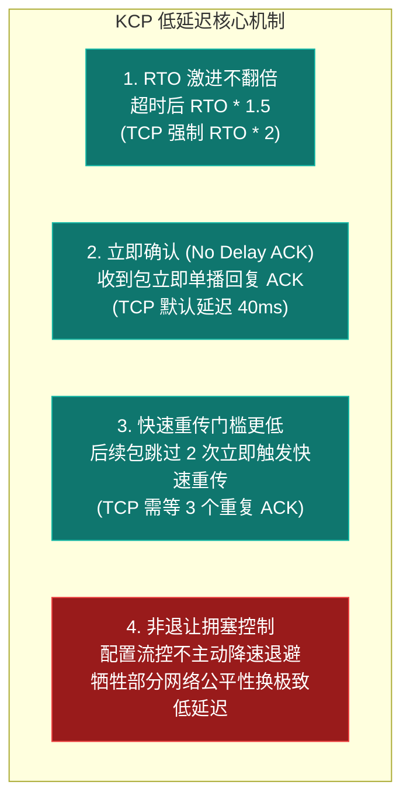
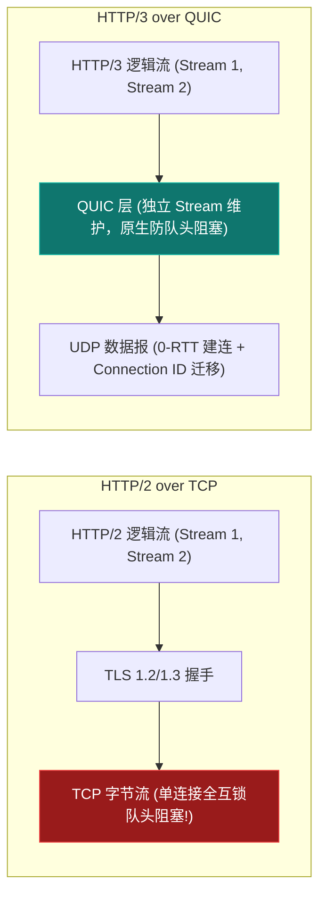
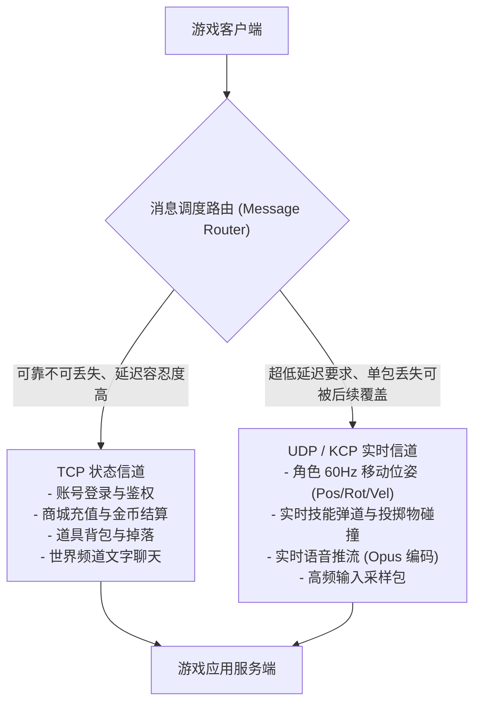

# 第三章 UDP、可靠 UDP 与传输层架构

> UDP（用户数据报协议）是传输层的极简无状态抽象。它不提供握手建立、按序重组、超时重传与流量拥塞控制，仅提供端口分发与可选的差错校验。正因为去除了所有内置传输约束，UDP 成为了现代低延迟系统、实时音视频流媒体与游戏高频同步网络架构的最佳基石。

---

## 0. 考点优先级概览

| 优先级 | 核心模块 | 重点考点 | 考核形式 |
| :--- | :--- | :--- | :--- |
| **P0** | **UDP 报文与协议横评** | UDP 8 字节报头结构、校验和与伪首部计算、TCP vs UDP 十维度全景横评、数据报边界与为什么不粘包 | 核心概念辨析、报头结构分析 |
| **P0** | **应用场景选型边界** | 实时音视频 (RTP/WebRTC)、实时游戏、DNS 查询、广播多播等非 TCP 场景的物理诱因 | 架构设计题、选型综合辨析 |
| **P1** | **ARQ 协议与信道计算** | 停止-等待 (Stop-and-Wait)、后退 N 帧 (GBN)、选择重传 (SR) 状态机制，**408 经典信道利用率与窗口比特推导大题** | **期末 / 408 必考定量计算大题** |
| **P1** | **现代协议深度演进** | KCP 协议 4 大激进低延迟策略、QUIC (HTTP/3) 架构革新（单连接多流消除队头阻塞、0-RTT、Connection ID 连接迁移） | 协议演进原理、大厂技术面深入考察 |
| **P2** | **工业与游戏实战** | 商业游戏 TCP+UDP 双通道混合架构、`recvmmsg`/`sendmmsg` 批量收发优化、UDP 缓冲区调优 (`SO_RCVBUF`) 与防丢包 | 游戏客户端/服务端底层性能优化 |
| **P3** | **参考实现与速查** | C++ 紧凑可靠 UDP 序列号与 ACK 驱动骨架、UDP/KCP 高频面试速答对照表 | 参考代码库（已折叠）、30秒核心速答 |

---

## P0 核心考点：报头结构、协议横评与消息边界

### 1. UDP 8 字节极简报头结构

UDP 报文头仅由 4 个字段组成，总长度固定为 **8 字节**：

```
 0                   1                   2                   3
 0 1 2 3 4 5 6 7 8 9 0 1 2 3 4 5 6 7 8 9 0 1 2 3 4 5 6 7 8 9 0 1
+-+-+-+-+-+-+-+-+-+-+-+-+-+-+-+-+-+-+-+-+-+-+-+-+-+-+-+-+-+-+-+-+
|          Source Port          |       Destination Port        |
+-+-+-+-+-+-+-+-+-+-+-+-+-+-+-+-+-+-+-+-+-+-+-+-+-+-+-+-+-+-+-+-+
|            Length             |           Checksum            |
+-+-+-+-+-+-+-+-+-+-+-+-+-+-+-+-+-+-+-+-+-+-+-+-+-+-+-+-+-+-+-+-+
|                            Payload                            |
+-+-+-+-+-+-+-+-+-+-+-+-+-+-+-+-+-+-+-+-+-+-+-+-+-+-+-+-+-+-+-+-+
```

* **Source Port (16-bit)**：源端口号，不需要对方回复时可置全 0。
* **Destination Port (16-bit)**：目的端口号，用于将数据交付给目标进程套接字。
* **Length (16-bit)**：UDP 数据报全长（**头部 8 字节 + 数据载荷**），单位为字节。最小值为 8（无载荷）。
* **Checksum (16-bit)**：端到端差错校验和。计算时在前面临时追加 **12 字节伪首部 (Pseudo Header)**（包含源 IP、目的 IP、全零字节、协议号 17、UDP 长度），覆盖头部与全部数据。IPv4 下校验和字段为可选（置 0 表示不计算），IPv6 下强制必须计算。

---

### 2. TCP vs UDP 核心机制全景对比

| 比较维度 | TCP (Transmission Control Protocol) | UDP (User Datagram Protocol) |
| :--- | :--- | :--- |
| **连接机制** | **面向连接**（需经过三次握手建立上下文） | **无连接**（直接 `sendto` 发射，无需建连） |
| **传输可靠性** | **完全可靠**（ACK 确认、超时重传、去重、保序） | **不可靠传输**（可能丢包、乱序、重复到达） |
| **传输形式** | **流式传输 (Byte Stream)**，无结构边界 | **数据报传输 (Datagram)**，保留消息结构边界 |
| **头部开销** | 最小 **20 字节**，带选项可达 60 字节 | 固定 **8 字节** |
| **吞吐与调速** | 受拥塞控制与流量控制算法严格动态钳制 | **无内置控速**，应用层能推多快网络层就发多快 |
| **粘包与拆包** | **会粘包**（应用层必须自定义长度前缀或定界符） | **天然不会粘包**（一次 `sendto` 对应一次 `recvfrom`） |
| **多播与广播** | 仅支持点对点单播 (Unicast) | **全面支持单播、多播 (Multicast)、广播 (Broadcast)** |
| **队头阻塞** | 前序包丢失会阻塞后续所有报文交付（Head-of-Line Blocking） | **无队头阻塞**，到达的报文立即独立上送应用层 |
| **资源消耗** | 服务端维护每个连接的 TCB/Socket 状态（内存大） | 无连接状态维护，极轻量开销 |
| **工业代表场景** | 网页传输 (HTTP/1.1/2)、文件传输 (FTP)、支付交易、游戏登录 | 实时游戏同步 (FPS/MOBA)、音视频 (WebRTC/RTP)、DNS、QUIC |

---

### 3. UDP 天然不粘包的底层机理

* **数据报边界 (Datagram Boundary)**：
  * 应用层执行一次 `write()` / `sendto()` 提交 $N$ 字节数据，操作系统直接封装成一个单独的 UDP 数据报送入链路层。
  * 接收端执行 `recvfrom()` 时，内核原样返回这一个独立的完整数据报。若用户提供的接收缓冲区小于该报文长度，多余数据会被内核直接截断丢弃（产生 `MSG_TRUNC` 警告），而绝不会向后累积给下一个 `recvfrom`。
* **对比 TCP**：TCP 仅将数据视为无边界的水流，内核发送队列会根据 MSS 将数据任意合并或拆分，因此应用层必须自行处理边界。

---

## P1 理论进阶与经典计算：ARQ 协议与信道利用率

### 1. 三大 ARQ (自动重传请求) 机制形式化对比

为了在不可靠信道上实现可靠传输，计算机网络演化出三种经典的滑动窗口 ARQ 模型：

| 协议类型 | 发送窗口大小 $W_T$ | 接收窗口大小 $W_R$ | 确认机制 | 丢包重传策略 | 408 序号空间要求 |
| :--- | :---: | :---: | :--- | :--- | :--- |
| **停止-等待 (Stop-and-Wait)** | $1$ | $1$ | 单帧逐个确认 | 超时未收到 ACK 则重传上一帧 | $n \ge 1$ 位（0 和 1 即可） |
| **后退 N 帧 (Go-Back-N, GBN)** | $> 1$ | $1$ | **累积确认**（ACK $n$ 代表 $n$ 及之前全收齐） | 乱序帧直接丢弃；若第 $k$ 帧超时，**重传从 $k$ 开始的全部 $W_T$ 帧** | **$1 < W_T \le 2^n - 1$** |
| **选择重传 (Selective Repeat, SR)** | $> 1$ | $> 1$ (通常 $W_R = W_T$) | **独立选择性确认**（每个帧单发 ACK） | 接收端缓存乱序帧；超时**仅重传对应丢失的单个帧** | **$W_T + W_R \le 2^n$**（通常 $W_T \le 2^{n-1}$） |

---

### 2. 408 经典信道利用率与滑动窗口定量推算

信道利用率 ($U$) 定义为发送方有效发射数据的时间占总通信周期的比例：

$$U = \frac{W_T \times T_{\text{trans}}}{T_{\text{trans}} + 2 \times T_{\text{prop}} + T_{\text{ack}}}$$

当 ACK 报文极小忽略其传输时延 $T_{\text{ack}}$ 时，简化为：

$$U = \frac{W_T \times \frac{L}{R}}{\frac{L}{R} + 2 \times T_{\text{prop}}}$$

> **408 经典真题推导示例**：
> 主机 A 和主机 B 采用滑动窗口协议传输数据，单向传播时延 $T_{\text{prop}} = 30\text{ ms}$，链路带宽 $R = 100\text{ Mbps}$，帧长 $L = 1000\text{ 字节}$，假设确认帧长度忽略不计。
> 1. 单帧传输时延 $T_{\text{trans}} = \frac{1000 \times 8\text{ bit}}{100 \times 10^6\text{ bps}} = \frac{8000}{10^8} = 0.08\text{ ms}$。
> 2. 一个往返周期 $\text{RTT} + T_{\text{trans}} = 2 \times 30\text{ ms} + 0.08\text{ ms} = 60.08\text{ ms}$。
> 3. 若要使信道利用率达到 $100\%$，所需最小发送窗口 $W_T$ 为：
>    $$W_T \ge \frac{60.08\text{ ms}}{0.08\text{ ms}} = 751\text{ 帧}$$
> 4. 若采用 **选择重传 (SR)** 协议，采用 $k$ 位二进制对帧进行编号，要求 $W_T + W_R \le 2^k$ 且 $W_T = W_R$：
>    $$2 \times 751 \le 2^k \implies 2^k \ge 1502 \implies k \ge 11\text{ 位}$$
>    即序号字段至少需要 **11 位** 才能打满信道。

---

### 3. KCP 协议：带宽换延迟的激进低延迟策略

KCP 是在 UDP 之上实现的纯算法级可靠 ARQ 传输库。其核心设计哲学为**用 10%~20% 的带宽浪费换取 30%~40% 的延迟降低**：



---

### 4. QUIC (HTTP/3) 协议体系架构革新

QUIC 直接构建于 UDP 之上，并在应用层深度整合了 TLS 1.3：



* **独立多路复用与消灭队头阻塞**：虽然单连接承载成百上千个 Stream，但每个 Stream 拥有独立的滑动窗口。Stream 1 丢包重传期间，Stream 2 的数据包不受任何阻碍继续交付应用层。
* **0-RTT 极速建连**：复用之前的会话密钥缓存，首个 UDP 载荷中即可直接携带应用请求数据。
* **连接迁移 (Connection Migration)**：不以传统的 IP+Port 四元组标识连接，改用 64 位无状态 **Connection ID**。移动设备从 Wi-Fi 切换至 5G 基站时，无需重新执行握手，连接平滑无感知保持。

---

## P2 工程实战与游戏架构：双通道选型与性能调优

### 1. 商业级网络游戏双通道通信架构设计

在千万级在线 MMO 与竞技游戏中，通用工程设计采用 **TCP + UDP/KCP 混合双通道分流模型**：



---

### 2. Linux UDP 接收缓冲区调优与批量收发

UDP 接收端若处理不及时，操作系统内核的 UDP Socket 缓冲区打满后会直接静默丢包（可通过 `netstat -su | grep "buffer errors"` 监控）：

1. **扩充内核接收缓冲区**：
   ```cpp
   int rcv_buf = 4 * 1024 * 1024; // 扩充至 4MB
   setsockopt(sock_fd, SOL_SOCKET, SO_RCVBUF, &rcv_buf, sizeof(rcv_buf));
   ```
2. **`recvmmsg` / `sendmmsg` 系统调用批量收发**：
   * 传统 `recvfrom` 单次调用仅取一个数据包，在高吞吐（如 200,000 PPS）场景下引发海量内核态/用户态上下文切换。
   * 采用 `recvmmsg` 一次系统调用批量拉取数十至数百个数据包，大幅降低 CPU 开销并削减 TLB 污染。

---

## P3 参考实现与速查

### 1. 简易可靠 UDP 确认与重传逻辑骨架

<details>
<summary><strong>高性能 C++ 可靠 UDP (滑动窗口与重发) 骨架实现</strong></summary>

```cpp
#include <cstdint>
#include <vector>
#include <deque>
#include <chrono>
#include <cstring>

#if defined(_WIN32)
#include <winsock2.h>
#else
#include <sys/socket.h>
#include <netinet/in.h>
#endif

#pragma pack(push, 1)
struct RtpHeader {
    uint32_t seq;     // 数据报唯一自增序列号
    uint32_t ack;     // 累积确认号
    uint16_t len;     // 数据体长度
    uint8_t  flag;    // 0x01: 数据包, 0x02: 纯 ACK 包
};
#pragma pack(pop)

class SimpleReliableUdp {
public:
    struct InFlightPacket {
        uint32_t seq;
        std::vector<uint8_t> buffer;
        std::chrono::steady_clock::time_point send_time;
        int retry_count;
    };

    SimpleReliableUdp(int sock_fd, sockaddr_in peer_addr) 
        : sock_fd_(sock_fd), peer_addr_(peer_addr), next_seq_(1), remote_ack_(0) {}

    // 发送可靠数据报
    void SendReliable(const void* data, uint16_t len) {
        RtpHeader hdr{};
        hdr.seq = next_seq_++;
        hdr.ack = remote_ack_;
        hdr.len = len;
        hdr.flag = 0x01;

        std::vector<uint8_t> raw_bytes(sizeof(RtpHeader) + len);
        std::memcpy(raw_bytes.data(), &hdr, sizeof(RtpHeader));
        std::memcpy(raw_bytes.data() + sizeof(RtpHeader), data, len);

        sendto(sock_fd_, reinterpret_cast<const char*>(raw_bytes.data()), 
               raw_bytes.size(), 0, reinterpret_cast<const sockaddr*>(&peer_addr_), sizeof(peer_addr_));

        // 记录在途队列等待 ACK
        in_flight_queue_.push_back({hdr.seq, std::move(raw_bytes), std::chrono::steady_clock::now(), 0});
    }

    // 收到对端发来的 ACK 帧
    void OnAckReceived(uint32_t ack_seq) {
        while (!in_flight_queue_.empty() && in_flight_queue_.front().seq <= ack_seq) {
            in_flight_queue_.pop_front(); // 确认移除
        }
    }

    // 心跳轮询检测超时重传
    void Tick(std::chrono::milliseconds rto_duration) {
        auto now = std::chrono::steady_clock::now();
        for (auto& pkt : in_flight_queue_) {
            if (now - pkt.send_time > rto_duration) {
                // 超时重发
                sendto(sock_fd_, reinterpret_cast<const char*>(pkt.buffer.data()), 
                       pkt.buffer.size(), 0, reinterpret_cast<const sockaddr*>(&peer_addr_), sizeof(peer_addr_));
                pkt.send_time = now;
                pkt.retry_count++;
            }
        }
    }

private:
    int sock_fd_;
    sockaddr_in peer_addr_;
    uint32_t next_seq_;
    uint32_t remote_ack_;
    std::deque<InFlightPacket> in_flight_queue_;
};
```
</details>

---

### 2. 高频面试考点速答对照

| 问题 | 核心回答要点 (30 秒速答) |
| :--- | :--- |
| **TCP 与 UDP 的本质区别？** | TCP 面向连接、保证可靠按序交付、基于字节流、具备滑动窗口流控与全套拥塞控制，头部 20~60B；UDP 无连接、不可靠、保留数据报边界、无内置拥塞调速、头部固定 8B 极轻量。 |
| **为什么 UDP 不会发生粘包？** | UDP 是**基于数据报**的协议，每个数据报通过以太网帧与 IP 长度严格定界。应用层单次 `sendto` 与底层的单个 UDP 报文一一对应，接收端 `recvfrom` 每次精准消费一个独立报文，无流式合并现象。 |
| **为什么实时游戏偏好 UDP 而非 TCP？** | TCP 的**队头阻塞**机制在单包丢失时会强制挂起后续所有已抵达分段的交付，在 FPS/MOBA 中表现为严重顿挫与瞬间瞬移。UDP 数据报即到即送，丢弃旧状态直接使用最新数据渲染，可大幅提升游戏流畅度。 |
| **KCP 是如何做到比 TCP 拥有更低延迟的？** | ① **RTO 激进调控**：超时后 RTO 仅乘 1.5 而非指数乘 2 退避；② **消除延迟 ACK**：收到数据立即回复确认；③ **降低快重传阈值**：跨越 2 个包即重传；④ **非退让流控**：配置模式下不主动降速退避。 |
| **QUIC 协议的核心优势有哪些？** | ① **基于 UDP 根治队头阻塞**：各逻辑 Stream 拥有独立窗口，单流丢包不影响其余流；② **0-RTT 极速握手**：整合 TLS 1.3 实现首次交互即携带数据；③ **连接迁移**：通过 64 位 Connection ID 支持移动端网络切换不中断。 |
