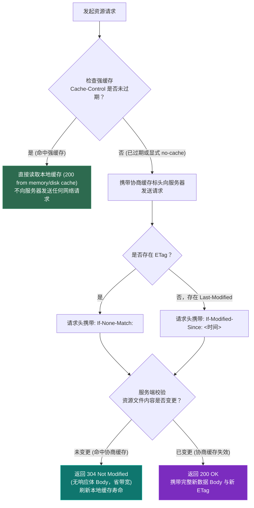
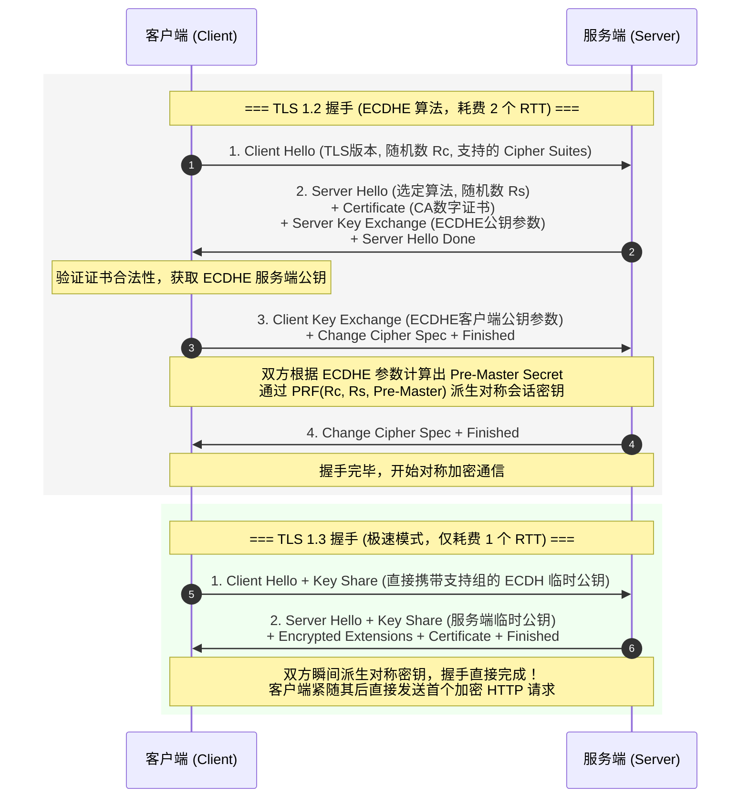
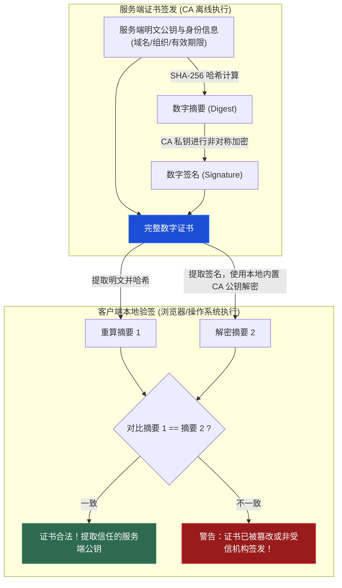

# 第四章 HTTP、HTTPS 与应用层协议演进

> 应用层直接面向业务逻辑与用户进程。HTTP 协议经历了从简单的明文短连接到多路复用二进制分帧，再到脱离 TCP 依赖的 QUIC 架构演进；结合 TLS 密码学体系、WebSocket 全双工通道与高效二进制序列化协议，构筑了现代 Web、分布式服务与跨平台游戏客户端的通信底座。

---

## 0. 考点优先级概览

| 优先级 | 核心模块 | 重点考点 | 考核形式 |
| :--- | :--- | :--- | :--- |
| **P0** | **协议演进与状态码** | HTTP/1.0 $\to$ 1.1 $\to$ 2 $\to$ 3 核心演进对比表、常见状态码辨析（301/302/304/502/504）、GET vs POST 核心边界 | 核心概念辨析、综合对比横评 |
| **P0** | **HTTP 缓存体系** | 强缓存 (Cache-Control/Expires) vs 协商缓存 (ETag/Last-Modified)、304 判定状态机 | **期末 / 面试必考流程状态机** |
| **P1** | **TLS 加密与握手** | 对称与非对称加密结合原理、TLS 1.2 vs TLS 1.3 握手时序推导、CA 证书链防篡改验签数学机制、前向安全 (PFS) | 握手时序分析、密码学机制推导 |
| **P1** | **身份认证与跨域** | Cookie / Session / JWT 无状态 Token 结构对比、CORS 简单请求 vs OPTIONS 预检请求触发条件 | 架构设计、安全与鉴权分析 |
| **P2** | **工业与游戏实战** | WebSocket 101 握手升级协议、Protobuf Varint 变长编码 vs FlatBuffers 零拷贝、HTTP Range 断点续传 | 游戏热更新与高性能序列化 |
| **P3** | **参考实现与速查** | C++ 紧凑 HTTP 报文解析状态机、HTTP/HTTPS 高频面试速答对照表 | 参考代码库（已折叠）、30秒核心速答 |

---

## P0 核心考点：版本演进、状态码与缓存机制

### 1. HTTP 协议版本演进全景对比

| 核心特性 | HTTP/1.0 | HTTP/1.1 | HTTP/2 | HTTP/3 (QUIC) |
| :--- | :--- | :--- | :--- | :--- |
| **底层传输** | TCP 单请求单连接 | TCP 长连接 (`keep-alive`) | TCP 单连接复用 | **UDP (QUIC 协议)** |
| **传输格式** | 纯文本 ASCII | 纯文本 ASCII | **二进制分帧 (Frame/Stream)** | **二进制分帧** |
| **多路复用** | 无 | 支持 Pipeline（易队头阻塞） | **真·多路复用**（多流并发） | **真·多路复用** |
| **队头阻塞** | 传输层 + 应用层双重阻塞 | **应用层队头阻塞**（前响应慢卡死后续） | **TCP 传输层队头阻塞**（丢单包卡整连接） | **彻底无队头阻塞**（流级独立重传） |
| **首部开销** | 每次重复完整发送 | 每次重复完整发送 | **HPACK 静态/动态字典压缩** | **QPACK 压缩**（支持乱序解压） |
| **服务端推送** | 不支持 | 不支持 | 支持 (Server Push) | 支持 |
| **建连耗时** | 1.5 RTT (TCP) | 首次 1.5 RTT，后续复用 | 1.5 RTT (TCP) + 1~2 RTT (TLS) | **0~1 RTT (集成 TLS 1.3 握手)** |

---

### 2. 核心状态码与语义速查

* **2xx (成功)**：
  * `200 OK`：请求成功，响应包含实体数据。
  * `204 No Content`：请求成功，但响应报文不含实体主体（如预检请求响应）。
  * `206 Partial Content`：客户端发送带有 `Range` 首部的分片下载请求成功。
* **3xx (重定向与缓存)**：
  * `301 Moved Permanently`：永久重定向，搜索引擎更新收录 URL。
  * `302 Found`：临时重定向，搜索引擎保留原 URL。
  * `304 Not Modified`：协商缓存命中，客户端直接读取本地缓存，响应不含 Body。
* **4xx (客户端错误)**：
  * `400 Bad Request`：请求报文存在语法错误。
  * `401 Unauthorized`：未通过 HTTP 身份认证。
  * `403 Forbidden`：服务器理解请求但拒绝授权访问。
  * `404 Not Found`：服务器无法找到请求的资源。
* **5xx (服务端错误)**：
  * `500 Internal Server Error`：服务端内部执行逻辑异常抛出。
  * `502 Bad Gateway`：网关/反向代理（如 Nginx）收到了上游应用服务（如 PHP/Node）的无效响应。
  * `503 Service Unavailable`：服务器瞬时超载或停机维护。
  * `504 Gateway Timeout`：网关/反向代理等待上游服务器响应超时。

---

### 3. HTTP 浏览器缓存状态机（强缓存 vs 协商缓存）



#### 关键缓存标头对比
* **强缓存标头**：
  * `Cache-Control: max-age=3600`：自请求起 3600 秒内有效（优先级高于 `Expires`）。
  * `Cache-Control: no-cache`：跳过强缓存，**必须向服务器发起协商缓存校验**。
  * `Cache-Control: no-store`：**彻底禁止一切缓存**（保护机密敏感数据）。
* **协商缓存标头**：
  * `ETag` / `If-None-Match`：基于文件内容生成的唯一哈希指纹，**精度达毫秒级**，优先级高于时间戳。
  * `Last-Modified` / `If-Modified-Since`：文件最后修改时间戳（仅精确到秒级）。

---

## P1 理论进阶与加密认证：TLS 密码学与 Token 鉴权

### 1. TLS 1.2 vs TLS 1.3 握手时序对比

HTTPS 是通过在 HTTP 与 TCP 之间插入 **TLS/SSL (传输层安全协议)** 实现加密与完整性保护的复合体系：



* **前向保密性 (PFS, Perfect Forward Secrecy)**：
  * 传统 RSA 密钥交换直接用服务器私钥解密客户端生成的 Pre-Master。若服务器私钥未来某天泄露，历史所有捕获的抓包流量均可被回溯解密！
  * **ECDHE (椭圆曲线 Diffie-Hellman)**：每次会话临时生成公私钥对，即使服务器私钥永久泄露，攻击者也无法解密过往历史流量。TLS 1.3 已全面强制淘汰 RSA 密钥交换。

---

### 2. CA 证书链与数字签名验签数学模型

为防止中间人攻击 (MITM) 伪造公钥，服务端证书必须经由受信 CA (Certificate Authority) 签名：



---

### 3. 用户鉴权模型对比：Cookie vs Session vs JWT

| 维度 | Cookie | Session | JWT (JSON Web Token) |
| :--- | :--- | :--- | :--- |
| **存储介质** | 客户端浏览器本地存储（最大 4KB） | 服务端内存、数据库或 Redis 缓存 | 客户端（可在 Header `Authorization` 中透传） |
| **有无状态** | 有状态，绑定浏览器环境 | **强状态**，服务端必须维护 Session 表 | **无状态 (Stateless)**，服务端仅验签不存数据 |
| **水平扩展性** | 差，受同源策略限制 | 差，分布式服务需要 Session 粘滞或集中式 Redis | **极佳**，分布式服务集群本地使用密钥解密验签 |
| **数据安全性** | 易受 XSS 窃取与 CSRF 攻击 | 核心数据存放在服务端，相对最安全 | Payload 仅做 Base64 编码，**切勿存放密码等敏感明文** |
| **工业应用场景** | 传统 PC 端浏览器网站登录态 | 企业内部 OA 系统、高风控管理后台 | **跨平台游戏登录**、移动端 App、微服务架构鉴权 |

---

## P2 工程实战与游戏协议：WebSocket、序列化与热更新

### 1. WebSocket 协议 101 升级机制

传统 HTTP 是单向“请求-响应”驱动模型，无法满足实时游戏或大屏推送需求。WebSocket 在复用 80/443 端口的基础上，通过标准 HTTP 报头升级为全双工通道：

1. **客户端发起升级握手**：
   ```http
   GET /chat HTTP/1.1
   Host: game.server.com
   Upgrade: websocket
   Connection: Upgrade
   Sec-WebSocket-Key: dGhlIHNhbXBsZSBub25jZQ==
   Sec-WebSocket-Version: 13
   ```
2. **服务端返回 101 状态码**：
   ```http
   HTTP/1.1 101 Switching Protocols
   Upgrade: websocket
   Connection: Upgrade
   Sec-WebSocket-Accept: s3pPLMBiTxaQ9kYGzzhZRbK+xOo=
   ```
   * **安全防伪校验**：服务端将 `Sec-WebSocket-Key` 与全局固定 GUID (`258EAFA5-E914-47DA-95CA-C5AB0DC85B11`) 拼接后计算 SHA-1 摘要，再进行 Base64 编码作为 `Sec-WebSocket-Accept` 返回，防止普通 HTTP 缓存代理误缓存该连接。

---

### 2. 游戏高性能数据序列化选型

游戏客户端与服务端通信必须在 CPU 编解码耗时与网络带宽之间追求极致：

| 序列化方案 | 编码格式 | 相对体积 | 反序列化吞吐 | 核心底层机制与优缺点 |
| :--- | :--- | :---: | :---: | :--- |
| **JSON** | 纯文本 ASCII | $100\%$ (基准) | 极慢 | 文本解析需要海量字符串匹配与浮点转换，体积臃肿，仅用于后台运营 API。 |
| **Protobuf** | 二进制 | $\sim 15\%\text{ - }25\%$ | 快 | **Varint 变长整型与 ZigZag 编码**。根据数值大小动态决定占用字节数（如整数 1 仅占 1B），结构强约束，游戏通信行业标准。 |
| **FlatBuffers** | 二进制 | $\sim 20\%\text{ - }35\%$ | **瞬时 (零拷贝)** | **支持直接内存映射寻址**。内部直接按内存偏移对齐存储，无需任何内存重分配反序列化即可就地读取字段，适合大规模物理/动画数据流。 |

---

### 3. 游戏资源热更新与 HTTP Range 断点续传

大型游戏资源包（动辄数百 MB 至数 GB）热更新下载严重依赖基于 CDN 的断点续传机制：

* 客户端通过在请求头中指定 `Range: bytes=5242880-10485759`，按 5MB 分块多线程并发拉取资源。
* CDN 服务端支持时返回 **`HTTP/1.1 206 Partial Content`**，并在响应头标明 `Content-Range: bytes 5242880-10485759/52428800`。
* 若中途网络断开，客户端根据本地已写入的磁盘文件偏移量继续请求剩余区间，极大降低弱网环境下的重试代价。

---

## P3 参考实现与速查

### 1. 紧凑型 HTTP 请求报文行与头解析状态机

<details>
<summary><strong>高性能 C++ 零内存拷贝 HTTP 请求行与头部解析器</strong></summary>

```cpp
#include <string_view>
#include <unordered_map>
#include <iostream>

struct HttpRequest {
    std::string_view method;
    std::string_view uri;
    std::string_view version;
    std::unordered_map<std::string_view, std::string_view> headers;
};

class HttpParser {
public:
    static bool Parse(std::string_view raw_stream, HttpRequest& out_req) {
        // 1. 提取请求行
        size_t line_end = raw_stream.find("\r\n");
        if (line_end == std::string_view::npos) return false;

        std::string_view request_line = raw_stream.substr(0, line_end);
        size_t first_space = request_line.find(' ');
        size_t second_space = request_line.rfind(' ');
        if (first_space == std::string_view::npos || second_space == first_space) return false;

        out_req.method  = request_line.substr(0, first_space);
        out_req.uri     = request_line.substr(first_space + 1, second_space - first_space - 1);
        out_req.version = request_line.substr(second_space + 1);

        // 2. 逐行解析 Header 头部
        size_t cursor = line_end + 2;
        while (cursor < raw_stream.size()) {
            size_t next_line = raw_stream.find("\r\n", cursor);
            if (next_line == std::string_view::npos) break;

            if (next_line == cursor) {
                // 遇到空行 \r\n\r\n，头部解析完毕，后续为 Body 实体
                return true; 
            }

            std::string_view header_line = raw_stream.substr(cursor, next_line - cursor);
            size_t colon_pos = header_line.find(':');
            if (colon_pos != std::string_view::npos) {
                std::string_view key = header_line.substr(0, colon_pos);
                std::string_view val = header_line.substr(colon_pos + 1);
                // 去除可能的前导空格
                while (!val.empty() && val.front() == ' ') val.remove_prefix(1);
                out_req.headers[key] = val;
            }
            cursor = next_line + 2;
        }
        return true;
    }
};
```
</details>

---

### 2. 高频面试考点速答对照

| 问题 | 核心回答要点 (30 秒速答) |
| :--- | :--- |
| **HTTP/1.1、HTTP/2 与 HTTP/3 的演进区别？** | HTTP/1.1 引入长连接与分块传输，但存在**应用层队头阻塞**；HTTP/2 引入二进制分帧与多路复用，通过单 TCP 连接并行传输多个流，并使用 HPACK 压缩头部，但面临 **TCP 传输层队头阻塞**；HTTP/3 将底层替换为基于 UDP 的 **QUIC 协议**，原生实现单流独立重传，彻底消除队头阻塞并实现 0-RTT 握手。 |
| **强缓存与协商缓存的执行判定逻辑？** | 客户端优先判定强缓存（`Cache-Control: max-age`），若未过期直接从内存/磁盘读取，不产生网络请求；若失效则向服务器发起协商缓存校验，带上 `If-None-Match` (ETag) 或 `If-Modified-Since`，若资源未变更服务端返回 **304 Not Modified** 复用缓存，若变更则返回 **200 OK** 与新数据。 |
| **HTTPS 是如何兼顾安全与传输性能的？** | 采用**混合加密机制**：在建立连接的 TLS 握手阶段，使用**非对称加密算法 (ECDHE/RSA)** 安全协商出临时的对称密钥；在握手完成后，后续的海量业务数据传输全面切换为极高效的**对称加密算法 (AES/ChaCha20)**，兼具非对称的安全密钥交换与对称的高速吞吐。 |
| **GET 和 POST 在语义与协议层面的本质区别？** | 规范语义上 GET 用于幂等、安全的资源读取，参数置于 URL Query，长度受 URI 限制且可被浏览器主动缓存；POST 用于非幂等、产生副作用的资源创建/修改，参数置于请求体 Body 中，无长度硬性限制，默认不予缓存。 |
| **为什么实时游戏与高频网络通信弃用 JSON 选用 Protobuf？** | JSON 是纯文本协议，解析依赖大量字符串匹配与内存动态分配，CPU 与带宽浪费严重；Protobuf 采用紧凑的**二进制 Varint 编码**与 Tag-Value 结构，体积减少 70% 以上，编解码性能快 5~10 倍，并提供跨语言强类型代码生成。 |
