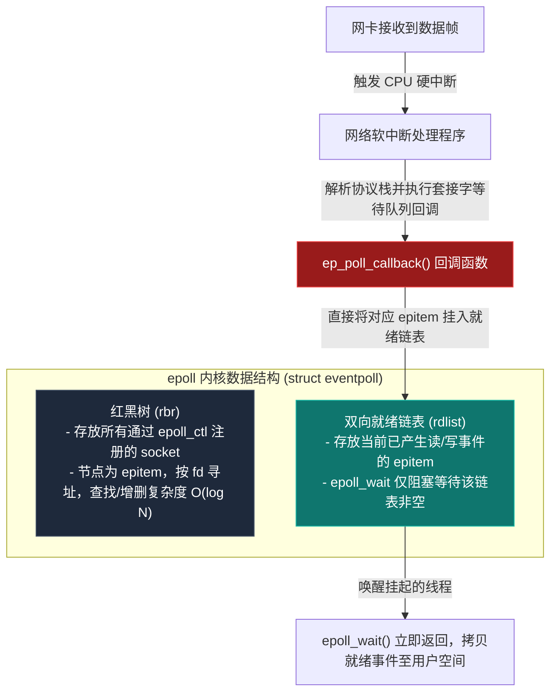
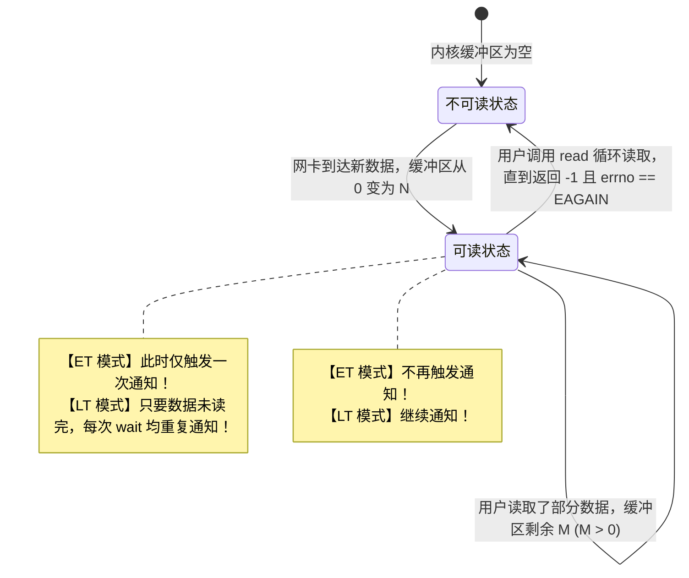
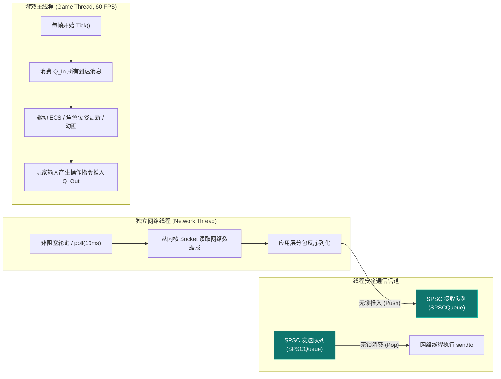

# 第五章 Socket 编程与 I/O 多路复用模型

> 套接字 (Socket) 是操作系统向应用层暴露的网络文件描述符抽象。在高并发网络服务与分布式游戏服务端中，如何以极低的 CPU 开销管理数以万计的并发连接，是系统架构的核心命题。从传统的阻塞 I/O 到基于红黑树与就绪链表的事件驱动多路复用 (epoll)，其演进本质是内核对**上下文切换与无序轮询开销**的极限压榨。

---

## 0. 考点优先级概览

| 优先级 | 核心模块 | 重点考点 | 考核形式 |
| :--- | :--- | :--- | :--- |
| **P0** | **五大 I/O 模型本质** | 阻塞 (BIO)、非阻塞 (NIO)、I/O 多路复用、信号驱动、异步 (AIO) 在两阶段访存中的行为判定 | 核心概念辨析、两阶段图解问答 |
| **P0** | **select/poll/epoll 横评** | 核心数据结构差异、文件描述符限制、内核态向用户态拷贝代价、时间复杂度推导 | **大厂高频面试必问横向对比** |
| **P1** | **epoll 底层内核机理** | `epoll_create`/`ctl`/`wait` 底层红黑树 (`rbr`) 与双向就绪链表 (`rdlist`)、网卡软中断与 `ep_poll_callback` 唤醒机制 | 内核源码级机制分析、性能深度推导 |
| **P1** | **LT vs ET 触发模式** | 水平触发 (Level Triggered) vs 边缘触发 (Edge Triggered) 状态转移、ET 必须配合非阻塞套接字与 `EAGAIN` 循环读的原因 | 状态机推演、手写事件循环逻辑 |
| **P2** | **并发架构与工程实战** | 单 Reactor 单线程 / 多线程 / 主从多 Reactor 架构推导、惊群效应 (Thundering Herd) 消除、客户端 SPSC 无锁队列交互 | 游戏服务端与客户端架构设计 |
| **P3** | **参考实现与速查** | C++ epoll 边缘触发高性能事件循环骨干、I/O 模型高频面试速答对照表 | 参考代码库（已折叠）、30秒核心速答 |

---

## P0 核心考点：五大 I/O 模型与多路复用横评

### 1. Unix 五大 I/O 模型的两阶段行为判定

任何网络 I/O 操作均包含两个物理阶段：
* **阶段 1：数据准备阶段**（数据经网卡到达内核缓冲区）。
* **阶段 2：数据拷贝阶段**（数据从内核缓冲区拷贝到用户进程内存空间）。

| I/O 模型 | 阶段 1：等待数据准备 | 阶段 2：内核向用户态拷贝 | 同步 / 异步判定 | 代表场景 |
| :--- | :--- | :--- | :--- | :--- |
| **阻塞 I/O (BIO)** | **阻塞挂起**（进程让出 CPU，进入睡眠态） | **阻塞挂起** | **同步 I/O** | 简单客户端通信、教学示例 |
| **非阻塞 I/O (NIO)** | **非阻塞轮询**（无数据立即返回 `EWOULDBLOCK`） | **阻塞挂起** | **同步 I/O** | 单线程轮询少量子设备 |
| **I/O 多路复用** | **阻塞在多路复用调用**（监听一组 fd） | **阻塞挂起** | **同步 I/O** | **epoll、Redis、Nginx、游戏服务** |
| **信号驱动 I/O** | **非阻塞**（注册 `SIGIO`，内核就绪后发信号） | **阻塞挂起** | **同步 I/O** | 很少在高性能通用服务中使用 |
| **异步 I/O (AIO)** | **完全非阻塞**（向内核下发读请求后立即返回） | **由内核完成拷贝**（零应用阻塞） | **纯异步 I/O** | Linux `io_uring`、Windows IOCP |

> 💡 **同步 vs 异步判定的终极分水岭**：**“阶段 2（数据从内核空间拷贝到用户空间）是否阻塞应用进程？”**。只要应用线程需要调用 `read()`/`recv()` 阻塞等待数据搬运，就属于**同步 I/O**；多路复用仅是“通知就绪”，因此本质上是**同步 I/O**。

---

### 2. select vs poll vs epoll 核心横向对比

| 评测维度 | select | poll | epoll |
| :--- | :--- | :--- | :--- |
| **内核底层数据结构** | 定长位图 (`fd_set`，默认最大 1024) | 动态链表 / 数组 (`pollfd`) | **红黑树 (保存监听集) + 双向就绪链表 (保存就绪事件)** |
| **支持的最大并发连接** | 受 `FD_SETSIZE` 限制（通常 **1024**） | 无硬性上限（受系统文件句柄总数限制） | **无上限**（仅受进程可用内存限制，GB 级内存可撑数百万） |
| **文件描述符拷贝开销** | 每次调用均需将全部集合从用户态深拷贝至内核态 | 每次调用仍需全量拷贝全部结构体数组 | **仅在 `epoll_ctl` 时单次插入红黑树，`wait` 无需重复全量拷贝** |
| **内核就绪检索复杂度** | $O(n)$ 全量遍历检查 | $O(n)$ 全量遍历检查 | **$O(1)$ 直接读取已就绪链表** |
| **工作模式支持** | 仅支持水平触发 (LT) | 仅支持水平触发 (LT) | **支持水平触发 (LT) 与边缘触发 (ET)** |
| **时间复杂度** | $O(n)$ 随监听 fd 数量线性衰减 | $O(n)$ 随监听 fd 数量线性衰减 | **$O(\text{就绪事件数})$，与总连接数完全解耦** |
| **跨平台支持** | POSIX 标准（全平台通用） | POSIX 标准（全平台通用） | **Linux 专有**（FreeBSD 对应 kqueue，Windows 对应 IOCP） |

---

## P1 理论进阶与机制剖析：epoll 底层原理与触发模式

### 1. epoll 内核实现机理：红黑树 + 就绪链表

Linux 内核通过 `struct eventpoll` 统一管理 epoll 实例：



* **常考误区澄清（mmap 辟谣）**：很多网络资料宣称“epoll 采用 mmap 实现了用户态与内核态零拷贝”，这是严重的技术讹误。Linux 内核中 `epoll_wait` 返回就绪事件列表时，底层调用的是 `__put_user()` 系列宏，**依然执行了微量的内存拷贝**，并未采用 mmap。但由于仅拷贝“就绪事件元数据（几个字节的 `struct epoll_event`）”，其开销微乎其微。

---

### 2. 水平触发 (LT) vs 边缘触发 (ET) 机制深度推导



#### 为什么 ET 模式下必须使用“非阻塞套接字 + 循环读到 EAGAIN”？
1. **防止数据残留饿死**：ET 模式只在套接字状态发生边缘跳变时触发一次通知。若用户仅调用一次 `read()` 读取了前 1024 字节，而内核实际到达了 4096 字节，剩余的 3072 字节将永远无法再次触发通知，导致数据挂死在内核缓冲区中。
2. **防止线程陷入死锁**：若套接字配置为阻塞模式，当用户使用 `while` 循环读取直至缓冲区排空时，最后一次 `read()` 在缓冲区无数据后会**陷入永久阻塞**，导致整个工作线程被卡死，无法处理其他连接。

---

## P2 工程实战与并发架构：Reactor 模式与游戏线程模型

### 1. 经典并发设计模式：Reactor vs Proactor

* **Reactor 模式（事件分发反应堆）**：
  * 基于 I/O 多路复用，核心逻辑为**“事件就绪时通知应用进程，由应用进程自己完成 I/O 读写与业务计算”**。
  * **主从多 Reactor 模型 (Multi-Reactor)**：
    * **MainReactor**：独占单个线程，仅负责监听服务端口并调用 `accept()`，生成已连接套接字后轮询负载均衡至 SubReactor。
    * **SubReactor 池**：通常与物理 CPU 核心数相同，每个 SubReactor 独立拥有一个 `epoll` 实例，专职监听数据的读写并交付工作线程池处理，彻底解耦建连与传输。代表实现：Nginx、Netty。
* **Proactor 模式（前摄式异步）**：
  * 基于异步 I/O，核心逻辑为**“应用进程发起异步读写请求后立即返回，操作系统在内核底层完成数据物理搬运后通知应用进程直接消费”**。代表实现：Windows IOCP。

---

### 2. 游戏客户端网络线程与主线程拓扑

在游戏客户端（如 Unreal Engine / Unity）中，网络 I/O 绝不允许阻塞每秒 60/120 帧的游戏主循环 (Game Thread)。业界通用方案为**网络线程独占 + 环形无锁队列 (SPSC Queue)**：



---

## P3 参考实现与速查

### 1. epoll 边缘触发 (ET) 非阻塞事件循环骨架

<details>
<summary><strong>高性能 C++ epoll ET 模式服务器事件循环实现</strong></summary>

```cpp
#include <sys/epoll.h>
#include <fcntl.h>
#include <unistd.h>
#include <iostream>
#include <vector>
#include <cerrno>

// 辅助函数：将套接字设置为非阻塞
inline bool SetNonBlocking(int fd) {
    int flags = fcntl(fd, F_GETFL, 0);
    return flags != -1 && fcntl(fd, F_SETFL, flags | O_NONBLOCK) != -1;
}

void RunEpollETServer(int listen_fd) {
    SetNonBlocking(listen_fd);

    int epfd = epoll_create1(0);
    if (epfd == -1) return;

    epoll_event ev{};
    ev.events = EPOLLIN | EPOLLET; // 边缘触发模式
    ev.data.fd = listen_fd;
    epoll_ctl(epfd, EPOLL_CTL_ADD, listen_fd, &ev);

    constexpr int kMaxEvents = 1024;
    std::vector<epoll_event> events(kMaxEvents);

    while (true) {
        int nfds = epoll_wait(epfd, events.data(), kMaxEvents, -1);
        for (int i = 0; i < nfds; ++i) {
            int curr_fd = events[i].data.fd;

            if (curr_fd == listen_fd) {
                // 1. 新连接到来：ET 模式下必须循环 accept 捞尽全连接队列
                while (true) {
                    sockaddr_in client_addr{};
                    socklen_t len = sizeof(client_addr);
                    int client_fd = accept(listen_fd, (sockaddr*)&client_addr, &len);
                    if (client_fd == -1) {
                        if (errno == EAGAIN || errno == EWOULDBLOCK) break; // 已捞空
                        break;
                    }
                    SetNonBlocking(client_fd);
                    epoll_event client_ev{};
                    client_ev.events = EPOLLIN | EPOLLET | EPOLLRDHUP;
                    client_ev.data.fd = client_fd;
                    epoll_ctl(epfd, EPOLL_CTL_ADD, client_fd, &client_ev);
                }
            } else if (events[i].events & EPOLLIN) {
                // 2. 客户端数据到达：ET 模式必须循环读取直到 EAGAIN
                char buf[2048];
                while (true) {
                    ssize_t n = read(curr_fd, buf, sizeof(buf));
                    if (n > 0) {
                        // 业务处理逻辑
                    } else if (n == 0) {
                        // 对端优雅关闭连接
                        epoll_ctl(epfd, EPOLL_CTL_DEL, curr_fd, nullptr);
                        close(curr_fd);
                        break;
                    } else {
                        if (errno == EAGAIN || errno == EWOULDBLOCK) break; // 数据已读完
                        // 发生物理异常
                        epoll_ctl(epfd, EPOLL_CTL_DEL, curr_fd, nullptr);
                        close(curr_fd);
                        break;
                    }
                }
            }
        }
    }
    close(epfd);
}
```
</details>

---

### 2. 高频面试考点速答对照

| 问题 | 核心回答要点 (30 秒速答) |
| :--- | :--- |
| **select、poll 与 epoll 的核心性能差异？** | select 使用固定 1024 位图，poll 使用结构体数组，两者每次均需将全部 fd 从用户态拷贝进内核并进行 $O(n)$ 全量轮询；epoll 采用**红黑树**管理监听集（仅 `ctl` 时单次操作），通过网卡中断回调函数将就绪事件挂入**双向就绪链表**，`wait` 时以 $O(\text{就绪数})$ 直接消费，性能与总连接数彻底解耦。 |
| **epoll 的 LT 与 ET 触发机制有何区别？** | LT（水平触发）模式下，只要内核缓冲区有未读数据，每次 `epoll_wait` 均会重复上送事件通知；ET（边缘触发）模式仅在套接字从未就绪跳变为就绪的一瞬间触发单次通知，后续不再重复提醒。 |
| **为什么 ET 模式必须搭配非阻塞 Socket 与循环读取？** | ET 模式单次通知后不再重复提醒，因此必须使用 `while` 循环读取直至缓冲区排空并返回 `EAGAIN`，防止未读完的数据永久挂死；同时必须设为非阻塞模式，否则在排空后的最后一次 `read` 调用会陷入永久阻塞，导致处理线程卡死。 |
| **I/O 多路复用究竟是同步 I/O 还是异步 I/O？** | **完全属于同步 I/O**。因为当多路复用监听到文件描述符可读后，真正将数据包从操作系统内核缓冲区复制到用户态进程内存空间的搬运阶段，依然是由应用程序调用 `read()`/`recv()` 主动执行且在复制期间线程处于阻塞状态。 |
| **什么是网络编程中的“惊群效应”？Linux 如何解决？** | 多个进程同时监听同一个处于 listen 状态的 socket 并挂起在 `epoll_wait` 时，一个新连接到达会触发内核同时唤醒所有休眠进程但仅一人竞争成功的系统颠簸。现代 Linux 在内核层针对 `accept` 消除了惊群，针对多 epoll 实例引入了 `EPOLLEXCLUSIVE` 标志位或采用多端口 `SO_REUSEPORT` 独立分发。 |
