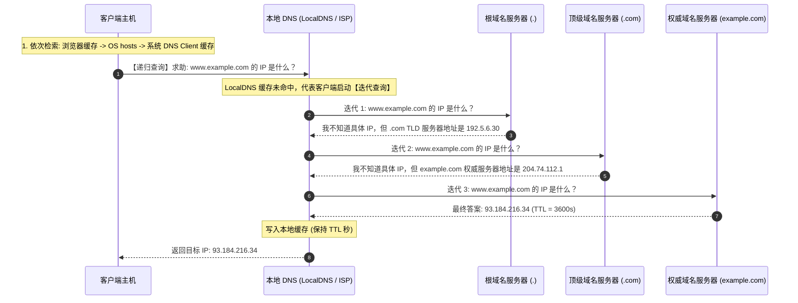
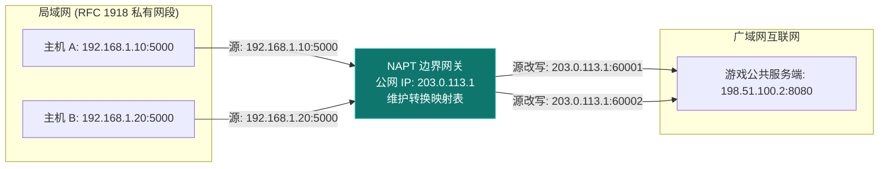
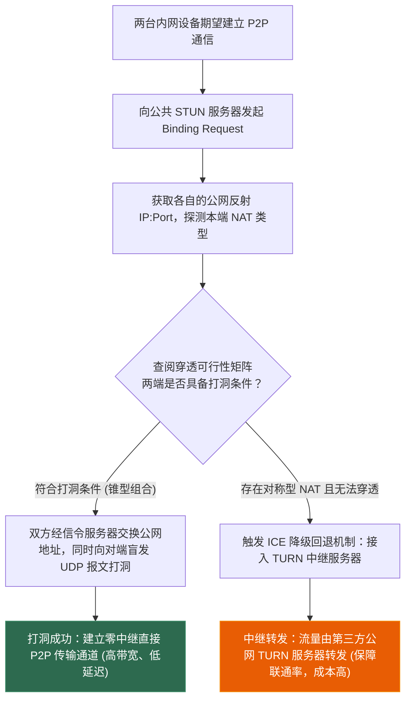
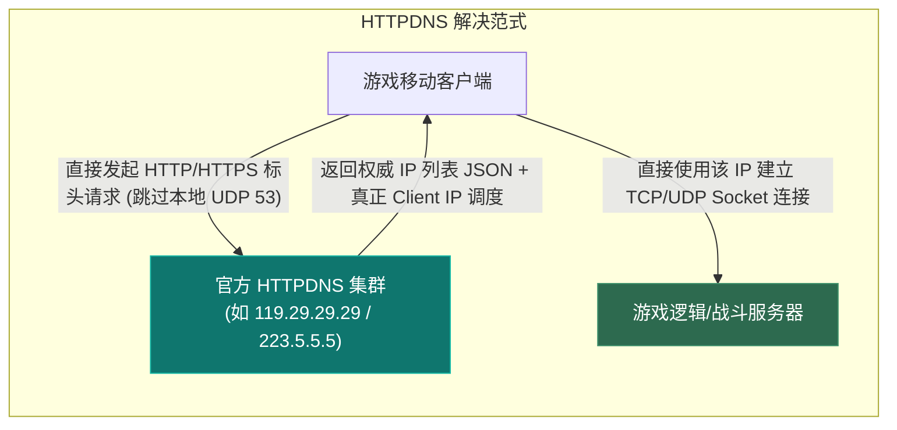

# 第六章 网络基础设施：DNS、NAT 穿透与 CDN

> 互联网的大规模稳健运行高度依赖于三大支撑底座：域名系统 (DNS) 构筑了分布式分层命名空间；网络地址转换 (NAT) 延缓了 IPv4 地址枯竭，但也给端到端对等通信 (P2P) 带来了阻隔；内容分发网络 (CDN) 则通过 Anycast 路由与边缘节点缓存缩短了物理链路延迟。理解这三者的交互是掌握大规模网络分发与 P2P 联机架构的关键。

---

## 0. 考点优先级概览

| 优先级 | 核心模块 | 重点考点 | 考核形式 |
| :--- | :--- | :--- | :--- |
| **P0** | **DNS 寻址与记录** | DNS 递归查询与迭代查询时序、根/顶级/权威 DNS 层级树、核心记录类型 (A/AAAA/CNAME/NS/TXT) | 流程时序分析、概念与记录辨析 |
| **P0** | **NAT 与端口映射** | NAPT 转换表维护原理、私有 IP (RFC 1918) 与公网路由边界 | 机制分析、转换表推算 |
| **P1** | **NAT 穿透与 P2P 矩阵** | **NAT 四种分类（全锥型、IP受限锥型、端口受限锥型、对称型）**、STUN/TURN/ICE 双向打洞状态机与穿透可行性判定矩阵 | **大厂面试经典推导、网络架构设计** |
| **P1** | **DNS 安全与现代演进** | LocalDNS 缓存污染与运营商劫持、HTTPDNS 移动端防劫持架构、DoH (DNS over HTTPS) 与 DoT | 线上故障排查、安全机制推导 |
| **P2** | **工业与游戏实战** | 局域网/P2P 联机打洞工程实现、CDN Anycast BGP 路由与回源机制、游戏大包资源热更新就近加速 | 架构设计、弱网与网络调度 |
| **P3** | **参考实现与速查** | C++ 简易 STUN 协议 Binding Request 报文封装与公网映射解析、网络基础设施高频速答对照表 | 参考代码库（已折叠）、30秒核心速答 |

---

## P0 核心考点：DNS 解析体系与 NAT 转换机制

### 1. DNS 分层树状命名空间与查询流程

DNS 采用树状分级拓扑：根域名服务器 (`.`) $\to$ 顶级域名服务器 TLD (`.com` / `.cn`) $\to$ 权威域名服务器 (`example.com`)：



* **递归查询 (Recursive Query)**：客户端发起的请求，服务端“必须负责到底”，直到返回最终 IP 或报错。
* **迭代查询 (Iterative Query)**：LocalDNS 向上级发起的一问一答，上级不直接代理寻址，而是返回“下一级可询问的 DNS 实体 IP”。

#### 核心 DNS 记录类型
* **A 记录 (Address)**：将域名直接映射为 32 位 IPv4 地址。
* **AAAA 记录**：将域名映射为 128 位 IPv6 地址。
* **CNAME 记录 (Canonical Name)**：别名记录，将一个域名指向另一个域名（CDN 厂商就近接入的核心手段）。
* **NS 记录 (Name Server)**：指定该子域名由哪台权威 DNS 服务器负责解析。

---

### 2. NAPT (网络地址与端口转换) 原理

私网设备（如 `192.168.x.x`）访问外网时，家庭/企业边界路由器通过动态维护 **NAPT 转换表** 映射端口：



* **出站报文改写**：路由器修改 IP 头部的源 IP 地址为自己的公网 IP，并修改传输层的源端口号为动态分配的外部端口。
* **入站报文还原**：服务端回包时目的地址为 `203.0.113.1:60001`，路由器查表检索到内网主机 `192.168.1.10:5000`，修改目的 IP/端口后向内网交换机转发。

---

## P1 理论进阶与机制推导：NAT 穿透与 P2P 矩阵

### 1. RFC 3489 规范下的 NAT 四大类型定义

| NAT 类型 | 端口映射规则 (Mapping) | 外部入站过滤规则 (Filtering) | 穿透特征与难度 |
| :--- | :--- | :--- | :--- |
| **1. 完全锥型 (Full Cone)** | 内网同一 `IP:Port` 映射为固定外网 `IP:Port`。 | **无任何过滤**。任何外部公网主机均可向该映射端口发送报文。 | 穿透极其容易，单次发包建立映射后全局可用。 |
| **2. 受限锥型 (Restricted Cone / IP-Restricted)** | 内网同一 `IP:Port` 映射为固定外网 `IP:Port`。 | **仅校验源 IP**。只有内网主机曾经主动发送过数据的公网 IP 才能入站。 | 较容易，对端必须先收到信令触发本端发包。 |
| **3. 端口受限锥型 (Port-Restricted Cone)** | 内网同一 `IP:Port` 映射为固定外网 `IP:Port`。 | **强校验源 IP + 源 Port**。只有内网主机曾经主动发送过的完整 `IP:Port` 才能入站。 | 业界最常见家庭路由器类型，需精确相互对发打洞。 |
| **4. 对称型 (Symmetric NAT)** | **内网向不同目标 IP:Port 发包，NAT 会为其分配不同的外网映射端口！** | **强校验源 IP + 源 Port**。 | **最严苛**。无法通过 STUN 获知用于对端通信的具体端口，直连打洞基本失效。 |

---

### 2. 双向 P2P 直连打洞穿透可行性矩阵

在无中心服务器转发的情况下，两台内网主机 Client A 与 Client B 进行 P2P UDP 打洞的可行性判定如下：

| Client A \ Client B | 完全锥型 (Full Cone) | 受限锥型 (Restricted) | 端口受限锥型 (Port-Restricted) | 对称型 (Symmetric) |
| :--- | :---: | :---: | :---: | :---: |
| **完全锥型 (Full Cone)** | **可直接穿透** | **可直接穿透** | **可直接穿透** | **可打洞穿透** |
| **受限锥型 (Restricted)** | **可直接穿透** | **可打洞穿透** | **可打洞穿透** | **无法穿透 (需中继)** |
| **端口受限锥型 (Port-Restricted)** | **可直接穿透** | **可打洞穿透** | **可打洞穿透** | **无法穿透 (需中继)** |
| **对称型 (Symmetric)** | **可打洞穿透** | **无法穿透 (需中继)** | **无法穿透 (需中继)** | **绝无可能打洞 (必走中继)** |

---

### 3. STUN / TURN / ICE 穿透标准状态机



---

## P2 工程实战与游戏架构：HTTPDNS 防劫持与 CDN 加速

### 1. 传统 LocalDNS 痛点与 HTTPDNS 架构

在移动网络与弱网环境下，传统运营商 LocalDNS 存在严重弊端：
1. **域名劫持与恶意插桩**：中间运营商劫持 UDP 53 明文报文，篡改 A 记录注入广告，甚至导流至竞品。
2. **跨运营商调度延迟**：权威 DNS 根据 LocalDNS 出口 IP 进行就近调度，若玩家配置了错误的公共 DNS（如 Google 8.8.8.8），会导致华东电信玩家被调度至华南联通节点。
3. **缓存污染与 TTL 生效慢**：部分运营商无视权威 DNS 设置的 TTL，私自长久缓存，导致游戏故障热迁移无法快速生效。



---

### 2. CDN Anycast 路由与边缘缓存架构

CDN (Content Delivery Network) 通过在全球各骨干网边缘机房部署反向代理服务器：

1. **Anycast BGP 路由注入**：多个物理机房同时向全球 BGP 路由器宣告同一个公网 IP 地址。路由器根据自治系统 AS 跳数自动将客户端路由至**物理拓扑距离最近**的边缘机房。
2. **回源机制 (Back-to-Source)**：
   * 若边缘节点命中缓存，直接以万兆内网线速吐出数据。
   * 若边缘节点 Cache Miss，通过自建优质高速骨干专线逐级向二级中心节点或源站 (Origin Server) 申请拉取，并异步写入本地存储。

---

## P3 参考实现与速查

### 1. 简易 STUN 协议 Binding Request 报文封装

<details>
<summary><strong>跨平台 C++ STUN (RFC 5389) 探测公网映射 IP/端口核心骨干</strong></summary>

```cpp
#include <cstdint>
#include <cstring>
#include <vector>
#include <iostream>

#if defined(_WIN32)
#include <winsock2.h>
#else
#include <arpa/inet.h>
#endif

// RFC 5389 STUN 基础报头 (20 字节)
#pragma pack(push, 1)
struct StunHeader {
    uint16_t msg_type;       // 0x0001: Binding Request; 0x0101: Binding Success Response
    uint16_t msg_length;     // 报文属性体长度 (不含这 20 字节头部)
    uint32_t magic_cookie;   // 固定值 0x2112A442
    uint8_t  transaction_id[12]; // 96 位随机唯一事务 ID
};
#pragma pack(pop)

static_assert(sizeof(StunHeader) == 20, "StunHeader must be exactly 20 bytes!");

class StunProber {
public:
    static std::vector<uint8_t> BuildBindingRequest() {
        std::vector<uint8_t> packet(sizeof(StunHeader));
        StunHeader* hdr = reinterpret_cast<StunHeader*>(packet.data());
        hdr->msg_type     = htons(0x0001); // Binding Request
        hdr->msg_length   = htons(0x0000); // 无附加属性
        hdr->magic_cookie = htonl(0x2112A442);
        
        // 伪随机填充 96-bit 事务 ID
        for (int i = 0; i < 12; ++i) {
            hdr->transaction_id[i] = static_cast<uint8_t>(rand() % 256);
        }
        return packet;
    }

    // 解析 STUN 服务端返回的 XOR-MAPPED-ADDRESS 属性
    static bool ParseMappedAddress(const uint8_t* resp, size_t len, uint32_t& out_ip, uint16_t& out_port) {
        if (len < sizeof(StunHeader)) return false;
        const StunHeader* hdr = reinterpret_cast<const StunHeader*>(resp);
        if (ntohs(hdr->msg_type) != 0x0101) return false; // 必须是 Success Response

        size_t offset = sizeof(StunHeader);
        uint16_t body_len = ntohs(hdr->msg_length);

        while (offset + 4 <= sizeof(StunHeader) + body_len && offset + 4 <= len) {
            uint16_t attr_type = ntohs(*reinterpret_cast<const uint16_t*>(resp + offset));
            uint16_t attr_len  = ntohs(*reinterpret_cast<const uint16_t*>(resp + offset + 2));
            offset += 4;

            if (attr_type == 0x0020) { // XOR-MAPPED-ADDRESS
                if (attr_len >= 8 && offset + attr_len <= len) {
                    uint8_t family = resp[offset + 1];
                    if (family == 0x01) { // IPv4
                        uint16_t raw_port = *reinterpret_cast<const uint16_t*>(resp + offset + 2);
                        uint32_t raw_ip   = *reinterpret_cast<const uint32_t*>(resp + offset + 4);

                        // 解 XOR 混淆: 端口与 magic_cookie 高 16 位异或，IP 与 magic_cookie 异或
                        out_port = ntohs(raw_port) ^ 0x2112;
                        out_ip   = ntohl(raw_ip)   ^ 0x2112A442;
                        return true;
                    }
                }
            }
            offset += (attr_len + 3) & ~3; // 4 字节对齐
        }
        return false;
    }
};
```
</details>

---

### 2. 高频面试考点速答对照

| 问题 | 核心回答要点 (30 秒速答) |
| :--- | :--- |
| **DNS 递归查询与迭代查询的区别？** | 递归查询由接收方“代劳到底”，客户端仅向 LocalDNS 发起单次请求便直接等待最终结果；迭代查询由发起方逐层询问，LocalDNS 依次向根域、顶级域、权威域发起一问一答的多次尝试，每次仅获取下一级 DNS 节点的引用地址。 |
| **DNS 为什么通常采用 UDP 端口 53？何时使用 TCP？** | UDP 无连接、无握手延迟、头部开销小，适合大部分小于 512 字节的高频快速解析请求；当**响应报文体积超过 512 字节**（触发 TC 截断位）、执行**主从 DNS 区域传送 (Zone Transfer)** 或采用安全拓展 DNSSEC 时，强制切换为 TCP 端口 53。 |
| **为什么对称型 NAT (Symmetric NAT) 极难穿透？** | 锥型 NAT 对内网同一 `IP:Port` 映射为固定外网端口；而对称型 NAT 面向不同的外部目标 IP 会**动态分配完全不同的外部映射端口**。主机无法通过第三方 STUN 服务器提前预知与目标节点通信时所生成的真实端口号，导致对方盲发探测包无法命中过滤规则。 |
| **什么是 HTTPDNS？它解决了传统 DNS 的什么核心痛点？** | HTTPDNS 绕开底层操作系统与运营商的 LocalDNS，直接通过 HTTP/HTTPS REST API 访问权威 DNS 集群。从物理层面根除了运营商的 **DNS 劫持与广告篡改**，并能基于真实的客户端出口 IP 实现**跨网/跨区精准就近调度**与分钟级故障容灾切换。 |
| **CDN 是如何利用 DNS 与 CNAME 实现就近加速的？** | 业务域名在权威 DNS 中配置 CNAME 别名指向 CDN 调度服务；当用户发起查询时，智能 DNS 根据客户端地理位置与所属运营商，返回物理拓扑距离最近的 CDN 边缘边缘节点 IP，客户端随后直接从最近节点高速拉取缓存资源。 |
