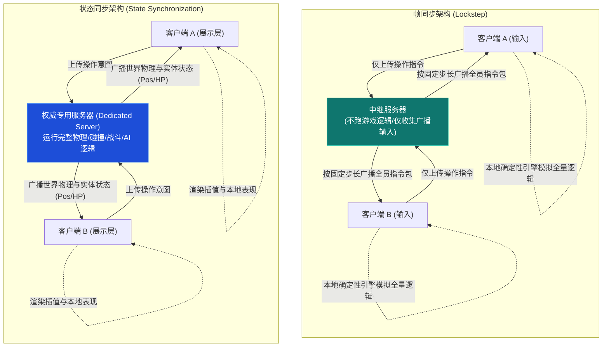
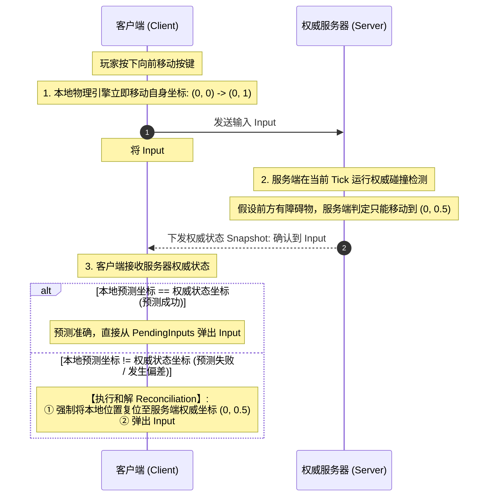
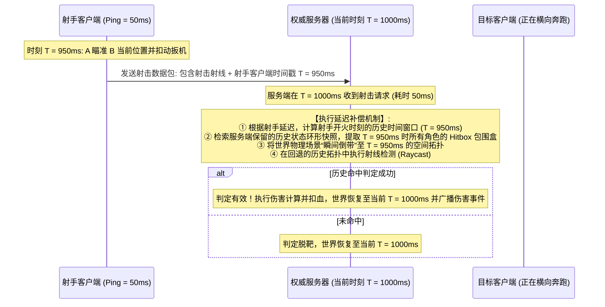

# 第七章 游戏网络同步专题：一致性与低延迟架构

> 广域网物理光速与路由排队时延是不可消除的物理客观规律。多人联机游戏设计的核心矛盾，是在**全局世界状态一致性 (Consistency)** 与**本地玩家即时操作响应性 (Responsiveness)** 之间寻找系统级平衡。通过帧同步、状态同步、客户端预测回滚与服务端延迟补偿，工程架构师在有限的网络带宽与不可抗拒的时延下构建出低延迟、强反作弊的虚拟交互世界。

---

## 0. 考点优先级概览

| 优先级 | 核心模块 | 重点考点 | 考核形式 |
| :--- | :--- | :--- | :--- |
| **P0** | **两大核心同步范式** | 帧同步 (Lockstep) vs 状态同步 (State Sync) 十维度全景对比、带宽与算力分配拓扑 | **游戏大厂客户端/服务端必考对比** |
| **P0** | **延迟隐藏核心技术** | 客户端预测 (Prediction) 与服务端和解 (Reconciliation) 状态转移、未确认输入队列维护 | 机制分析、状态时序图绘制 |
| **P1** | **确定性与射击补偿** | 定点数数学 (Fixed-Point) 消除跨平台浮点不确定性原理、**延迟补偿 (Lag Compensation) 历史快照倒回检测数学模型** | 经典大题推导、反作弊与射击命中判定 |
| **P1** | **平滑插值与时钟同步** | 实体内插值 (Interpolation) 与外推 (Dead Reckoning)、Jitter Buffer 抖动吸收、NTP 双向时差与 RTT 估算 | 算法公式推导、弱网优化模型 |
| **P2** | **工业带宽与视野优化** | Delta 状态压缩、数值量化与位打包 (Bit Packing)、九宫格 AOI (Area of Interest) 视野裁剪、断线重连追帧优化 | 引擎底层架构、高并发网络协议设计 |
| **P3** | **参考实现与速查** | C++ 乐观帧同步回滚与快速追帧骨架实现、游戏网络同步高频面试速答对照表 | 参考代码库（已折叠）、30秒核心速答 |

---

## P0 核心考点：帧同步 vs 状态同步与预测和解

### 1. 帧同步 (Lockstep) vs 状态同步 (State Sync) 全景对比



| 维度 | 帧同步 (Lockstep / 乐观帧同步) | 状态同步 (Server-Authoritative State Sync) |
| :--- | :--- | :--- |
| **权威决策核心** | **所有客户端并行执行相同逻辑**，服务器仅为输入转发中继 | **专用服务器 (DS) 具备绝对权威**，客户端仅为终端展示 |
| **传输数据内容** | **极小**：仅传输玩家操作指令（如移动摇杆向量、按键触发） | **较大**：传输实体位姿 (Transform)、血量属性、状态快照 |
| **网络带宽消耗** | 极低（与同屏实体数量无关，仅与玩家输入数挂钩） | 较高（与视野范围内同步实体数量呈线性正相关） |
| **确定性依赖** | **强依赖**：所有客户端执行结果必须严格达到位级别一致 | **无依赖**：各端表现与模拟细节由服务器权威裁定覆盖 |
| **网络延迟表现** | 传统模式延迟受制于最慢玩家；乐观模式需回滚追帧 | 配合强客户端预测，本地玩家操作可做到零感延迟 |
| **断线重连实现** | 较重：需从关键帧快照重演历史所有帧输入执行**快速追帧** | 极简：服务器直接下发当前时刻全量世界状态快照即可就地恢复 |
| **反作弊能力** | **较弱**：全量数据存在于客户端内存中，易受内存透视与全图挂破解 | **极强**：服务器权威验证物理碰撞与视线遮挡，天然防全图透视 |
| **对战回放成本** | **极低**：只需保存初始种子和全场各帧玩家输入流（几百 KB） | 极高：需连续高频录制全图实体状态差量数据流（数十 MB） |
| **工业代表作品** | 《王者荣耀》、《英雄联盟》、《星际争霸2》、《街霸》系列 | 《CS2》、《守望先锋》、《PUBG》、《原神》、《魔兽世界》 |

---

### 2. 客户端预测与服务端和解 (Client-side Prediction & Reconciliation)

在状态同步游戏中，若每次移动均等待服务器返回才更新画面，玩家将感知到数十至上百毫秒的操作黏滞。因此客户端采用**乐观预测先行**策略：



---

## P1 理论进阶与确定性推导：定点数与延迟补偿

### 1. 跨平台确定性 (Determinism) 与定点数数学模型

帧同步的数学公理基础是：**相同的初始状态集合 $S_0$ + 相同顺序的离散输入序列 $I_1, I_2, \dots, I_n \implies$ 必然产生严格位一致的最终状态 $S_n$**。

#### 为什么 IEEE 754 浮点数无法用于帧同步：
1. **编译器与指令集优化差异**：x86 的 FPU 扩展精度（80-bit 内部寄存器）在溢出截断时与 ARM 的 VFP/NEON 存在微小的舍入差异。
2. **快速数学库指令差异**：开启 `/fp:fast` 后，编译器可能将 $a \times b + c$ 融合成单周期 FMA (Fused Multiply-Add) 指令，消除中间舍入，与无 FMA 硬件的计算结果在末位比特产生微小分歧。
3. **分歧放大效应 (Butterfly Effect)**：即使位置坐标在第 10 帧仅产生 $0.00001$ 的舍入误差，该误差会在后续物理碰撞判定中导致“命中”与“未命中”的分歧，几秒钟内彻底演化为两台设备上完全不同维度的游戏世界。

#### 定点数 (Fixed-Point) 数学推导与实现
放弃浮点表示，使用高位表示整数、低位表示小数的定点整数模拟实数（通常采用 Q16.16 或 Q32.32 格式，以 64 位整数实现）：

$$\text{FixedVal} = \lfloor x \times 2^{16} \rfloor$$

* **加减法**：直接整型加减：$A + B$。
* **乘法**：$(A \times B) \gg 16$（需使用 64 位中间变量防止 32 位溢出）。
* **除法**：$(A \ll 16) / B$。

---

### 2. 延迟补偿 (Lag Compensation) 历史时间倒回判定推导

在竞技射击游戏 (FPS) 中，玩家 A 屏幕上瞄准并射击玩家 B 时，玩家 A 看到的画面实际上是 **$\frac{1}{2}\text{RTT}_A$ 之前的历史景象**。若服务端使用当前瞬时坐标进行射线碰撞检测，玩家 A 即使枪枪爆头也会因判定为空而产生强烈的违和感。



* **掩体后被击中 (Peeker's Advantage 效应)**：延迟补偿优先保证了射击者的“指哪打哪”，其直接代价是受害者玩家 B 即使已经跑进掩体，但由于其在玩家 A 的历史视图中仍在掩体外，服务器仍会判定命中，受害者会感知到“被拐弯子弹击中”。

---

## P2 工程实战与引擎底层：状态压缩、AOI 与抖动吸收

### 1. 状态快照带宽优化：Delta 压缩与位打包

大型多人游戏若无节制广播全量 Transform，百人同屏下带宽将瞬间打满：

1. **Delta 差量压缩**：服务端仅向客户端广播相对于客户端已确认的上一帧所**发生变更的属性**。未移动实体的坐标与未变化的血量字段完全不编码。
2. **定点量化与位打包 (Bit Packing)**：
   * 旋转四元数 $(x, y, z, w)$：由于单位四元数满足 $x^2 + y^2 + z^2 + w^2 = 1$，仅需标记绝对值最大的分量索引（2-bit），随后仅传输其余 3 个分量并压缩至 10-bit 定点整数，总带宽由 128-bit 锐减至 32-bit。
   * 布尔标记位：将 8 个 `bool` 变量压缩合并入单个 `uint8_t` 位掩码中。
3. **空间九宫格兴趣管理 (Area of Interest, AOI)**：将大地图划分为网格，通过二维跳表或十字链表管理实体位置，仅向客户端推送其视野九宫格内的实体状态，远距离实体完全不发送。

---

### 2. 实体内插值 (Interpolation) 与抖动缓冲 (Jitter Buffer)

客户端渲染帧率（通常 60~144 FPS）远高于服务器网络 Tick 率（通常 20~64 Hz），直接使用离散网络包驱动会导致画面剧烈瞬移抖动：

* **内插值延迟窗口 (Interpolation Delay)**：
  客户端主动设置一个固定平滑延迟（如 $100\text{ms}$，相当于 2 个服务器 Tick 间隔），接收到的状态包首先存入环形队列。
* **双样本线性插值**：
  客户端在渲染时刻 $T_{\text{render}} = T_{\text{current}} - 100\text{ms}$ 时，在队列中找到紧邻前后两次服务器状态 $S_1(T_1)$ 与 $S_2(T_2)$，通过平滑插值公式渲染中间平滑位姿：
  $$\text{Pos}_{\text{render}} = \text{Lerp}(S_1.\text{Pos}, S_2.\text{Pos}, \frac{T_{\text{render}} - T_1}{T_2 - T_1})$$

---

## P3 参考实现与速查

### 1. 乐观帧同步回滚与快速追帧骨架实现

<details>
<summary><strong>高性能 C++ 乐观帧同步 (预测、回滚与追帧重新模拟) 骨架</strong></summary>

```cpp
#include <vector>
#include <deque>
#include <cstdint>
#include <iostream>

struct PlayerInput {
    int32_t move_x;
    int32_t move_y;
    uint32_t buttons;
};

struct GameState {
    int32_t pos_x;
    int32_t pos_y;
    int32_t hp;
};

// 确定性纯函数模拟逻辑
GameState SimulateLogic(const GameState& prev, const std::vector<PlayerInput>& inputs) {
    GameState next = prev;
    for (const auto& in : inputs) {
        next.pos_x += in.move_x;
        next.pos_y += in.move_y;
    }
    return next;
}

class OptimisticLockstepEngine {
public:
    OptimisticLockstepEngine() : current_frame_(0), confirmed_frame_(0) {
        state_history_.push_back(GameState{0, 0, 100});
    }

    // 本地主循环每逻辑帧 Tick
    void UpdateLocalFrame(const PlayerInput& local_input) {
        // 1. 记录本帧本地预测输入并保存当前状态快照
        std::vector<PlayerInput> predicted_inputs = {local_input};
        input_history_.push_back(predicted_inputs);

        // 2. 本地先行模拟推进
        GameState next_state = SimulateLogic(state_history_.back(), predicted_inputs);
        state_history_.push_back(next_state);
        current_frame_++;
    }

    // 收到服务端广播的权威真实帧输入集合
    void OnServerFrameBroadcast(uint32_t frame_id, const std::vector<PlayerInput>& authoritative_inputs) {
        if (frame_id >= input_history_.size()) return;

        // 检查预测是否与服务器权威输入完全一致
        bool mismatch = false;
        if (input_history_[frame_id].size() != authoritative_inputs.size()) {
            mismatch = true;
        } else {
            for (size_t i = 0; i < authoritative_inputs.size(); ++i) {
                if (input_history_[frame_id][i].move_x != authoritative_inputs[i].move_x ||
                    input_history_[frame_id][i].move_y != authoritative_inputs[i].move_y) {
                    mismatch = true;
                    break;
                }
            }
        }

        if (mismatch) {
            // 预测失败！执行回滚与快速追帧
            RollbackAndResimulate(frame_id, authoritative_inputs);
        }
        confirmed_frame_ = frame_id;
    }

private:
    void RollbackAndResimulate(uint32_t error_frame, const std::vector<PlayerInput>& correct_inputs) {
        // 1. 纠正出错帧的输入
        input_history_[error_frame] = correct_inputs;

        // 2. 从出错帧起点开始连续重新推演模拟直至当前最新帧
        for (uint32_t f = error_frame; f < current_frame_; ++f) {
            state_history_[f + 1] = SimulateLogic(state_history_[f], input_history_[f]);
        }
    }

    uint32_t current_frame_;
    uint32_t confirmed_frame_;
    std::vector<GameState> state_history_;
    std::vector<std::vector<PlayerInput>> input_history_;
};
```
</details>

---

### 2. 高频面试考点速答对照

| 问题 | 核心回答要点 (30 秒速答) |
| :--- | :--- |
| **帧同步与状态同步的本质区别？** | 帧同步客户端本地运行全套确定性逻辑，服务端仅收集并广播纯操作指令，带宽极低且天然支持回放，但强依赖定点数确定性且易受外挂内存透视；状态同步由权威服务端统一运行物理和战斗逻辑并下发状态快照，天然防作弊、断线重连快，但对服务器算力与带宽要求高。 |
| **为什么帧同步必须使用定点数 (Fixed-Point)？** | 浮点数 (IEEE 754) 在不同 CPU 架构、指令集优化（如 FMA）与不同编译器舍入模式下会产生末位位级精度分歧。帧同步的任何微小分歧都会在后续帧的物理和碰撞判断中呈雪崩式放大，导致各端世界彻底脱轨反相。 |
| **简述客户端预测与服务端和解 (Reconciliation) 的流程？** | 客户端按下操作按键后立即在本地物理模拟先行更新自身位置以消除感知延迟，并将输入序号推入在途队列；当收到服务端权威状态后对比坐标，若有偏差则强制将自身复位至服务端历史权威坐标，并从在途队列中重放后续所有未确认指令重新推演至当前帧。 |
| **FPS 游戏中的“延迟补偿”原理与负面影响？** | 服务端维护数秒内的历史世界包围盒环形缓冲区。当收到射击请求时，根据射手网络延迟将其视图回退到历史时间点进行精确射线相交检测；其主要负面效应是“受害者掩体后中弹 (Peeker's Advantage)”，即受害者已经跑入掩体但在对方历史视野中仍旧暴露。 |
| **什么是实体插值 (Interpolation)？为什么能消除画面卡顿？** | 实体插值人为在客户端引入一小段固定平滑延迟（如 100ms），渲染引擎始终在队列中最近两个已到达的服务端真实历史快照之间执行线性平滑过渡，从而完全吸收广域网抖动对位移连续性的破坏，使低频网络包呈现高帧率丝滑视觉体验。 |
