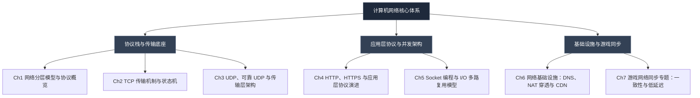

# 计算机网络核心体系：从底层协议到高性能游戏实战

> 面向 **C++ 与游戏客户端/系统开发** 的计算机网络知识库。全系列兼顾**校内期末考 / 考研 408 经典定量计算大题与协议状态机推演**，以及**大厂底层技术面所聚焦的工业级网络性能调优、无阻塞 I/O 驱动与多人实时联机同步架构**。

---

## 知识框架与考核全景

计算机网络的考察由**经典理论与定量计算**和**工业级底层与游戏实战**两大维度构成：

| 模块 | 核心考核要点 | 重点章节 | 考核形式 |
| :--- | :--- | :--- | :--- |
| **网络分层与时延体系** | TCP/IP 四层 vs OSI 七层、数据封装/解封装、URL 请求全时序、时延四要素计算、BDP、CIDR 掩码划分 | [第一章](./01_network_model/) | **必考 CIDR 子网大题**、时延推导 |
| **TCP 传输机制与状态机** | 三次握手/四次挥手 11 种状态机、TIME_WAIT/CLOSE_WAIT 治理、拥塞控制 4 阶段数值演进、Nagle 算法 | [第二章](./02_tcp/) | **必考拥塞窗口演进大题**、状态转移分析 |
| **UDP 与可靠传输选型** | UDP 8 字节极简报头、TCP vs UDP 横评、ARQ (停等/GBN/SR) 信道利用率推导、KCP 激进重传、QUIC 架构 | [第三章](./03_udp/) | **必考 ARQ 窗口利用率大题**、协议选型 |
| **HTTP/HTTPS 与应用层** | HTTP/1.1 vs 2 vs 3 演进、强缓存与协商缓存状态机、TLS 1.2 vs 1.3 握手密码学、WebSocket、Protobuf | [第四章](./04_http/) | 缓存流程追踪、TLS 握手时序分析 |
| **Socket 编程与 I/O 模型** | 五大 I/O 模型两阶段判定、select/poll/epoll 底层数据结构横评、LT vs ET 触发、Reactor 高并发架构 | [第五章](./05_socket_and_io/) | **大厂高频底层面试**、高并发架构设计 |
| **网络基础设施 (DNS/NAT/CDN)** | DNS 递归/迭代解析流程、NAT 四种类型过滤规则与 P2P 穿透矩阵、HTTPDNS 移动端防劫持、CDN Anycast | [第六章](./06_infrastructure/) | 穿透可行性判定、线上故障与防劫持 |
| **游戏网络同步专题** | 帧同步 (Lockstep) vs 状态同步 (State Sync)、定点数消除浮点差异、客户端预测回滚、延迟补偿回溯 | [第七章](./07_game_networking/) | **游戏大厂核心面试大题**、同步架构设计 |

---

## 章节导航

### 📗 协议栈与传输底座 (Ch 1, 2, 3)

---

#### [第一章 网络分层模型与协议概览](./01_network_model/)

> 从物理信道时延到协议分层解耦，剖析端到端请求全流程与经典定量计算。

**核心内容**：
- **P0 核心考点**：TCP/IP 四层 vs OSI 七层映射表、逐层 PDU 封装/解封装、URL 完整请求时序、IPv4 报头字段
- **P1 理论与计算**：网络时延四要素计算与光纤时延推演、时延带宽积 (BDP)、**CIDR 子网划分标准 7 步矩阵推导模板**、以太网 64 字节最小帧长推导
- **P2 工程实战**：MTU 1500B / MSS 1460B 边界、IP 分片雪崩丢包陷阱与 DF=1 规避、游戏紧凑二进制包头 `#pragma pack(push, 1)` 与网络端序

---

#### [第二章 TCP 传输机制与状态机](./02_tcp/)

> 深入连接管理 11 种状态转移，全面推导滑动窗口、拥塞控制数值演化与工程陷阱。

**核心内容**：
- **P0 核心考点**：三次握手（防历史连接）与四次挥手标准时序、11 种状态转移机、TIME_WAIT 2MSL 根本成因、CLOSE_WAIT 堆积排查
- **P1 理论与计算**：**408 经典拥塞控制 4 阶段（慢启动/拥塞避免/快重传/快恢复）数字演进表格推导**、Reno vs Cubic vs BBR 横评、半连接队列与 SYN Cookie 防护
- **P2 工程实战**：Nagle 算法与 Delayed ACK 40ms 延迟死锁机理、`TCP_NODELAY` 调优、TIME_WAIT 端口耗尽与 `SO_REUSEADDR`、TCP 队头阻塞缺陷

---

#### [第三章 UDP、可靠 UDP 与传输层架构](./03_udp/)

> 解构 UDP 极简设计与数据报边界，探索 ARQ 重传模型、KCP 优化与 QUIC 架构革新。

**核心内容**：
- **P0 核心考点**：UDP 8 字节报头、12 字节伪首部校验和、TCP vs UDP 十维度全景横评、数据报边界保证（天然不粘包机制）
- **P1 理论与计算**：三大 ARQ 协议（停等 / GBN / SR）对比、**408 经典信道利用率与滑动窗口比特极值推导大题**、KCP 4 大激进低延迟策略、QUIC (HTTP/3) 0-RTT 与连接迁移
- **P2 工程实战**：商业游戏 TCP+UDP 双通道分流架构、`recvmmsg` 批量系统调用优化、UDP 内核接收缓冲区调优 (`SO_RCVBUF`)

---

### 📘 应用层、并发 I/O 与基础设施 (Ch 4, 5, 6)

---

#### [第四章 HTTP、HTTPS 与应用层协议演进](./04_http/)

> 系统解析 HTTP 版本更迭、浏览器缓存状态机、TLS 密码学握手与高性能二进制序列化。

**核心内容**：
- **P0 核心考点**：HTTP/1.0 $\to$ 1.1 $\to$ 2 $\to$ 3 核心演进对比表、状态码（301/302/304/502/504）、强缓存与协商缓存状态机推导
- **P1 理论与机制**：TLS 1.2 (ECDHE) vs TLS 1.3 握手时序对比、前向保密性 (PFS)、CA 数字证书验签数学模型、Cookie / Session / JWT 无状态 Token
- **P2 工程实战**：WebSocket 101 Switching Protocols 握手升级协议、Protobuf Varint 变长压缩 vs FlatBuffers 零拷贝、游戏热更新 HTTP Range 断点续传

---

#### [第五章 Socket 编程与 I/O 多路复用模型](./05_socket_and_io/)

> 剖析 Linux 网络系统调用演进，深入 epoll 红黑树与就绪链表内核机制，设计高性能并发架构。

**核心内容**：
- **P0 核心考点**：五大 I/O 模型两阶段行为判定（同步 vs 异步本质分水岭）、select vs poll vs epoll 底层数据结构与性能全景横评
- **P1 理论与机制**：epoll 内核实现机理（红黑树 `rbr` + 双向就绪链表 `rdlist` + `ep_poll_callback` 中断回调）、水平触发 (LT) vs 边缘触发 (ET)、ET 模式搭配非阻塞套接字与 `EAGAIN` 循环读
- **P2 工程实战**：主从多 Reactor 线程池并发架构、惊群效应消除 (`EPOLLEXCLUSIVE` / `SO_REUSEPORT`)、游戏客户端独立网络线程与主线程 SPSC 无锁队列交互

---

#### [第六章 网络基础设施：DNS、NAT 穿透与 CDN](./06_infrastructure/)

> 掌握全球互联网分布式寻址、NAT 过滤穿透可行性判定与边缘内容加速分发。

**核心内容**：
- **P0 核心考点**：DNS 递归查询 vs 迭代查询时序、根/顶级/权威分级架构、NAPT 端口转换表映射原理
- **P1 理论与推导**：**NAT 四种模型（完全锥型 / 受限锥型 / 端口受限锥型 / 对称型）**、STUN/TURN/ICE P2P 打洞穿透可行性矩阵判定
- **P2 工程实战**：LocalDNS 劫持与移动端 HTTPDNS 解决架构、CDN Anycast BGP 就近路由与回源机制、局域网对等穿透实现

---

### 🎮 游戏网络与实时同步工程 (Ch 7)

---

#### [第七章 游戏网络同步专题：一致性与低延迟架构](./07_game_networking/)

> 突破物理延迟瓶颈，全方位掌握现代竞技与多人联机游戏的同步架构与抗弱网黑科技。

**核心内容**：
- **P0 核心考点**：帧同步 (Lockstep) vs 状态同步 (State Sync) 十维度全景横评、一致性与响应性权衡、客户端预测 (Prediction) 与服务端和解 (Reconciliation) 流程
- **P1 理论与算法**：定点数数学 (Fixed-Point) 消除跨平台 IEEE 754 浮点不确定性推导、**延迟补偿 (Lag Compensation) 历史快照时间倒带判定推演**、实体内插值 (Interpolation) 与 Jitter Buffer 抖动吸收
- **P2 工程实战**：Delta 快照压缩、四元组与浮点定点量化位打包 (Bit Packing)、九宫格 AOI 视野裁剪、乐观帧同步回滚与快速追帧
