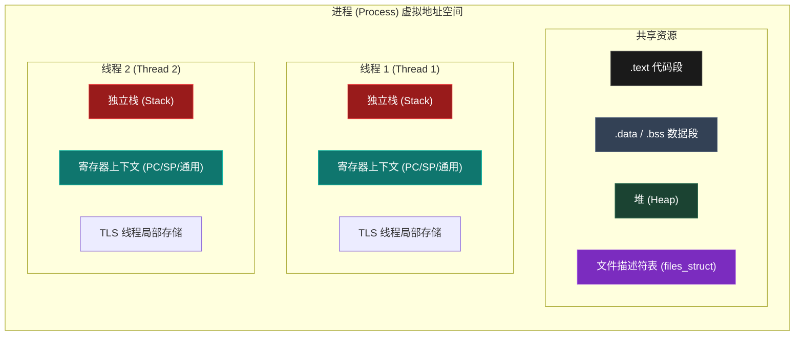
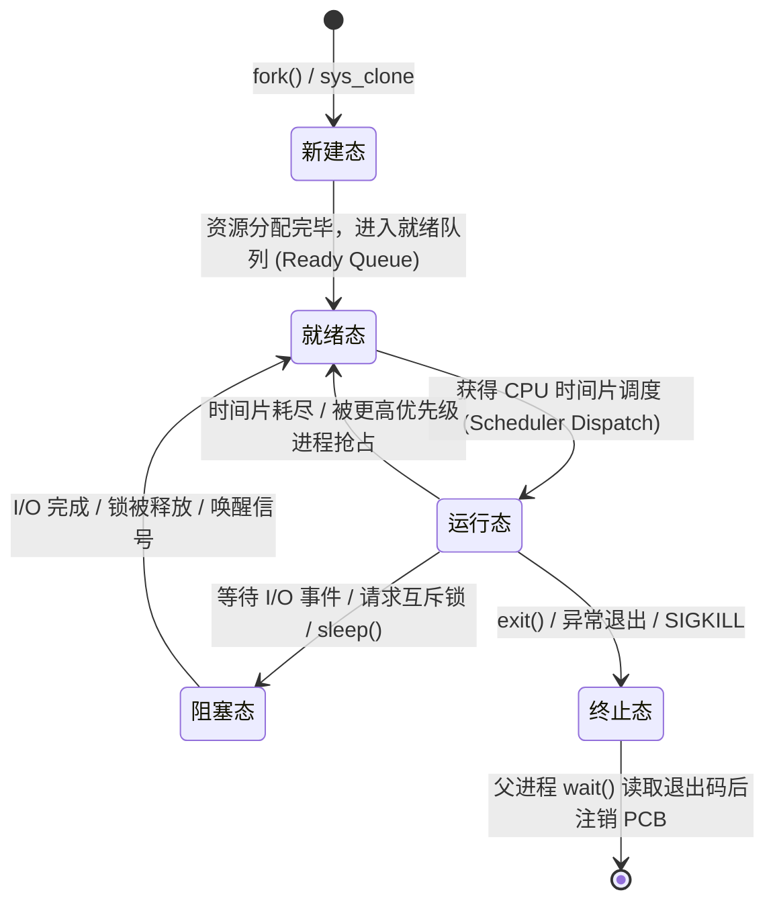
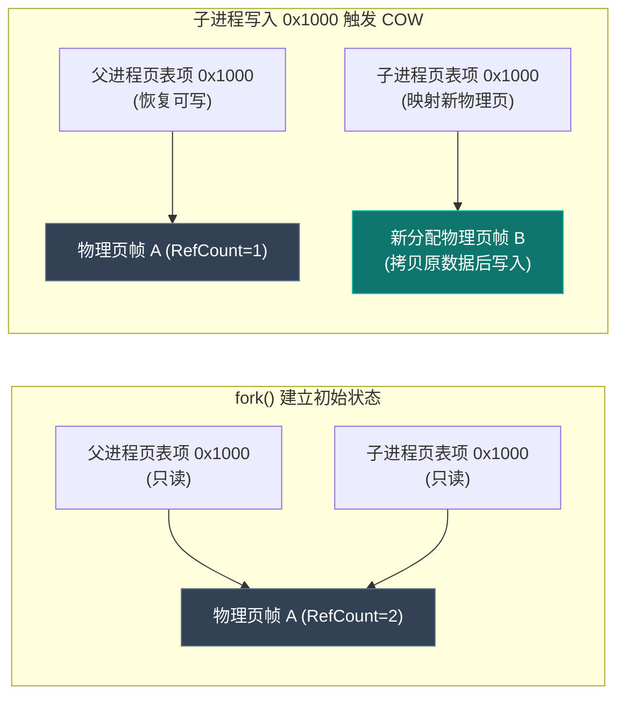

# 第一章 进程与线程体系

> 操作系统最核心的基础抽象：进程是**资源分配**的最小单位，线程是 **CPU 调度**的最小单位。本章梳理两者的底层数据结构、生命周期转换、硬件级切换开销以及多线程并发架构。

---

## 0. 考点优先级概览

| 优先级 | 核心模块 | 重点考点 | 考核形式 |
| :--- | :--- | :--- | :--- |
| **P0** | **进程与线程本质** | 进程与线程区别、共享与独立资源边界、五状态转换机、PCB `task_struct` | 核心概念问答、状态转换选择题 |
| **P0** | **上下文切换代价** | 寄存器现场保存、CR3 页表切换、TLB 刷新、Cache 污染（直接 vs 间接开销） | 性能深度剖析、大厂高频面试 |
| **P1** | **创建与执行机制** | `fork()` 结合 Copy-On-Write (COW) 缺页中断、`exec()` 系列、`clone()` 系统调用标志位 | 机制推导、系统调用分析 |
| **P1** | **线程模型与特殊状态** | 1:1 内核线程模型 vs M:N 用户线程模型、僵尸进程 (Zombie) vs 孤儿进程 (Orphan) 成因与回收 | 常见陷阱题、运维与诊断题 |
| **P2** | **游戏与系统工程实战** | 游戏引擎主线程-渲染线程分工、Job System 任务窃取 (Work-Stealing)、CPU 亲和性绑核 (Affinity) | 架构设计、高并发与低延迟优化 |
| **P3** | **核心实现与代码** | Linux/Windows 线程亲和性设置、Job System 调度器骨干实现 | 参考代码库（已折叠） |

---

## P0 核心考点：资源边界、状态机与切换开销

### 1. 进程 vs 线程资源隔离与共享边界

* **进程 (Process)**：拥有独立的虚拟地址空间（0 ~ 3G/4G 用户态空间）、独立的页表、文件描述符表与系统资源。
* **线程 (Thread)**：同一进程内的所有线程共享进程的绝大部分资源，仅保留极少数维持独立执行流的上下文。

| 资源类别 | 同一进程下所有线程 **共享** | 每个线程 **私有/独立** |
| :--- | :--- | :--- |
| **内存空间** | 代码段 (`.text`)、已初始化/未初始化数据段 (`.data` / `.bss`)、堆 (`Heap`)、内存映射区 (`mmap`) | **独立调用栈 (Stack)**（局部变量、调用链与返回地址） |
| **系统资源** | 打开的文件描述符表 (`fd table`)、信号处理函数 (`signal handlers`)、工作目录、进程 PID / UID | **寄存器上下文**（PC 指针、SP 栈顶、通用寄存器、FPU/SIMD 状态） |
| **其他属性** | 进程级环境变量、IPC 通信端点 | **线程本地存储 (TLS)**、线程 ID (TID)、信号屏蔽字 (Signal Mask) |



---

### 2. 进程状态机与五状态转换

标准操作系统遵循五状态模型，Linux 内核通过 `task_struct.state` 维护：



* **运行态 $\to$ 阻塞态**：是**主动行为**（由进程执行系统调用等待资源引发）。
* **阻塞态 $\to$ 运行态**：**不可能直接发生**！必须先经中断处理进入**就绪态**，再等待调度器分配 CPU。

---

### 3. 上下文切换的底层硬件开销剖析

上下文切换 (Context Switch) 是抢占式多任务操作系统的核心，但其开销并非零成本：


#### 直接开销 vs 间接开销

1. **直接开销 (Direct Overhead，约数百纳秒)**：
   * 保存与恢复 CPU 寄存器集合（RIP/PC、RSP、通用寄存器、EFLAGS 标志寄存器、AVX/FPU 状态）。
   * 触发内核态陷阱 (Trap) 与调度器决策耗时。
2. **间接开销 (Indirect Overhead，约数微秒至数十微秒，远大于直接开销)**：
   * **TLB (快表) 刷新**：进程切换需修改 CR3 寄存器装载新页表，硬件通常使所有非全局 TLB 项失效。切换后首轮访存将发生大量 TLB Miss，导致四级页表多次访存惩罚。
   * **CPU L1/L2 Cache 污染**：新任务执行所需的数据并不在当前 Cache Line 中，产生大量 Cache Miss。
   * **CPU 指令流水线冲刷 (Pipeline Flush)**：预测跳转与已载入指令完全废弃。

---

## P1 理论与进阶：创建机制、线程模型与特殊状态

### 1. `fork()` 与写时复制 (Copy-On-Write, COW)

* **机制原理**：`fork()` 创建子进程时，内核**并不为子进程深度拷贝物理内存页**，而是直接复制父进程的虚拟页表项。
* **只读标记**：内核将父子双方映射到该物理页的页表项属性均置为**只读 (Read-Only)**。
* **缺页中断触发**：当任一方尝试写入该共享物理页时，MMU 硬件检测到写权限异常，触发 **14 号缺页中断 (Page Fault)**。
* **物理页分裂**：内核捕获异常后，为写入方分配一个新的物理页帧，将原数据拷贝过去，并将该新页标记为可写，更新写入方页表项。未修改的物理页全程共享。



---

### 2. 线程实现模型对比 (1:1, M:N, 1:N)

| 模型 | 映射关系 | 调度主体 | 优势 | 缺陷 | 代表实现 |
| :--- | :--- | :--- | :--- | :--- | :--- |
| **1:1 (内核级线程)** | 1 个用户线程 $\to$ 1 个内核 `task_struct` | 内核调度器 | 支持真正的多核并行；单线程系统调用阻塞不影响其他线程 | 线程创建与切换需穿透内核态，开销相对偏大 | Linux (NPTL)、Windows 线程 |
| **M:N (混合/两级模型)** | M 个用户执行体 $\to$ N 个内核线程 | 用户级调度器 + 内核调度器 | 极致轻量创建与上下文切换，兼具多核并行能力 | 调度器实现极其复杂，需处理系统调用阻塞对内核线程的占用 | Go (Goroutine)、Rust Tokio |
| **1:N (用户级线程/绿色线程)** | N 个用户线程 $\to$ 1 个内核线程 | 用户层运行时 | 切换开销极低（无系统调用） | **一个线程阻塞将导致整个进程挂起**；无法利用多核 CPU | 早期 Java 绿色线程、Python 单线程 event loop |

> **Linux 统一设计哲学**：Linux 内核不单独设立“线程”结构，进程与线程统一使用 `task_struct`。`pthread_create()` 底层调用 `clone()` 系统调用。若带有 `CLONE_VM | CLONE_FILES | CLONE_FS | CLONE_SIGHAND` 标志，则为共享资源的**线程**；反之则为资源独立的**进程**。

---

### 3. 僵尸进程与孤儿进程

* **僵尸进程 (Zombie)**：
  * **成因**：子进程已终止（`exit()` 释放了代码段、堆、栈等），但父进程尚未调用 `wait()` 或 `waitpid()` 读取其退出状态，内核保留其 PCB `task_struct`。
  * **危害**：长期累积将耗尽操作系统的进程 ID (PID) 配额，导致系统无法创建新进程。
  * **清理机制**：父进程调用 `wait()`；或父进程捕获 `SIGCHLD` 信号设为 `SIG_IGN` 自动回收；若父进程死循环卡死，可终止父进程，使子进程转变为孤儿进程。
* **孤儿进程 (Orphan)**：
  * **成因**：父进程先于子进程终止，子进程仍在运行。
  * **处置**：内核立即将子进程收养给 `init` 进程（PID=1，在 modern Linux 中为 `systemd`）。`init` 进程会循环调用 `wait()` 自动清理终止的子进程，**无资源泄露危害**。

---

## P2 工程与游戏实战：引擎并发架构与亲和性

### 1. 游戏引擎经典多线程架构设计

为避免频繁上下文切换与线程竞争，现代商业游戏引擎（如 Unreal Engine、Unity）绝不采用“一个逻辑对象一个线程”的粗粒度模型，而是采用**专职核心线程 + 细粒度 Job System 线程池**：

1. **主线程 (Main Thread / Game Thread)**：按固定帧率驱动整个游戏世界逻辑（ECS Tick、玩家输入处理、Gameplay 状态转移、蓝图/脚本解释）。
2. **渲染线程 (Render Thread)**：延迟一帧处理由主线程通过双缓冲队列提交的**渲染指令包 (Render Commands)**，执行可见性裁剪、动态合批、状态排序并向 GPU 提交 Draw Call。
3. **工作线程池 (Worker Threads / Job System)**：线程数严格匹配物理核心数（$N_{\text{workers}} = N_{\text{cores}} - 1$），通过任务分解与工作窃取 (Work-Stealing) 并行分担物理模拟、骨骼蒙皮动画更新、光线追踪 BVH 构建等重计算。
4. **独立阻塞 I/O 线程**：专职网络数据包序列化解包、异步资源流式解压 (Streaming IO)。

---

### 2. 线程亲和性 (Thread Affinity) 绑核优化

在高性能计算和游戏开发中，操作系统的多核负载均衡策略可能将同一个线程在不同的 CPU 核心之间迁移，引发严重的 L1/L2 缓存冷启动。

通过设置**线程亲和性掩码**，强制线程运行在指定物理核上：
* **主线程 & 渲染线程**：分别锁定在固定的大核上，确保独占最高主频与私有 L2 缓存。
* **音频实时线程**：独占专用核心，避免被突发计算抢占导致爆音。

---

## P3 参考实现与速查

### 1. CPU 亲和性设置参考

<details>
<summary><strong>跨平台线程绑核实现（Linux / Windows）</strong></summary>

```cpp
#include <thread>
#include <iostream>

#if defined(__linux__)
#include <pthread.h>
#include <sched.h>

bool BindThreadToCore(std::thread& t, int core_id) {
    cpu_set_t cpuset;
    CPU_ZERO(&cpuset);
    CPU_SET(core_id, &cpuset);
    return pthread_setaffinity_np(t.native_handle(), sizeof(cpu_set_t), &cpuset) == 0;
}
#elif defined(_WIN32)
#include <windows.h>

bool BindThreadToCore(std::thread& t, int core_id) {
    DWORD_PTR mask = (1ULL << core_id);
    return SetThreadAffinityMask(reinterpret_cast<HANDLE>(t.native_handle()), mask) != 0;
}
#endif
```
</details>

---

### 2. 简易无锁 Work-Stealing 任务队列骨架

<details>
<summary><strong>Job System 任务分发原型</strong></summary>

```cpp
#include <functional>
#include <atomic>
#include <vector>
#include <thread>

class JobSystem {
public:
    using Task = std::function<void()>;

    explicit JobSystem(size_t worker_count) : stop_(false) {
        for (size_t i = 0; i < worker_count; ++i) {
            workers_.emplace_back([this]() {
                while (!stop_.load(std::memory_order_relaxed)) {
                    Task task;
                    if (PopTask(task)) {
                        task();
                    } else {
                        std::this_thread::yield();
                    }
                }
            });
        }
    }

    void Submit(Task t) {
        // 环形缓冲或无锁队列分发任务
    }

    ~JobSystem() {
        stop_.store(true, std::memory_order_relaxed);
        for (auto& w : workers_) {
            if (w.joinable()) w.join();
        }
    }

private:
    bool PopTask(Task& out_task) { return false; /* 队列提取逻辑 */ }
    std::vector<std::thread> workers_;
    std::atomic<bool> stop_;
};
```
</details>

---

### 3. 高频面试考点速答对照

| 问题 | 核心回答要点 |
| :--- | :--- |
| **进程与线程的本质区别？** | 进程是资源分配的最小单位，拥有独立虚拟地址空间与页表；线程是 CPU 调度的最小单位，同进程线程共享地址空间、文件表与堆，仅私有独立栈和寄存器上下文。 |
| **为什么进程上下文切换比线程慢得多？** | 线程切换仅需保存和恢复 CPU 寄存器现场；进程切换还需装载新的 CR3 页表基地址，迫使硬件**刷新 TLB**，导致后续指令与数据访存产生大量 TLB Miss 与 L1/L2 缓存冷缺失。 |
| **`fork()` 如何利用 COW 优化性能？** | `fork()` 初始仅浅拷贝页表项并将父子页表均设为只读。双方读操作共享物理页；任一方写入时触发 14 号缺页中断，内核捕获后单页按需深拷贝分配新物理页。 |
| **僵尸进程如何产生与避免？** | 子进程终止而父进程未调用 `wait()`/`waitpid()` 导致 PCB 遗留。通过显式回收、捕获 `SIGCHLD` 置为 `SIG_IGN` 自动回收，或使用双重 `fork()` 转交 init 托管。 |
