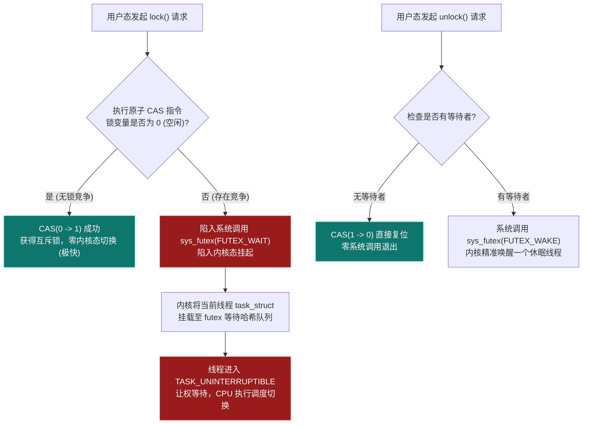
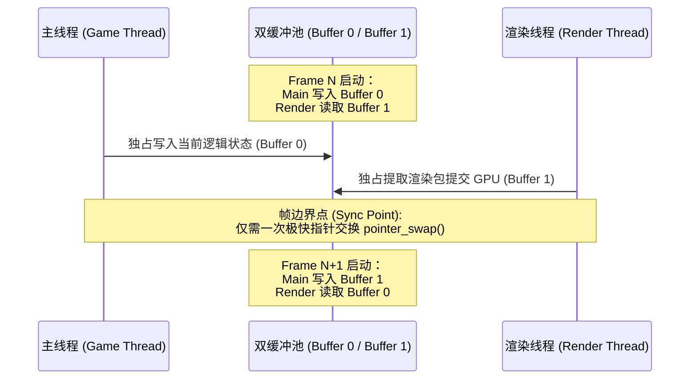

# 第二章 进程同步、互斥与死锁

> 并发编程的核心矛盾：当多个执行流并发访问共享可变状态时，非原子的指令交错必然导致竞态条件 (Race Condition)。本章系统梳理**经典 PV 同步大题模型**、**底层锁原语（CAS/futex）**、**死锁银行家算法计算**与**工业级无锁设计**。

---

## 0. 考点优先级概览

| 优先级 | 核心模块 | 重点考点 | 考核形式 |
| :--- | :--- | :--- | :--- |
| **P0** | **经典 PV 操作大题** | 生产者-消费者（P操作先后顺序陷阱）、读者-写者、哲学家就餐（死锁破除策略） | 期末/408 核心大题、手写伪代码 |
| **P0** | **互斥锁与硬件原语** | 临界区四原则、CAS 指令 (`CMPXCHG`)、自旋锁适用场景、Linux futex 快速路径与慢速路径 | 概念辨析、大厂底层技术面 |
| **P1** | **死锁与银行家算法** | 死锁 4 大必要条件、死锁预防与破除、**银行家算法安全性检查矩阵推演** | 核心计算题、安全序列推导 |
| **P1** | **并发经典陷阱** | 条件变量虚假唤醒 (Spurious Wakeup)、CAS 的 ABA 问题与版本号机制、读写锁写者饥饿 | 机制分析题、多线程排错 |
| **P2** | **游戏与系统工程实战** | 渲染/逻辑主线程双缓冲同步机制、单生产者单消费者 (SPSC) 无锁环形队列、Cache Line 对齐防伪共享 | 性能调优、工业级无锁架构 |
| **P3** | **参考实现与速查** | SPSC 无锁队列完整代码模板、高频面试速答表 | 参考代码库（已折叠） |

---

## P0 核心考点：经典 PV 操作大题与同步互斥原语

### 1. 临界区四项访问原则 (Dijkstra)

为确保并发执行的正确性与系统推进能力，临界区同步机制必须满足以下四条准则：
1. **空闲让进 (Progress)**：临界区空闲时，若有进程请求进入，应允许其立即进入。
2. **忙则等待 (Mutual Exclusion)**：已有进程在临界区内时，其余试图进入的进程必须等待。
3. **有限等待 (Bounded Waiting)**：任何等待进入临界区的进程必须在有限时间内进入，杜绝进程饿死。
4. **让权等待 (Yield on Block)**：当进程不能进入临界区时，应立即释放 CPU 资源（进入阻塞态休眠），避免占用 CPU 忙等（自旋锁违背该原则）。

---

### 2. 三大经典 PV 操作大题规范化推导

在信号量机制中：
* `P(S)` 或 `wait(S)`：`S = S - 1`，若 `S < 0`，则当前进程阻塞并加入等待队列。
* `V(S)` 或 `signal(S)`：`S = S + 1`，若 `S <= 0`，则从等待队列中唤醒一个被阻塞的进程。

#### ① 生产者-消费者问题 (Producer-Consumer Problem)

* **问题模型**：缓冲区容量为 $N$，多个生产者放入产品，多个消费者取出产品。
* **信号量设计**：
  * `empty = N`：同步信号量，表示空缓冲区槽位数（初值为 $N$）。
  * `full = 0`：同步信号量，表示已存放产品的槽位数（初值为 $0$）。
  * `mutex = 1`：互斥信号量，保护缓冲区修改的临界区。

```c
semaphore empty = N; // 空闲槽位
semaphore full  = 0; // 产品数量
semaphore mutex = 1; // 缓冲区访问互斥锁

void Producer() {
    while (1) {
        Item item = ProduceItem();
        P(empty);       // ① 先申请空槽位 (资源同步)
        P(mutex);       // ② 再申请临界区访问权 (互斥)
        
        Buffer[in] = item;
        in = (in + 1) % N;
        
        V(mutex);       // ③ 释放互斥锁
        V(full);        // ④ 通知消费者有新产品
    }
}

void Consumer() {
    while (1) {
        P(full);        // ① 先申请产品 (资源同步)
        P(mutex);       // ② 再申请临界区访问权 (互斥)
        
        Item item = Buffer[out];
        out = (out + 1) % N;
        
        V(mutex);       // ③ 释放互斥锁
        V(empty);       // ④ 释放空槽位通知生产者
        ConsumeItem(item);
    }
}
```

> **★ 考试高频致命陷阱**：
> `P(empty)` 和 `P(mutex)` **绝对不能调换顺序**！
> 若先 `P(mutex)` 再 `P(empty)`：当缓冲区已满时，生产者先拿到 `mutex`，随后在 `P(empty)` 上阻塞。此时消费者需要进入缓冲区消费以腾出空位，但因拿不到 `mutex` 亦被阻塞，导致**双方互相持有/等待对方资源，形成永久死锁**。
> **口诀**：**先同步、后互斥；先放互斥、后放同步。**

---

#### ② 读者-写者问题 (Readers-Writers Problem：读者优先)

* **规则**：允许多个读者同时读；写者与其他写者、读者互斥。
* **信号量设计**：
  * `rw_mutex = 1`：数据读写互斥锁。
  * `mutex = 1`：保护 `read_count` 变量的互斥锁。
  * `int read_count = 0`：记录当前活跃读者数量。

```c
semaphore rw_mutex = 1;
semaphore mutex = 1;
int read_count = 0;

void Writer() {
    P(rw_mutex);        // 独占访问
    // 写入数据...
    V(rw_mutex);
}

void Reader() {
    P(mutex);
    read_count++;
    if (read_count == 1) {
        P(rw_mutex);    // 第一个进入的读者负责把写者锁住
    }
    V(mutex);

    // 读取数据...

    P(mutex);
    read_count--;
    if (read_count == 0) {
        V(rw_mutex);    // 最后一个离开的读者负责唤醒写者
    }
    V(mutex);
}
```

---

#### ③ 哲学家就餐问题 (Dining Philosophers Problem)

* **问题描述**：5 位哲学家围坐，每两人之间有一根筷子。必须同时拿到左右两根筷子才能就餐。
* **死锁成因**：5 位哲学家同时拿起左边的筷子，都试图拿右边的筷子，形成**循环等待环**导致死锁。
* **三大破除死锁方案**：
  1. **限制就餐人数**：最多允许 4 位哲学家同时尝试拿起筷子（通过计数信号量 `semaphore count = 4;` 限制），保证至少有 1 位哲学家能拿齐双筷。
  2. **奇偶编号不对称加锁（破坏循环等待）**：奇数号哲学家先拿左边再拿右边，偶数号哲学家先拿右边再拿左边。
  3. **AND 信号量机制 / 原子性获取**：仅当左右两根筷子均可用时，才一次性全部拿起。

---

### 3. 底层互斥机制：从 CAS 到 Linux futex



* **CAS (Compare-And-Swap)**：硬件级原子指令（x86 为 `lock cmpxchg`）。原子执行：若 `*addr == expected` 则写入 `desired` 返回真，否则返回假并将当前值写入 `expected`。
* **自旋锁 (Spinlock)**：利用 CAS 循环忙等（Test-and-Set）。**适用场景**：临界区极短（数十纳秒内）、多核环境、内核中断上下文（不可睡眠）。
* **futex (Fast Userspace muTEX)**：
  * **快速路径 (Fast Path)**：无竞争时，仅在用户空间通过原子 CAS 操作标记锁变量，完全不需要进行系统调用。
  * **慢速路径 (Slow Path)**：发生冲突时，通过 `sys_futex(FUTEX_WAIT)` 陷入内核休眠让出 CPU；锁持有者释放时通过 `sys_futex(FUTEX_WAKE)` 唤醒。
  * `std::mutex` 与 POSIX `pthread_mutex` 在 Linux 下均基于 futex 构建。

---

## P1 理论与经典计算：死锁理论与银行家算法

### 1. 死锁产生的四大必要条件

系统发生死锁必须同时满足以下 4 个条件，破坏其中任一条件即可预防死锁：

1. **互斥条件 (Mutual Exclusion)**：资源在一段时间内只能被一个进程占用。
2. **请求并保持条件 (Hold and Wait)**：进程已经持有至少一个资源，但又提出了新的资源请求，而该资源被其他进程占用，此时请求进程被阻塞，但对自己已获得的资源保持不放。
3. **不剥夺条件 (No Preemption)**：进程已获得的资源在未使用完之前，不能被其他进程强行剥夺，只能由该进程自愿释放。
4. **循环等待条件 (Circular Wait)**：存在一个进程与资源的环形链 $\{P_0, P_1, \dots, P_n\}$，其中 $P_0$ 等待 $P_1$ 持有的资源，$P_1$ 等待 $P_2$ 持有的资源，$\dots$，$P_n$ 等待 $P_0$ 持有的资源。

---

### 2. 银行家算法 (Banker's Algorithm) 安全性推导大题

* **核心思想**：死锁避免算法。在分配资源前，先预判分配后系统是否处于**安全状态**（即能否找到一个**安全序列**，使得所有进程均能按某种顺序顺利完成并归还资源）。

#### 经典计算题标准解答范式

**题目背景**：系统中有 5 个进程 $\{P_0, P_1, P_2, P_3, P_4\}$ 和 3 类资源 $\{A, B, C\}$。已知 $T_0$ 时刻各资源总量为 $A: 10, B: 5, C: 7$。此时刻系统的状态矩阵如下：

$$Need[i][j] = Max[i][j] - Allocation[i][j]$$

$$Available = \text{Total} - \sum Allocation = [10, 5, 7] - [7, 2, 5] = [3, 3, 2]$$

| 进程 | $Max$ (最大需求) | $Allocation$ (已分配) | $Need$ (尚需需求) | $Available$ (可用初始) |
| :---: | :---: | :---: | :---: | :---: |
| | A B C | A B C | A B C | A B C |
| **$P_0$** | 7 5 3 | 0 1 0 | **7 4 3** | **3 3 2** |
| **$P_1$** | 3 2 2 | 2 0 0 | **1 2 2** | |
| **$P_2$** | 9 0 2 | 3 0 2 | **6 0 0** | |
| **$P_3$** | 2 2 2 | 2 1 1 | **0 1 1** | |
| **$P_4$** | 4 3 3 | 0 0 2 | **4 3 1** | |

#### 安全性检查推导过程表格

每次寻找一个满足 $Need[i] \le Work$ 且未执行完毕的进程：

| 检查顺序 | 选定进程 | 当前可用 $Work$ | 尚需 $Need$ | 是否满足 $Need \le Work$ | 进程运行完毕归还后 $Work' = Work + Allocation$ |
| :---: | :---: | :---: | :---: | :---: | :---: |
| 1 | **$P_1$** | [3, 3, 2] | [1, 2, 2] | 是 | $[3, 3, 2] + [2, 0, 0] = \mathbf{[5, 3, 2]}$ |
| 2 | **$P_3$** | [5, 3, 2] | [0, 1, 1] | 是 | $[5, 3, 2] + [2, 1, 1] = \mathbf{[7, 4, 3]}$ |
| 3 | **$P_4$** | [7, 4, 3] | [4, 3, 1] | 是 | $[7, 4, 3] + [0, 0, 2] = \mathbf{[7, 4, 5]}$ |
| 4 | **$P_0$** | [7, 4, 5] | [7, 4, 3] | 是 | $[7, 4, 5] + [0, 1, 0] = \mathbf{[7, 5, 5]}$ |
| 5 | **$P_2$** | [7, 5, 5] | [6, 0, 0] | 是 | $[7, 5, 5] + [3, 0, 2] = \mathbf{[10, 5, 7]}$ |

* **结论**：找到安全序列 $\{P_1, P_3, P_4, P_0, P_2\}$（安全序列不唯一），故 $T_0$ 时刻系统处于**安全状态**。

---

### 3. 并发编程常见经典陷阱

1. **条件变量虚假唤醒 (Spurious Wakeup)**：
   * 线程在没有被显式 `notify` 或信号被其他竞争线程先一步消耗时，`wait()` 也可能异常返回。
   * **准则**：等待条件变量必须放在 `while (!condition)` 循环中，严禁使用 `if`。
2. **CAS 的 ABA 问题与版本号机制**：
   * 变量值从 $A \to B \to A$，普通 CAS 误以为未被修改。在无锁内存池/链表中会导致使用已悬挂的野指针。
   * **解决方案**：引入版本号标记指针（Tagged Pointer / `std::atomic<std::pair<T*, uint64_t>>`），使每次更新版本号单调自增。

---

## P2 工程与游戏实战：高性能双缓冲与无锁队列

### 1. 游戏引擎逻辑-渲染双缓冲 (Double Buffering)

在游戏运行过程中，若主线程写状态、渲染线程读状态共用一把互斥锁，会导致高频锁竞争并引发严重的帧率抖动 (Frame Hitch)。



* **核心收益**：整个游戏运行期间，主线程与渲染线程各写各的缓冲区，**无锁并发进行**；仅在帧结束的同步点交换指针，将锁开销降至绝对最低。

---

### 2. SPSC 无锁队列 (Single-Producer Single-Consumer)

在低延迟网络收发包、音频流播放及 Job 派发场景中，广泛采用基于环形缓冲区的单生产单消费无锁队列：
* **核心技巧**：生产者维护 `head`，消费者维护 `tail`。读写指针采用 `std::memory_order_acquire` 和 `std::memory_order_release` 约束。
* **伪共享防护**：将 `head` 与 `tail` 分别放置在独立的 Cache Line 中（通过 `alignas(64)` 对齐），防止多核缓存行乒乓 (Cache Bouncing)。

---

## P3 参考实现与速查

### 1. 缓存行对齐的 SPSC 无锁环形队列

<details>
<summary><strong>工业级 SPSC 环形队列实现</strong></summary>

```cpp
#include <atomic>
#include <vector>
#include <cstddef>
#include <new>

template <typename T, size_t Capacity>
class SpscQueue {
    static_assert((Capacity & (Capacity - 1)) == 0, "Capacity must be power of 2");

public:
    SpscQueue() : head_(0), tail_(0) {}

    bool Enqueue(const T& item) {
        const size_t head = head_.load(std::memory_order_relaxed);
        if ((head - tail_.load(std::memory_order_acquire)) >= Capacity) {
            return false; // 队列满
        }
        buffer_[head & (Capacity - 1)] = item;
        head_.store(head + 1, std::memory_order_release);
        return true;
    }

    bool Dequeue(T& out_item) {
        const size_t tail = tail_.load(std::memory_order_relaxed);
        if (tail >= head_.load(std::memory_order_acquire)) {
            return false; // 队列空
        }
        out_item = buffer_[tail & (Capacity - 1)];
        tail_.store(tail + 1, std::memory_order_release);
        return true;
    }

private:
    T buffer_[Capacity];
    alignas(64) std::atomic<size_t> head_; // 对齐至独立 Cache Line，防止伪共享
    alignas(64) std::atomic<size_t> tail_;
};
```
</details>

---

### 2. 核心考点速答对照

| 问题 | 核心回答要点 |
| :--- | :--- |
| **自旋锁与互斥锁的选用场景？** | 自旋锁忙等不让权，适合临界区极短（纳秒级）、多核 CPU 且不可休眠（中断处理）的场景；互斥锁（futex）冲突时让权休眠，适合长临界区或竞争激烈的业务场景。 |
| **生产者-消费者中 P 信号量顺序为何不能互换？** | 若先申请互斥锁 `P(mutex)` 再申请资源 `P(empty)`，在缓冲区满时生产者拿锁后阻塞，消费者因无法获锁而不能消费，直接导致双向永久死锁。 |
| **死锁预防与死锁避免的区别？** | 死锁预防是在系统设计阶段**静态破坏 4 个必要条件之一**（如按序加锁破坏循环等待）；死锁避免是在运行期每次资源分配前进行**动态安全性检查**（如银行家算法），若分配后进入不安全状态则拒绝分配。 |
| **条件变量虚假唤醒是如何处理的？** | 在 POSIX 标准中，中断信号或多消费者竞争可能导致线程未接收到有效数据却被唤醒。代码必须通过 `while (condition_is_false) { wait(); }` 循环重新验证条件。 |
