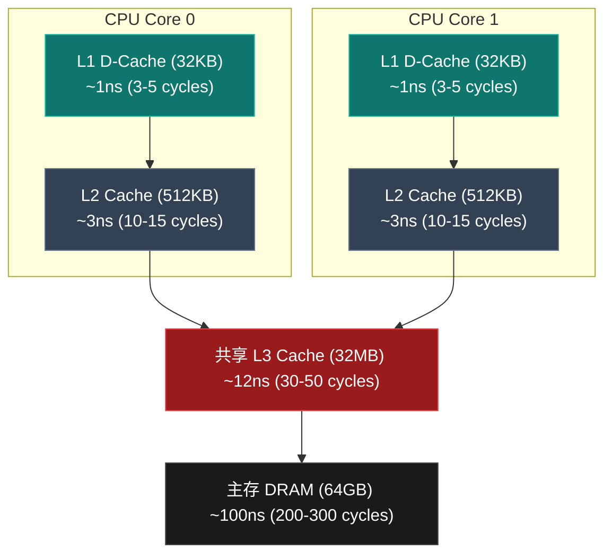
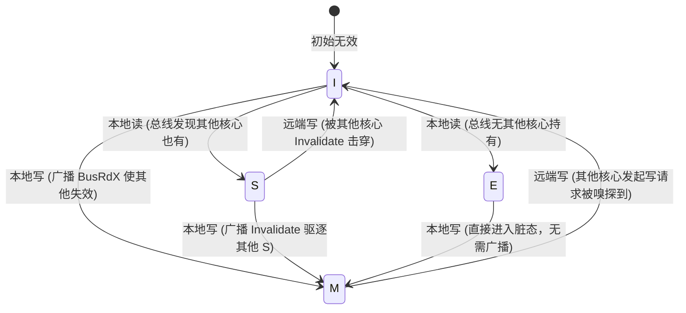
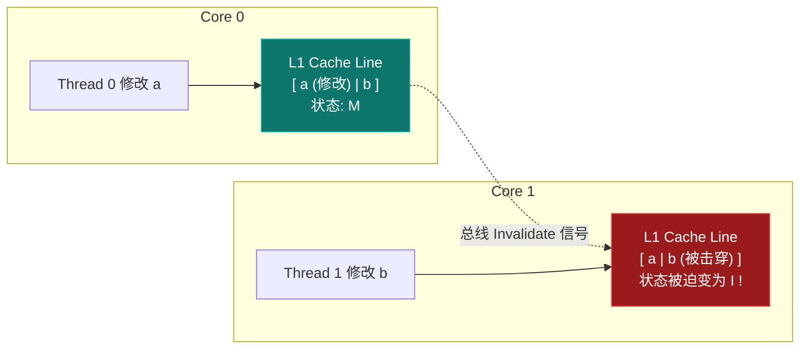
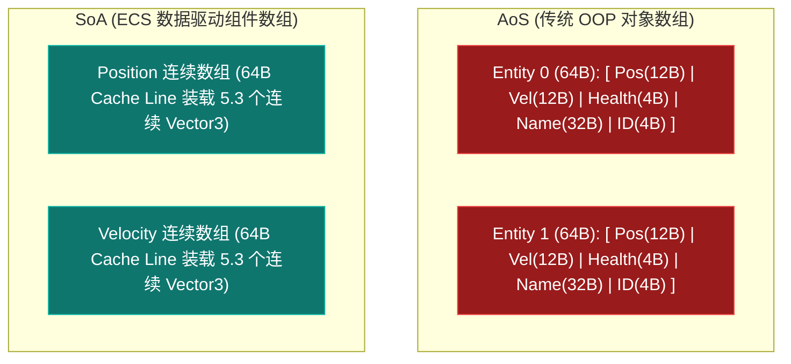

# 第四章 CPU 缓存与体系结构性能优化

> 冯·诺依曼架构的核心瓶颈：CPU 计算指令仅需约 0.3ns（1 个时钟周期），而主存 DRAM 访存延迟高达 50~100ns（相差近 300 倍）。**利用时间局部性与空间局部性构建的 CPU 缓存体系是填平“内存墙 (Memory Wall)”的根本手段**。本章深入剖析 Cache Line 组相联寻址、MESI 协议、伪共享成因与面向数据的架构 (DOD/ECS) 优化。

---

## 0. 考点优先级概览

| 优先级 | 核心模块 | 重点考点 | 考核形式 |
| :--- | :--- | :--- | :--- |
| **P0** | **Cache Line 与寻址** | 64B 缓存行、物理地址拆解（Tag / Index / Offset）、组相联映射 (Set-Associative) | 硬件结构分析、地址位数推导 |
| **P0** | **MESI 协议与伪共享** | 四状态转换机、总线嗅探、伪共享 (False Sharing) 物理成因与 64B 内存对齐消除 | 大厂高频底层面试、多线程性能调优 |
| **P1** | **分支预测与流水线** | 分支预测失败代价（15~20 cycles 流水线冲刷）、排序数组循环加速本质、`[[likely]]` 与无分支编程 | 经典机制解析、汇编级优化 |
| **P1** | **指令级并行 (ILP)** | 超标量、乱序执行、数据依赖链破除（循环展开）、Store-Load 转发 | 架构理论题、编译器优化原理 |
| **P2** | **游戏与系统工程实战** | ECS (数据驱动架构) 的 SoA vs AoS 缓存行满载率对比、SIMD 连续内存向量化加速 | 引擎底层架构设计、性能瓶颈排查 |
| **P3** | **参考实现与速查** | 消除伪共享基准测试代码、高频面试速答对照 | 参考代码库（已折叠） |

---

## P0 核心考点：Cache Line、MESI 协议与伪共享

### 1. 缓存层级与 Cache Line 结构

现代 CPU 普遍配备三级缓存：
* **L1 缓存 (32KB~64KB / Core)**：分立为指令缓存 (L1I) 与数据缓存 (L1D)，单核心私有，延迟约 1ns (3~5 cycles)。
* **L2 缓存 (512KB~1MB / Core)**：单核心私有统一缓存，延迟约 3ns (10~15 cycles)。
* **L3 缓存 (16MB~64MB+ / Socket)**：所有 CPU 核心共享，延迟约 10~15ns (30~50 cycles)。
* **DRAM 主存**：延迟约 60~100ns (200~300 cycles)。



#### 物理地址到 Cache Line 的拆解

CPU 从不逐字节从内存拉取数据，最小传输单元是固定的 **Cache Line（通常为 64 字节）**。
在 $N$ 路组相联 (Set-Associative) 结构中，物理地址被拆解为三段：
1. **Offset (块内偏移量)**：$\log_2(64) = 6$ 位，精确定位 64 字节中的特定字节。
2. **Index (组索引)**：$\log_2(\text{组数})$ 位，索引映射到缓存的具体“组 (Set)”。
3. **Tag (标签)**：剩余高位，组内各路并行比对该 Tag 是否匹配。

---

### 2. 缓存一致性：MESI 协议

多核 CPU 中，同一主存物理块可能同时被读入多个核心的私有 L1/L2 缓存中。MESI 状态机通过**总线嗅探 (Bus Snooping)** 维持多核强一致性：

| 状态 | 含义 | 本地可读？ | 本地可写？ | 其他核心缓存状态 | 与主存数据 |
| :--- | :--- | :---: | :---: | :--- | :--- |
| **M (Modified)** | 脏行已修改 | **是** | **是**（无需总线广播） | 其他核心必然为 **I** | **不一致**（滞后写回） |
| **E (Exclusive)** | 独占干净行 | **是** | **是**（直接升为 M） | 其他核心必然为 **I** | **一致** |
| **S (Shared)** | 共享干净行 | **是** | **否**（必须先发 Invalidate 广播） | 其他核心可为 **S** | **一致** |
| **I (Invalid)** | 缓存失效行 | **否** | **否**（发生读/写未命中） | 无关 | 数据已过期失效 |



---

### 3. 伪共享 (False Sharing) 的物理成因与消除

#### 物理成因

**伪共享**是多线程高并发下的重大隐形性能杀手：两个运行在不同物理核上的线程，各自频繁修改**逻辑上毫无关联的独立变量**，但这两个变量在内存地址上相隔过近（**恰好落在了同一个 64 字节 Cache Line 中**）。



* **恶性循环**：Core 0 写入 `a`，MESI 协议向总线广播 Invalidate 信号，直接将 Core 1 包含 `b` 的整个 Cache Line 强制置为 **I (Invalid)**；紧接着 Core 1 写入 `b`，再次向总线广播 Invalidate，反向把 Core 0 的 Cache Line 置为 I。
* **后果**：该 64B 缓存行在两个 CPU 核心之间疯狂“乒乓颠簸 (Cache Bouncing)”，多核并发退化为总线锁竞争，性能暴跌 5~10 倍。

#### 消除方法

1. **显式 64 字节对齐**：使用 `alignas(64)` 或填充字节 (Padding)，强制将高频独立修改的变量隔离在不同的 Cache Line 中。
2. **C++17 标准常量**：使用 `alignas(std::hardware_destructive_interference_size)` 进行标准移植对齐。
3. **检测工具**：使用 Linux `perf c2c` (Cache to Cache) 分析跨核命中与颠簸事件。

---

## P1 理论与进阶：分支预测与指令级并行 (ILP)

### 1. 分支预测 (Branch Prediction) 及其性能惩罚

现代 CPU 采用数十级深度指令流水线（IF 取指 $\to$ ID 译码 $\to$ EX 执行 $\to$ MEM 访存 $\to$ WB 写回）。
* 遇到条件跳转指令（`if/else`）时，流水线不能停顿等待执行结果，分支预测器（结合 BTB 历史目标缓冲）会预先推测分支走向并提前载入指令。
* **预测失败的代价**：若推测错误，流水线中数十条预取指令必须**全部作废并彻底清空 (Pipeline Flush)**，重新从真实分支处取指，惩罚高达 **15~20 个时钟周期**。

#### 经典现象：为什么排序后的数组遍历更快？

对乱序数组执行 `if (arr[i] > 128) sum += arr[i];`：
* **乱序数据**：分支走向毫无规律，预测准确率接近 50%，导致频繁发生流水线冲刷。
* **排序后数据**：前半段稳定为假、后半段稳定为真，动态预测器准确率逼近 100%，耗时可降低 2~3 倍。

#### 编译期指导与无分支设计

```cpp
// 1. C++20 分支倾向性属性
if (ptr != nullptr) [[likely]] {
    // 编译器将大概率执行的代码紧密排布在主执行流，优化指令缓存 (I-Cache)
    ProcessFastPath(ptr);
} else [[unlikely]] {
    HandleError();
}

// 2. 无分支 (Branchless) 消除跳转
int max_val(int a, int b) {
    // 避免 if (a > b) 分支冲刷风险，利用算术位掩码生成无分支机器码
    int diff = a - b;
    return a - (diff & (diff >> 31));
}
```

---

### 2. 指令级并行 (ILP) 与循环展开

现代超标量 CPU 拥有多个算术逻辑单元 (ALU)，能在单个时钟周期并行发射多条互不干扰的指令。
* **循环携带依赖 (Loop-Carried Dependence)**：`sum += data[i]` 每一步必须等待前一步加法写回寄存器，形成串行依赖链。
* **多路累加打断依赖**：展开为 4 路独立变量计算（`sum0 += data[i]`, `sum1 += data[i+1]` ...），使 4 条加法指令同时在不同的 ALU 中并行执行，吞吐率翻倍提升。

---

## P2 工程与游戏实战：ECS 数据驱动与缓存行利用

### 1. 结构数组 (AoS) vs 数组结构 (SoA) 的缓存利用率

面向对象架构 (AoS) 与面向数据架构 (SoA / ECS) 的底层差距完全由 CPU 缓存特性决定：



* **AoS 场景**：若仅需遍历实体更新位置，CPU 每次加载 64B Cache Line，其中却夹杂了当前系统毫不关心的 `Name`、`Health`，**有效数据仅占 12B，缓存带宽利用率不足 19%**。
* **SoA 场景**：所有 `Position` 连续紧密贴合存储，单次 Cache Line 装载 100% 均为有效数据，空间局部性被发挥到极限，且天然支持 SIMD 单指令多数据流（如 AVX-256 一次加载 8 个 float 并行运算）。

---

## P3 参考实现与速查

### 1. 消除伪共享基准实现

<details>
<summary><strong>多线程计数器伪共享对比测试模板</strong></summary>

```cpp
#include <atomic>
#include <new>

// ❌ 错误示范：counterA 与 counterB 落在同一 64B 缓存行内，引发恶劣伪共享
struct BadCounters {
    std::atomic<uint64_t> counter_a{0};
    std::atomic<uint64_t> counter_b{0};
};

// ✅ 正确示范：通过对齐或显式填充强制隔离到独立缓存行
struct GoodCounters {
    alignas(64) std::atomic<uint64_t> counter_a{0};
    alignas(64) std::atomic<uint64_t> counter_b{0};
};
```
</details>

---

### 2. 核心考点速答对照

| 问题 | 核心回答要点 |
| :--- | :--- |
| **什么是 Cache Line？大小一般是多少？** | Cache Line 是 CPU 缓存与主存交换的最小物理数据粒度，现代主流架构（x86/ARM）统一为 64 字节。每次访存未命中时，硬件自动加载连续的 64 字节以契合空间局部性。 |
| **伪共享是如何产生的？工程上如何规避？** | 多个物理核并发读写各自不相关的变量，但这些变量在物理内存上同处于一个 64B 缓存行，导致 MESI 协议不断向总线广播失效信号迫使对方缓存行被刷出。使用 `alignas(64)` 或填充字节将变量隔离在独立缓存行中规避。 |
| **MESI 协议中 M 态与 E 态的核心区别？** | 两者均表明该缓存行仅由当前单个核心独占持有；但 E 态数据未被修改且与主存保持一致（写回时无需刷盘），而 M 态数据已被本地核心修改（Dirty），被逐出时必须强制写回物理主存。 |
| **为什么 ECS 架构在性能上优于传统 OOP？** | 传统 OOP 采用 AoS 布局，对象内部冷热数据掺杂导致 Cache Line 加载时有效数据占比低；ECS 采用 SoA 布局，将同类型组件在内存中线性紧凑排布，缓存行利用率达 100%，并能无缝激活 SIMD 向量化计算。 |
