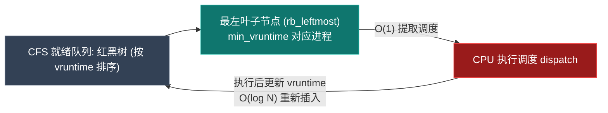
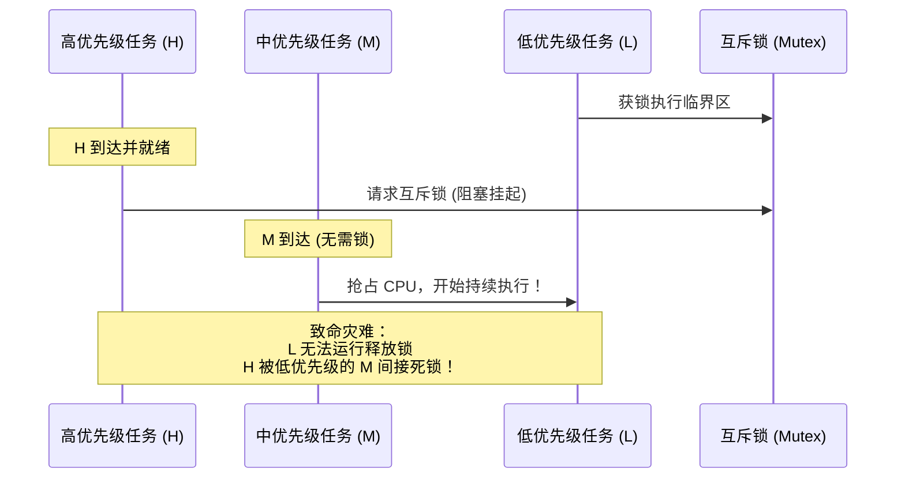

# 第五章 进程调度算法与实时系统

> 调度器是操作系统的核心协调中枢，负责在有限的 CPU 核心上公平、高效地分配计算资源。本章深入剖析**四大经典调度算法的甘特图与周转时间计算大题**、**Linux CFS 虚拟运行时间 ($vruntime$) 与红黑树机制**、**优先级反转 (Priority Inversion) 的软硬件化解方案**以及**游戏引擎固定步长主循环实战**。

---

## 0. 考点优先级概览

| 优先级 | 核心模块 | 重点考点 | 考核形式 |
| :--- | :--- | :--- | :--- |
| **P0** | **调度评价指标与计算** | 周转时间、带权周转时间、等待时间公式推导与定量计算 | 期末/408 核心大题、甘特图绘制 |
| **P0** | **经典调度算法对比** | FCFS（护航效应）、SJF/SRTF、HRRN（高响应比优先）、RR（时间片权衡）、MLFQ（多级反馈） | 算法机制推导、选择与综合题 |
| **P1** | **Linux CFS 调度器** | 虚拟运行时间 ($vruntime$) 权重递增公式、红黑树就绪队列结构、唤醒补偿机制 | 大厂底层原理面、设计理念题 |
| **P1** | **优先级反转问题** | 产生机理（火星探路者经典事故）、优先级继承 (Priority Inheritance) vs 优先级天花板 | 并发设计题、实时系统大题 |
| **P2** | **游戏引擎与实时实战** | 固定步长 (Fixed Timestep) 物理累加器、音频线程实时调度 (`SCHED_FIFO`) 防爆音 | 客户端架构设计、低延迟调优 |
| **P3** | **参考实现与速查** | 游戏引擎半固定步长主循环代码、高频面试速答对照 | 参考代码库（已折叠） |

---

## P0 核心考点：经典调度算法与周转时间计算大题

### 1. 核心评价指标与计算公式

* **周转时间 (Turnaround Time)**：作业从提交到完成所经历的时间跨度。
  $$T = \text{完成时刻} - \text{到达时刻}$$
* **带权周转时间 (Weighted Turnaround Time)**：衡量长短作业的相对等待公平性，值恒 $\ge 1$（越小越好）。
  $$W = \frac{\text{周转时间}}{\text{实际运行服务时间}} = \frac{T}{T_s}$$
* **等待时间 (Waiting Time)**：作业在就绪队列中等待 CPU 调度的累计时间。
  $$T_w = \text{周转时间} - \text{实际运行服务时间} = T - T_s$$
* **平均周转时间**：$\bar{T} = \frac{1}{n} \sum_{i=1}^n T_i$；**平均带权周转时间**：$\bar{W} = \frac{1}{n} \sum_{i=1}^n W_i$。

---

### 2. 五大经典调度算法横向对比

| 算法 | 抢占性 | 核心调度依据 | 优缺点深度剖析 | 适用场景 |
| :--- | :--- | :--- | :--- | :--- |
| **FCFS (先来先服务)** | 非抢占 | 进程到达就绪队列的时间先后 | **护航效应 (Convoy Effect)**：长作业先占 CPU，短作业/I/O 进程严重阻塞 | 早期批处理系统 |
| **SJF (短作业优先)** | 非抢占 / 抢占 (SRTF) | 作业预估运行时间最短者优先 | **理论平均等待时间最短**；但对长作业极不公平，易致**饥饿 (Starvation)**；需预知运行时间 | 理论最优基准 |
| **HRRN (高响应比优先)** | 非抢占 | 响应比 $R = 1 + \frac{\text{等待时间}}{\text{服务时间}}$ 最高者 | 动态兼顾短作业（$T_s$ 小）与长作业（等待时间长后 $R$ 自动升高），**彻底杜绝饥饿** | 批处理与综合系统 |
| **RR (时间片轮转)** | 抢占 | 就绪队列 FIFO + 固定时间片 $q$ | 响应速度快；时间片过大退化为 FCFS，过小导致上下文切换开销剧增 | 分时交互操作系统 |
| **MLFQ (多级反馈队列)** | 抢占 | 多级优先级队列 + 时间片递增 | 综合性能最优：无需预知运行时间，I/O 密集型自动停留高优先级，长任务降级并配以大时间片 | 现代通用操作系统雏形 |

---

### 3. 经典甘特图与指标推导大题

**题目**：已知四个进程的到达时间与所需服务时间如下，求各算法的平均周转时间与平均带权周转时间：
* $P_1$：到达时刻 0，服务时间 8
* $P_2$：到达时刻 1，服务时间 4
* $P_3$：到达时刻 2，服务时间 9
* $P_4$：到达时刻 3，服务时间 5

#### ① FCFS 调度推演

```mermaid
gantt
    title FCFS 调度甘特图
    dateFormat X
    axisFormat %s
    section P1
    0-8   : 0, 8s
    section P2
    8-12  : 4s
    section P3
    12-21 : 9s
    section P4
    21-26 : 5s
```



* **指标计算**：
  * $P_1$：完成 8，周转 $8-0=8$，带权周转 $8/8=1.00$
  * $P_2$：完成 12，周转 $12-1=11$，带权周转 $11/4=2.75$
  * $P_3$：完成 21，周转 $21-2=19$，带权周转 $19/9=2.11$
  * $P_4$：完成 26，周转 $26-3=23$，带权周转 $23/5=4.60$
* **平均指标**：平均周转时间 $\bar{T} = \frac{8+11+19+23}{4} = \mathbf{15.25}$；平均带权周转 $\bar{W} = \frac{1+2.75+2.11+4.60}{4} = \mathbf{2.62}$。

#### ② SJF (抢占式 SRTF，最短剩余时间优先) 推演

```mermaid
gantt
    title SRTF (抢占式短作业优先) 甘特图
    dateFormat X
    axisFormat %s
    section P1
    0-1   : 0, 1s
    10-17 : 7s
    section P2
    1-5   : 4s
    section P4
    5-10  : 5s
    section P3
    17-26 : 9s
```



* **推演过程**：
  * 时刻 0：$P_1$ 运行。
  * 时刻 1：$P_2$ 到达，剩余时间 $P_2(4) < P_1(7)$，**发生抢占**，$P_2$ 运行至时刻 5 结束。
  * 时刻 5：就绪队列有 $P_4(5), P_1(7), P_3(9)$，选最短者 $P_4$ 运行至时刻 10 结束。
  * 时刻 10：选剩余最短者 $P_1(7)$ 运行至时刻 17 结束。
  * 时刻 17：最后执行 $P_3(9)$ 至时刻 26 结束。
* **指标计算**：
  * $P_1$：完成 17，周转 $17-0=17$，带权周转 $17/8=2.125$
  * $P_2$：完成 5，周转 $5-1=4$，带权周转 $4/4=1.00$
  * $P_3$：完成 26，周转 $26-2=24$，带权周转 $24/9=2.67$
  * $P_4$：完成 10，周转 $10-3=7$，带权周转 $7/5=1.40$
* **平均指标**：平均周转时间 $\bar{T} = \frac{17+4+24+7}{4} = \mathbf{13.00}$（优于 FCFS）；平均带权周转 $\bar{W} = \mathbf{1.80}$。

---

## P1 理论与进阶：Linux CFS 调度器与优先级反转

### 1. Linux 完全公平调度器 (CFS)

CFS (Completely Fair Scheduler) 自 Linux 2.6.23 起作为普通进程的默认调度算法，其核心思想是：**虚拟运行时间 ($vruntime$) 越小，说明获得的 CPU 份额越欠缺，越应当优先调度**。

#### $vruntime$ 核心公式

$$vruntime \mathrel{+}= \Delta \text{exec\_time} \times \left( \frac{\text{NICE\_0\_LOAD}}{\text{weight}} \right)$$

* 静态优先级 `nice` 映射为权重 `weight`（`nice=0` 对应权重 1024）。
* **高优先级进程**（`nice < 0`，`weight > 1024`）：$vruntime$ 增长慢，在红黑树中向右移动慢，更容易停留在左侧被高频调度。
* **低优先级进程**（`nice > 0`，`weight < 1024`）：$vruntime$ 增长快，迅速向红黑树右侧移动，让出调度权。



---

### 2. 优先级反转 (Priority Inversion) 与火星探路者案例

* **现象定义**：高优先级任务被低优先级任务间接阻塞，导致调度顺序颠倒的异常现象。
* **经典触发场景**：
  1. 低优先级任务 $L$ 获取共享资源锁 `Mutex`。
  2. 高优先级任务 $H$ 到达，试图获取 `Mutex` 被阻塞，挂起等待 $L$ 释放。
  3. 中优先级任务 $M$ 到达（不需要 `Mutex`），凭借其高于 $L$ 的优先级，**无情抢占了任务 $L$ 的 CPU**。
  4. 最终导致：**任务 $M$ 持续执行，任务 $L$ 无法运行并释放锁，高优先级任务 $H$ 无法得到执行**（$H$ 被无关的 $M$ 严重阻碍）。



#### 解决方案

1. **优先级继承协议 (Priority Inheritance Protocol, 最常用)**：
   * 当任务 $H$ 在任务 $L$ 持有的锁上阻塞时，内核**临时将任务 $L$ 的优先级动态提升至任务 $H$ 的相同级别**。
   * 使得任务 $L$ 能快速抢占中间任务 $M$ 完成临界区并释放锁；锁释放后，$L$ 立即恢复原优先级，$H$ 成功拿锁执行。
2. **优先级天花板协议 (Priority Ceiling Protocol)**：
   * 为每个互斥锁预先设定一个“天花板优先级”（即可能访问该锁的所有任务中的最高优先级）。任何任务一旦拿到该锁，优先级立即提升至天花板级别。

---

## P2 工程与游戏实战：帧同步、时钟步长与实时线程

### 1. 游戏引擎主循环的三种步长策略

在游戏客户端与物理引擎开发中，操作系统时间片抖动直接影响物理模拟的一致性与画面平滑度：

| 步长策略 | 核心机制 | 致命隐患 / 优势 | 适用领域 |
| :--- | :--- | :--- | :--- |
| **可变步长 (Variable)** | 物理模拟每次使用真实帧时间：`Tick(deltaTime)` | **极其致命**：帧率波动导致数值积分结果不确定，物理穿透、联机不同步 | 简单单机轻度渲染 |
| **纯固定步长 (Fixed)** | 严格按固定步长（如 16.6ms / 60Hz）推进 | 若帧率低于 60Hz 导致画面慢动作；帧率高则浪费算力 | 早期主机固定帧率游戏 |
| **半固定步长 (Accumulator)** | **累计真实时间进入累加器，按固定小步长循环消耗，剩余时间插值渲染** | **工业界标准**：物理保证绝对确定性，画面保持无抖动插值丝滑渲染 | UE5 / Unity / 自研物理引擎 |

---

### 2. 音频与实时线程的调度选型

* **普通 Gameplay 主线程**：运行于标准调度（Linux `SCHED_OTHER` / CFS），偶尔偶发数十毫秒的帧顿挫（如加载贴图）在工程上可以容忍。
* **音频混音线程**：音频驱动的 Ring Buffer 通常极小（如 5~10ms）。若被其他计算密集型任务抢占稍作停顿，将直接引发硬件缓冲区欠载（Buffer Underrun），产生刺耳的**爆音**。
* **方案**：音频线程必须通过 `sched_setscheduler()` 提升为硬实时策略 **`SCHED_FIFO`**，并辅以 CPU 亲和性绑核。

---

## P3 参考实现与速查

### 1. 半固定步长物理主循环架构

<details>
<summary><strong>工业级固定物理步长 + 画面插值累加器循环</strong></summary>

```cpp
#include <chrono>
#include <thread>

void RunGameLoop() {
    using clock = std::chrono::high_resolution_clock;
    constexpr double dt = 0.016666; // 60Hz 确定性物理更新步长
    double accumulator = 0.0;
    auto previous_time = clock::now();

    while (IsRunning()) {
        auto current_time = clock::now();
        std::chrono::duration<double> elapsed = current_time - previous_time;
        previous_time = current_time;
        
        // 限制最大步长，防止进入螺旋式死循环 (Spiral of Death)
        accumulator += std::min(elapsed.count(), 0.25);

        // 确定性固定物理更新
        while (accumulator >= dt) {
            SimulatePhysicsFixed(dt);
            accumulator -= dt;
        }

        // 渲染插值计算：根据剩余的时间比例平滑过渡变换矩阵
        const double alpha = accumulator / dt;
        RenderFrameInterpolated(alpha);
    }
}
```
</details>

---

### 2. 核心考点速答对照

| 问题 | 核心回答要点 |
| :--- | :--- |
| **周转时间与带权周转时间的物理意义？** | 周转时间是进程从提交至执行完毕的总耗时；带权周转时间是周转时间除以实际服务时间（恒 $\ge 1$），表征系统为单位工作量所付出的相对服务代价，更公平地反映短作业的满意度。 |
| **CFS 调度器是如何保障公平性的？** | CFS 引入虚拟运行时间 $vruntime$ 追踪进程已分配的计算量。每次调度选择红黑树最左端 $vruntime$ 最小的进程投入运行；高优先级通过分配更大的权重系数降低其 $vruntime$ 的增长斜率。 |
| **什么是优先级反转？如何彻底解决？** | 高优先级任务 $H$ 在低优先级任务 $L$ 持有的锁上阻塞，中优先级任务 $M$ 抢占 $L$，导致 $H$ 间接被 $M$ 永久推迟。解决方案是优先级继承协议：让持有锁的 $L$ 临时继承 $H$ 的高优先级，迅速完成临界区释放锁。 |
| **多级反馈队列 (MLFQ) 相比单一队列的优势？** | 自动平衡长短作业且无需预知运行时间。新进程先入高优先级短时间片队列快速响应交互；计算密集型任务耗尽时间片后逐级降级到长时间片队列，兼顾了快速响应与批处理高吞吐。 |
