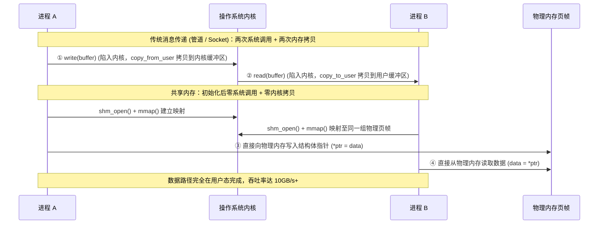
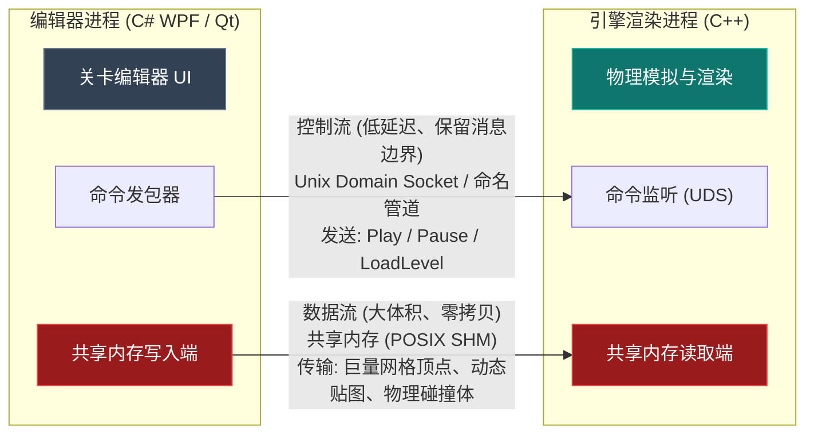

# 第六章 进程间通信 (IPC) 体系与选型

> 操作系统的核心设计基石是虚拟地址空间隔离：进程 $A$ 的指针在进程 $B$ 的地址空间中毫无意义。**进程间通信 (Inter-Process Communication, IPC) 的本质是操作系统在隔离之墙上开凿安全、受控的数据交换通道**。本章深入剖析**六大 IPC 核心机制的底层原理**、**共享内存零拷贝架构**、**信号可重入安全陷阱**与**游戏引擎混合多进程架构**。

---

## 0. 考点优先级概览

| 优先级 | 核心模块 | 重点考点 | 考核形式 |
| :--- | :--- | :--- | :--- |
| **P0** | **六大 IPC 机制对比** | 管道（匿名 vs 命名）、消息队列、共享内存、信号、Unix 域套接字 (UDS) | 选型对比题、时空开销分析 |
| **P0** | **共享内存零拷贝机制** | 共享内存物理页映射原理、为什么必须外挂同步机制 (信号量/futex) | 核心概念辨析、高性能通信面 |
| **P1** | **信号与异步安全** | 常见信号含义 (SIGKILL/SIGTERM/SIGSEGV)、信号处理函数的**异步信号安全 (Async-Signal-Safe)** 陷阱 | 系统级排错、并发陷阱题 |
| **P1** | **UDS 传递文件描述符** | Unix Domain Socket 短路网络栈优势、`SCM_RIGHTS` 辅助数据跨进程传递 fd | 高性能服务端、底层进阶考察 |
| **P2** | **游戏与系统工程实战** | 游戏引擎-编辑器双进程架构（控制流走 UDS / 管道，数据流走共享内存）、Chrome 多进程隔离沙箱模型 | 工业级架构设计、系统解耦方案 |
| **P3** | **参考实现与速查** | POSIX 共享内存与信号量模板、高频面试速答对照 | 参考代码库（已折叠） |

---

## P0 核心考点：六大 IPC 机制对比与选型矩阵

### 1. 为什么不能直接跨进程传指针？

进程 $A$ 的虚拟地址 `0x004031A8` 由进程 $A$ 的专属页表（CR3 寄存器）映射到物理页帧 $X$；在进程 $B$ 中，相同的虚拟地址 `0x004031A8` 可能未映射或映射至完全不同的物理页帧 $Y$。**直接跨进程传递指针必然导致无效内存访问或数据污染**，必须借助内核进行数据转运或内存重映射。

---

### 2. 六大 IPC 机制全维度对比矩阵

| IPC 方式 | 通信媒介 | 数据形式 | 进程亲缘要求 | 消息边界？ | 数据拷贝次数 | 核心优缺点与典型场景 |
| :--- | :--- | :--- | :--- | :---: | :---: | :--- |
| **匿名管道 (Pipe)** | 内核内存环形缓冲 (64KB) | 无结构字节流 (半双工) | **强依赖**（父子/兄弟，需继承 fd） | ❌ 无 | **2 次** | 机制最简，自带读写阻塞同步；仅适合 Shell 管道 (`ls \| grep`) |
| **命名管道 (FIFO)** | 文件系统可见的特殊文件节点 | 无结构字节流 (半双工) | **无依赖**（任意不相关进程） | ❌ 无 | **2 次** | 任意进程按路径打开；依然是单向字节流，需上层自行切分包 |
| **消息队列 (MQ)** | 内核维护的链表式消息缓冲区 | 有类型、有优先级的结构化消息 | 无依赖 | **✅ 有** | **2 次** | 消息天然自带边界与优先级，支持按类型过滤读取；适合命令与事件通知 |
| **共享内存 (Shared Mem)** | 内核映射的公共物理内存页 | 用户自定义任意内存结构 | 无依赖 | 自行约定 | **0 次 (零拷贝)** | **全系统速度最快**；内核不提供同步保护，必须搭配信号量或锁 |
| **信号 (Signal)** | 内核软件中断通知 | 仅传递整数信号编号 (无负载) | 无依赖 (需知 PID) | N/A | 0 次 | 异步开销极低；但无法承载复杂数据，存在严重的异步可重入安全限制 |
| **Unix 域套接字 (UDS)** | 内核 Socket 环形缓冲区 | 字节流 (Stream) / 数据报 (Dgram) | 无依赖 | 可选 | **2 次** | 本地 IPC 首选标准。**短路网络协议栈**（无 TCP/IP 封包校验），支持传 fd |

---

### 3. 共享内存 (Shared Memory) 零拷贝机理



* **为什么共享内存必须外挂同步机制？**
  内核仅负责将同一物理页映射至各进程的虚拟地址空间，**完全不感知上层何时读写**。若进程 $A$ 写了一半进程 $B$ 开始读，将导致致命的脏读与撕裂 (Torn Read)。因此必须搭配 **POSIX 进程间信号量 (`sem_init(..., 1, ...)`)** 或 **共享内存互斥锁 (`PTHREAD_PROCESS_SHARED`)**。

---

## P1 理论与进阶：信号重入安全与 UDS 进阶

### 1. 信号 (Signal) 与异步信号安全 (Async-Signal-Safe)

信号是操作系统唯一的**硬件/软件异步通知机制**。信号可以随时随地打断主程序的指令流，强行跳转至注册的信号处理函数 (`Signal Handler`) 执行。

#### 异步安全陷阱与死锁

```c
// ❌ 致命错误：在信号处理函数中调用 malloc() 或 printf()
void OnSignal(int sig) {
    printf("Received signal %d\n", sig); // 危险！
}
```
* **死锁成因**：`printf()` 与 `malloc()` 内部维护了全局互斥锁。若主线程正在执行 `malloc()` 并持有了内存分配锁，恰在此时外部信号到来打断执行流，信号处理函数又尝试调用 `malloc()` 或 `printf()` 申请锁，**由于同一个线程无法再次获得该非递归锁，系统立即陷入永久自我死锁**。
* **安全开发铁律**：
  1. 信号处理函数只做一件事：设置 `volatile sig_atomic_t g_shutdown = 1;` 标志位后立即返回，由主循环安全轮询。
  2. 若必须输出，只能调用 POSIX 规范明文列出的**可重入异步信号安全函数**（如 `write()`、`_exit()`），严禁调用标准 I/O 库。

---

### 2. Unix 域套接字 (UDS) 传递文件描述符 (`SCM_RIGHTS`)

在 Linux 中，不同进程的文件描述符表是完全私有的。若进程 $A$ 打开文件得到 `fd=3`，直接将数字 `3` 通过 IPC 传给进程 $B$，进程 $B$ 的 `fd=3` 映射的可能是其自身的标准错误或无意义索引。

* **解决方案**：利用 Unix Domain Socket 的 `sendmsg()` 附带 `SCM_RIGHTS` 辅助数据 (Ancillary Data)。
* **内核机制**：内核介入时，会查阅进程 $A$ 的 `fd=3` 对应的全局系统级 `struct file*` 节点，并在进程 $B$ 的文件描述符表中自动分配一个空闲条目（例如分配为 `fd=7`），将其指针指向同一个底层内核文件对象并增加引用计数。

---

## P2 工程与游戏实战：引擎-编辑器双进程通信

### 1. 游戏编辑器与引擎的混合 IPC 架构

现代游戏开发工具链（如虚幻引擎 Unreal Editor、自研引擎）中，编辑器与运行期引擎常拆分为独立进程：
* **解耦优势**：编辑器 UI 崩溃或脚本跑崩不会影响底层游戏沙箱；引擎发生段错误也不会让策划未保存的关卡数据丢失。



* **架构分工**：
  * **控制通道**：走 **UDS / 命名管道**。承载具有明确消息边界的指令包（如 `SpawnActor`, `SetCameraPos`），自动享受阻塞队列与事件驱动通知。
  * **高频数据通道**：走 **POSIX 共享内存**。承载每帧更新的百万级点云、顶点数据、骨骼变换矩阵，避免高带宽数据在内核间来回拷贝消耗 CPU 周期。

---

## P3 参考实现与速查

### 1. POSIX 共享内存与进程间信号量通信

<details>
<summary><strong>无拷贝共享内存写入端实现</strong></summary>

```cpp
#include <sys/mman.h>
#include <sys/stat.h>
#include <fcntl.h>
#include <unistd.h>
#include <semaphore.h>
#include <cstring>

struct SharedFrameData {
    sem_t mutex_sem; // 进程间信号量
    uint32_t frame_index;
    float delta_time;
    char scene_name[64];
};

void WriteSharedFrame() {
    const char* shm_path = "/game_engine_frame";
    int shm_fd = shm_open(shm_path, O_CREAT | O_RDWR, 0666);
    ftruncate(shm_fd, sizeof(SharedFrameData));

    auto* data = static_cast<SharedFrameData*>(
        mmap(nullptr, sizeof(SharedFrameData), PROT_READ | PROT_WRITE, MAP_SHARED, shm_fd, 0)
    );

    // 初始化进程间信号量 (pshared = 1 代表跨进程共享)
    sem_init(&data->mutex_sem, 1, 1);

    // 写入临界区
    sem_wait(&data->mutex_sem);
    data->frame_index = 1001;
    data->delta_time = 0.0166f;
    std::strncpy(data->scene_name, "MainLevel", sizeof(data->scene_name));
    sem_post(&data->mutex_sem);

    close(shm_fd);
}
```
</details>

---

### 2. 核心考点速答对照

| 问题 | 核心回答要点 |
| :--- | :--- |
| **为什么共享内存是所有 IPC 中速度最快的？** | 管道、消息队列与套接字在通信时，数据必须经历“用户态 $\to$ 内核缓冲区 $\to$ 用户态”的 2 次系统调用与 2 次内存数据拷贝；共享内存仅需在初始时建立虚拟页映射，后续数据读写直达物理内存，实现零系统调用与零数据拷贝。 |
| **管道与消息队列的核心区别是什么？** | 管道提供的是无结构的连续字节流，没有边界概念，上层协议必须自己处理分包粘包；消息队列提供的是离散的结构化数据块，天然保留消息边界，且支持基于优先级或类型的条件接收。 |
| **为什么在信号处理函数中不能调用 `malloc`？** | `malloc` 依赖堆内存全局互斥锁。若主线程持锁执行时被外部信号打断，信号处理函数若再次调用 `malloc` 申请同一把锁，将引发同一个线程内部不可重入的自我永久死锁。 |
| **Unix Domain Socket 相比 TCP 本地回环 (Loopback) 的优势？** | TCP 本地回环依然需要完整走完 TCP/IP 协议栈的分段、校验和计算、流控与握手挥手流程；Unix 域套接字直接在内核层进行纯内存缓冲区投递，延迟低 2~3 倍且天然支持借助 `SCM_RIGHTS` 跨进程安全传递文件描述符。 |
