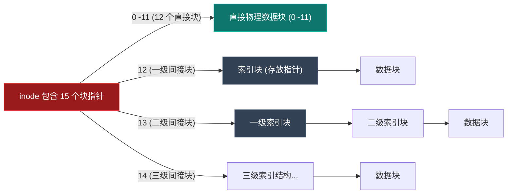
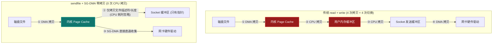

# 第七章 文件系统、inode 计算与磁盘调度

> 文件系统将磁盘上无结构的离散物理扇区抽象为面向用户的逻辑文件与目录树；I/O 子系统则协调高主频 CPU 与低速外部硬件设备之间的数据流通。本章系统讲解 **UNIX inode 多级索引容量计算大题**、**磁盘调度（SSTF/SCAN/C-SCAN）寻道推导**、**I/O 控制演进（DMA/通道）**、**五大 I/O 模型（epoll/io_uring）**与**零拷贝技术**。

---

## 0. 考点优先级概览

| 优先级 | 核心模块 | 重点考点 | 考核形式 |
| :--- | :--- | :--- | :--- |
| **P0** | **inode 多级索引计算** | 直接块、一级/二级/三级间接块指针寻址，最大文件容量推导与访盘次数计算 | 期末/408 核心计算大题 |
| **P0** | **磁盘寻道调度大题** | 磁道访问序列调度：FCFS、SSTF、SCAN（电梯）、C-SCAN、C-LOOK 移动道数推演 | 经典计算题、画图推算 |
| **P1** | **I/O 控制方式演进** | 轮询（程序直接控制）$\to$ 中断驱动 $\to$ DMA (直接内存访问) $\to$ 通道控制方式 | 机制对比选择题、硬件协同分析 |
| **P1** | **五大 I/O 模型与 epoll** | 阻塞/非阻塞/多路复用/异步 I/O 对比、select/poll/epoll 底层演化、LT vs ET 模式 | 大厂高频技术面、网络与存储底层 |
| **P2** | **零拷贝与存储优化** | `read/write` 4次拷贝 vs `sendfile` SG-DMA 零拷贝、游戏 PAK 虚拟文件系统 (VFS) | 高性能服务器、引擎资源流式加载 |
| **P3** | **参考实现与速查** | epoll 边沿触发 (ET) 正确读取模板、核心考点速查表 | 参考代码库（已折叠） |

---

## P0 核心考点：inode 索引计算与磁盘调度算法

### 1. UNIX inode 多级混合索引计算大题

在经典 UNIX 文件系统中，文件控制块 FCB 与文件名分离，元数据存放在 `inode` (Index Node) 中。文件数据块采用混合索引分配：



#### 经典容量推导大题标准范式

**例题**：某文件系统磁盘块大小为 **4KB**，每个块地址指针占用 **4 字节**。inode 结构包含 12 个直接寻址指针、1 个一级间接指针、1 个二级间接指针和 1 个三级间接指针。
1. **单块所能容纳的指针数**：
   $$N_{\text{ptr}} = \frac{4\text{KB}}{4\text{B}} = \frac{4096}{4} = 1024 = 2^{10}\text{ 个指针}$$
2. **各级寻址容量拆解**：
   * **12 个直接指针**：$12 \times 4\text{KB} = \mathbf{48\text{KB}}$
   * **1 个一级间接指针**：$1024 \times 4\text{KB} = \mathbf{4\text{MB}}$
   * **1 个二级间接指针**：$1024^2 \times 4\text{KB} = 1024 \times 4\text{MB} = \mathbf{4\text{GB}}$
   * **1 个三级间接指针**：$1024^3 \times 4\text{KB} = 1024 \times 4\text{GB} = \mathbf{4\text{TB}}$
3. **该文件系统支持的单个文件最大逻辑容量**：
   $$\text{MaxFileSize} = 48\text{KB} + 4\text{MB} + 4\text{GB} + 4\text{TB} \approx \mathbf{4\text{TB}}$$

#### 访盘次数计算

* **访问直接块数据**（如字节偏移量 10KB 处）：查 inode 即知物理块号，仅需 **1 次访盘**。
* **访问二级间接块数据**（如字节偏移量 10MB 处）：
  * 第 1 次访盘：读取一级索引块；
  * 第 2 次访盘：读取二级索引块；
  * 第 3 次访盘：根据指针读取真实物理数据块。
  * 总计需要 **3 次磁盘 I/O**（若索引块未被 Page Cache 命中）。

---

### 2. 磁盘调度算法推导大题

机械硬盘寻道时间 (Seek Time) 是磁盘 I/O 的最大物理耗时。磁盘调度旨在**重新编排磁道请求访问次序，最小化磁头移动总距离**。

* **FCFS (先来先服务)**：按请求先后顺序依次服务，简单公平，但平均寻道距离最长。
* **SSTF (最短寻道时间优先)**：优先服务与当前磁头距离最近的请求。易导致两端的磁道长期**饥饿 (Starvation)**。
* **SCAN (电梯算法)**：磁头沿单一方向单调移动，沿途服务所有请求，直到到达磁盘最外/最内边界后**反向移动**并继续服务。
* **C-SCAN (循环扫描算法)**：磁头单向服务（如仅在向内移动时服务）；到达边界后**快速复位至最外端（复位途中不服务任何请求）**，保证所有位置等待时间的绝对均匀。
* **LOOK / C-LOOK**：SCAN / C-SCAN 的实用改进版。磁头移动到**该方向上的最后一个请求处**即掉头或复位，无需走到物理最边缘。

#### 经典寻道距离推演大题

**题目**：磁头当前停留在 **100 号磁道**，且正向**磁道增加方向**移动。就绪队列中的磁道访问请求序列为：
$$55, 58, 39, 18, 90, 160, 150, 38, 184$$

#### SCAN (电梯算法) 调度推演

* 磁头当前为 100，向磁道增加方向移动，故先服务 $\ge 100$ 的请求（由小到大）：$150 \to 160 \to 184$。
* 到达最外端请求 184 后掉头，向磁道减小方向移动，服务剩余请求（由大到小）：$90 \to 58 \to 55 \to 39 \to 38 \to 18$。

```
访问路径：100 → 150 → 160 → 184 → 90 → 58 → 55 → 39 → 38 → 18
移动磁道数计算：
  向右阶段：|184 - 100| = 84
  向左阶段：|184 - 18|  = 166
  总磁道移动道数 = 84 + 166 = 250 道
  平均寻道长度 = 250 / 9 ≈ 27.78 道
```

#### C-SCAN (循环扫描) 调度推演

* 磁头向增加方向服务：$150 \to 160 \to 184$。
* 快速单向复位至最小请求端（直奔 18，途中不服务），随后继续向增加方向服务：$38 \to 39 \to 55 \to 58 \to 90$。

```
访问路径：100 → 150 → 160 → 184 → (复位到 18) → 38 → 39 → 55 → 58 → 90
移动磁道数计算：
  第一阶段：|184 - 100| = 84
  复位距离：|184 - 18|  = 166
  第二阶段：|90 - 18|   = 72
  总磁道移动道数 = 84 + 166 + 72 = 322 道
```

---

## P1 理论与进阶：I/O 控制方式与五大 I/O 模型

### 1. I/O 控制方式的四代演进

操作系统的发展历程实质上是不断解放 CPU、减少 CPU 对低速外设轮询干预的过程：


* **DMA 控制器核心寄存器**：
  * **CR (Command Register)**：控制命令寄存器（读/写）。
  * **MAR (Memory Address Register)**：内存物理基地址寄存器。
  * **DC (Data Counter)**：要传输的字节/块计数器。
  * **DR (Data Register)**：暂存数据缓冲区。

---

### 2. 五大经典 I/O 模型深度对比

I/O 处理分为两阶段：**阶段一：等待数据准备就绪**；**阶段二：将数据从内核空间拷贝至用户进程缓冲区**。

| I/O 模型 | 阶段一：等待数据就绪 | 阶段二：内核向用户空间拷贝 | 核心特征与系统调用 |
| :--- | :--- | :--- | :--- |
| **阻塞 I/O (BIO)** | 进程阻塞挂起 | 进程阻塞挂起 | 编程简单，1 线程对应 1 客户端连接，高并发下线程数爆炸 |
| **非阻塞 I/O (NIO)** | 进程轮询（返回 `EWOULDBLOCK`） | 进程阻塞挂起 | 轮询占用 CPU 周期，空转浪费资源 |
| **I/O 多路复用** | 阻塞于 `select/poll/epoll` | 进程阻塞挂起 | 单线程管理上万连接，连接就绪时才发起真正的读取 |
| **信号驱动 I/O** | 不阻塞（SIGIO 异步信号通知） | 进程阻塞挂起 | 需处理异步信号处理上下文，复杂度高 |
| **异步 I/O (AIO)** | **完全不阻塞** | **完全不阻塞（内核完成拷贝）** | 真正意义上的全异步。内核处理完阶段 1 与阶段 2 后回调（Linux **`io_uring`**） |

---

### 3. select / poll / epoll 机制演进

* **select / poll**：
  * 每次调用需将全部 $N$ 个 fd 集合从用户态深拷贝至内核态。
  * 内核以 $O(N)$ 轮询遍历所有 fd 检测就绪事件，唤醒后用户程序仍需 $O(N)$ 遍历定位。
* **epoll 核心优化（红黑树 + 就绪双向链表）**：
  1. `epoll_ctl()` 仅在初次注册时将 fd 挂入内核**红黑树**，无需每次重复拷贝 fd 列表。
  2. 设备就绪时，硬件中断驱动内核回调，直接将该 fd 节点放入**就绪双向链表 (`rdllist`)**。
  3. `epoll_wait()` 仅需以 $O(1)$ 检查就绪链表是否为空，并仅向用户态返回发生事件的活跃 fd。

#### 水平触发 (LT) vs 边沿触发 (ET)

* **水平触发 (Level-Triggered, LT，默认)**：只要读缓冲区有数据，每次 `epoll_wait()` 均会持续触发通知。安全且不易丢事件。
* **边沿触发 (Edge-Triggered, ET)**：仅在缓冲区从未就绪变为就绪的**跳变瞬间通知一次**。
  * **必须配合非阻塞套接字 (`O_NONBLOCK`)**，且循环读取必须持续到 `read()` 返回 `-1` 且 `errno == EAGAIN`，否则残留数据将永久丢失通知。

---

## P2 工程与游戏实战：零拷贝与虚拟文件系统

### 1. 传统 I/O 与零拷贝 (Zero-Copy) 性能对比

在游戏资源下载、文件传输或大贴图载入中，传统 `read + write` 涉及 **4 次上下文切换与 4 次数据拷贝**：



* **`sendfile()`**：彻底消除用户态拷贝。在具备 Scatter-Gather 特性的网卡上，连内核内部的 CPU 拷贝也完全免除，全程仅发生 **2 次 DMA 硬件直传**。

---

### 2. 游戏资源打包与虚拟文件系统 (VFS)

现代大型游戏将数万个散碎资源压缩打包为单一大型虚拟文件（如 UE 的 `.pak` 文件）：
* **直接散碎读取的灾难**：遍历打开数万个几 KB 的小文件将导致操作系统在磁盘上频繁进行 `inode` 寻道、`dentry` 缓存失效，加载耗时剧增。
* **PAK 虚拟文件系统设计**：
  * 将所有资源合并为单个连续大文件，在文件末尾追加存储**自定义虚拟文件目录表 (TOC, Table of Contents)**。
  * 游戏启动时一次性将 TOC 读入内存，后续虚拟路径检索完全在内存中走哈希表查偏移量，结合 `pread()` 或 `mmap` 按块极速流式读取。

---

## P3 参考实现与速查

### 1. epoll 边沿触发 (ET) 工业级处理模板

<details>
<summary><strong>无阻塞非阻塞 ET 循环读取实现</strong></summary>

```cpp
#include <sys/epoll.h>
#include <fcntl.h>
#include <unistd.h>
#include <cerrno>
#include <iostream>

void SetNonBlocking(int fd) {
    int flags = fcntl(fd, F_GETFL, 0);
    fcntl(fd, F_SETFL, flags | O_NONBLOCK);
}

void HandleEpollET(int epoll_fd, int socket_fd) {
    SetNonBlocking(socket_fd);
    
    epoll_event ev{};
    ev.events = EPOLLIN | EPOLLET; // 开启边沿触发模式
    ev.data.fd = socket_fd;
    epoll_ctl(epoll_fd, EPOLL_CTL_ADD, socket_fd, &ev);

    // 事件处理时：必须循环读取直至 EAGAIN
    char buffer[4096];
    while (true) {
        ssize_t bytes_read = read(socket_fd, buffer, sizeof(buffer));
        if (bytes_read > 0) {
            // 处理读取到的数据...
        } else if (bytes_read == 0) {
            close(socket_fd); // 对端关闭连接
            break;
        } else {
            if (errno == EAGAIN || errno == EWOULDBLOCK) {
                // 缓冲区数据已全部排空，等待下一次边缘跳变
                break;
            }
            close(socket_fd); // 读取发生异常
            break;
        }
    }
}
```
</details>

---

### 2. 核心考点速答对照

| 问题 | 核心回答要点 |
| :--- | :--- |
| **文件描述符 (fd)、打开文件表项与 inode 的关系？** | 每个进程私有独立的 fd 表；fd 指向全局打开文件表项（记录文件当前读写偏移量 offset 与打开标志）；多个不同进程或 dup 出来的打开文件表项最终可共同指向同一个磁盘文件的 `inode`（存放真实元数据与物理数据块指针）。 |
| **硬链接与软链接的本质区别？** | 硬链接是目录项 (`dentry`) 中指向已有 `inode` 的新文件名，与原文件共享相同的 `inode` 号与物理数据块，增加 inode 引用计数；软链接（符号链接）是新建的一个独立文件，其 `inode` 物理数据块中存放的是目标文件的路径字符串。 |
| **epoll 相比 select 性能大幅提升的本质原因？** | select 每次均需将全量 fd 数组在用户与内核空间之间进行深拷贝，且内核以 $O(N)$ 轮询；epoll 仅在初次注册时将 fd 存入内核红黑树，设备就绪时通过中断回调直接将活跃 fd 链入就绪双向链表，`epoll_wait()` 以 $O(1)$ 仅检索返回活跃事件。 |
| **DMA 相比传统中断驱动的根本优势？** | 中断驱动方式下，设备每准备好一个字/字节的数据就中断一次 CPU，CPU 需频繁参与数据搬运；DMA 方式由 DMA 控制器接管总线，数据以**数据块**为单位直接在主存与外设之间直传，仅在整块传输结束时中断一次 CPU。 |
