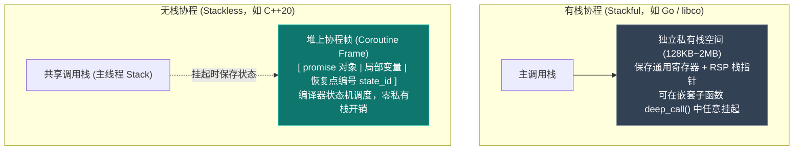
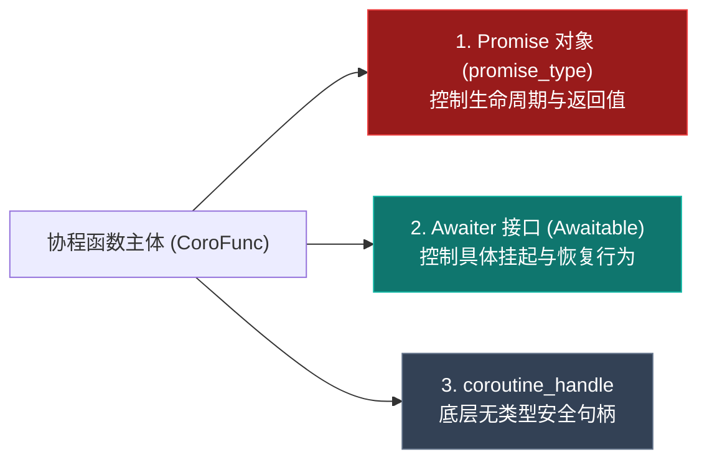

# 第八章 协程机制与异步编程范式

> 异步并发的核心痛点：多线程切换开销沉重且面临锁竞争，异步回调函数又极易陷入难以维护的“回调地狱 (Callback Hell)”。**协程 (Coroutine) 是用户态的协作式调度执行流，允许函数在特定点主动挂起并稍后在原位恢复**。本章深入剖析**有栈协程 vs 无栈协程的底层内存与寄存器差异**、**C++20 协程状态机编译机制**与**游戏引擎行为树协程化设计**。

---

## 0. 考点优先级概览

| 优先级 | 核心模块 | 重点考点 | 考核形式 |
| :--- | :--- | :--- | :--- |
| **P0** | **有栈 vs 无栈协程** | 独立调用栈 vs 状态机闭包、嵌套调用挂起能力、内存与上下文切换开销对比 | 核心概念辨析、大厂底层技术面 |
| **P0** | **C++20 协程机制** | `co_await`, `co_yield`, `co_return`；Promise 契约、Awaitable 接口、`coroutine_handle` | 现代 C++ 面试高频必考 |
| **P1** | **协程帧与 HALO 优化** | 协程帧 (Coroutine Frame) 堆分配结构、HALO 堆分配消除、暂停/恢复控制流转 | 编译器机制推导、底层内存分析 |
| **P2** | **游戏工程实战** | 消除异步回调地狱、UE5 Latent Action 协程化改造、游戏 AI 行为树节点协作 | 架构设计、Gameplay 逻辑实现 |
| **P3** | **参考实现与速查** | 极简 `Task<T>` Awaiter 框架模板、高频面试速答对照 | 参考代码库（已折叠） |

---

## P0 核心考点：有栈 vs 无栈协程与执行模型

### 1. 线程 vs 协程的核心哲学

* **线程 (Thread)**：由操作系统内核以**抢占式 (Preemptive)** 调度驱动。CPU 随时可能因时钟中断强行剥夺当前线程的运行权；切换开销达微秒级，涉及用户态/内核态陷阱、页表与寄存器全面刷新。
* **协程 (Coroutine)**：在用户态由程序自身以**协作式 (Cooperative)** 调度推进。只有协程自身主动执行暂停原语（如 `yield` / `co_await`）时才会让出执行权；切换开销在数十纳秒级，**无任何内核态切换介入**。

---

### 2. 有栈协程 (Stackful) vs 无栈协程 (Stackless)

这是面试中考察协程底层原理的最核心考点：

| 维度 | 有栈协程 (Stackful Coroutine) | 无栈协程 (Stackless Coroutine) |
| :--- | :--- | :--- |
| **调用栈实现** | 每个协程拥有**独立的用户态调用栈**（默认 128KB ~ 2MB） | **无独立调用栈**，挂起状态与局部变量保存在**堆上协程帧 (Coroutine Frame)** |
| **任意嵌套挂起** | **✅ 支持**：可在深层嵌套调用的任意子函数中暂停 | **❌ 不支持**：只能在标记为协程的顶层函数中直接挂起 |
| **暂停/恢复机制** | 类似微型线程：通过汇编显式保存/恢复 CPU 寄存器 (SP/IP/通用) | **编译器编译期状态机变换**：将函数体切分为多个分支标签，更新状态码后直接 `return` |
| **单机并发量** | 受栈内存上限限制（几万到数十万个） | 极度轻量（单帧仅数十至数百字节），**可轻松支撑百万级并发** |
| **代表实现** | Go (Goroutine)、Lua 协程、腾讯微信 `libco` | **C++20 协程**、Rust `async/await`、C# `async/await` |



---

## P1 理论与进阶：C++20 协程机制深度剖析

C++20 引入了语言层面的原生无栈协程机制。只要一个函数体内包含了 `co_await`、`co_yield` 或 `co_return` 三个关键词之一，它就会被编译器重写为一个协程。

### 1. C++20 协程协同三要素



1. **`Promise` 对象（通过返回类型的 `promise_type` 约定）**：
   * `get_return_object()`：构建并返回暴露给外部调用者的协程包装器（如 `Task<T>`）。
   * `initial_suspend()`：决定协程创建后是立即执行 (`suspend_never`) 还是初始挂起等待唤醒 (`suspend_always`)。
   * `final_suspend()`：协程终止后的清理挂起行为。
   * `return_value(v)` / `return_void()`：处理 `co_return` 的产出结果。
   * `unhandled_exception()`：捕获协程内的未处理异常。
2. **`Awaiter` 接口（控制 `co_await <expr>` 行为）**：
   * `bool await_ready()`：若返回 `true`，表示结果已就绪，**完全不发生挂起**（零开销直通）。
   * `void await_suspend(std::coroutine_handle<> h)`：挂起时执行，通常将句柄 `h` 注册到 I/O 事件循环或线程池中。
   * `T await_resume()`：协程恢复后执行，返回最终求得的值给表达式。
3. **`std::coroutine_handle<>`**：
   * 用户态的非属主控制句柄，提供 `.resume()`（恢复执行）与 `.destroy()`（显式销毁堆帧）。

---

### 2. 协程帧 (Coroutine Frame) 与 HALO 优化

* **协程帧构成**：包括 `Promise` 对象自身、函数入参拷贝、挂起跨越点存活的所有局部变量以及当前执行进度编号 (`suspend index`)。
* **HALO (Heap Allocation Elision Optimization)**：若编译器通过内联分析确信协程的生命周期完全嵌套在外层调用者的生存期内，编译器会自动消除堆分配，**直接在调用方的栈帧上就地分配协程帧**，实现绝对零堆开销。

---

## P2 工程与游戏实战：行为树、对话与 Latent Action

### 1. 消除异步回调地狱 (Callback Hell)

在游戏开发中，跨越多帧的异步流程（例如：请求资源包 $\to$ 解密 $\to$ 实例化网格 $\to$ 播放淡入动画）传统上需层层嵌套 Lambda 回调，极易出现内存泄漏与对象生命周期悬挂。

```cpp
// 现代 C++ 协程化编写：以直观的同步顺序表征真正的异步时序
Task<void> LoadAndSpawnCharacter(int character_id) {
    auto asset_bundle = co_await AsyncLoadAssetBundle(character_id); // 异步 I/O 挂起
    auto model_mesh   = co_await AsyncDecompressMesh(asset_bundle);   // 线程池 Job 挂起
    
    // 自动切回主线程恢复执行
    Actor* character  = World::SpawnActor(model_mesh);
    co_await PlayFadeInAnimation(character, 1.0f);                   // 定时动画挂起
}
```

---

### 2. 游戏 AI 行为树节点与对话系统协程化

* **打断与状态保存**：在 NPC 对话逐字输出、技能引导吟唱（Channeling）中，无栈协程天然充当**带局部上下文的状态机**。无需手写复杂的 `Tick(float dt)` 计时与枚举跳转，通过 `co_await WaitForSeconds(0.1f)` 即可自然休眠让出 CPU，大幅削减逻辑复杂度。

---

## P3 参考实现与速查

### 1. 极简可等待 Task 模板骨架

<details>
<summary><strong>C++20 协程 Task 原型实现</strong></summary>

```cpp
#include <coroutine>
#include <utility>

template <typename T>
struct Task {
    struct promise_type {
        T value_;
        Task get_return_object() {
            return Task{std::coroutine_handle<promise_type>::from_promise(*this)};
        }
        std::suspend_always initial_suspend() noexcept { return {}; }
        std::suspend_always final_suspend() noexcept { return {}; }
        void return_value(T v) { value_ = std::move(v); }
        void unhandled_exception() { std::terminate(); }
    };

    std::coroutine_handle<promise_type> handle_;
    explicit Task(std::coroutine_handle<promise_type> h) : handle_(h) {}
    ~Task() { if (handle_) handle_.destroy(); }

    struct Awaiter {
        std::coroutine_handle<promise_type> h_;
        bool await_ready() const noexcept { return false; }
        void await_suspend(std::coroutine_handle<> awaiting_handle) noexcept {
            h_.resume(); // 简易链式推进
        }
        T await_resume() { return std::move(h_.promise().value_); }
    };

    auto operator co_await() { return Awaiter{handle_}; }
};
```
</details>

---

### 2. 核心考点速答对照

| 问题 | 核心回答要点 |
| :--- | :--- |
| **有栈协程与无栈协程的底层区别？** | 有栈协程为每个实例开辟独立的用户态调用栈，可通过汇编保存 SP 寄存器在任意嵌套子函数中自由挂起；无栈协程（如 C++20）没有独立栈，由编译器在编译期将函数转换为状态机类，挂起状态与局部变量存储在堆分配的协程帧中，开销极小。 |
| **协程暂停与线程阻塞的区别？** | 线程阻塞是陷入内核态将线程挂起至等待队列，导致该线程绑定的私有栈内存与 CPU 资源双重浪费；协程暂停完全在用户态执行，仅保存局部变量并向事件循环让出控制权，底层物理线程可立即转向执行其他海量任务。 |
| **C++20 协程中 `initial_suspend` 的作用？** | 决定协程被创建调用后的初始行为。若返回 `std::suspend_always`，则协程创建后处于挂起状态（惰性执行，需外部调用 `resume()` 启动）；若返回 `std::suspend_never`，则协程被调用时立即开始同步执行直至遇到第一个 `co_await`。 |
