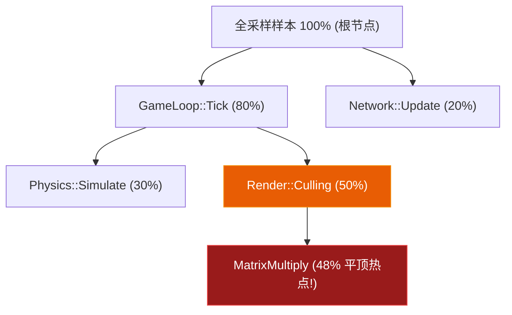

# 第九章 系统调试与性能分析工具链

> 优秀的系统与客户端工程师的核心标志：不仅能编写代码，更能在线上系统发生崩溃、死锁、内存泄漏或帧率骤降时，**凭借严密的排查方法论与标准化工具链快速定位根因**。本章系统讲解**CPU 飙高与卡死排查三板斧**、**GDB 与 Core Dump 诊断**、**AddressSanitizer (ASan) 内存检测**、**Linux perf 采样与火焰图热点定位**以及**游戏客户端性能瓶颈判定**。

---

## 0. 考点优先级概览

| 优先级 | 核心模块 | 重点考点 | 考核形式 |
| :--- | :--- | :--- | :--- |
| **P0** | **高频线上故障排查流程** | CPU 占用 100% 定位流、内存持续暴涨泄漏定位流、进程卡死/D 状态排查流 | 综合场景问答、“你怎么排查”必考题 |
| **P0** | **核心调试工具链** | `top -H` 线程定位、`strace` 系统调用追踪、`/proc/<pid>/` 运行时诊断 | 运维与系统级命令考察 |
| **P1** | **GDB 与 Core Dump 诊断** | `ulimit -c` 配置、段错误 (SIGSEGV) 事后调试、多线程死锁 `thread apply all bt` | 代码崩溃与死锁分析 |
| **P1** | **内存工具对比 (ASan vs Valgrind)** | 编译期插桩 (ASan) vs 动态二进制翻译 (Valgrind)、UAF / 内存越界检测 | 内存诊断技术选型 |
| **P2** | **perf 性能采样与火焰图** | `perf record` 硬件计数器、火焰图 (FlameGraph) 平顶特征识别、`perf c2c` 伪共享检测 | 性能调优实战、架构优化 |
| **P3** | **参考实现与速查** | GDB 常用命令速查表、高频面试速答对照 | 工具指令速查库（已折叠） |

---

## P0 核心考点：线上问题排查三板斧与核心工具链

### 1. 经典故障排查标准化 SOP

#### ① 进程 CPU 占用 100% 飙高排查流程

1. **定位高负载线程 TID**：执行 `top -H -p <pid>`，找出占用 CPU 比例异常偏高的具体线程 ID（例如线程 `TID = 24105`）。
2. **转换十六进制编号**：执行 `printf "0x%x\n" 24105` $\to$ 输出 `0x5e29`。
3. **抓取调用栈定位代码行**：
   * 使用 `pstack <pid>` 或 `gdb attach <pid>` 进入调试模式。
   * 执行 `info threads` 找到对应 `LWP 24105` 或线程 ID。
   * 切换至该线程执行 `thread <id>`，执行 `bt` (backtrace) 打印完整函数调用栈，直接定位死循环或热点算法所在的代码行。

---

#### ② 内存持续泄漏排查流程

1. **宏观确认**：通过 `top` 观察进程的 `RES` (常驻物理内存) 是否随时间单调递增；查看 `/proc/<pid>/status` 中的 `VmRSS` 与 `VmSize` 增长趋势。
2. **精确定位手段（首选 AddressSanitizer）**：
   * 在编译选项中加入 `-fsanitize=address -g -O1`。
   * 程序运行复现并正常退出（或通过 `__lsan_do_leak_check()` 触发检查），ASan 自动在终端打印详细的内存泄漏内存块大小、分配时的时间戳与完整的调用栈代码行号。

---

#### ③ 进程卡死 / 不可中断休眠 (D 状态) 排查流程

* **现象**：进程 `STAT` 状态显示为 `D` (Uninterruptible Sleep)，执行 `kill -9` 均无法终止。
* **原因**：进程陷入内核态等待外设硬件 I/O（如 NFS 网络存储超时、机械硬盘坏道读阻塞）。
* **诊断命令**：
  * `cat /proc/<pid>/stack`：直接打印进程当前所卡在的**内核态函数调用栈**（例如阻塞在 `vfs_read()` $\to$ `ext4_file_read()`）。
  * `cat /proc/<pid>/wchan`：查看其当前休眠等待的内核事件名称。
  * `iostat -xz 1`：检查系统磁盘 Util 负载是否达到 100%。

---

### 2. `/proc/<pid>/` 运行时信息宝库

Linux 的 `/proc` 是伪文件系统，是内核向用户态暴露进程内部状态的纯内存接口：
* `/proc/<pid>/status`：汇总进程物理内存 (`VmRSS`)、虚拟空间 (`VmSize`)、线程总数及自愿/非自愿上下文切换次数。
* `/proc/<pid>/maps`：查看进程完整的虚拟地址空间段布局（堆、栈、代码段及动态库 `.so` 映射区）。
* `/proc/<pid>/fd/`：列出当前进程打开的所有文件描述符软链接（若目录内条目数持续上升，说明存在 **文件描述符泄露 (fd leak)**）。

---

## P1 理论与进阶：GDB、Core Dump 与内存杀手锏

### 1. Core Dump 事后分析

* **Core Dump 开启**：Linux 默认将核心转储大小设为 0。线上需配置 `ulimit -c unlimited`，并在 `/proc/sys/kernel/core_pattern` 中配置转储路径格式（如 `/var/core/core_%e_%p_%t`）。
* **加载诊断**：
  * 执行 `gdb <可执行程序路径> <core文件路径>`。
  * GDB 启动后自动停留在触发崩溃的致命指令处（如 `Program terminated with signal SIGSEGV, Segmentation fault`）。
  * 执行 `bt` (backtrace) 打印崩溃时调用栈；执行 `print *ptr` 检查野指针或空指针解引用；执行 `thread apply all bt` 检查是否由于其他线程引发竞争所致。

---

### 2. 内存检测工具：AddressSanitizer (ASan) vs Valgrind

| 维度 | AddressSanitizer (ASan) | Valgrind (Memcheck) |
| :--- | :--- | :--- |
| **底层实现机制** | **编译器插桩**（在每笔内存访问前插入指令校验影子内存 Shadow Memory） | **动态二进制重写**（在 CPU 仿真虚拟机上逐条解释翻译运行程序） |
| **运行时性能损耗** | **极低（速度仅慢 1.5 ~ 2 倍）**，内存开销增加约 2~3 倍 | **极其昂贵（程序运行慢 10 ~ 30 倍）**，内存占用暴涨 |
| **适用环境** | 研发自测、集成测试、甚至部分线上灰度 | 无法重新编译源码的遗留二进制程序检测 |
| **检测缺陷类型** | 堆/栈/全局缓冲区越界、释放后使用 (UAF)、双重释放 (Double Free)、内存泄漏 | 内存泄漏、使用未初始化内存、内存重叠拷贝 |

---

## P2 性能剖析与火焰图 (FlameGraph)

### 1. Linux `perf` 采样与火焰图实战

* **采集指令**：以 99Hz 的非对称采样频率对目标进程进行调用栈采样（避免与系统周期性定时器产生共振）：
  ```bash
  perf record -F 99 -p <pid> -g -- sleep 30
  ```
* **生成火焰图**：
  ```bash
  perf script | ./stackcollapse-perf.pl | ./flamegraph.pl > flame.svg
  ```



#### 火焰图深度解读法则

1. **横轴 (X 轴)**：代表该函数及其子函数在采样周期内**被采样到的时间占比**（越宽代表消耗 CPU 时间越长）。注意：横轴并不代表时间先后顺序，而是按字母序合并展示。
2. **纵轴 (Y 轴)**：代表**函数调用栈深度**（从底部的入口函数逐级向上调用）。
3. **寻找“平顶 (Flat Top)”**：火焰图最顶层呈现出较宽平直边缘的函数，代表当前函数自身（而非其子函数）正在疯狂消耗 CPU 周期，是性能优化的第一目标。

---

### 2. 游戏客户端 CPU-Bound vs GPU-Bound 判定

在游戏性能优化中，绝不能在未定性瓶颈前盲目优化：
* **CPU-Bound (CPU 瓶颈)**：主线程或渲染线程耗时超过帧预算（如 16.6ms），而 GPU 处于空闲等待（GPU Utilization 偏低）。**根因**：物理碰撞过重、Gameplay 脚本低效、Draw Call 数量过多导致驱动开销大。
* **GPU-Bound (GPU 瓶颈)**：CPU 提交渲染指令极快，但 GPU 处理画面超时。**根因**：复杂像素着色器 (Pixel Shader)、超高分辨率后处理、过度重绘 (Overdraw)。

---

## P3 参考实现与速查

### 1. GDB 调试高频指令速查表

<details>
<summary><strong>GDB 常用核心调试指令清单</strong></summary>

```bash
# ===== 断点与运行 =====
b main                     # 在 main 函数设断点
b File.cpp:128             # 在指定文件行号设断点
b Class::Func if x > 100   # 条件断点
r                          # 运行 (run)
c                          # 继续执行 (continue)
n                          # 单步步过 (next)
s                          # 单步步入 (step)
finish                     # 执行到当前函数返回

# ===== 变量与内存查看 =====
p var                      # 打印变量值
p *ptr@10                  # 打印指针连续 10 个元素
x/16xb 0x7ffd0000          # 以十六进制按字节查看 16 字节物理内存
display var                # 每次停顿自动打印变量

# ===== 多线程调试 =====
info threads               # 列出所有线程及其当前所在函数
thread 3                   # 切换到 3 号线程
thread apply all bt        # 打印全量所有线程的调用栈 (死锁定位神技)
```
</details>

---

### 2. 核心考点速答对照

| 问题 | 核心回答要点 |
| :--- | :--- |
| **线上遇到进程 CPU 占用 100% 怎么排查？** | `top -H -p <pid>` 定位到高 CPU 占用的线程 TID；将 TID 转为十六进制；通过 `pstack <pid>` 或 `gdb attach` 抓取该线程调用栈，直接定位引发死循环或密集计算的源代码行。 |
| **如何排查生产环境发生的偶发性死锁？** | 挂载 GDB 执行 `thread apply all bt` 导出全量线程堆栈；搜索所有处于等待互斥锁（如 `futex_wait` 或 `pthread_mutex_lock`）的线程，交叉比对它们各自持有的锁地址与等待的锁地址，找出形成闭环依赖的锁调用链。 |
| **AddressSanitizer 的原理是什么？相比 Valgrind 优势在哪？** | ASan 通过编译器插桩为每 8 字节物理内存分配 1 字节影子内存记录合法性。访问物理内存前硬件执行快表比对。ASan 属于编译期优化插桩，速度损耗仅 1.5~2 倍（Valgrind 慢 20 倍以上），适合在开发测试中全量开启。 |
| **火焰图中的横轴与纵轴分别代表什么？** | 纵轴表示函数调用栈的深度（越往上调用链越深）；横轴表示该函数在全部采样样本中的占比宽度（越宽代表消耗 CPU 时间越长，并不代表时间流逝顺序）。横轴顶部的“平顶”即为性能热点。 |
