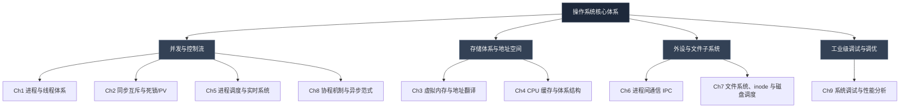

# 操作系统核心体系：从基础理论到高性能工程实战

> 面向 **C++ 与游戏客户端/系统开发** 的操作系统知识库。本系列兼顾**校内期末考 / 考研 408 经典定量计算大题与理论推演**，以及**大厂高频底层技术面所聚焦的硬件开销、内存局部性与系统级调优**。

---

## 知识框架与考核全景

操作系统的考察由**经典理论与定量计算**和**底层硬件与工业实战**两大维度构成：

| 模块 | 核心考核要点 | 重点章节 | 考核形式 |
| :--- | :--- | :--- | :--- |
| **进程与线程管理** | 进程线程资源边界、状态机、PCB、上下文切换开销（寄存器/页表/TLB/Cache 污染） | [第一章](./01_process_and_thread/) | 核心概念辨析、机制推导 |
| **并发同步与死锁** | 临界区四原则、三大经典 PV 操作（生产者消费者/读者写者/哲学家）、死锁 4 条件、银行家算法 | [第二章](./02_synchronization/) | **必考 PV 伪代码大题**、**银行家矩阵计算题** |
| **内存管理** | 逻辑地址转物理地址、多级页表级数推导、TLB 有效访存时间 (EAT)、四大页面置换缺页率推算 | [第三章](./03_memory_management/) | **必考地址翻译大题**、**页面置换计算题** |
| **CPU 缓存与体系结构** | Cache Line 结构（Tag/Index/Offset）、MESI 协议、伪共享 (False Sharing) 对齐消除、ECS (SoA vs AoS) | [第四章](./04_cpu_cache/) | 大厂底层面试、多核高并发调优 |
| **进程调度** | FCFS、SJF/SRTF、HRRN、RR、MLFQ 周转时间/带权周转时间推导、Linux CFS 虚拟运行时间 ($vruntime$)、优先级反转 | [第五章](./05_process_scheduling/) | **必考甘特图计算大题**、实时调度机制 |
| **进程间通信 (IPC)** | 匿名/命名管道、消息队列、共享内存零拷贝机制、信号异步安全限制、UDS 传递文件描述符 | [第六章](./06_ipc/) | IPC 机制横向对比、选型分析 |
| **文件系统与 I/O** | UNIX inode 多级混合索引与最大文件容量计算、磁盘寻道调度（SSTF/SCAN/C-SCAN）、四代 I/O 控制演进、epoll、零拷贝 | [第七章](./07_file_io/) | **必考 inode 计算大题**、**磁盘寻道移动道数计算** |
| **协程机制** | 有栈协程 vs 无栈协程、C++20 协程状态机（Promise/Awaitable/`coroutine_handle`）、协程帧与 HALO 优化 | [第八章](./08_coroutine/) | 现代 C++ 机制、异步编程范式 |
| **调试与性能调优** | CPU 飙高排查三板斧、GDB 与 Core Dump 段错误定位、ASan 内存检测、Linux perf 与火焰图热点定位 | [第九章](./09_debug_and_profiling/) | 线上故障综合排查实战 |



---

## 章节导航

### 📗 并发与调度核心 (Ch 1, 2, 5, 8)

---

#### [第一章 进程与线程体系](./01_process_and_thread/)

> 深入操作系统最核心的资源分配与调度抽象，剖析硬件级上下文切换代价与游戏多线程并发模型。

**核心内容**：
- **P0 核心考点**：进程与线程本质差异、共享与独立资源边界、五状态转换机、上下文切换直接（寄存器）与间接（CR3/TLB/Cache 污染）开销
- **P1 理论与机制**：`fork()` 配合 Copy-On-Write (COW) 缺页中断机制、1:1 内核线程模型 vs M:N 混合模型、僵尸进程与孤儿进程成因与回收
- **P2 工程实战**：游戏引擎多线程模型（主线程/渲染线程/Worker 线程池）、Job System 任务窃取 (Work-Stealing)、CPU 亲和性绑核 (Affinity)

---

#### [第二章 进程同步、互斥与死锁](./02_synchronization/)

> 从临界区四原则到三大经典 PV 操作模型，从 CAS/futex 到银行家算法矩阵安全性推演。

**核心内容**：
- **P0 核心考点**：三大经典 PV 操作大题（生产者-消费者 P 操作顺序陷阱、读者-写者读写互斥、哲学家就餐破除环形死锁）、CAS 指令与 Linux futex 快速路径机制
- **P1 理论与计算**：死锁 4 大必要条件、**银行家算法安全性检查矩阵推演大题**、条件变量虚假唤醒与 CAS 的 ABA 问题
- **P2 工程实战**：主线程与渲染线程双缓冲无锁交换 (Double Buffering)、缓存行对齐的 SPSC 无锁环形队列

---

#### [第五章 进程调度算法与实时系统](./05_process_scheduling/)

> 全面掌握调度评价指标与经典甘特图推导，解析现代 Linux CFS 调度器与优先级反转事故。

**核心内容**：
- **P0 核心考点**：周转时间与带权周转时间公式、FCFS 护航效应、SJF/SRTF 抢占甘特图、HRRN 动态响应比计算、RR 时间片权衡、MLFQ 多级反馈
- **P1 理论与进阶**：Linux CFS 虚拟运行时间 ($vruntime$) 权重公式与红黑树结构、火星探路者优先级反转与优先级继承协议 (Priority Inheritance)
- **P2 工程实战**：游戏物理模拟半固定步长累加器主循环、实时音频线程 `SCHED_FIFO` 调度防爆音

---

#### [第八章 协程机制与异步编程范式](./08_coroutine/)

> 对比用户态协作式调度与内核抢占式调度，解析 C++20 原生无栈协程的编译期状态机实现。

**核心内容**：
- **P0 核心考点**：有栈协程 (Stackful) vs 无栈协程 (Stackless) 底层内存与寄存器差异、深层嵌套挂起能力对比
- **P1 C++20 机制**：`co_await`/`co_yield`/`co_return`；Promise 契约、Awaiter 接口、`std::coroutine_handle` 控制流、协程帧与 HALO 优化
- **P2 游戏实战**：消除异步加载回调地狱、UE5 Latent Action 协程化、游戏 AI 行为树节点与对话时序推进

---

### 📘 内存与底层硬件 (Ch 3, 4)

---

#### [第三章 虚拟内存、地址翻译与页面置换](./03_memory_management/)

> 深入虚拟内存抽象，掌握逻辑地址转物理地址计算大题、TLB 访存时间分析与页面置换算法。

**核心内容**：
- **P0 核心考点**：虚拟地址拆解（页号 vs 偏移量）、物理地址合成、多级页表级数与内存节省原理、TLB 有效访存时间 (EAT) 概率计算
- **P1 理论与计算**：页面置换四大算法（OPT/FIFO/LRU/CLOCK）缺页推演表格大题、Bélády 异常成因、软缺页 vs 硬缺页 vs 段错误 (SIGSEGV)
- **P2 工程实战**：`malloc` 底层机制（`brk` 堆顶推移 vs `mmap` 匿名映射）、`mmap` 文件映射零拷贝、游戏帧分配器 (Frame Allocator)

---

#### [第四章 CPU 缓存与体系结构性能优化](./04_cpu_cache/)

> 突破“内存墙”，深入 Cache Line 组相联映射、多核 MESI 缓存一致性协议与面向数据设计 (DOD)。

**核心内容**：
- **P0 核心考点**：64B 缓存行、物理地址拆解（Tag/Index/Offset）、MESI 协议四状态转换、多核伪共享 (False Sharing) 成因与 64B 内存对齐消除
- **P1 体系结构优化**：分支预测失败的流水线冲刷代价（15~20 cycles）、排序数组循环加速本质、`[[likely]]` 属性与无分支编程、指令级并行 (ILP)
- **P2 游戏实战**：面向对象 (AoS) vs 面向数据 (SoA / ECS) 缓存行装载率实测（18.75% vs 100%）、SIMD 连续内存向量化加速

---

### 📙 存储、通信与运维排错 (Ch 6, 7, 9)

---

#### [第六章 进程间通信 (IPC) 体系与选型](./06_ipc/)

> 梳理六大 IPC 核心机制的底层原理，分析共享内存零拷贝与信号异步可重入安全陷阱。

**核心内容**：
- **P0 核心考点**：六大 IPC 机制全维度对比矩阵（管道、FIFO、消息队列、共享内存、信号、Unix Domain Socket）
- **P1 理论与机制**：共享内存零拷贝机理与进程间信号量同步、信号异步可重入安全 (Async-Signal-Safe) 与死锁规避、UDS 跨进程传递文件描述符 (`SCM_RIGHTS`)
- **P2 工程实战**：游戏编辑器与引擎双进程通信架构（控制流走 UDS / 管道，大数据流走 POSIX 共享内存）

---

#### [第七章 文件系统、inode 计算与磁盘调度](./07_file_io/)

> 剖析文件系统三层内核数据结构、UNIX inode 混合多级索引计算大题、磁盘调度与 Linux 五大 I/O 模型。

**核心内容**：
- **P0 核心考点**：UNIX inode 混合索引最大文件容量定量计算与访盘次数推导、磁盘寻道调度算法（SSTF/SCAN/C-SCAN/LOOK）磁道移动道数推演大题
- **P1 理论与机制**：四代 I/O 控制演进（轮询 $\to$ 中断 $\to$ DMA $\to$ 通道）、五大 I/O 模型对比、epoll 红黑树与就绪链表机制、水平触发 (LT) vs 边沿触发 (ET)
- **P2 工程实战**：`sendfile` 零拷贝技术对比、游戏散碎资源打包与虚拟文件系统 (PAK VFS) 目录表优化

---

#### [第九章 系统调试与性能分析工具链](./09_debug_and_profiling/)

> 建立严密的系统级故障排查方法论，熟练掌握 GDB、Core Dump、ASan、perf 采样与火焰图定位。

**核心内容**：
- **P0 核心考点**：线上故障排查三板斧（CPU 占用 100% 线程定位流、内存持续暴涨排查流、进程不可中断休眠 D 状态诊断）
- **P1 调试杀手锏**：Core Dump 崩溃转储分析与多线程堆栈打印 (`thread apply all bt`)、AddressSanitizer (ASan) 编译期插桩内存越界/泄漏检测
- **P2 性能与火焰图**：Linux `perf` 采样与火焰图 (FlameGraph) 平顶热点识别、`perf c2c` 伪共享检测、游戏客户端 CPU-Bound vs GPU-Bound 帧时间判定

---

## 建议复习路线

### 🎯 考试与面试高频考点路径（聚焦大题与常考机制）

```
阶段一：并发与同步（Ch1 进程线程边界与切换开销 → Ch2 经典 PV 操作大题与银行家算法）
阶段二：存储与调度（Ch3 地址翻译与页面置换计算 → Ch5 调度甘特图与周转时间推导）
阶段三：外设与文件（Ch7 inode 索引容量计算与磁盘调度算法）
阶段四：排错与选型（Ch6 共享内存零拷贝 → Ch9 CPU 100% 与内存泄漏排查 SOP）
```

### 📚 现代系统与游戏高性能进阶路径（深入硬件底层）

```
阶段一：内存与缓存架构（Ch3 虚拟内存与多级页表 → Ch4 Cache Line、MESI 协议与伪共享消除）
阶段二：面向数据设计（Ch4 ECS 架构 SoA 内存布局与 SIMD 向量化）
阶段三：低延迟并发与异步（Ch1 引擎 Job System 线程池 → Ch8 C++20 无栈协程状态机）
阶段四：性能分析与调优（Ch7 epoll/io_uring 高性能 I/O → Ch9 perf 火焰图与锁竞争分析）
```

---

> 📖 本系列全部文章均采用 CC BY-NC-SA 4.0 协议发布。
