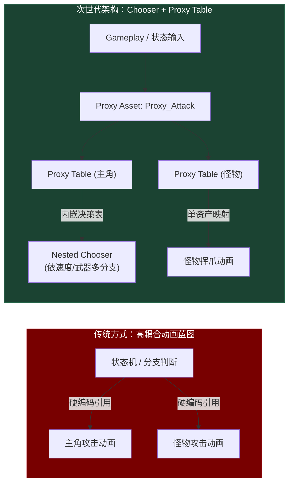
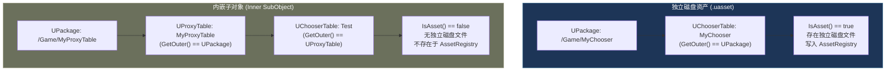
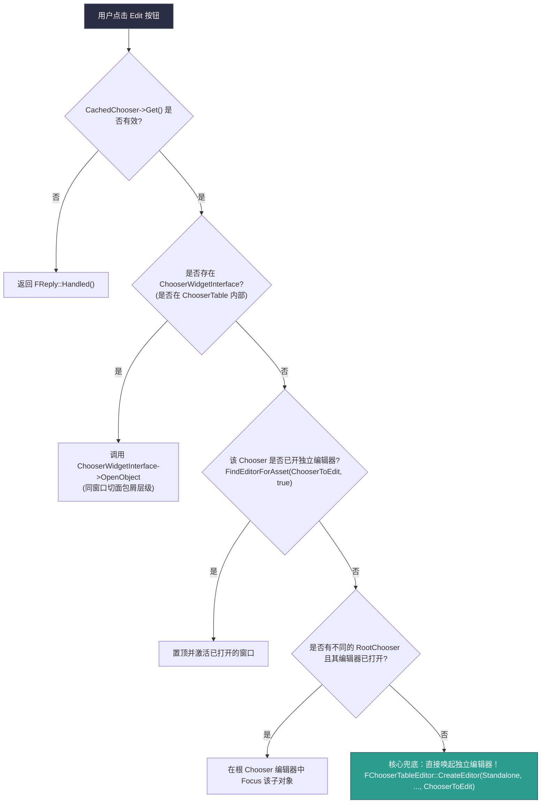

# 虚幻引擎源码攻坚实录：修复 Proxy Table 内嵌 Chooser 无法原地编辑缺陷 (UE-410161)

> **一句话理解**：当复合对象直接作为宿主资产的内联子对象（Inner SubObject）存在时，因其 `IsAsset() == false` 且缺少独立的 Package 路径，会导致依赖 `FAssetData` 检索的通用资产打开路由（`UAssetEditorSubsystem::OpenEditorForAsset`）静默丢弃；但由于 `FAssetEditorToolkit` 内部原生实现了**顺着 Outer 链向上回溯顶级资产标脏保存（`GetSaveableObjects`）**与**全局事务撤销栈（`RF_Transactional`）**机制，我们只需通过专用 Toolkit 直接唤起编辑器实例，即可彻底摒弃“导出为独立外部资产”的社区妥协方案，完美实现子对象的原地编辑。

---

## 1. 业务场景与故障现场

### 1.1 次世代动画架构：Chooser 与 Proxy Table
在虚幻引擎传统的动画开发中，角色动作切换往往依赖动画蓝图里密密麻麻的状态机和过渡连线（`Blend List by Bool/Enum`），极易演化为难以维护的“意大利面条”。

为了将逻辑与资产彻底解耦，Epic 引入了全新的数据驱动框架：
* **Chooser Table（选择器表）**：将复合判断抽象为**多维决策表（Decision Table）**。根据角色速度、状态 Tag、地面材质等列规则，查表输出目标动作，是 Motion Matching（姿态匹配）的核心基石。
* **Proxy Table（代理表）**：进一步解耦角色与具体资源。逻辑层只认抽象的代理标识符（如 `Proxy_Attack`），不同角色或武器挂载不同的 Proxy Table 分别映射具体动画。



### 1.2 复合决策诉求：Nested Chooser（内嵌选择器）
当某个代理条目不再是单一动画，而是需要根据连招段数、装备状态进行二次决策时，UE 支持在该单元格中直接创建 **Nested Chooser**。

为了避免磁盘上产生数以百计碎小的 `.uasset` 资产文件，该 Chooser 是作为 **Inner SubObject（内存内嵌子对象）** 直接生在 Proxy Table 内部的。

### 1.3 故障现象 (UE-410161)
在 Proxy Table 中新建完内联 Chooser 后：
* 单元格中显示了 Chooser 名称与图标；
* 点击旁边的 **`Edit`** 按钮时：**界面毫无响应，预期的 Chooser 编辑窗口死活无法弹开，仅有 Proxy Table 自身的窗口被重置顶**；
* 该 Bug 被收录于 Epic Issues 官方追踪系统（**UE-410161**），影响 UE 5.8 与最新主分支。此前社区历史 PR（#14408 / #14085）因无法解决子对象编辑，被迫妥协做成了“导出另存为外部独立文件”的折中文案。

---

## 2. 深入病灶与核心根因

### 2.1 源码追踪：错误的 Outer Package 假设
顺着 Slate 按钮的回调，我们定位到控件工厂实现文件：
`Engine/Plugins/Chooser/Source/ChooserEditor/Private/ChooserEditorWidgets.cpp` 中的 `CreateNestedChooserWidget`：

```cpp
// 原始有缺陷的实现 (ChooserEditorWidgets.cpp: 约 L346-L365)
+ SHorizontalBox::Slot().AutoWidth()
[
    SNew(SButton)
    .Text(LOCTEXT("Edit","Edit"))
    .OnClicked_Lambda([CachedChooser, TransactionObject, ChooserWidgetInterface]()
    {
        if (CachedChooser->IsValid())
        {
            if (ChooserWidgetInterface)
            {
                ChooserWidgetInterface->OpenObject(CachedChooser->Get());
            }
            else
            {
                // 【致命盲区 1】：假设 TransactionObject 所在包必定是 UChooserTable！
                UObject* RootChooser = TransactionObject->GetPackage()->FindAssetInPackage();
                
                // 【致命盲区 2】：拿到的是 FProxyTableEditor，它根本没有实现针对子对象的 FocusWindow
                IAssetEditorInstance* Editor = GEditor->GetEditorSubsystem<UAssetEditorSubsystem>()->FindEditorForAsset(RootChooser, false);
                if (Editor)
                {
                    Editor->FocusWindow(CachedChooser->Get());
                }
            }
        }
        return FReply::Handled();
    })
];
```

这里暴露出跨模块演进遗留的 **假设失效**：
1. **原作者的思维局限**：这段代码在编写时，系统内只有 `UChooserTable`。作者理所当然地假定外层对象 `TransactionObject->GetPackage()->FindAssetInPackage()` 必然是顶层的根 Chooser Table。
2. **Proxy Table 引入后的崩塌**：当 Proxy Table 模块复用该控件时，`TransactionObject` 实为 `UProxyTable`！找到的编辑器实例是 `FProxyTableEditor`。`FProxyTableEditor` 未重写带参数的 `FocusWindow`，只能调用基类的 `BringToolkitToFront()` 将 Proxy Table 自身置顶，完全无视内嵌 Chooser。
3. **缺少 Editor 时的静默丢弃**：由于传入 `bFocusIfOpen = false`，一旦未打开任何编辑器，逻辑就直接扑空，根本没有后续唤起流程。

---

### 2.2 为什么通用管线 `OpenEditorForAsset` 无法生效？

有开发者会问：“那为什么不直接在 `else` 里调用标准的 `GEditor->GetEditorSubsystem<UAssetEditorSubsystem>()->OpenEditorForAsset(CachedChooser->Get())` 呢？”

这正是此前社区开发者误入歧途的关键：**内嵌 Chooser 在底层不是常规资产**。



#### 底层规范：`IsAsset()` 的定义
在虚幻引擎中，判断一个 UObject 是否为资产由其外层链决定：
```cpp
bool UObjectBaseUtility::IsAsset() const
{
    return (GetOuter() == nullptr || GetOuter()->IsA<UPackage>());
}
```
* **独立资产**：其 Outer 直接指向 `UPackage`，`IsAsset()` 为 `true`，会在 `AssetRegistry` 中生成 `FAssetData` 词条。
* **内联子对象**：内嵌 Chooser 的 Outer 是 `UProxyTable`，`IsAsset()` 为 `false`。

#### 通用打开管线中的静默失败
`UAssetEditorSubsystem::OpenEditorForAsset` 内部委托给 `AssetDefinitionDefault.cpp`：
```cpp
EAssetCommandResult UAssetDefinitionDefault::OpenAssets(const FAssetOpenArgs& OpenArgs) const
{
    TArray<UObject*> Objects = OpenArgs.LoadObjects<UObject>();
    // ...
}
```
而在 `FAssetOpenArgs::LoadObjects` 内部，系统严格依赖 `FAssetData` 从资产注册表或磁盘路径中反序列化加载对象。由于 SubObject 没有独立的 Package 路径，`LoadObjects` 无法定位，返回空数组，通用管线彻底哑火。

---

## 3. 架构破解：SubObject 原地编辑的可行性

既然无法走基于文件的通用路由，那么**直接唤起专用 Toolkit 是否安全？会不会导致保存丢失或 Ctrl+Z 事务断裂？**

翻阅引擎源码底层实现，可以得出斩钉截铁的结论：**UE 底层架构天然支持 SubObject 编辑！**

### 3.1 标脏与保存机制：`GetSaveableObjects` 的 Outer 回溯链
在 `Engine/Source/Editor/UnrealEd/Private/Toolkits/AssetEditorToolkit.cpp` 第 601 行，官方源码清晰记录了对于子对象编辑的处理逻辑：

```cpp
void FAssetEditorToolkit::GetSaveableObjects(TArray<UObject*>& OutObjects) const
{
    for (const TObjectPtr<UObject>& Object : EditingObjects)
    {
        // 官方源码注释：如果正在编辑一个资产的子对象（如关卡脚本蓝图），
        // 依然允许对其进行编辑，但在保存操作时视为作用于顶层资产本身！
        for (UObject* TestObject = Object; TestObject != nullptr; TestObject = TestObject->GetOuter())
        {
            if (TestObject->IsAsset())
            {
                OutObjects.AddUnique(TestObject);
                break;
            }
        }
    }
}
```

#### 工作流剖析：
1. 当我们直接为内嵌 `UChooserTable` 启动 `FChooserTableEditor` 时，`EditingObjects` 存入该指针；
2. 用户在弹出的 Chooser 窗口中增删行列并按下 `Ctrl+S` 时，触发 `SaveAsset_Execute`；
3. `GetSaveableObjects` 启动 `for` 循环沿着 `GetOuter()` 向上追溯，第一级抓到了宿主 **`UProxyTable`**；
4. 由于 `UProxyTable->IsAsset() == true`，系统将 `UProxyTable` 加入保存列表，将其所在的整个 Package 标脏（MarkPackageDirty）并写入磁盘；
5. 内嵌 Chooser 作为 Proxy Table 的内部属性被一并持久化保存。

---

### 3.2 事务与撤销重做：`RF_Transactional`
在创建内嵌 Chooser 时（`CreateNestedChooserWidget` 约 L252）：
```cpp
UChooserTable* NewChooser = NewObject<UChooserTable>(
    TransactionObject, 
    UChooserTable::StaticClass(), 
    NewChooserName, 
    RF_Transactional // 关键事务标志位
);
```
* **撤销栈属于全局，而非属于窗口**：UE 编辑器的 Undo/Redo 缓冲区由全局单例 `GEditor->Trans`（`UTransactor`）统一管控。
* 只要目标对象被打上了 `RF_Transactional` 标志位，无论它是在主窗口、浮动窗口还是独立 Toolkit 中被修改，其属性变更都会被序列化进全局的 `FScopedTransaction`。
* 在独立的 Chooser 编辑窗口中按 `Ctrl+Z`，修改能够精准回滚并触发 Proxy Table 的重绘。

---

### 3.3 编辑器生命周期注册
绕过子系统直接调用 `FChooserTableEditor::CreateEditor()` 是否会变成不受管辖的“黑户”？
* 答案是**完全合规**。
* 在 `FAssetEditorToolkit::InitAssetEditor` 执行过程中，内部首要任务就是调用：
  ```cpp
  GEditor->GetEditorSubsystem<UAssetEditorSubsystem>()->NotifyAssetsOpened(ObjectPtrDecay(EditingObjects), this);
  ```
* 该内嵌子对象的指针与对应的 Toolkit 句柄会被即刻注册到全局的 `OpenedAssets` 与 `OpenedEditors` 双向映射表中；
* 窗口关闭时亦会触发 `NotifyAssetClosed`。子系统的生命周期管理闭环完全不受影响。

---

## 4. 落地修复方案

我们重写 `CreateNestedChooserWidget` 中的按钮点击逻辑，构建 **四级稳健路由体系**：



### 4.1 最终补丁代码
修改文件：`Engine/Plugins/Chooser/Source/ChooserEditor/Private/ChooserEditorWidgets.cpp`

```cpp
		+ SHorizontalBox::Slot().AutoWidth()
		[
			SNew(SButton)
			.Text(LOCTEXT("Edit","Edit"))
			.OnClicked_Lambda([CachedChooser, TransactionObject, ChooserWidgetInterface]()
			{
				if (UChooserTable* ChooserToEdit = CachedChooser->Get())
				{
					if (ChooserWidgetInterface)
					{
						ChooserWidgetInterface->OpenObject(ChooserToEdit);
					}
					else
					{
						if (IAssetEditorInstance* ExistingEditor = GEditor->GetEditorSubsystem<UAssetEditorSubsystem>()->FindEditorForAsset(ChooserToEdit, true))
						{
							ExistingEditor->FocusWindow(ChooserToEdit);
						}
						else
						{
							UChooserTable* RootChooser = ChooserToEdit->GetRootChooser();
							IAssetEditorInstance* RootEditor = (RootChooser && RootChooser != ChooserToEdit)
								? GEditor->GetEditorSubsystem<UAssetEditorSubsystem>()->FindEditorForAsset(RootChooser, true)
								: nullptr;

							if (RootEditor)
							{
								RootEditor->FocusWindow(ChooserToEdit);
							}
							else
							{
								FChooserTableEditor::CreateEditor(EToolkitMode::Standalone, TSharedPtr<IToolkitHost>(), ChooserToEdit);
							}
						}
					}
				}
				return FReply::Handled();
			})
		];
```

---

## 5. 验证与官方 PR 提交

### 5.1 实机闭环验证（基于 `ue5-main` 源码构建）
1. **增量编译**：修改单一 `.cpp` 文件，UnrealBuildTool 在 8 秒内完成 `ChooserEditor` 模块增量链接；
2. **复现路径重测**：
   * 新建 Proxy Table，添加 Proxy Asset 映射；
   * Value 类型切为 `Nested Chooser`，点击 `New Nested Chooser` 创建内嵌子表 `Test`；
   * 点击 **`Edit`** 按钮，**专属的 Chooser Table 编辑器窗口准确定位并瞬时弹开**；
3. **数据持久化校验**：
   * 在弹出的 Chooser 窗口中添加列（Column）、添加规则行（Row）；
   * 按下 `Ctrl+S` 保存，观察到宿主 `Proxy Table` 资产标脏（Dirty 标识消失，保存到磁盘）；
   * 重启编辑器重新打开 Proxy Table，配置好的内嵌选择器数据完整无损。

### 5.2 官方 Pull Request (PR #15415)
修复成果已正式向 Epic Games 官方仓库主干 `ue5-main` 提交 PR（**[#15415](https://github.com/EpicGames/UnrealEngine/pull/15415)**）。

---

## 6. 面试 30 秒速答核心卡片

针对高阶引擎/游戏客户端面试中可能出现的连环追问，以下是直击底层规范的标准答案：

```markdown
Q1: 为什么内嵌的 UChooserTable 无法通过常规的 UAssetEditorSubsystem 打开？
A1: UE 底层判定资产的标准是其 Outer 直接指向 UPackage（IsAsset() == true）。内嵌 Chooser 是在 Proxy Table 内部 New 出来的内存子对象（SubObject），IsAsset() 为 false。通用子系统底层依赖 FAssetData 并在 AssetRegistry 中检索磁盘包路径，对于没有独立包的子对象会检索失败返回空数组，导致通用打开管线静默扑空。

Q2: 绕过通用子系统直接调用 FChooserTableEditor::CreateEditor()，外层资产包的标脏保存（Save）会丢吗？
A2: 绝对不会。FAssetEditorToolkit 内部在执行 GetSaveableObjects 时，原生实现了一套通过 GetOuter() 递归向上回溯的机制。当发现被编辑对象是 SubObject 时，它会一路向上追溯，直到找到第一个 IsAsset() 为 true 的顶层资产（即宿主 UProxyTable），并对该 Package 执行标脏和文件落盘。

Q3: 为什么这种设计比社区此前“导出另存为外部资产”的 PR 更优秀？
A3: 另存为外部资产破坏了数据的内聚性，为了一个小决策强行在磁盘生成大量碎小 .uasset 文件，违背了 Proxy Table 模块化封装的设计初衷。原地唤起独立 Toolkit 既保留了内联子对象的轻量与紧凑，又完美复用了 UE 资产编辑器完备的撤销栈与生命周期管理。
```
